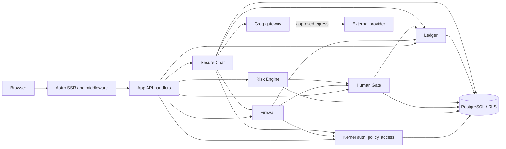

# Backend architecture AS-IS — partial

Astro SSR with Node standalone (`astro.config.mjs`), `src/middleware.ts`, and route handlers under `src/pages/app/api`; product services share Kernel authentication, tenant access, DB transaction helpers and Ledger writer. PostgreSQL is accessed by `pg` (`src/server/kernel/db.mjs`). Gateway code controls approved model and budget (`src/server/ai/groq-gateway.mjs`). These are source observations, not deployed-state evidence.

This conceptual diagram is not an exhaustive dependency graph. In particular modules have direct cross-domain imports and SQL: Firewall escalation and Risk review create Human Gate requests, and Human Gate references Firewall registry. Ownership boundaries requested by the target have not been fully established. Current model approvals and target provider connectivity require independent inspection. `render.yaml` is a candidate blueprint with app gate off, not evidence of deployed service configuration.

An independently authenticated enterprise lifecycle joining registry, policy pack, finding, treatment, review and evidence has not been established. Public demo data is synthetic; public and enterprise availability must be tested separately.
