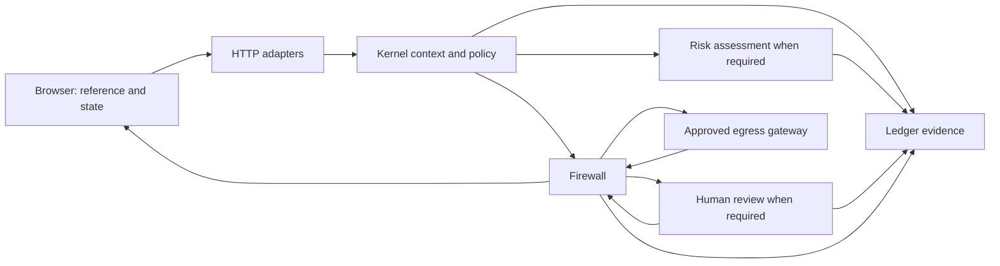

# Backend architecture TARGET — proposal, not implemented

Keep Astro SSR / Node modular monolith and existing routes. Kernel owns verified identity, scope, entitlement, policy coordination and context; Risk owns assessments; Firewall owns enforcement; Human Gate owns approvals; Ledger owns evidence; Gateway owns approved egress and budget. Secure Chat consumes these capabilities. Registry and policy packs are shared capabilities, not independent mandatory products. Replace direct cross-module writes with explicitly owned transactional contracts, preserving existing API compatibility and RLS. No new broker or framework is justified by this initial review.

Context fields: sessionId, tenantId (enterprise), actorId, assetId/version, policyPackId/version, assessmentId, runId, correlationId, requestFingerprint, reviewId, evidenceId, schemaVersion. Each is an existing verified reference or justified null; no invented relationship. Authorization derives from server-verified identity and membership. The context is a target contract and is not currently a verified end-to-end schema.

Required before enabling resume: bind approval to exact sanitized payload without exposing sensitive content; validate asset and policy versions, scope, authorization and expiry; atomically consume the permit and coordinate durable side effects; recheck output. Provider calls must not hold database transactions. Define reconciliation of unknown provider outcomes, with no automatic replay. ADR and security review are needed for any persistent payload binding or storage strategy. Treat this as an unresolved design, not authorization to persist message hashes or content.
