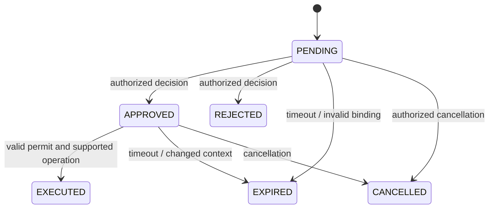

# State machines and sequences — 09 (partial source review)

Scope: working tree at HEAD `d42f658c7543024025ba8f8c9416a8bebd37d8fe`. Source findings are not live evidence. Target states below are requirements, not implemented claims.

## Human Gate as implemented
`src/server/human-gate/core.mjs:5` defines PENDING, APPROVED, REJECTED, EXPIRED, CANCELLED, EXECUTED. PENDING may become APPROVED/REJECTED/EXPIRED/CANCELLED; APPROVED may become EXECUTED/EXPIRED/CANCELLED; remaining states are terminal. The service locks the request, validates binding and authority, and conditionally updates decisions and permit (`src/server/human-gate/service.mjs:321`, `:359`, `:376`, `:409`, `:414`). It explicitly rejects execution of FIREWALL_ESCALATION_REVIEW at `:398`.



## Runtime as observed, not an end-to-end acceptance
```mermaid
sequenceDiagram
  participant Client
  participant Firewall
  participant DB as PostgreSQL
  participant HG as Human Gate
  Client->>Firewall: Guard request UUID and synthetic payload
  Firewall->>DB: tenant lock, policy, decision, audit, evidence
  opt ESCALATE and integration available
    Firewall->>HG: create bound review within transaction
  end
  DB-->>Firewall: commit or rollback
  Firewall-->>Client: decision / pending review / failure
  Note over HG: Approval does not resume provider; execute returns 409
```

Secure Chat reserves quota, rechecks access and policies, protects input, calls the provider outside a DB transaction, checks output, rechecks access and settles before returning (`src/server/secure-chat/service.mjs:217`–`:276`). On uncertain provider result it preserves reservation and does not retry automatically. Its ESCALATE currently denies rather than creating a review (`src/server/secure-chat/integration.mjs:15`–`:24`).

## Critical gap before resumable egress
`src/server/firewall/binding.mjs:25`–`:34` explicitly excludes submitted text and its hash; fingerprint binds decision metadata, policy, request and actor, but not exact sanitized payload. `tests/firewall-review-binding.test.mjs:107` expects the same request ID and different text with the same outcome to return ALREADY_EVALUATED, not a content conflict. This is currently fail-closed against repeat execution, but cannot establish approval of exact payload for later resumption. A target design must choose an authorized, privacy-preserving binding and storage/lifetime strategy, revalidate all versions and permissions, and demonstrate atomic single consumption before enabling execution. Do not reuse the existing fingerprint as proof of payload equality.

Target: VALIDATED → INSPECTED → DENIED / AWAITING_REVIEW / AUTHORIZED → EXECUTING → OUTPUT_CHECK → COMPLETED, with explicit EXPIRED/CANCELLED/FAILED and uncertain-provider outcomes. Transitions and recovery require implementation and tests; no direct browser transition may authorize execution.
