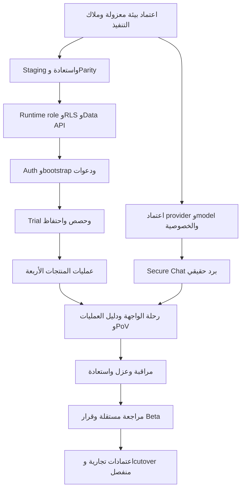

# BRIGHT AI — FINAL 360° PROJECT AUDIT & COMPLETION REPORT

تاريخ التقييم: 2026-11-10، بتوقيت الرياض. النطاق: المصدر الحالي، الموقع العام، Render و Neon و Sentry و PostHog قراءة فقط، وفحوص محلية بلا بيانات عملاء. **قرار الإطلاق: NO-GO للتجربة العامة والبيع التشغيلي.**

## 1. Executive Summary

الموقع التسويقي يعمل، لكن بوابة AIGAS والمنتجات لا تُخدم على الأصل الحالي. أثبت Render مباشرة أن الخدمة `BRIGHTAI` من نوع `static_site` وتنشر `dist/client`. إعداد المستودع يطلب Node standalone؛ البناء يحتوي مسارات SSR، لكن الخدمة الحالية لا تشغّلها. لم يعد السبب مجرد استنتاج من 404.

Neon يحتوي أساس بيانات، لا بيئة تشغيل مثبتة: production فرع وحيد غير محمي؛ 31 جدولًا عليها RLS، لكن سياستين فقط، وغياب `aigas_runtime` وسجل الترحيلات. لا مستخدمين أو جلسات أو مؤسسات Auth، ولا tenants/memberships عند القراءة. تشغيل المنتجات أو العزل أو الاستعادة لم يثبت.

المصدر يتضمن منطقًا فعليًا للمنتجات الخمسة، مع فجوات تكامل محددة. `APPROVED_MODELS` و`approvedProviders` و`approvedReviewIntegrations` فارغة. تجربة 48 ساعة لها آلة حالات وقراءة استحقاقات، لكن جداولها غير موجودة حيًا ولا مسار تشغيلي مكتمل للطلب والتفعيل والحذف مثبت. لا يجوز استبدال هذه الفجوات بنتائج واجهة ثابتة.

البناء PASS، اختبارات Node: **18 PASS، 9 FAIL، 5 SKIP**. فحص Firewall المحلي المستقل عن الشبكة: **8/8 PASS**. فحص المسارات الموجود في المشروع FAIL عند assertion التحليلات؛ لا يعني أن جميع المسارات فشلت. التفاصيل محفوظة مع التقرير.

**المخرجات:** مصفوفة 76 متطلبًا، حساب قابل لإعادة الإنتاج، مواصفات تجربة منتجات حقيقية، وخطة إغلاق موسعة دون سقف ثابت. التقرير منجز ضمن التغطية المبينة؛ إكمال المنتجات وتشغيل Beta ما زالا BLOCKED. ليس هذا اختبار اختراق أو اعتماد امتثال أو ضمان اكتشاف كل عيب.

## 2. Current Source Commit والنسخة المنشورة

| العنصر | الدليل الحالي |
|---|---|
| الفرع المحلي | `main`؛ شجرة العمل نظيفة قبل إنشاء مخرجات هذا التدقيق |
| HEAD | `7b1f533f71c7b1f41884790366a4d5967c85a87b` |
| GitHub | قراءة commit نفسه نجحت؛ لم تحدث كتابة بعيدة |
| Render service | `srv-d7m5bcjbc2fs73826v20`، workspace وافق عليه المستخدم للقراءة |
| Live deploy | `dep-dbpg8kgae00c73easjr0`، status=`live`، SHA مطابق لـ HEAD |
| وقت انتهاء النشر | `2026-11-10T11:48:06.828415Z` = 14:48:06 بتوقيت الرياض |
| Artifact المستخدم | `dist/client` على static site؛ لا Node start command في هذه الخدمة |
| Artifact digest | NOT_VERIFIED؛ لم يرجعه جرد الخدمة/النشر |
| الفرق عن عقل المشروع | عبارة «لا deploy مثبت» قديمة؛ النشر الثابت مثبت الآن، تشغيل المنتجات غير مثبت |

المصدر: [live-evidence.json](live-evidence.json). تطابق SHA لا يعني تطابق سلوك Node مع static hosting.

## 3. Architecture Inventory

| الطبقة | الموجود فعليًا | حد الدليل |
|---|---|---|
| الواجهة العامة | Astro، صفحات مولدة مسبقًا، العربية `ar-SA` و RTL، مكونات معرفة ومنتجات | زحف 55 صفحة + عينة متصفح، لا مراجعة بصرية كاملة لكل صفحة |
| Portal/Auth | `src/pages/app/*` و`src/pages/auth/sign-up.astro` و accept-invitation؛ AppLayout وعميل Neon Auth | المصدر موجود؛ لا حساب حقيقي جُرّب |
| API | 29 ملف route تحت `src/pages/app/api` | العدد جرد ملفات، لا عدد endpoints ناجحة |
| Kernel | هوية JWT، عضويات، صلاحيات، أقسام وسياسات، استحقاقات وتجربة | مسارات bootstrap/قبول الدعوة تحت runtime role تحتاج معالجة مستقلة |
| المنتجات | `src/server/{firewall,ledger,human-gate,risk-engine,secure-chat}` | قراءة مسارات أساسية وعقود واختبارات؛ لا E2E |
| البيانات | `pg` ومعاملات و GUC scope، 27 ملف migration | لا ledger حي، ولا يُفترض تطبيق الملفات بترتيبها الرقمي آليًا |
| الاستضافة | Astro server + Node standalone + `scripts/server.mjs`؛ Render blueprint web | الخدمة الفعلية static_site؛ blueprint لا يثبت الإعداد المنشور |
| المراقبة | `src/server/observability/*` وقوائم سماح واعتمادات مستقلة | wiring دون destination/ingestion مثبتين |

العقد المحلي: `package.json` version `2.0.0`، Node `22.x`، `packageManager=pnpm@10.19.0`؛ lockfile المتتبع `package-lock.json` دون pnpm lockfile. التنفيذ المثبت استعمل Node `22.22.2`. المثبت محليًا Astro `6.4.8` و adapter `10.1.4`؛ Render الحالي يستعمل `pnpm install && pnpm run build` بينما blueprint يطلب `npm ci && npm run build`.

الأوامر المعلنة فقط: `dev`, `build`, `preview`, `start`, `start:local`. لا scripts لـ test/lint/typecheck. استُخدم Node test runner مباشرة للاختبارات الموجودة، دون اختراع حزمة lint أو تنزيل اعتماديات. [dependencies.txt](dependencies.txt).

## 4. MCP Connection & Usage Register

| القدرة | الحالة | ما استُخدم وما لم يُستنتج |
|---|---|---|
| GitHub | CONNECTED/READ | fetch_commit للـ SHA؛ لا push/commit/PR/merge |
| Render | CONNECTED/READ | workspaces→اختيار المستخدم→services/get_service/deploys؛ لا تغيير config/env/domain |
| Neon | CONNECTED/READ | project/branches/DataAPI/snapshots/schedule و SELECT للكتالوج والأعداد؛ لا DDL/DML/migration |
| Sentry | CONNECTED/READ | find_projects fresh أعاد قائمة فارغة في نطاق الاتصال الحالي؛ لا دليل مشروع آخر خارج هذا النطاق |
| PostHog | CONNECTED/READ | learn، اكتشاف schemas، metadata للمشروع النشط 720936؛ لا أحداث أُرسلت ولا تغيير إعدادات |
| Chrome DevTools | CONNECTED/READ | صفحة Firewall، accessibility snapshot، DOM، GET/z حف ولقطة؛ لا دخول أو تعبئة بيانات |
| Made Good Designs | CONNECTED/READ | مرجع first-run/dashboard؛ مصدر تصميم فقط وليس دليل جاهزية |
| أدوات محلية | USED | git read، skills index، build، node tests، Firewall harness، SSR localhost، فحص env بدون قيم |
| Ahrefs/Semrush/DataForSEO | EXPOSED/NOT_USED | الأدوات ظاهرة؛ لم تُفترض صلاحية اتصال أو رصيد أو بيانات ترتيب؛ لم يُصرف رصيد مدفوع |
| Figma/21st/Stitch/Awwwards/Mobbin/Lazyweb/Adobe/MagicPath/Animation وبدائل المتصفح | EXPOSED/NOT_USED | لا حاجة لتكرار المرجع أو دليل المتصفح؛ الظهور فيالجرد لا يعني نجاح الاتصال |
| Cloud SQL/SQL Expert/Context7/LSP/JDTLS/Paper/AMD/Caveman | NOT_VERIFIED | لم يثبت وصول مختص لهذه الأسماء ضمن الأدوات المختارة؛ لا ادعاء استخدامها |
| Graphify | UNAVAILABLE | `graphify-out/graph.json` والأمر غير متاحين؛ لم يُثبّت شيء |
| Cloudflare/DNS/GSC/GBP | ACCESS_NOT_VERIFIED | لا قراءة control plane؛ لا تغيير DNS ولا ادعاء سياسة edge أو فهرسة |

جرد الأدوات المعلنة: [capabilities.json](capabilities.json)، جرد 388 ملف مهارة: [skill-index.txt](skill-index.txt). الملفات الدالة قُرئت لتحديد workflow؛ لم يُجرَ تدقيق شامل لكل مهارة. استُخدمت مهارات التدقيق والتحقق و Neon و SEO والتقييم الإرشادي، ومراجعة مستقلة للمخرجات وفق requesting-code-review. البنية القائمة لم تُستبدل بنصائح skill الخاصة ببناء مشروع جديد.

## 5. Overall Completion Percentage — منهج الحساب

المرجع الملزم للحساب هو [REQUIREMENTS.md](REQUIREMENTS.md) و[requirements.csv](requirements.csv) و[requirements.json](requirements.json). كل صف يحدد وزنًا، دليلًا، مستوى المصدر، تشغيلًا، اعتمادًا، نقصًا، تبعيات، ومعيار إغلاق. النسب **مؤشرات أدلة لمصفوفة التدقيق الأولية** وليست نسبة أسطر كود أو تقدير ساعات العمل المتبقية أو عقد قبول موقّعًا.

الأوزان: 5 لمخاطر العزل/الصلاحيات/سلامة البيانات وبوابات الإطلاق؛ 3 للوظيفة الأساسية أو الاعتماد التشغيلي؛ 2 لتجربة أو اكتشاف مساند. منح نصف نقطة للمصدر قرار تقييم معلن: تنفيذ قُرئ لكن قبوله لم يثبت، وربع نقطة لملف/وثيقة/موصل غير مكتمل. اعتماد المشروع لهذه الأوزان ما زال مطلوبًا؛ مراجعة المدقق تفحص اتساقها ودليلها ولا تحولها إلى موافقة تجارية.

`S=0/0.25/0.5/1` للمصدر وفق التعريف التفصيلي. `R=1` فقط عند إثبات المعيار تشغيليًا، وإلا صفر؛ فحص محلي موسوم LOCAL ولا يرفع R لمسار حي. `A=1` عند اعتماد مستقل مثبت، وإلا صفر. غير المنطبق يُستبعد من المقام ولا يمنح نقطة مجانية.

`Overall = Σ[W × (S + R المنطبق + A المنطبق)] ÷ Σ[W × عدد المراحل المنطبقة]`.

`Readiness Q = min(S, R إن انطبق, A إن انطبق)` لكل صف؛ جاهزية النطاق = `ΣWQ/ΣW`. وجود مانع P0 يُبقي NO-GO مهما ارتفع المتوسط. «0% متحقق للمنتج» تعني غياب دليل نجاح عملياته الحية في هذه الجولة، ولا تعني عدم وجود أي كود.

| المؤشر | المكتسب / الممكن | النسبة |
|---|---:|---:|
| Source Implementation Completion | 164.25 / 322 | 51.01% |
| Runtime Verification Completion | 12 / 304 | 3.95% |
| Security & Compliance Readiness | 7.5 / 204 | 3.68% |
| Product Functional Readiness | 0 / 116 | 0.00% |
| UI/UX Completion | 2 / 62 | 3.23% |
| SEO Readiness | 7 / 16 | 43.75% |
| Beta Launch Readiness | 18.5 / 278 | 6.65% |
| Commercial Production Readiness | 27.5 / 322 | 8.54% |
| Overall staged evidence completion | 176.25 / 767 | 22.98% |

الحساب يعاد بـ`python3 Audit/final-360-2026-11-10/calculate.py`؛ [scores.json](scores.json) الناتج العددي. لا نسب انطباعية ولا 100% للنطاقات المفتوحة.

## 6. Completion لكل وحدة ومنتج

| الوحدة | المصدر: نقاط/مقام (%) | التشغيل: نقاط/مقام (%) | الجاهزية: نقاط/مقام (%) |
|---|---:|---:|---:|
| Architecture | 7.5/16 (46.88%) | 0/8 (0.00%) | 5.5/16 (34.38%) |
| Operations | 16.25/21 (77.38%) | 3/21 (14.29%) | 3/21 (14.29%) |
| Database | 15.0/35 (42.86%) | 0/35 (0.00%) | 0/35 (0.00%) |
| Auth/Kernel | 16.25/35 (46.43%) | 0/35 (0.00%) | 0/35 (0.00%) |
| Firewall | 14.25/26 (54.81%) | 0/26 (0.00%) | 0/26 (0.00%) |
| Ledger | 10.5/21 (50.00%) | 0/21 (0.00%) | 0/21 (0.00%) |
| Human Gate | 12.5/25 (50.00%) | 0/25 (0.00%) | 0/25 (0.00%) |
| Risk Engine | 9.5/19 (50.00%) | 0/19 (0.00%) | 0/19 (0.00%) |
| Secure Chat | 12.5/25 (50.00%) | 0/25 (0.00%) | 0/25 (0.00%) |
| Trial | 12.25/26 (47.12%) | 0/21 (0.00%) | 5/26 (19.23%) |
| Privacy/Provider | 10.0/20 (50.00%) | 0/15 (0.00%) | 5/20 (25.00%) |
| Monitoring | 5.5/11 (50.00%) | 0/11 (0.00%) | 0/11 (0.00%) |
| UI/UX | 7.5/13 (57.69%) | 2/13 (15.38%) | 2/13 (15.38%) |
| SEO | 11.5/16 (71.88%) | 7/16 (43.75%) | 7/16 (43.75%) |
| Commercial | 3.25/13 (25.00%) | 0/13 (0.00%) | 0/13 (0.00%) |

الاستحقاقات والتجربة والمراقبة مشتركة في جاهزية المنتجات وإن لم تُكرر أوزانها داخل كل منتج. يُراجع البسط والمقام في الملف الآلي، ولا تجمع نسب الوحدات حسابيًا بلا أوزان.

## 7. Source vs Runtime vs Approval

| المستوى | أمثلة وحدود |
|---|---|
| SOURCE_PRESENT | منطق حصص وسلسلة Ledger وتجربة48 ساعة ومراقبة؛ لا قبول E2E |
| IMPLEMENTED لنطاق ضيق | بناء standalone، guard محلي8/8، gate محلي false يعطي503، وعقد يمنع billing التلقائي |
| CONFIGURED | خدمة Render ثابتة وData API نشطة؛ إعداد قائم لكنه غير كافٍ لتشغيل المنتجات |
| RUNTIME_VERIFIED لنطاق ضيق | 55 صفحة عامة200 مع metadata وروابط؛ service/deploy/SHA مثبتة من Render |
| APPROVED | لا اعتماد تشغيل جديد للمزود أو trial أو monitoring أو release مثبت؛ إذن قراءة workspace ليس إذن نشر |
| BLOCKED | عمليات المنتجات الحية وتجربة ما قبل الشراء وعزل مؤسستين والاستعادة والإطلاق |
| NOT_APPLICABLE | Paid checkout ليس شرطًا لتجربة مجانية ولا يُمنح نجاحًا مجانيًا في المقام |

وصف README التاريخي عن Groq/Gemini وSSE/Redis ليس عقد تشغيل حاليًا. قوائم المزودين في المصدر الحالي فارغة، وAPPROVED_TARGET في كود التجربة لا يعادل توقيع تشغيل للبيئة الحالية.

## 8. Security Gap Analysis

P0 هنا مانع إطلاق، وليس إثبات اختراق. كل بند مرتبط بمعرّفات المصفوفة، ومنها يُعرف مصدره ومعيار إغلاقه.

| الأولوية | الفجوة والدليل | الإغلاق المطلوب |
|---|---|---|
| P0-01 | OP01: خدمة Render ثابتة؛ app و API يعيدان 404 | Node Staging واختبار API فعلي قبل أي تغيير للدومين |
| P0-02 | DB04–DB07: runtime role غائب، سياسات قليلة ومنح عميل واسعة | دور محدود واختبارات A/B و Data API وملكية المحادثة |
| P0-03 | DB03: كائنات مطلوبة للمصدر غير موجودة في الكتالوج | Parity و migration ledger وتمرين ترحيلات معتمد |
| P0-04 | AU03–AU04: bootstrap وقبول الدعوة تحت RLS غير مكتملين | قناة مشغل محدودة، دون منح INSERT عامة أو runtime مالك |
| P0-05 | AR02–AR03: 9 اختبارات تفشل و 5 اختبارات DB متجاوزة | حسم العقود وتشغيل الاختبارات على قاعدة معزولة |
| P0-06 | SC02/PR01: سجلات النماذج والمزودين فارغة | اعتماد معالجة ومزود ونموذج قبل أي إرسال |
| P0-07 | TR02–TR04: تفعيل التجربة وحصصها وحذفها غير مكتملة | دورة خادمية وسياسة احتفاظ وحذف قابلة للتنفيذ |
| P0-08 | DB01–DB02: production وحيد وغير محمي؛ لا استعادة مقاسة | Staging معزول وحماية وتمرين RPO/RTO |
| P1-01 | OP04: CSP/HSTS غائبتان في العينة العامة؛ static يتجاوز middleware | حماية على طبقة HTTP أو edge تشمل GET/HEAD والأخطاء |
| P1-02 | MO01–MO03/PR04: لا ingestion أو تنبيهات مثبتة؛ GA4 منفصل عن بوابات PostHog | مراجعة جميع payloads وموافقة خصوصية واختبار تنبيهات |
| P1-03 | AR04: فحص advisories للاعتماديات لم يُنفذ | تقرير ثغرات وتقييم قابلية الاستغلال، دون ترقية عشوائية |
| P1-04 | PR03/CO01: الخصوصية والشروط والسعر و SLA غير معتمدة | اعتماد المالك والقانون والدعم؛ لا ادعاء استضافة سعودية |
| P2-01 | UI02–UI05/SE05–SE06: الجوال والإتاحة والأداء والظهور ناقصة التحقق | مراجعة وقياسات محددة بدل ادعاء WCAG أو ترتيب بحث |

وجود grants لا يثبت تسريبًا: الجداول دون سياسة تحجب عادةً دورًا غير مالك، بينما قد يتجاوز owner/BYPASSRLS الحماية. لا توجد تجربة هويات فعلية تسمح بتأكيد العزل أو نفيه.

عولجت صلاحية ملف `.env` محليًا من 0644 إلى 0600 ضمن سياسة الأسرار المطلوبة. بقي ignored وغير متتبع، ولم تتغير قيمه ولم يُختبر مفتاح عند أي مزود.

## 9. Database & Tenant Isolation Audit

المشروع `young-frog-60183055`، قاعدة `neondb`، فرع `br-young-bird-b43proeb`، PostgreSQL 18.6، المنطقة `aws-us-east-2`. نتائج القراءة: 31 جدولًا، RLS على 31، FORCE على صفر، سياستان، لا دور `aigas_runtime` ولا migration ledger. أعداد Auth users/sessions/orgs و tenants/memberships كلها صفر. اقتصرت القراءة على الكتالوج والأعداد، دون صفوف عميل أو محتوى محادثة.

الدور authenticated لديه SELECT/INSERT/UPDATE/DELETE على 31 جدولًا، أي 124 منحة، و EXECUTE فعلي على 10 دوال حسب has_function_privilege. Data API نشطة على public. السياستان الموجودتان تستخدمان `aigas.sc_tenant_id/sc_user_id`؛ المصدر الأحدث يضيف سياقًا وسياسات أخرى. العدد وحده لا يثبت العزل.

نطاق SELECT الفعلي والهدف محفوظان في [catalog-queries.sql](catalog-queries.sql)، والنتيجة في [migration-catalog.json](migration-catalog.json). الكائنات المفقودة ضمن هذا النطاق: جداول trial_requests/events/entitlements و hg_delegations/grants، أعمدة audit السياقية المطلوبة، حقول residual الرقمية، دالة quota-v2، و chain trigger. بعض أعمدة Ledger مثل sequence_no و previous_hash موجودة. هذه مقارنة كائنات، وليست حكمًا بأن كل ترحيل آخر مطبق بالكامل.

لا تطبق 0001–0027 آليًا على الإنتاج. أعد اشتقاق الخطة من الكتالوج وحراس الترتيب و`docs/beta/STAGING-RESTORE-AND-MIGRATION-PLAN.md`. الترحيل 0019 متجاوز بعد 0025، و 0027 يحتاج 0025، و 0016 يحتاج مراجعة SECURITY DEFINER وصلاحيات EXECUTE.

نافذة التاريخ 21600 ثانية، ولا snapshots أو جدول تلقائي في القراءة الحالية. [وثائق Neon](https://neon.com/docs/postgres/backup-restore/branch-restore) تصف استعادة ضمن نافذة التاريخ؛ وجودها لا يثبت RPO/RTO للمشروع. لم تُجرَ استعادة أو كتابة على Neon.

## 10. Rendering & Deployment Audit

| المسار | الحي | محليًا: البناء الحالي والعلم false |
|---|---|---|
| `/` | 200 HTML، دون CSP/HSTS في العينة | 200، دون CSP على HTML الثابت |
| `/app/` | 404 HTML | 503 HTML، no-store و noindex و CSP baseline |
| `/app/api/kernel/health/` | 404 HTML | 503 JSON برمز APP_UNAVAILABLE |
| `/%61pp/` | لم يُفحص حيًا | 503؛ تطبيع المسار لا يتجاوز gate |
| `/auth/sign-up/` | 404 | 200 SSR؛ لم تُجرب جلسة |
| `/app/{five-products}/` | جميعها 404 | لم تُختبر عملياتها |
| `/products/firewall.html` | 404 | 301 إلى المسار النظيف |
| `/products/firewall/index.html` | 200 دون تحويل | لم يُفحص محليًا |

جرد المصدر لا يعلن `/auth/sign-in/` أو `/auth/login/`، لذلك لا يُعد 404 فيهما عيبًا مستقلًا. الدخول الفعلي يُستخرج من واجهة Auth القائمة؛ app و sign-up يكفيان لإثبات فجوة SSR.

قيمة `AIGAS_APP_ENABLED` على Render **غير معروفة**؛ لم تُطلب متغيرات قد تكشف أسرارًا. blueprint ليست دليل إعداد حي، والعلم لا يشغّل SSR على Static Site. الاستجابات الحية المفحوصة تستخدم كاش عامًا مع `s-maxage=300`. لم يُقرأ control plane لـ Cloudflare أو DNS.

احتاج الخادم المحلي صلاحية listen خارج sandbox ونجح بعدها. قراءة الشبكة من shell المقيد تعذرت؛ أدلة الموقع الحي جاءت من Browser، وقراءة localhost من فحص محلي مصرح. هذه قيود أدوات، وليست دليل تعطل الموقع.

## 11. Five Products Functional Readiness

| المنتج | التنفيذ الموجود في المصدر | مانع القبول الحالي |
|---|---|---|
| Firewall | قواعد حرفية ونسخ، خمس حالات، guard وربط قرار وحصص | لا تشغيل API/DB؛ registry التصعيد والمزود الخارجي فارغان |
| Ledger | append متسلسل لكل مؤسسة، hash و idempotency وتصدير وفاحص مستقل | اختبار chain يفشل؛ trigger غير موجود حيًا؛ لا bundle حقيقي تحقق مستقلًا |
| Human Gate | طلب ومراجع وقرار وتفويض وإلغاء؛ استهلاك permit داخل معاملة | جداول grants/delegations غائبة؛ لا اختبار أثر أو سباقات |
| Risk Engine | أصول ونسخ وتقييم ومعالجة وقبول خطر وتصدير | حقول residual الرقمية ناقصة؛ منهج التجربة واعتمادها غير مثبتين |
| Secure Chat | خادم رسائل وسياسات وحصص وملكية و adapter لرد حقيقي | APPROVED_MODELS فارغة؛ quota-v2 غائبة؛ لا موافقة معالجة |

`INTERNAL_DEMO_NOTE` في Human Gate يثبت مسار ملاحظة فقط. `KERNEL_WORKSPACE_RENAME` أثر داخلي حقيقي في المصدر يحتاج اختبارًا. قبول خطر في Risk Engine لا يمنح إذن نشر. سلسلة Ledger لا تثبت توقيعًا أو صحة مصدر أو زمن أو حماية من مدير قاعدة البيانات.

التفصيل: FW01–FW06 و LD01–LD05 و HG01–HG05 و RE01–RE05 و SC01–SC05 في المصفوفة. لا منتج نال RUNTIME_VERIFIED لمجرد واجهة أو جدول.

## 12. Real Pre-Purchase Experience Assessment

الحالة الحية غير قابلة للتشغيل. عينة Firewall تعرض طلب معلومات/سعر ولا تعرض CTA للتجربة؛ إضافة زر إلى app الآن ستقود إلى 404. كود trial يقرأ حالات واستحقاقات 48 ساعة، لكنه لا يثبت دورة طلب وتفعيل وحذف مكتملة.

[REAL-TRIAL-SPEC.md](REAL-TRIAL-SPEC.md) يحدد مسارًا فعليًا لكل منتج: API وحفظ وقراءة لاحقة ودليل وحالات رفض. هذه **مواصفات تنفيذ**، ولم يبنِ هذا التدقيق صفحات جديدة أو يدّعِ تشغيل التجربة.

تسبق الإتاحة: Node Staging، parity، runtime isolation، Auth و bootstrap، دورة تجربة خادمية وحصص واحتفاظ، ثم نجاح المنتج المحدد. يمكن إثبات عمليات المنتجات الأربعة دون AI خارجي، مع تسمية التنفيذ المحلي بوضوح. Secure Chat يبقى مغلق الإرسال حتى اعتماد المزود. لا تُشترط إضافة مدفوعة لتطبيق حماية Kernel الأساسية.

## 13. UI/UX & Motion Audit

راجعت صفحة Firewall الحية عبر DOM و accessibility tree ولقطة مرئية. الاتجاه RTL صحيح والعنوان واضح و CTA التواصل ظاهر. المحاكاة العامة لا تُحسب عملية منتج؛ لا تُزال صفتها حتى تعمل العمليات فعلًا.

رحلة التجربة الغائبة ومسارات app المعطلة عائقان بشدة 4/4 وفق التقييم الإرشادي. طلب viewport بعرض 390 أعاد عرضًا فعليًا 500؛ عند 500 و 1200 لم يظهر تجاوز أفقي، لكن هذا **ليس اختبار جوال 390**. لا دليل دورة كاملة بلوحة المفاتيح أو قارئ شاشة أو قياس تباين.

توجد قواعد prefers-reduced-motion في CSS، ولم يُختبر تغييرها أو تقاس LCP/INP/CLS. لا ادعاء WCAG أو تحسن أداء. مرجع التطوير: UI by [Made Good Designs — first-run workspace](https://madegooddesigns.com/inspiration/ui/first-run-web-corporate-62137d99d784)، للاستفادة من خطوات التهيئة والحالة الفارغة مع المكونات القائمة؛ ليس دليل جودة تشغيل.

## 14. SEO & Saudi Visibility Audit

الزحف الحالي شمل 55 صفحة من sitemap: كلها 200، بعناوين فريدة ووصف و canonical مطابق و H1 واحد، ودون img فاقدة لخاصية alt أو JSON-LD غير صالح نحويًا. زحف روابط إضافي فحص 56 مسارًا وأعاد 200؛ لا يشمل صلاحية كل fragment أو ملف مورد. الأدلة في [seo-crawl.json](seo-crawl.json) و[additional-evidence.json](additional-evidence.json).

robots يسمح بالزحف ويشير للخريطة؛ llms.txt متاح ويعلن حدود المنتجات. app/auth خارج sitemap. عيب aliases مثبت حيًا رغم نجاح تحويله محليًا. سكربت verify-routes توقف عند assertion قديم يطابق نداء gtag دون analyticsPage، بينما المصدر الحالي يمررها؛ هذا تعارض اختبار، وليس إثبات تعطل التاغ أو نجاح بقية السكربت.

لم تثبت: صحة rich results الدلالية، جودة مصادر ومؤلفي كل مقال، indexing و GSC، ترتيب السعودية، CTR، GBP، backlinks، AI citations، أو CWV. نسبة SEO مؤشر متطلبات التدقيق، وليست Health Score من Google. لا تُخترع بيانات NAP أو تقييمات أو شهادات.

## 15. Sentry/PostHog Audit

Sentry أعاد قائمة مشاريع فارغة عند fresh read ضمن نطاق الاتصال الحالي. لا ingestion أو release/environment أو تنبيه مثبت. مشروع PostHog النشط 720936، Default project: ingested_event=false، anonymize_ips=false، console/performance opt-in=true، autocapture_opt_out و heatmaps_opt_in=null، session_recording_opt_in=false.

هذه إعدادات مشروع، ولا تثبت أن SDK يرسل من الموقع. لا يُستنتج «صفر أحداث» من flag وحده. لم يُعد فحص حد الخطة التاريخي؛ لذلك لا يُعرض كحقيقة حالية. لا إنشاء مشروع أو ترقية أو إرسال أحداث.

مصدر AIGAS يغلق المراقبة دون مرجع اعتماد وبيئة و SHA كامل وعلم ومفتاح لكل طبقة، مع kill switch مستقل. PostHog مقصور على staging/beta. هذا wiring، لا اعتماد ولا حدث واصل. يلزم O1–O8 من وثيقة المراقبة: أخطاء Auth/DB/AI والمنتجات، payload منقح، تنبيه و ack من مسؤول، واختبار kill switch. لا chat/body/token/SQL/docs أو replay/autocapture دون موافقة مستقلة.

GA4 العام يحتاج تقييمًا منفصلًا: BaseLayout يحذف q/from لمسارات docs/knowledge فقط قبل page_location/referrer. بوابات PostHog لا تحمي GA4 من query عشوائي. لم يُرسل marker حساس في التدقيق.

## 16. API Credential Availability Register

`.env` الفعلي موجود وغير متتبع و ignored، وصلاحيته أصبحت 0600. فُحصت الأسماء ووجود قيم فقط، دون اختبار صلاحيتها لدى المزود أو كشفها. لم تُضف متغيرات فارغة غير لازمة. السجل الكامل المنقح: [credentials.json](credentials.json).

| الغرض | المتغير | الحالة | الخطوة المطلوبة |
|---|---|---|---|
| Neon | DATABASE_URL / DATABASE_URL_UNPOOLED | PRESENT | اعتماد دور وهدف staging؛ لا طباعة DSN |
| Neon Auth | NEON_AUTH_BASE_URL / NEON_AUTH_JWKS_URL | PRESENT | جلسة فعلية واختبار issuer بعد تشغيل staging |
| مزودو AI | GROQ/GEMINI/OPENAI/DEEPSEEK/NVIDIA_API_KEY | PRESENT / NOT_APPROVED | اعتماد مزود ومعالجة قبل أي اتصال |
| Anthropic | ANTHROPIC_API_KEY | MISSING | لا مفتاح مطلوب قبل اختيار المزود |
| Secure Chat | AIGAS_SC_<PROVIDER>_API_KEY | لا مزود معتمد محدد | لا اختلاق registry أو اسم مفتاح مفعل |
| Sentry | AIGAS_SENTRY_DSN | MISSING_CREDENTIAL | مشروع واعتماد ثم Secret Store |
| PostHog | AIGAS_POSTHOG_API_KEY / AIGAS_POSTHOG_HOST | MISSING | وجهة واعتماد ثم التهيئة |
| المراقبة | AIGAS_MONITORING_APPROVAL_REF / RELEASE ومراجع اعتماد الطبقات | MISSING | مراجع قرارات حقيقية؛ الأسماء الكاملة في credentials.json |
| فتح Portal/RLS | AIGAS_APP_ENABLED / AIGAS_REQUIRE_RLS | MISSING محليًا | لا يُستنتج غيابهما من Render |

لا credential صُنّف INVALID؛ لم يُختبر. PRESENT تعني قيمة غير فارغة، لا صلاحية أو اعتماد معالجة.

## 17. Blockers P0/P1/P2

القسم 8 والمصفوفة يحددان كل عائق وإغلاقه. يغلق P0 بدليل للنسخة والبيئة المحددتين، لا بوجود ملف أو خطة. قد تصبح الخصوصية والمراقبة والدعم بوابات P0 عند نقل بيانات عملاء أو إطلاق عقد تجاري. تحسين المحتوى والحركة لا يعوض عيب SSR أو عزل البيانات.

## 18. Dependencies and Critical Path

إصلاح العقود محليًا ممكن أثناء تجهيز الموافقات. تهيئة Node تسبق التحقق التشغيلي للمصادقة، ولا تعتمد على اكتمال اختبار Auth نفسه. لا رفع لصلاحيات runtime لحل bootstrap، ولا اعتبار نجاح أربعة منتجات دليلًا لخامس.

## 19. GO/NO-GO Assessment ومراجعة مستقلة

| البوابة | الحكم | شرط المرور |
|---|---|---|
| G1 عام/مصدر | PARTIAL | بناء وصفحات عامة ناجحة؛ الاختبارات و aliases ما زالت مفتوحة |
| G2 SSR/Artifact | BLOCKED | Node Staging و API JSON ودليل deploy/SHA |
| G3 Auth/Onboarding | BLOCKED | جلسات فعلية ومؤسستان و bootstrap ودعوات |
| G4 Tenant Security | BLOCKED | Runtime RLS واختبارات A/B و participant-only و Data API |
| G5 Migrations | BLOCKED | Ledger و parity وتمرين على المعزول |
| G6 Provider/Trial | BLOCKED | موافقات نطاق ومزود وحصص واحتفاظ |
| G7 Recovery | BLOCKED | استعادة ورجوع مع RPO/RTO مقاسين |
| G8 Monitoring/Privacy | BLOCKED | وجهة معتمدة و payload وتنبيه و ack و kill switch |
| G9 UAT/Release | NOT_VERIFIED | توقيع المشغل والمدقق على نفس المرشح |

هذه بوابات هذا التدقيق؛ ملفات RC ذات SHA القديم تبقى تاريخية ولم تُعدّل. Beta و Commercial كلاهما **NO-GO**. لا يحل مدقق المخرجات محل اعتماد القانون أو الأمن أو المالك. [INDEPENDENT-REVIEW.md](INDEPENDENT-REVIEW.md) يوثق مراجعة الحسابات وحدود الادعاءات.

## 20. Final Execution Roadmap

1. حسم عقود الاختبارات محليًا، تشغيل DB integration معزولة، وفحص advisories.
2. تجهيز قرارات البيئة والمشغل و runtime والخصوصية والاحتفاظ والمزود، وخطة كائنات وترحيلات واستعادة قابلة للمراجعة.
3. بعد تفويض محدد: Staging Node/DB، ترحيلات معتمدة، RLS و Auth و bootstrap. لا نقل للدومين.
4. دورة trial خادمية وحصص وانتهاء وحذف وفق سياسة، ثم عمليات المنتجات الحقيقية وربط UI إضافي.
5. إثبات الرد الحقيقي لـ Secure Chat بعد اعتماده، ومؤسستين وحالات رفض لكل منتج، وتصدير و PoV من DB.
6. مراقبة معتمدة وتنبيهات وعزل واستعادة و UI/SEO/CWV و UAT.
7. مدقق مستقل يراجع نفس SHA وحزمة الدليل؛ قرار Beta محدود ثم قرار تجاري و cutover منفصلان.

[EXECUTION-PROMPTS.md](EXECUTION-PROMPTS.md) يحتوي 25 برومبتًا مستقلًا بتبعيات ومعايير قبول وأسرار بأسمائها. لا يمثل أي برومبت تفويض كتابة خارجية.

## الأدلة وحدود التغطية

| الدليل | المرجع | النتيجة وحدودها |
|---|---|---|
| E01 | live-evidence.json | Render/deploy/Neon/Sentry و HTTP من Browser |
| E02 | migration-catalog.json و additional-evidence.json | كتالوج وأعداد و snapshots و PostHog metadata |
| E03 | tests.tap | 18 PASS / 9 FAIL / 5 SKIP على المصدر قبل أي تعديل في الجولة |
| E04 | build.log | PASS مع تحذيرات prerender request.headers |
| E05 | firewall-harness.log | 8/8 PASS محلي؛ لا DB أو مزود |
| E06 | local-http.json | Gate و SSR و alias محليًا؛ لا تشغيل إنتاج |
| E07 | seo-crawl.json | HTML و metadata لـ 55 صفحة؛ لا ترتيب أو فهرسة |
| E08 | routes.log | توقف FAIL عند Analytics assertion؛ البقية لم تكتمل |
| E09 | credentials.json | أسماء وحضور و 600؛ لا فحص صلاحية مفاتيح |
| E10 | requirements.* و calculate.py و scores.json | حساب شفاف لمصفوفة أولية، لا موافقة إطلاق |

لم يُنفذ: كتابة خارجية أو نداء مزود، جلسات فعلية، اختبار اختراق أو ضغط، فحص كل مقاسات وقارئات الشاشة، مراجعة كل نصوص المقالات، GSC/GBP/rankings/CWV، إعداد DNS/Cloudflare، artifact digest، تدوير أو اختبار كل الأسرار. فحص المصدر اقتصر على المسارات والعقود المشار إليها، ولا يضمن خلو بقية المستودع من العيوب. ملف http.json يحفظ فشل شبكة shell المقيدة فقط؛ الدليل الحي المعتمد من Browser في E01.

أوامر التحقق وhashes مصدرها في [verification-manifest.json](verification-manifest.json). نسخة harness محفوظة في [firewall-harness-source.mjs](firewall-harness-source.mjs)؛ تُشغّل من مسارها الأصلي `scripts/firewall-local-verify.mjs` حتى تبقى import paths صحيحة.

تحديث نطاق البرومبتات بتوجيه المستخدم (2026-11-10): أُلغي سقف15، وفُصلت الخطة إلى25 برومبتًا بمسؤوليات أضيق. النسب والأدلة التشغيلية لم تتغير. المراجعة المستقلة الأصلية تخص نسخة15؛ تحديث التقسيم خضع لفحص وثائقي محلي، ولا يضيف اعتماد إطلاق.
