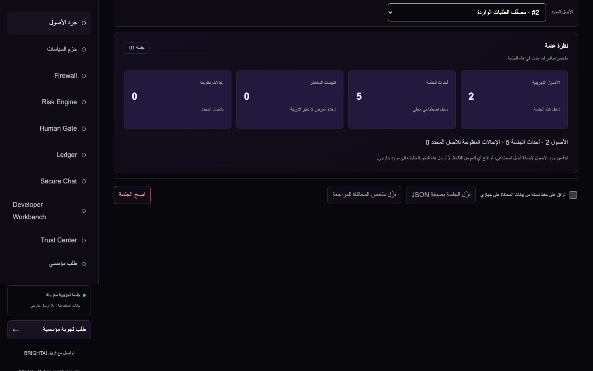
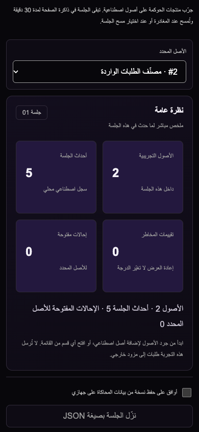

# Visual parity report — P10

## القرار

**BLOCKED — لم يُنفّذ تدقيق التكافؤ البصري.** التقطت لقطتا candidate بعد تحديث shell، لكن لا توجد صورة مرجعية من MagicPath أو screenshot diff/overlay؛ لذلك لا يوجد `PASS` بصري.

## المطلوب مقابل المتاح

| شرط | نتيجة | سبب |
|---|---|---|
| مرجع MagicPath من نفس revision | `BLOCKED` | عُرف revision `476467892385353728` وقُرئ سياق كود، لكن لم تصل صورة المعاينة قابلة للفحص/التصدير |
| مرشح التطبيق عند 1440×900 و390×844 | `CAPTURED` | `candidate-overview-1440x900.png` و`candidate-overview-390x844.png` محفوظتان في هذه الحزمة |
| استجابة 320/768/1440 | `PASS — LOCAL SMOKE` | Chrome E2E يتحقق من عدم overflow ويشغّل axe؛ هذا لا يغطي 360/1024/1920 أو zoom |
| overlay أو مقارنة اختلافات | `NOT RUN` | يلزم screenshot من المصدر والمرشح |
| Hero before/after | `NOT CAPTURED` | لا صورة مرجعية محفوظة |
| keyboard/focus/accessibility | `PARTIAL — LOCAL E2E` | تنقل لوحة المفاتيح وaxe يمران للمختبر عند 320/768/1440؛ contrast الشامل وVoiceOver/NVDA وreduced-motion NOT VERIFIED |
| LCP/CLS/INP | `NOT VERIFIED` | لا قياس لهذه النسخة/المقاسات؛ لا استنتاج ميداني |

## ملاحظات مرئية من المرشح — ليست حكمًا على parity

المرشح يعرض sidebar RTL ثابتًا على desktop، قائمة أقسام قابلة للطي على المقاسات الصغيرة، topbar، header، وأربع بطاقات metrics مشتقة من جلسة synthetic. استُخدمت tokens المشروع المحلية. الصور الملتقطة تبين المرشح فقط ولا تصلح بديلًا عن source screenshot.

## لقطات المرشح

## خطة استكمال الأدلة

1. احفظ preview/reference لنفس revision، مع metadata: component ID، revision ID، timestamp، viewport.
2. شغّل المرشح محليًا بصيغة Node SSR، التقط الحالات المتناظرة على 1440×900 و390×844 لبقية الشاشات.
3. قارن overlay/diff مع تعليم كل فرق `EXPECTED_FUNCTIONAL` أو `ACCESSIBILITY_FIX` أو `UNEXPECTED` وسبب موثق.
4. لا تستنتج score بصري أو Core Web Vitals ميدانيًا قبل توفر أدلةها.
