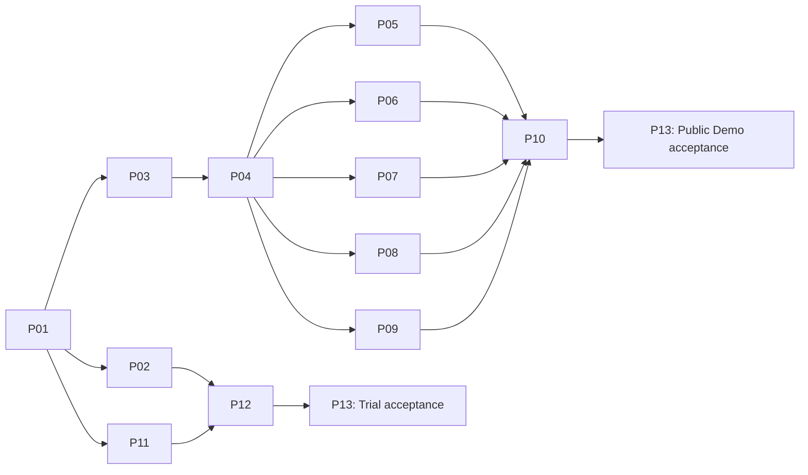

# P01 — دلتا HEAD وخريطة الإغلاق

16 نوفمبر 2026، توقيت الرياض. **التدقيق DONE؛ تشغيل المنتجات BLOCKED.**

## ما تغيّر في الحكم

- HEAD المحلي وGitHub main: `f221ac4177d63dad649bfaf892868b5c6d971a0d`؛ المرجع `a6f3551071bb12102957f556bb3badb21cb80b3c`؛ 24 commit. الشجرة نظيفة عند البداية. استُخدم `git -c core.fsmonitor=false status --short` بعد خطأ fsmonitor، دون تغيير إعداداته.
- فرق المصدر ليس صفرًا كما في Executive Closure التاريخي: **245 سجل ملف = 99 إعادة تسمية R100 + 84 تقريرًا/دليلًا + 55 مصدرًا/اختبارًا + 7 سياق/وثائق**. الـ55: 34 src، و12 scripts، و6 tests، وترحيلان، وredirects.json. [الجرد](delta.json).
- منذ الرأس المعروف `54ba24c…` تغيرت التقارير ومواضع الأدلة ووثيقة البرومبتات؛ لا فرق في src/scripts/migrations/tests/render.yaml. إضافة برومبت لا تعني تنفيذ ميزة.
- المنتجات الخمسة وKernel التعليمي تعمل حيًا، وتغيّر أمثلتها فعلًا. لكنها لا تحقق عقد المختبر الجديد كاملًا: إدخال → تشغيل → نتيجة مرتبطة بالإدخال → سبب → Reset.
- نقر الدخول لكل منتج انتهى فعليًا بـ404 دون نموذج دخول. جميع مساحات التطبيق المفحوصة وHealth و37 مسار API تطبيقي تعيد HTML404 بكاش عام `public, max-age=0, s-maxage=300`.
- Staging: **42 جدولًا و90 سياسة** بقراءة مباشرة؛ ledger يحوي29 صفًا APPLIED. بصمات `0030–0033` تطابق المصدر؛ إعادة تطبيقها عمل مكرر. الإنتاج:31 جدولًا، سياسات على جدولين،124 منحة authenticated، وruntime وledger وexploration غائبة. هذه قراءة كتالوج owner، وليست اختبار عزل A/B.
- `/solutions/` الحي يعرض المركز الجديد؛ مانع «الصفحة القديمة» في D01 أصبح متجاوزًا لهذا المسار. `/knowledge/?q=audit` ما زال404؛ `/docs/` ومقال المعرفة الممثل200. لا يصح تعميم تعطل جميع المقالات.

## التصنيف وحدوده

| التصنيف | المعنى |
|---|---|
| SOURCE_ONLY | تنفيذ موجود دون دليل سلوكي كافٍ للشرط |
| LOCAL_VERIFIED | تحقق محلي محدد، لا يثبت النشر |
| STAGING_VERIFIED | قراءة أو تشغيل محدد على Staging |
| LIVE_VERIFIED | سلوك مرصود على brightai.live |
| BLOCKED | قبول مطلوب محجوب بسبب مثبت |
| UNKNOWN | الدليل لا يحسم الحالة |

التصنيف لكل شرط، وليس حكمًا شاملًا على اسم المنتج. الأدلة القديمة مؤرخة صراحةً، ولا تُرقّى إلى تحقق اليوم.

## جرد الميزات ومصالحة التقارير

| الشرط | ملف/سطر عند HEAD | الدليل أو URL | التصنيف | المتبقي فقط |
|---|---|---|---|---|
| مركز solutions الحالي | `src/pages/solutions/index.astro:1` | `/solutions/`200 بعنوان «حلول حسب القطاع» | LIVE_VERIFIED | تحويلات19 وSW لم يُعاد فحصها |
| allowlist ورفض returnTo الخارجي/المشفر | `src/shared/product-navigation.mjs:13`،`:23` | اختبارات التنقل الحالية PASS | LOCAL_VERIFIED | جلسة حقيقية وانتقال مخول حي |
| فصل الدخول عن الاستفسار والاشتراك | `src/components/ProductJourney.astro:10`،`:13` |5 نقرات دخول،10 تعبئات موضوع تواصل | LIVE_VERIFIED للنص والتعبئة؛ BLOCKED للدخول | إصلاح origin؛ لا إعادة بناء allowlist |
| تباين D05 | `src/styles/variables.css`،`interior.css` | تقرير11نوفمبر:5.80:1 و5.69:1 | LOCAL_VERIFIED مؤرخ | قياس الحالات الحية النهائية؛ لا إعادة الإصلاح نفسه |
| nextStep خادمي في Kernel | `src/server/kernel/guidance.mjs:1`؛`src/pages/app/kernel/index.astro:27` | اختبارات guidance والهوية الحالية PASS | LOCAL_VERIFIED | متصفح OWNER/ADMIN/MEMBER بجلسات حقيقية |
| بحث المعرفة وتحويلها | `src/scripts/knowledge-search.mjs:1`؛redirects.json | search3PASS اليوم؛ wrapper301 تاريخي؛ live knowledge404 | LOCAL_VERIFIED للبحث؛ BLOCKED للتحويل | نشر التوجيه وحفظ query؛ لا كتابة البحث من جديد |
|0032 قفل EXECUTE | `migrations/0032_aigas_trial_trigger_execute_lock.sql:4` | hash مطابق؛ runtime EXECUTE=false بقراءة Neon | STAGING_VERIFIED | لا يثبت تطبيق الإنتاج |
|0033 استكشاف48h | `migrations/0033_aigas_exploration.sql:3`،`:14`،`:31` | الجدول والدالة موجودان؛ hash مطابق | STAGING_VERIFIED للبنية | runtime/Auth واختبار رفض A→B عبر التطبيق |
| حدود الاستكشاف | `src/server/kernel/exploration.mjs:4`،`:27` | dashboard/list/browse فقط؛ العمليات الأخرى مرفوضة | SOURCE_ONLY في هذه الجولة؛ DB تاريخي فيT03 | ليست Trial تشغيلية ذاتية أو منح كتابة |
| حماية سياق Chat | `src/server/secure-chat/integration.mjs:11`،`:34` | اختبارات secure-chat-policy الحالية PASS | LOCAL_VERIFIED | اعتماد provider/region/cost/policy ورسالة فعلية؛ لم تُرسل هنا |
| ربط Firewall بالمراجعة | `src/server/firewall/escalation.mjs:14`،`:61` | registry فارغ؛ binding unit PASS | LOCAL_VERIFIED للحراسة؛ BLOCKED للتكامل | adapter معتمد ودورة مراجعة مستقلة |
| Node blueprint | `render.yaml:6`،`:10`،`:18` | web/node/npm/healthz موجودة أصلًا؛ الحي404 | SOURCE_ONLY للإعداد؛ BLOCKED للتشغيل | قبول origin فعلي؛ لا إعادة كتابة blueprint |
| نوع Render وDeploy SHA الحالي | لا يثبته yaml | لم تُقرأ خدمة Render مباشرة في هذه الجولة | UNKNOWN | readback موثوق؛404 وحده لا يثبت static_site |

تقارير D01/D02/D05/D06/D07 قُرئت من مواضعها المنقولة تحت:
`Audit/brightai-closure/t05-secure-chat-2026-11-11/observability-privacy-2026-11-11/`.
روابط Executive Closure القديمة `../d…` لا تطابق النقل الحالي؛ عُثر على الملفات فعليًا. لم تُعدّل التقارير التاريخية.

**ملفات لم تتغير عن المرجع:** ProductExperience.astro،src/pages/products/*،render.yaml،package.json،package-lock.json،src/styles/experience.css. لا تنسب الأمثلة التعليمية أو blueprint أو experience.css إلى دلتا هذه الجولة. [لقطة المصدر المرقمة](source-lines.txt) تشمل صفحات التطبيق والمنتجات ومسارات API والمكونات المطلوبة؛ هذا جرد مسارات، وليس تدقيقًا أمنيًا شاملًا لكل خدمة خلف API.

## مصفوفة ست تجارب × تسعة حقول

| التجربة | المدخل العام | بلا حساب | التفاعل المرصود / النقص | التطبيق |48h|390/1440|خصوصية|الدليل|
|---|---|---|---|---|---|---|---|---|
|Firewall|`/products/firewall/`|LIVE_VERIFIED تعليمي|WARN/BLOCK يغيران السبب؛ لا إدخال نص أو Reset|BLOCKED404|BLOCKED|LIVE_VERIFIED؛overflow0|صفر طلبات أثناء التفعيل فقط|ProductExperience:19؛keyboard.json؛صور firewall|
|Ledger|`/products/ledger/`|LIVE_VERIFIED تعليمي|سليم/معدل يبدل النص؛ لا حدثين أو Hash محسوب أو موضع خلل|BLOCKED404|BLOCKED|LIVE_VERIFIED؛overflow0|النطاق المحدود نفسه|ProductExperience:32؛keyboard.json؛صور ledger|
|Human Gate|`/products/human-gate/`|LIVE_VERIFIED تعليمي|approve/reject يغيران الرسالة؛ لا Queue أو persona أو SoD منفذ عام|BLOCKED404|BLOCKED|LIVE_VERIFIED؛overflow0|النطاق المحدود نفسه|ProductExperience:46؛keyboard.json؛صور human-gate|
|Risk Engine|`/products/risk-engine/`|LIVE_VERIFIED تعليمي|الخلايا تغير السياق والسبب؛ لا أصل أو معالجة أو residual|BLOCKED404|BLOCKED|LIVE_VERIFIED؛overflow0|النطاق المحدود نفسه|ProductExperience:22؛scenarios.json؛صور risk-engine|
|Secure Chat|`/products/secure-chat/`|LIVE_VERIFIED تعليمي|عام/داخلي يغيران الفقاعتين؛ لا composer أو send أو Reset|BLOCKED404|BLOCKED|LIVE_VERIFIED؛overflow0|النطاق المحدود نفسه؛ consent payload UNKNOWN|ProductExperience:38؛keyboard.json؛صور secure-chat|
|Kernel|`/kernel/`|LIVE_VERIFIED تعليمي|استبدال رقم؛ الضغط المكرر يبقي complete؛ لا Reset أو رحلة منتجات|BLOCKED404|BLOCKED|LIVE_VERIFIED؛overflow0|النطاق المحدود نفسه|src/pages/kernel.astro:45؛cta.json؛صور kernel|

هذه تفاعلات تعليمية ناجحة ضمن وصفها الصريح. **لا واحدة من الست تحقق عقد المختبر الجديد كاملًا**؛ ذلك لا يلغي نجاح التفاعلات المحددة.

### تنفيذ السيناريو والعرض

- Playwright على الحي عند1440×900 و390×900؛12تحميلًا و12تفعيلًا، جميعها scrollWidth=viewport. حُفظت12لقطة بعد التفاعل، ولقطتا catalog ولقطتا app404. النص العربي واتجاهه مقروءان في العينات المفحوصة؛ الجوال يكدس الأقسام في صفحات طويلة.
- قياس DOM: صفر input/textarea داخل main للست؛ ليست مدخلات المستخدم جزءًا من التجربة الحالية.
- focus+Enter فعّل أزرار التجارب الست؛ هذا ليس اختبار Tab شاملًا أو قارئ شاشة. جُرّبت حالتان لكل تجربة. سببا أول وآخر خلية Risk متطابقان لأنهما في منطقة مراجعة عميقة؛ مقارنة مرتفع/محدود لاحقًا أعطت سببين مختلفين. لم يُسجّل ذلك كعيب.
- Kernel «أعد المثال» يكرر النتيجة ويبقي `data-state=complete`؛ لا يعيدها إلى ready. يطابق ذلك `kernel.astro:45–54`.
- زمن إنجاز مهمة مستخدم، أخطاؤه وتقييم الصعوبة وطلبات المساعدة UNKNOWN؛ لم تُجر جلسة بحث مستخدمين أو قياسات CWV.
- لا تثبت هذه النقرات حفظ حدث أو قرار سياسة أو استجابة AI. صفر طلبات خلال التفعيل لا يثبت خصوصية التحليلات بعد consent أو كامل دورة التحميل.

## مسح CTA لكل منتج

`ProductJourney.astro:10` للدخول،`:11` للاستفسار،`:13` للاشتراك. `product-navigation.mjs:16` يحفظ returnTo لكل منتج. بطاقة الكتالوج التفصيلية تذهب إلى publicPath؛ فهرس أسماء المنتجات يذهب إلى Kernel. ليست هناك دعوتان منفصلتان لمختبر عام وTrial كما يتطلب P03.

| المنتج | returnTo المقصود | نتيجة النقر الفعلية | موضع زر الدخول عند390px | الاستفسار/الاشتراك |
|---|---|---|---|---|
|Firewall|`/app/firewall/`|Kernel404؛0 حقول password|3509.83px|موضوعان صحيحان؛ بلا إرسال |
|Ledger|`/app/ledger/`|Kernel404؛0 حقول password|3669.23px|موضوعان صحيحان؛ بلا إرسال |
|Human Gate|`/app/human-gate/`|Kernel404؛0 حقول password|3263.82px|موضوعان صحيحان؛ بلا إرسال |
|Risk Engine|`/app/risk-engine/`|Kernel404؛0 حقول password|3022.56px|موضوعان صحيحان؛ بلا إرسال |
|Secure Chat|`/app/secure-chat/`|Kernel404؛0 حقول password|3541.54px|موضوعان صحيحان؛ بلا إرسال |

القياس إحداثي document top، وارتفاع viewport900px. [cta.json](cta.json)،[contact.json](contact.json). نجاح10/10 تعبئات موضوع يثبت الاستقبال في النموذج فقط؛ المصدر `contact.astro:46` يستخدم mailto، ولم يُختبر التسليم أو تفعيل Trial أو اشتراك.

## تغطية HTTP

كل المسارات على `https://brightai.live`، بمتصفح بلا جلسة وGET. [http.json](http.json) يسجل الصفحات والعناوين والكاش وURL النهائي؛ [api-http.json](api-http.json) يسجل37مسار API مستخرجًا من المصدر، إضافة إلى observability وAPI القديم وAuth.

- 200: `/products/` وصفحات المنتجات الخمس،`/kernel/`،`/docs/`،`/solutions/`.
- 404: `/app/`،Kernel والمنتجات الخمسة،operator/trials،ومسار Risk asset بمعرّف UUID اصطناعي،`/healthz/`،`/knowledge/?q=audit`.
-404 HTML مع كاش عام:37 API تطبيقي +`/api/observability/` +`/api/ai/chat/` +`/auth/sign-up/`.
- بعض API يدعم POST دون GET، مثل `src/pages/app/api/firewall/evaluate.ts:4`؛ GET404 هنا ليس اختبار عملية POST أو تفويضها. لم تُرسل عمليات كتابة أو طلبات provider. ديناميكيات UUID مثّلت بمعرّف اصطناعي ثابت؛ لا بيانات مؤسسات حقيقية.

## Gap Register قابل للإغلاق

الأرقام التالية جديدة خاصة بـP01. [CSV](GAP-REGISTER.csv) يحوي المالك والشرط والتصنيف؛ لا مهام خارجية أُنشئت.

|ID|الأولوية / الحالة|النقص المثبت|المالك / العمل|شرط الإغلاق|
|---|---|---|---|---|
|G01|P0 BLOCKED|app/health/API404؛ خمسة dead ends|DevOps / P02|origin Node مربوط بـSHA؛6مساحات تصل للدخول؛JSON صحيح حسب الحالة؛no-store؛readiness يفحص التبعيات |
|G02|P1 SOURCE_ONLY|مداخل المختبر/Trial غير منفصلة؛ CTA بعيد بالجوال|Product / P03|دعوتان واضحتان وأول قيمة عملية قبل النصوص الطويلة؛ لا تغيير Hero |
|G03|P0 SOURCE_ONLY|لا عقد scenario/input/decision/reset مشترك|Sandbox / P04|6مسارات أو مكافئات؛ حالتان لكل تجربة؛Reset؛0وصول إلى tenantAPI/DB/provider |
|G04|P1 SOURCE_ONLY|Firewall يختار وصف القرار بدل تقييم مدخل demo|Firewall UX / P05|5قرارات معللة مرتبطة بالمدخل؛تنقيح قبل/بعد؛حظر لا يُتجاوز؛Reset |
|G05|P1 SOURCE_ONLY|Ledger يبدل نصًا بلا سلسلة محسوبة|Evidence UX / P06|حدثان؛تحقق؛تعديل؛كشف موضع الخلل؛وسم Synthetic لأي حزمة |
|G06|P1 SOURCE_ONLY|Human Gate بلا Queue/persona/SoD عام|Workflow / P07|دورة اصطناعية بحالات الخادم؛رفض self-approval؛ربط demo مستقل |
|G07|P1 SOURCE_ONLY|Risk بلا أصل/معالجة/residual|Risk UX / P08|تغيير السياق والضابط يغير النتيجة بسبب مفهوم؛منهج demo معلن |
|G08|P1 SOURCE_ONLY|Chat قصتان بلا محرر أو قرار محاكاة|Conversation / P09|3سيناريوهات موسومة؛new-chat/reset؛لا إيهام بوجود provider |
|G09|P1 SOURCE_ONLY|Kernel مثال واحد بلا state handoff|Kernel UX / P10|رحلة سياسة→دليل؛ScenarioID اصطناعي؛Reset حقيقي؛لا tenant عام |
|G10|P0 BLOCKED|Production31/سياسات على2؛runtime/ledger غائبان|DBA/Security / P11|delta واستعادة وتفويض؛A/B محدود الصلاحية على البيئة العاملة؛لا rebuild لـStaging |
|G11|P1 BLOCKED|0033 browse-only؛UI تقول لا self-activation؛Auth404|Identity/FinOps / P12|بريد موثق→tenant→grants→حصة48h→expiry/revocation؛A/B؛اعتماد policy/cost/provider للإرسال |
|G12|P1 UNKNOWN|قبول شامل/CWV/SR/consent privacy/UI مصادق غير مقاسة|QA/Release / P13|أدلة النسخة النهائية؛قرارات مستقلة للديمو وTrial وEnterprise |
|G13|P1 BLOCKED|knowledge query404 مع redirect مصدر موجود|DevOps / P02؛SEO / P13|301واحد إلىdocs يحفظ query والمقالات؛لا إعادة محرك البحث |

تكامل Firewall الحقيقي مع Human Gate محجوب مستقلًا بـregistry فارغ (`escalation.mjs:14`)؛ لا ينبغي تحويله إلى شرط لإطلاق demo اصطناعي. إرسال Chat الحقيقي أيضًا شرط منفصل عن عمل المحاكاة العامة.

## P02–P13: التبعيات بعد حذف العمل المكرر

| العمل | التبعية الفعلية | النطاق المتبقي فقط |
|---|---|---|
|P02|P01؛قبول DB/Auth يرتبط بـP11|G01/G13؛origin/cache/قبول؛لا إعادة Node blueprint |
|P03|P01|G02؛تحسين المداخل والتسلسل؛الهوية والبطاقات موجودة |
|P04|عقد تنقل P03؛يمكن بدء المحرك مستقلًا|G03؛مستقل عن P02 وP11 وقواعد المؤسسات |
|P05|P04|G04؛إعادة استخدام DecisionCircuit/RedactionDemo؛لا إعادة محرك الحماية الخادمي |
|P06|P04|G05؛إعادة استخدام العارض والفاحص حيث يلائم؛لا إعادة Ledger الخادمي |
|P07|P04؛تسليم تصعيد demo منP05 اختياري|G06؛حالات الخادم: PENDING/APPROVED/REJECTED/EXPIRED/CANCELLED/EXECUTED؛لا اختراع CLARIFICATION كحالة خادم |
|P08|P04|G07؛استثمار RiskWorkspace والعرض الحالي؛منهج demo معلن |
|P09|P04 للديمو؛P02/P11/P12 للإرسال الحقيقي|G08؛حماية السياق موجودة؛لا provider للمختبر العام |
|P10|عقود P05–P09|G09؛وصل state فقط؛لا إعادة authorization أو nextStep |
|P11|P01 للتخطيط؛P02 للقبول عبر التطبيق|G10؛التخطيط لا ينتظر النشر؛0030–0033 موجودة على Staging |
|P12|P02 وP11؛ربط تجربة المستخدم معP10|G11؛لا يلزم اكتمال demo لإثبات identity/quota؛browse48h لا يساوي Trial تشغيلية |
|P13|قبول عام بعدP03–P10؛Trial بعدP02/P11/P12|G12؛لا تُحجب مراجعة الديمو بغياب provider |

احذف من قائمة التنفيذ المتبقي: إعادة تطبيق Staging0030–0033،إعادة بناء allowlist،إعادة إصلاح توكنات D05 نفسها،إعادة nextStep،إعادة إنشاء مركز solutions،إعادة كتابة محرك بحث المعرفة،وإعادة إنشاء Node blueprint. يبقى تحقق النشر والحالات النهائية لكل منها؛ لم تُحذف أدلة أو ملفات تاريخية.

## القرار والتحقق والحدود

- `PUBLIC_DEMO_NO-GO` لعقد المختبرات الست الجديد؛ الأمثلة التعليمية القائمة تعمل ضمن وصفها.
- `TRIAL_48H_NO-GO`: التطبيق وAuth404،وفجوة DB/runtime،ولا رحلة ذاتية مثبتة.
- `ENTERPRISE_NO-GO`: لا دليل تشغيل أو تعافٍ أو قبول شامل؛هذا ليس إعادة تدقيق Enterprise كاملًا.
- 42 اختبارًا محليًا PASS،0FAIL،0SKIP: التنقل،guidance،الهوية،review binding،سياسة Chat،ترتيب migrations،بحث المعرفة،observability. [TAP](local-tests.tap). لم يُشغّل build أو DB harness جديد؛لا تغيير مصدر يستدعيهما.
- Neon MCP استُخدم SELECT فقط على Staging والإنتاج. [Staging hash comparison](staging-hash-comparison.json)،[Production catalog](production-catalog.json). الكتالوج ليس برهان RLS سلوكيًا،ولا يثبت اتصال التطبيق بهذه القاعدة.
- GitHub connector طابق main مع SHA المحلي. Render نوع الخدمة وDeploy SHA UNKNOWN؛HTTP لا يربط artifact بالـHEAD. لا نكرر وصف static_site التاريخي كحقيقة اليوم.
- المهارتان المستخدمتان: research-repository وtest-scenario. Graphify graph غير موجود؛لم يُثبّت شيء. استُخدم Git/Node وPlaywright وNeon وGitHub،دون أدوات تصميم خارجية لا تحتاجها المهمة.
- لا commit/push/deploy/DNS/Neon write/paid AI/إرسال رسائل. لم تتغير ملفات المصدر أو الإعدادات. لم تُنشأ Issues أو حسابات أو منح.

## الأدلة والصور

[دلتا](delta.json) · [HTTP](http.json) · [API](api-http.json) · [CTA](cta.json) · [تواصل](contact.json) · [12سيناريو](scenarios.json) · [Keyboard](keyboard.json) · [لقطات إضافية](supplement.json).

| التجربة |1440|390|
|---|---|---|
|الكتالوج|[صورة](catalog-1440.png)|[صورة](catalog-390.png)|
|Firewall|[صورة](p01-firewall-1440.png)|[صورة](p01-firewall-390.png)|
|Ledger|[صورة](p01-ledger-1440.png)|[صورة](p01-ledger-390.png)|
|Human Gate|[صورة](p01-human-gate-1440.png)|[صورة](p01-human-gate-390.png)|
|Risk Engine|[صورة](p01-risk-engine-1440.png)|[صورة](p01-risk-engine-390.png)|
|Secure Chat|[صورة](p01-secure-chat-1440.png)|[صورة](p01-secure-chat-390.png)|
|Kernel|[صورة](p01-kernel-1440.png)|[صورة](p01-kernel-390.png)|
|app404|[صورة](app404-1440.png)|[صورة](app404-390.png)|
