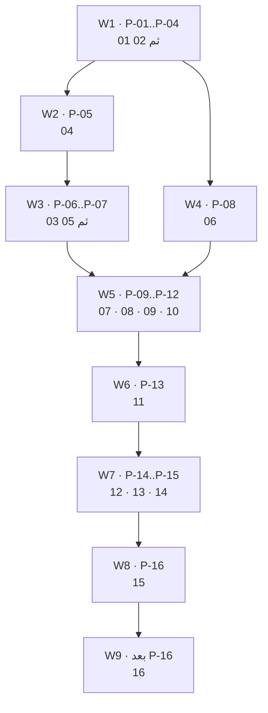

# BRIGHT AI / AIGAS — حزمة البرومبتات التنفيذية H (16 برومبتًا)

```yaml
pack: H
version: 2.1
redesigned: 2026-11-16
source_report: Audit/BRIGHT-AI-2026-FINAL-360-AUDIT.html
report_timestamp: 2026-11-16 14:00 UTC
report_baseline_sha: 738520067de19ae3bb5380beb292cd4d44861b69
current_head_at_redesign: cb9863f19e3d215c32f7e18c9beb2c591eddb411
baseline_rule: يُقرأ HEAD عند التشغيل؛ رأس التقرير مرجع للفجوات لا للكود الحالي
requirements_register: 50 متطلبًا ذريًا بوزن 100 (التقرير يعلنها ولا يسردها)
scorecard_metrics: 22
verdicts: {PUBLIC_DEMO: CONDITIONAL_GO, 48H_TRIAL: NO_GO, COMMERCIAL_LAUNCH: NO_GO}
executor: وكيل تنفيذ محلي (OpenCode / Codex أو ما يكافئه)
status: READY_FOR_EXECUTION — البرومبتات لم تُنفّذ داخل هذه الحزمة
```

> **ما تغيّر في هذا الإصدار:** مزامنة كاملة مع تقرير 360 (الأحكام الثلاثة، المقاييس الـ22، المسار الحرج P-01…P-16، سجل عدم اليقين 8%)، مخطط موحّد لكل برومبت، خطوات مرقّمة لكل منها مخرج، إعادة تحقق إلزامية من الفجوة قبل التعديل، سجل فجوات مربوط بمسار الملف، خريطة موجات وبوابات، قالب تقرير تسليم واحد، وقائمة صريحة بما لم يُتحقق منه.
> **ما لم يتغيّر:** نطاق الفجوات الست عشرة، حدود الصلاحيات، والمناطق المحمية.

---

## 0. كيف تُستخدم الحزمة

| الوضع | متى | كيف |
|---|---|---|
| **مفرد** | إصلاح فجوة واحدة الآن | شغّل برومبتًا واحدًا كاملًا، ثم أوقف الجلسة وسلّم تقريره. |
| **موجة** | إغلاق مجموعة مترابطة | شغّل برومبتات الموجة بترتيبها الداخلي (بعض الموجات تسلسلي)، ولا تبدأ الموجة التالية قبل عبور بوابتها. |
| **كامل** | إغلاق نهائي | الموجات W1←W9 بالترتيب المطابق لمسار تقرير 360. **PROMPT-15** بوابة إلزامية قبل **PROMPT-16**. |

**قواعد التشغيل:**

1. برومبت واحد لكل جلسة عمل. لا تدمج برومبتين في تعديل واحد إلا إذا نصّت البطاقة على ذلك.
2. ابدأ دائمًا بـ**إعادة التحقق**، ثم عدّل، ثم تحقق، ثم سلّم. لا تعدّل قبل تأكيد أن الفجوة ما زالت قائمة.
3. لا تعِد تنفيذ ميزة موجودة، ولا تُصلح خللًا خارج نطاق البطاقة ولو ظهر أمامك؛ سجّله في «خارج النطاق».
4. الملفات المشتركة بين برومبتين لا تُعدّل من جلستين متوازيتين. تحقق من الجدول في §3.
5. أي خطوة تحتاج بيئة خارجية (Render، Cloudflare، Neon Production، Groq، DNS) **لا تُنفّذ**؛ جهّز خطتها وسلّمها للمالك.

### 0.1 دورة حياة البرومبت

```
Preflight  →  إعادة تحقق الفجوة + قراءة القيود + تسجيل baseline SHA
Execute    →  تعديلات محلية في حدود النطاق فقط
Verify     →  الأوامر والفحوص المذكورة في البطاقة، على الحالة النهائية
Report     →  تقرير التسليم (§0.2) + الحالة النهائية
Stop       →  توقف. لا انتقال تلقائي إلى برومبت آخر
```

### 0.2 قالب تقرير التسليم (إلزامي، 8 أسطر كحد أقصى)

```md
## PROMPT-XX — <العنوان>
- **Baseline:** <SHA قبل التعديل> → <SHA/شجرة العمل بعده>
- **تم:** <1–3 نقاط: التغيير وسببه>
- **الملفات:** <حتى 3 مسارات جوهرية>
- **التحقق:** PASS / FAIL / NOT RUN — <الأمر أو الفحص ونتيجته الفعلية>
- **الحالة:** DONE / PARTIAL / BLOCKED
- **الادعاءات:** ما أصبح LOCAL / STAGING / LIVE، وما بقي NOT_VERIFIED
- **خارج النطاق:** ما لاحظته ولم تلمسه
- **مفتوح:** ما يحتاج موافقة أو بيئة خارجية
```

**مسار الأثر:** `Audit/prompt-h-<YYYY-MM-DD>/<PROMPT-ID>/REPORT.md` مع `evidence/` للمخرجات الخام (JSON/TAP/لقطات). لا تُحفظ أسرار ولا رموز جلسات ولا بريد حقيقي في الأثر.

### 0.3 ضوابط الجودة العامة

- **لا ادعاء بلا دليل:** `PASS` اختبار محلي ≠ `LIVE_VERIFIED` ≠ `APPROVED`. لا تكتب «100%» أو «جاهز للإنتاج» أو «متوافق WCAG» بلا فحص يغطي النطاق المذكور.
- **حالات الدليل المستخدمة:** `SOURCE_PRESENT` · `SCHEMA_PRESENT` · `CONFIGURED` · `LOCAL_VERIFIED` · `STAGING_VERIFIED` · `LIVE_VERIFIED` · `NOT_VERIFIED` · `BLOCKED`.
- **أسرار:** بالأسماء فقط. لا تطبع `DATABASE_URL` أو أي مفتاح، ولا تضع قيمة سرية في تقرير أو اختبار.
- **بيانات:** اصطناعية افتراضيًا. لا بريد حقيقي، لا JWT، لا مستند عميل.
- **لغة:** الكود والتعليقات إنجليزية، ونصوص الواجهة عربية RTL، والأسماء التقنية داخل `bdi dir="ltr"`.

### 0.4 مرجع الحزمة — تقرير 360

| الحقل | القيمة |
|---|---|
| التقرير | `Audit/BRIGHT-AI-2026-FINAL-360-AUDIT.html` |
| التوقيت | 2026-11-16 14:00 UTC (17:00 الرياض) |
| الرأس المفحوص | `738520067de19ae3bb5380beb292cd4d44861b69` (+36 عن `a6f3551071bb…`) |
| الرأس الحالي وقت إعادة التصميم | `cb9863f19e3d215c32f7e18c9beb2c591eddb411` — **غير مدقق** |
| النطاق | 22 مقياسًا · 50 متطلبًا ذريًا بوزن 100 · ثقة 92.00% · عدم يقين موزون 8.00% |
| الأصل الحي آنذاك | Static Site (`dist/client`) — `srv-d7m5bcjbc2fs73826v20` — SSR 404 |

**الأحكام الثلاثة كما في التقرير (تُنقل حرفيًا ولا تُخفَّف):**

| الحكم | حالة التقرير | الشرط الحرفي للتقرير | البرومبتات التي تغلقه |
|---|---|---|---|
| `PUBLIC_DEMO` | CONDITIONAL GO | إصلاح ربط `LedgerDemo` في `/products/ledger/#lab` وتوحيد `/demo/firewall/` | 01 |
| `48H_TRIAL` | NO-GO | 404 حيًا على `/auth/sign-up/` و`/app/trial/` + Production بلا RLS كامل | 03, 04, 05, 11 |
| `COMMERCIAL_LAUNCH` | NO-GO | غياب Node SSR حي · Data API/`BYPASSRLS` · `APPROVED_MODELS=[]` · مفتاح Groq مكشوف | 04, 05, 06, 07, 12, 13, 15, 16 |

**المقاييس التي تخصّ هذه الحزمة (من §1 في التقرير):**

| # | المقياس | النسبة (البسط/المقام) | ما يحرّكه |
|---|---|---|---|
| 01 | Overall Completion | 54.48 / 100 | كل الموجات |
| 02 | Source Implementation | 84.50 / 100 | 01, 03, 06, 07, 09, 10 |
| 03 | Deployed Runtime Readiness | 6.25 (1.00/16.00) — 45 مسارًا خادميًا 404 | 04 |
| 04 | Security & RLS & Isolation | 11.11 (2.00/18.00) | 03, 05 |
| 08 | Product UX | 76.56 (12.25/16.00) | 01, 02 |
| 12 | Public Demo Functional | 87.50 (10.50/12.00) — 5 من 6 مختبرات | 01 |
| 13 | 48h Trial Readiness | 25.00 (1.50/6.00) | 11 |
| 14 | Groq Config / Model Approval | 11.11 (0.50/4.50) | 06, 07 |
| 15 | Groq Server Integration | 30.00 (1.50/5.00) | 06 |
| 16 | Groq Product Coverage | 0.00 (0.00/4.00) | 07, 08, 09, 10 |
| 17 | Firewall Readiness | 68.75 (5.50/8.00) | 09 |
| 19 | Human Gate Readiness | 71.88 (5.75/8.00) | 09 |
| 20 | Risk Engine Readiness | 81.25 (6.50/8.00) | 10 |
| 21 | Secure Chat Readiness | 62.50 (5.00/8.00) | 07 |
| 22 | Monitoring / SEO / Performance | 50.00 — Monitoring 50 · SEO 75 · Perf 0 (NOT_MEASURED) | 12, 14 |

**سجل عدم اليقين (8.00%) موزّعًا على البرومبتات:**

| البند | الوزن | البرومبت |
|---|---|---|
| عزل Tenant A/B سلوكيًا على فرع Neon حقيقي + اختبار PITR | 2.0% | 05 |
| صلاحية وسقف حساب المالك على Groq بعد التدوير | 2.0% | 06 |
| LCP/CLS/INP في متصفح فعلي | 1.0% | 14 |
| NVDA/VoiceOver على الشاشات المصادقة | 0.5% | 14 |
| تشغيل حزمة الاختبارات المحلية كاملة بعد التعديلات | 2.5% | 15 |

> **قاعدة الاشتقاق:** لا يظهر في هذه الحزمة برومبت لا يقابله فجوة في التقرير أو في الكود. وما يخالف التقرير يُكتب صراحةً كـ«تحقق قرائي خارج التقرير».

---

## 1. القواعد العامة (تُطبّق على PROMPT-01 … PROMPT-16 ولا تُكرَّر في البطاقات)

### 1.1 الصلاحيات

| العمل | مسموح | يحتاج موافقة مالك صريحة |
|---|---|---|
| تعديل ملفات محلية | ✅ | — |
| تشغيل build / tests / فحوص محلية | ✅ | — |
| PostgreSQL محلي مؤقت | ✅ | — |
| `git commit` / `push` / PR / merge | ❌ | لا يُرفع القيد في هذه الحزمة |
| نشر Render / Cloudflare / DNS | ❌ | ✅ تنفيذ المالك |
| migrations على Staging أو Production | ❌ | ✅ |
| تعطيل Data API، تدوير مفتاح، تفعيل CSP | ❌ | ✅ |
| تعديل `.env*` أو `.github/workflows/` | ❌ | ✅ |

### 1.2 Baseline

1. قبل أي تعديل: `git status --short` و`git rev-parse HEAD`.
2. سجّل SHA في التقرير. لا تفترض أن SHA الحزمة ساري.
3. إن تغيّر HEAD عن آخر مراجعة، أعد التحقق من الفجوة قبل العمل؛ إن كانت أُغلقت، سلّم `BLOCKED — premise false` وتوقف.
4. لا تعمل على شجرة عمل تحمل تغييرات غير متعلقة بالمهمة دون تسجيلها أولًا.

### 1.3 المناطق المحمية (ممنوعة في كل البرومبتات)

| العنصر | الملفات |
|---|---|
| Hero والهوية البصرية | `src/pages/index.astro`, `src/components/Constellation.astro`, `src/components/BrandLogo.astro`, `src/styles/theme.css` |
| النصوص والروابط العامة للصفحة الرئيسية | أي نص أو رابط أو ترتيب قسم داخل الصفحة الرئيسية |
| عقود API القائمة | لا تغيير شكل استجابة أو رمز حالة خارج ما تنص عليه البطاقة |
| الاختبارات القائمة | لا تُعدّل لتُمرّر إصلاحًا؛ أضف اختبارًا جديدًا |

### 1.4 درجات الخطورة

| الدرجة | المعنى |
|---|---|
| **P0** | يمنع أي تشغيل عام أو إنتاجي، أو يمسّ أمن/عزل/بيانات. لا تُعبر بوابته بغير دليل. |
| **P1** | خلل وظيفي مؤثر أو ادعاء غير مثبت في رحلة أساسية. |
| **P2** | جودة أو أداء أو اعتماديات بلا خطر مباشر. |

### 1.5 شروط التوقف (Stop Conditions)

أوقف البرومبت وسلّم `BLOCKED` مع السبب إذا:

- الفجوة غير قائمة أو أُغلقت في HEAD الحالي.
- التعديل المطلوب يخرج عن الملفات المذكورة.
- الفحص يحتاج بيئة خارجية بلا تفويض.
- ظهر أن الإصلاح سيكسر عقدًا قائمًا لم تذكره البطاقة.
- تعذّر التحقق مرتين لسبب بيئي متكرر (سجّل السبب؛ لا تُخفِ الفحص الفاشل).

---

## 2. مسار التنفيذ المشتق من تقرير 360

الترتيب يتبع المسار الحرج في §6 من تقرير 360؛ ولا تُفتح موجة قبل عبور بوابة السابقة.



| الموجة | مرحلة التقرير §6 | البرومبتات | داخل الموجة | البوابة | شرط العبور |
|---|---|---|---|---|---|
| **W1** | P-01..P-04 Public Labs & UI Parity | 01, 02 | 01 ثم 02 | **G1** | مختبر Ledger مربوط + `/demo/firewall/` موحّد + صفر hex خارج التوكنز + 5 مقاسات بلا تجاوز |
| **W2** | P-05 Node SSR Origin & CDN Bypass | 04 | — | **G2** | `/healthz/` ready + المسارات الخادمية بلا 404 + API 401 JSON |
| **W3** | P-06..P-07 Delta 0035/0036 + RLS + Runtime Cutover | 03, 05 | 03 ثم 05 | **G3** | 0035/0036 على Staging + posture Production + Data API معطّل + PITR مثبت |
| **W4** | P-08 Groq Key Rotation & Gateway | 06 | — | **G4** | مفتاح مدوّر + 200/429/timeout/circuit/budget + صفر تسرب |
| **W5** | P-09..P-12 Secure Chat · Public AI · Firewall/HG/Risk | 07, 08, 09, 10 | متوازية | **G5** | نموذج ELIGIBLE لجهة واحدة + Sandbox معطّل افتراضيًا + ESCALATE → PENDING + Risk بلا سلطة درجة |
| **W6** | P-13 48h Trial Live E2E | 11 | — | **G6** | 112/112 + عزل 403 + لا تجدد نافذة أو حصة |
| **W7** | P-14..P-15 Observability & Astro 7 (+ قياسات ما قبل البوابة) | 12, 13, 14 | متوازية | **G7** | CSP مفروض + 0 Critical/High + CWV/وصولية/تحويلات مقاسة |
| **W8** | P-16 Final QA Gate | 15 | — | **G8** | كل الاختبارات PASS بلا SKIP غير مبرر + 0 P0 blockers |
| **W9** | بعد P-16: التحويل الحي | 16 | — | **G9** | دخان 5 دقائق + 48 ساعة مراقبة + إيصال موقّع |

> **التوازي المسموح فقط:** W1 تسلسلي (01 ثم 02) وW3 تسلسلي (03 ثم 05). المتوازي فعلًا: 12/13/14 في W7 (ملفات منفصلة) و07/08/09/10 في W5 (كلها بعد بوابة Groq). أي توازٍ آخر يحتاج تأكيدًا من جدول التبعيات.

**تجميد الملفات:** لا تُعدّل `src/server/secure-chat/*` قبل W5، ولا `render.yaml` من برومبتين معًا (`04` و`13`)، ولا `migrations/*` إلا من PROMPT-03/05/09 وبترتيب صريح.

---

## 3. فهرس البرومبتات

| ID | العنوان | خطورة | موجة | يعتمد على | الملفات الجوهرية | معيار الخروج |
|---|---|---|---|---|---|---|
| 01 | إغلاق مختبر Ledger وتوحيد Firewall والتوكنز | P1 | W1 | — | `ProductExperience.astro`, `demo/[product].astro` | المختبرات الست تعمل بنفس النظام البصري |
| 02 | نمط المهمة أولًا وتوفيق النصوص | P2 | W1 | 01 | `LabShell.astro`, `pricing.astro`, `contact.astro` | أول مهمة فوق خط الطي + 3 نصوص متطابقة |
| 03 | الترحيلات 0035/0036 ومصفوفة RLS والبوتستراب | P0 | W3 | — | `migration-order.mjs`, `migrations/0035*`, `0036*` | 76/76 PASS + إنشاء مؤسسة عبر `aigas_runtime` |
| 04 | أصل Node SSR ودور الاتصال وسياسة الكاش | P0 | W2 | — | `db.mjs`, `render.yaml` | `/healthz/` ready + API 401 JSON لا 404 |
| 05 | تأمين Neon Staging ثم Production وتعطيل Data API | P0 | W3 | 03, 04 | `apply-migrations.mjs`, `audit-runtime-posture.mjs` | `rlsEnforced` + Data API معطّل + استعادة مثبتة |
| 06 | بوابة Groq الموحدة | P0 | W4 | — | `env.mjs`, `ai/groq-gateway.mjs`, `adapter.mjs` | اختبارات 200/429/timeout/circuit/budget |
| 07 | اعتماد النموذج وتشغيل Secure Chat | P0 | W5 | 06 | `models.mjs`, `secure-chat/service.mjs` | نموذج ELIGIBLE + فحص مخرجات + حصص |
| 08 | Sandbox عام اختياري بـ Groq | P1 | W5 | 06 | `public-sandbox-limiter.mjs`, `groq-sandbox.ts` | 3 طلبات ثم 429 + fallback حتمي |
| 09 | فحص مخرجات Firewall وتصعيد Human Gate | P1 | W5 | 03, 06 | `firewall/guard.mjs`, `escalation.mjs`, `0037*` | ESCALATE → 202 PENDING بمراجع مستقل |
| 10 | مساعد Risk استشاري | P2 | W5 | 06 | `risk-engine/assist.mjs`, `RiskWorkspace.astro` | JSON مخطط + الدرجة حتمية |
| 11 | رحلة 48 ساعة End-to-End على Node | P0 | W6 | 04, 05 | `sign-up.astro`, `self-service-trial.mjs` | 112/112 + عزل 403 + لا تجدد نافذة |
| 12 | CSP Enforce وحوكمة المراقبة | P1 | W7 | 04 | `middleware.ts`, `observability/config.mjs` | صفر انتهاك + url-policy مثبت |
| 13 | تنظيف الاعتماديات وترقية Astro | P2 | W7 | — | `package.json`, `render.yaml` | 0 Critical/High + بناء كامل |
| 14 | CWV والوصولية والـSEO | P2 | W7 | 02, 04 | `verify-cwv-a11y.mjs` | LCP/CLS/INP داخل الحدود + 0 انتهاك آلي |
| 15 | بوابة الإصدار الشاملة | P0 | W8 | 01–14 | `Audit/prompt-h-<date>/GATE/` | 0 P0 blockers + شهادة |
| 16 | التحويل النهائي والمراقبة | P0 | W9 | 15 | `Audit/.../LIVE-CUTOVER-RECEIPT.md` | 200 ready + SHA مطابق + إيصال موقّع |

---

## 4. سجل الفجوات (Gap Register)

**قاعدة:** كل فجوة مربوطة بدليل في المستودع. أعد التحقق منها قبل التعديل؛ إن لم تعد قائمة، أغلقها في التقرير ولا تُعدّل شيئًا.

| Gap | البيان | الدليل | البرومبت | الحالة عند التصميم |
|---|---|---|---|---|
| G-01 | `ProductExperience.astro` لا يعرض `LedgerDemo` ويسقط إلى قالب جامد؛ `demo/[product].astro` يستخدم نموذجًا قديمًا؛ ألوان hex خارج التوكنز | `src/components/ProductExperience.astro:21`, `src/components/LedgerDemo.astro:36`, `src/components/SecureChatDemo.astro:43`, `src/pages/demo/[product].astro:21` | 01 | مؤكدة بالقراءة |
| G-02 | نمط «المهمة أولًا» منفّذ في خمسة مختبرات ومفقود في صفحة Ledger (تقرير §5)؛ تعارض نصوص `/pricing/` و`/contact/` مع وجود تجربة 48h (قراءة خارج التقرير) | `src/components/LabShell.astro`, `src/pages/pricing.astro`, `src/pages/contact.astro` | 02 | مؤكدة بالتقرير لصفحة Ledger؛ قياس الشاشة مطلوب |
| G-03 | `0034` خارج `DELTA_ORDER`؛ الجدولان الجديدان بلا `aigas_client_deny`؛ `aigas_runtime` لا ينشئ مؤسسة/يقبل دعوة عبر مسار محروس | `scripts/migration-order.mjs:17-19`, `migrations/0033_aigas_exploration.sql:19`, `migrations/0034_aigas_self_service_trial.sql:11`, `scripts/verify-runtime-rls.mjs:355` | 03 | مؤكدة بالقراءة |
| G-04 | الخدمة المنشورة `srv-d7m5bcjbc2fs73826v20` من نوع Static/`dist/client` ⇒ 45 مسارًا خادميًا 404 (تقرير §1/§2)؛ Pooler يرفض `options=-c role=…` عند البدء؛ `AIGAS_DB_RUNTIME_ROLE` غير موجود | `render.yaml`, `src/server/kernel/db.mjs:99-102` | 04 | مؤكدة بالتقرير (Static) — أعد فحص الحالة الحية |
| G-05 | Production: 31 جدولًا/سياستان/0 FORCE، Data API نشط، `protected=false`، PITR 6h، دور مالك `BYPASSRLS` (تقرير §3) | `Audit/BRIGHT-AI-2026-FINAL-360-AUDIT.html` §3 — **يُعاد قياسه** | 05 | تاريخية عند التنفيذ — أعد القياس |
| G-06 | مفتاح Groq سابق مكشوف؛ `adapter.mjs` يشترط `AIGAS_SC_<PROVIDER>_API_KEY`؛ لا 429/سقف تزامن/قاطع ميزانية (تقرير §4 والمقاييس 14–15) | `src/server/secure-chat/adapter.mjs`, `src/server/kernel/env.mjs` | 06 | مؤكدة بالقراءة والتقرير |
| G-07 | `APPROVED_MODELS` فارغة | `src/server/secure-chat/models.mjs:3` | 07 | مؤكدة بالقراءة |
| G-08 | المختبر العام حتمي فقط بلا مسار حي اختياري | `src/components/SecureChatDemo.astro` | 08 | مؤكدة |
| G-09 | `approvedReviewIntegrations` فارغة ولا نوع عملية تصعيد؛ لا فحص مخرجات (المقياسان 17 و19: 68.75% و71.88%) | `src/server/firewall/escalation.mjs:14`, `src/server/firewall/guard.mjs` | 09 | مؤكدة بالقراءة والتقرير |
| G-10 | لا مساعد تحليل أولي في Risk | `src/pages/app/api/risk-engine/`, `src/components/RiskWorkspace.astro` | 10 | مؤكدة |
| G-11 | مسار العودة بـ OTP واكتمال الرحلة على أصل Node لم يُتحقق منه End-to-End (المقياس 13: 25%، و404 حيًا) | `src/pages/auth/sign-up.astro`, `src/scripts/trial-home.ts` | 11 | NOT_VERIFIED |
| G-12 | CSP يعمل Report-Only؛ مسار المراقبة والمدة غير معتمدين (المقياس 22: Monitoring 50%) | `src/middleware.ts:62-63,140`, `src/pages/api/observability.ts` | 12 | مؤكدة بالقراءة |
| G-13 | 3 حزم غير مستوردة؛ ثغرة حرجة تتطلب `astro ≥ 7.3.2` وNode `≥ 22.23.4` (مسار التقرير P-15) | `package.json`, `scripts/verify-dependency-posture.mjs` | 13 | مؤكدة بالقراءة |
| G-14 | LCP/CLS/INP وقارئ الشاشة على الشاشات المصادقة غير مقاسة (بندا عدم اليقين 1.0% و0.5%، والمقياس 22 Live Performance = 0) | لا سكربت قياس | 14 | NOT_VERIFIED |
| G-15 | لا بوابة انحدار شاملة بعد الإصلاحات | — | 15 | إجرائية |
| G-16 | الدومين الحي ما زال على الأصل السابق | تقرير حي سابق | 16 | إجرائية |

> **ملاحظة اتساق:** تقرير 360 §1 يعلن سجلًا ذريًا من **50 متطلبًا بوزن 100**، لكنه لا يسرد المتطلبات ولا أوزانها المفردة. لذلك `req_ref` في البطاقات يبقى **وصفيًا غير متحقق**، والربط الملزم هو: فجوة `G-xx` ← دليل ملف/سطر ← مقياس منشور في التقرير. لا تخترع رقمًا ولا وزنًا، ولا تحسب نسبة من مصفوفة غير مسرودة.

---

## 5. بطاقات البرومبتات

> **مخطط البطاقة ثابت في الست عشرة:** سطر بيانات `P · W · يعتمد على · يفتح · الفجوة · req_ref` ← **الفجوة** ← **نطاق الملفات** (مسموح/محظور) ← **الخطوات** (كل خطوة بمخرج) ← **التحقق** ← **معيار الخروج** ← **التراجع** ← **الموافقة** ← **خارج النطاق**.
> `يفتح` تعني المستهلك المباشر داخل الموجات؛ بوابة **PROMPT-15** تجمع الجميع ولا تتكرر في كل بطاقة.

### PROMPT-01 · إغلاق مختبر Ledger وتوحيد Firewall وتوكنز المختبرات

**P1 · W1 · يعتمد على: — · يفتح: 02، 14 · الفجوة: G-01 · req_ref (غير متحقق): REQ-29, REQ-30, REQ-40**

**الفجوة:** تقرير 360 يحكم `PUBLIC_DEMO` = CONDITIONAL GO بشرط واحد: إصلاح ربط `LedgerDemo` في `/products/ledger/#lab` وتوحيد `/demo/firewall/`؛ والمقياس 12 يسجل 10.50/12.00 لأن خمسة مختبرات فقط مكتملة. سببها: `ledger` يسقط إلى قالب جامد بلا حساب SHA-256، و`/demo/firewall/` يستخدم نموذجًا قديمًا، وثلاثة ملفات تحمل ألوانًا صلبة خارج التوكنز.

**نطاق الملفات:** مسموح `src/components/ProductExperience.astro`, `src/components/LedgerDemo.astro`, `src/components/SecureChatDemo.astro`, `src/pages/demo/[product].astro`, `src/shared/ledger-demo.mjs` (للقراءة فقط عند الحاجة). **محظور** `src/pages/index.astro`, `Constellation.astro`, `src/styles/theme.css`.

**الخطوات:**

1. تحقق من الفجوة: `rg -n "LedgerDemo|kind === 'ledger'" src/components/ProductExperience.astro` — يجب ألا يظهر استيراد `LedgerDemo`. إن ظهر، أغلق الفجوة وتوقف.
2. أضف استيراد `LedgerDemo` واعرضه عند `kind === 'ledger'`، واحذف الفروع الميتة لـ `human-gate` و`secure-chat` داخل القالب البديل (غير قابلة للوصول بعد الفروع الأعلى). ← **المخرج:** كل `kind` له مسار عرض واحد.
3. في `src/pages/demo/[product].astro` استورد `FirewallWorkspace.astro` واعرضه عند `product === 'firewall'` بدل `#generic-demo`، مع إبقاء `CSP connect-src 'none'`. ← **المخرج:** لا نموذج قديم مزدوج.
4. استبدل كل قيم hex الصلبة في الملفات الثلاثة بتوكنز `variables.css` (`--surface-raised`, `--surface-sunken`, `--border-strong`, `--color-text`, `--color-focus`, `--color-action-hover-strong`)، مع قيمة احتياطية مطابقة للّون الحالي حتى لا يتغير المظهر بصريًا.
5. اربط `data-lab-reset` في `LabShell` بدالة إعادة ضبط `LedgerDemo` الفعلية. ← **المخرج:** الضغط يعيد السلسلة إلى حالتها الأولى.

**التحقق:**

- `npm run build` ينجح.
- `node --test tests/firewall-demo.test.mjs tests/ledger.test.mjs` ينجح.
- لقطة `/products/ledger/#lab` و`/demo/firewall/` على 360/390/768/1024/1440 بلا تجاوز أفقي.
- تباين أزرار المختبرات ≥ 4.5:1، و0 طلبات شبكة أثناء التفاعل.
- لقطة Hero الرئيسية مطابقة قبل/بعد (diff بصري).

**معيار الخروج:** المختبرات الست تعمل بنفس النظام البصري والوظيفي، بلا كود ميت ولا hex خارج التوكنز.

**التراجع:** `git checkout -- <الملفات الأربعة>`.
**الموافقة:** لا commit داخل الحزمة؛ قرار الدمج للمالك بعد مراجعة التقرير.
**خارج النطاق:** إعادة تصميم المختبرات، تغيير نصوص الصفحة الرئيسية، إضافة Backend.

---

### PROMPT-02 · نمط المهمة أولًا وتوفيق نصوص التجربتين

**P2 · W1 · يعتمد على: 01 · يفتح: 14 · الفجوة: G-02 · req_ref (غير متحقق): REQ-28, REQ-33, REQ-42, REQ-49**

**الفجوة:** تقرير 360 §5 يسجل أن نمط Linear — مهمة أساسية في أول شاشة دون تمرير طويل — منفّذ في خمسة مختبرات و**مفقود في صفحة منتج Ledger** تحديدًا. ويُضاف إليه تحقق قرائي خارج التقرير: حالات `Empty/Loading/Verified/Blocked` غير مميّزة بغير اللون، ونصوص `/pricing/` و`/contact/` تنفي التفعيل الذاتي الذي تعد به صفحة المنتج. لا تُعِد بناء المختبرات الخمسة العاملة.

**نطاق الملفات:** `src/components/LabShell.astro`, `src/styles/experience-hub.css`, `src/pages/kernel.astro`, `src/pages/pricing.astro`, `src/pages/contact.astro`, `src/pages/app/trial/index.astro`. **محظور** الصفحة الرئيسية و`Constellation.astro`.

**الخطوات:**

1. قِس الحالة الحالية قبل التعديل: ارتفاع أول عنصر تفاعلي على 360×800 و390×844، وسجّل الأرقام في التقرير.
2. طبّق نمط المختبرات الخمسة على صفحة Ledger داخل `LabShell` + `experience-hub.css`: صندوق المهمة أولًا، والنص التمهيدي سطران كحد أقصى. لا تغيّر ترتيب المختبرات الخمسة العاملة. ← **المخرج:** أول تفاعل داخل أول شاشة على 360×800 في Ledger.
3. اجعل الـInspector مدمجًا أسفل المهمة مباشرة، وأضف لكل حالة من الأربع أيقونة + وسمًا نصيًا صريحًا لا يعتمد على اللون.
4. استبدل hex في `src/pages/app/trial/index.astro` (`#494151`, `#21192e`, `#f5b544`) بتوكنز مع قيمة احتياطية مطابقة.
5. وحّد الصياغة في `pricing.astro` و`contact.astro` على ثلاث فئات واضحة: (أ) مختبر عام فوري بلا حساب، (ب) استكشاف 48 ساعة محدود بالقراءة لصاحب بريد موثق عند فتح البوابة، (ج) تجربة مؤسسية تشغيلية بموافقة مشغّل. لا تستخدم لفظ «مجاني دائم» أو «تجربة كاملة» لما هو محدود.

**التحقق:**

- 5 مقاسات × المسارات المتأثرة: `scrollWidth === clientWidth`.
- Tab / Shift+Tab / Escape تعمل، وترتيب التركيز منطقي.
- `node scripts/verify-product-journey.mjs` و`node scripts/verify-interior-ui.mjs` ينجحان.
- تطابق نصي حرفي بين العروض الثلاثة في المسارات الثلاثة (قائمة نصوص موحّدة في التقرير).

**معيار الخروج:** نصوص متطابقة، أول مهمة فوق خط الطي على الجوال، حالات مفهومة بلا لون وحده.
**التراجع:** `git checkout` للملفات المعدلة.
**الموافقة:** المالك على الصياغة قبل الدمج (نص تجاري).
**خارج النطاق:** إضافة أسعار أو وعود جديدة، تغيير منطق التفعيل.

---

### PROMPT-03 · الترحيلات 0035/0036 ومصفوفة RLS والبوتستراب

**P0 · W3 · يعتمد على: — · يفتح: 05، 09 · الفجوة: G-03 · req_ref (غير متحقق): REQ-06, REQ-09, REQ-13**

**الفجوة:** `0034` غير مدرج في `DELTA_ORDER` فيختلف المسار fresh عن delta؛ الجدولان `aigas_exploration_grants` و`aigas_self_service_trials` بلا سياسة `aigas_client_deny` فيسقط فحص DB06؛ ولا دالة محروسة لإنشاء مؤسسة أو قبول دعوة عبر `aigas_runtime`.

**نطاق الملفات:** `scripts/migration-order.mjs`, `migrations/0035_aigas_tenant_isolation_closure_v2.sql` (جديد), `migrations/0036_aigas_runtime_workspace_bootstrap.sql` (جديد), `src/server/kernel/service.mjs`, `scripts/verify-runtime-rls.mjs`, `tests/migration-order.test.mjs`.
**بيئة:** PostgreSQL 18 محلي مؤقت فقط (Disposable). **ممنوع** الاتصال بـ Neon Staging أو Production.

**الخطوات:**

1. **لا تعدّل `0033` أو `0034`** — بصماتهما مثبتة في سجل Staging. أضف `'0034', '0035', '0036'` بالترتيب إلى `DELTA_ORDER`.
2. أنشئ `0035` داخل غلاف `BEGIN; … COMMIT;` واحد: سياسة `aigas_client_deny` بـ`AS RESTRICTIVE` على الجدولين الجديدين بنفس نمط `0025:431`، وسحب الصلاحيات عن `authenticated` و`anonymous`، وتحديث `aigas_is_tenant_member` لفحص `u.banned IS NOT TRUE`، ثم **Postcondition** يفشل الترحيل إذا بقي أي `public.aigas_*` بلا `aigas_client_deny`.
3. أنشئ `0036`: دالة `SECURITY DEFINER` محروسة `aigas_bootstrap_workspace(p_name text)` بـ`search_path = pg_catalog, public` تتحقق من `aigas_actor()` وعدم الحظر، وتنشئ المستأجر + عضوية `OWNER` + حدث التدقيق ذريًا؛ ودالة محروسة لقبول الدعوة الموثقة. امنح `EXECUTE` لـ`aigas_runtime` فقط وأسحبه عن `PUBLIC`.
4. حدّث `src/server/kernel/service.mjs` لاستدعاء الدالة بدل `INSERT` المباشر، وأضف الجدولين إلى قائمة القراءة في `scripts/verify-runtime-rls.mjs`.
5. أضف اختبار ترتيب يثبت أن delta وfresh يصلان لنفس الحالة النهائية.

**التحقق:**

- `node --test tests/migration-order.test.mjs` ينجح.
- `node scripts/db-migration-rehearsal.mjs` بالوضعين `fresh` و`delta` ينجح.
- `node scripts/verify-runtime-rls.mjs` PASS على المصفوفة كاملة (العدد المتوقع 76؛ **سجّل العدد الفعلي** ولا تفترضه).
- إثبات سلوكي: إنشاء مؤسسة وقبول دعوة عبر اتصال `aigas_runtime` (NOBYPASSRLS)، وفشل كتابة مباشرة من خارج الدالة بـ`42501`.

**معيار الخروج:** مسار fresh وdelta متطابقان، وكل جدول `aigas_*` محمي، والبوتستراب يعمل عبر دور runtime وحده.
**التراجع:** حذف `0035`/`0036` محليًا واستعادة الملفات المعدلة.
**الموافقة:** لا تطبيق خارجي. تطبيق `0035`/`0036` على أي بيئة هو PROMPT-05 بموافقة منفصلة.
**خارج النطاق:** تعديل ترحيلات مطبقة، لمس Production، كتابة بيانات حقيقية.

---

### PROMPT-04 · أصل Node SSR ودور الاتصال وسياسة الكاش

**P0 · W2 · يعتمد على: — · يفتح: 05، 11، 12، 14 · الفجوة: G-04 · req_ref (غير متحقق): REQ-01, REQ-02, REQ-03, REQ-04, REQ-46**

**الفجوة:** `render.yaml` في المصدر يعرّف Web Service من نوع Node، لكن الخدمة المنشورة `srv-d7m5bcjbc2fs73826v20` كانت `static_site` تخدم `dist/client` فقط، فيسجل التقرير 45 مسارًا خادميًا يرجع 404 ومقياس جاهزية تشغيل 6.25%؛ ومجمع Neon يرفض تمرير `options=-c role=aigas_runtime` عند البدء؛ و`AIGAS_DB_RUNTIME_ROLE` غير موجود في الكود، و`AIGAS_REQUIRE_RLS` مذكور في تعليق `render.yaml` لا كمتغير.

**نطاق الملفات:** `src/server/kernel/db.mjs`, `render.yaml`, `scripts/verify-node-runtime.mjs`, `docs/NODE-ORIGIN-OPERATOR-2026-11-16.md`.

**الخطوات:**

1. في `db.mjs` أضف دعمًا اختياريًا لـ`AIGAS_DB_RUNTIME_ROLE`: إن كان المضبوط حساب قناة محدودًا، نفّذ `SET LOCAL ROLE aigas_runtime` داخل `transaction()` و`probeDatabase()`، وتحقق أن `current_user = 'aigas_runtime'` و`rolbypassrls = false`. ← **المخرج:** لا اعتماد على معاملات بدء Pooler.
2. أضف إلى `render.yaml` المتغير `AIGAS_REQUIRE_RLS: "true"` (كقيمة صريحة لا تعليق)، وأسماء مفاتيح Groq وCSP مع `sync: false` للأسرار.
3. تحقق محليًا: `npm run build` ثم `node scripts/verify-node-runtime.mjs`، وتأكد من `/healthz/`، `/auth/sign-up/`، مسارات `/app/*`، و`/knowledge/?q=audit` → 301 إلى `/docs/?q=audit` مع حفظ المعامل.
4. **بإذن المشغّل فقط** — جهّز خطة تشغيل ورقية (لا تنفّذ): إنشاء Web Service معزول على `.onrender.com` مربوط بـNeon Staging، تحقق `/healthz/` = 200 مع `consistent: true`، ثم Bypass Cache لبادئات `/app*`, `/auth*`, `/api*`, `/healthz*` قبل أي ربط دومين.

**التحقق:**

- `/app/api/kernel/members/` بلا جلسة = 401 JSON بهوية `application/json`، لا 404 HTML.
- ترويسة `Cache-Control: private, no-store, max-age=0` على المسارات الخاصة.
- `node scripts/verify-routes.mjs` ينجح، ولا صفحات ثابتة تحت `/app/*` تتظاهر بالعمل.

**معيار الخروج:** الأصل الخادمي يعمل محليًا بالكامل، وخطة المشغّل جاهزة ومكتوبة، ولا ادعاء نشر.
**التراجع:** إبقاء الخدمة الثابتة كخيار إعادة توجيه فوري في Cloudflare.
**الموافقة:** المالك إلزاميًا قبل أي إجراء Render/Cloudflare أو ربط `brightai.live`.
**خارج النطاق:** نقل DNS، إنشاء HTML ثابت يوهم بعمل الواجهة، تعديل `.env` الحقيقي.

---

### PROMPT-05 · تأمين Neon Staging ثم Production وتعطيل Data API

**P0 · W3 · يعتمد على: 03، 04 · يفتح: 11 · الفجوة: G-05 · req_ref (غير متحقق): REQ-06, REQ-07, REQ-08, REQ-10**

**الفجوة:** تقرير 360 §3: Production على 31 جدولًا وسياستين فقط و0 FORCE، Data API نشط، فرع `protected=false` بـPITR ست ساعات فقط، واتصال بمالك `BYPASSRLS` بلا `aigas_runtime` ولا `ops` ledger؛ مقابل Staging بعد `0034`: 43 جدولًا/91 سياسة/2 FORCE وledger 30/30. **أعد القياس قبل أي إجراء؛ لا تعتمد أرقام التقرير كحالة حالية.**

**نطاق الملفات:** `scripts/apply-migrations.mjs`, `scripts/audit-runtime-posture.mjs`, `scripts/verify-restore-rehearsal.mjs`.

**الخطوات:** بالترتيب، ولا تُدمج خطوتان.

1. **Staging المعزول:** طبّق `0035` و`0036`، وتحقق من وصول `ops.aigas_migration_ledger` إلى 32 صفًا `APPLIED` بلا انحراف بصمات. ← **المخرج:** تقرير ledger + hashes.
2. نفّذ اختبار العزل السلوكي على Staging: قراءة وكتابة مرفوضة بين Tenant A وB عبر `aigas_runtime` (403/42501، وليس صفر صفوف صامتًا).
3. بروفة الاستعادة على فرع مؤقت مشتق من Production (`verify-restore-rehearsal.mjs`)؛ التقرير يسجل PITR ست ساعات فقط، فارفع النافذة بعد إثبات الاستعادة، ثم فعّل حماية الفرع. ← **المخرج:** دليل استعادة محسوب لا وعد.
4. عطّل Neon Data API عن مخطط `public` من لوحة التحكم (إجراء مالك).
5. **Production:** preflight قرائي، ثم `apply-migrations.mjs --mode delta` حتى `0036`، ثم أنشئ دور اتصال محدود (`LOGIN NOINHERIT NOBYPASSRLS`) يمنح `SET` إلى `aigas_runtime` فقط، وحدّث بيئة الخادم، وأزل أي DSN يحمل `neondb_owner` من مسار التشغيل.
6. أعد قياس posture وأصدِر التقرير.

**التحقق:**

- `node scripts/audit-runtime-posture.mjs` يثبت: كل جداول `aigas_*` بـRLS، `FORCE RLS` على جدولي المحادثة، صفر صلاحيات لـ`authenticated`/`anonymous`، Data API = disabled، `connectionPrivilege().rlsEnforced === true`.
- اتصال مالك مع `AIGAS_REQUIRE_RLS=true` يفشل بـ503 `RLS_NOT_ENFORCED`.

**معيار الخروج:** Production محمي، قابل للاستعادة، ومقاس بدليل جديد لا برقم قديم.
**التراجع:** استعادة الفرع المحمي المؤخذ قبل الترحيل. **الموافقة:** المالك إلزاميًا على نافذة الصيانة وكل خطوة إنتاجية.
**خارج النطاق:** حذف بيانات، تغيير خطط Neon، فتح الوصول العام.

---

### PROMPT-06 · بوابة Groq الموحدة

**P0 · W4 · يعتمد على: — · يفتح: 07، 08، 09، 10 · الفجوة: G-06 · req_ref (غير متحقق): REQ-34, REQ-35, REQ-36**

**الفجوة:** مفتاح سابق مكشوف؛ `adapter.mjs` يشترط اسم `AIGAS_SC_<PROVIDER>_API_KEY`؛ لا معالجة 429 ولا سقف تزامن ولا قاطع ميزانية؛ ونموذج qwen يستهلك حد الرموز في وضع التفكير الافتراضي.

**نطاق الملفات:** `src/server/kernel/env.mjs`, `src/server/ai/groq-gateway.mjs` (جديد), `src/server/secure-chat/adapter.mjs`, `.env.example`, `tests/groq-gateway.test.mjs` (جديد).

**قبل البدء (المالك):** إبطال المفتاح القديم في لوحة Groq، توليد مفتاح جديد، وضعه في `.env` المحلي فقط، مع `GROQ_MODEL=qwen/qwen3.8-27b`. **لا تطبع القيمة.**

**الخطوات:**

1. في `env.mjs` أضف `resolveProviderSecret(apiKeyEnv)` التي تقبل فقط `/^AIGAS_SC_[A-Z0-9_]+_API_KEY$/`، وتقرأ `process.env.AIGAS_SC_GROQ_API_KEY || process.env.GROQ_API_KEY`، وترفض القيم التي تحوي سطرًا جديدًا أو أي متغير يبدأ بـ`PUBLIC_GROQ`.
2. أنشئ `src/server/ai/groq-gateway.mjs` وتدير `POST /openai/v1/chat/completions` و`GET /openai/v1/models` مع:
   - تحقق حرفي من مطابقة `GROQ_MODEL` للسجل المعتمد.
   - وضع محادثة محكوم: `reasoning_effort: "none"`, `temperature: 0.7`, `top_p: 0.80`, `stream: false`, `n: 1` (و`reasoning_format: "hidden"` للاستخدام الاستشاري الداخلي فقط).
   - `AbortSignal.timeout` (15 ثانية افتراضيًا)، سقف تزامن `AIGAS_GROQ_MAX_CONCURRENCY` (5)، و429 باحترام `retry-after` مع إعادة أسّية محدودة (محاولتان كحد أقصى، بلا إعادة عشوائية)، وقاطع دائرة يفتح 60 ثانية بعد 5 إخفاقات 5xx/شبكة متتالية ويعيد التوجيه للوضع الحتمي.
   - محاسبة تكلفة لحظية بسعر النموذج المعتمد في السجل (المرجع الحالي 0.80/1M in + 4.00/1M out) مقابل `AIGAS_GROQ_DAILY_BUDGET_USD` و`AIGAS_GROQ_MONTHLY_BUDGET_USD`، وإيقاف بـ503 `BUDGET_CAP_REACHED`.
   - تنقيح أي `Authorization` أو مفتاح من رسائل الخطأ.
3. اربط `adapter.mjs` بالبوابة، وحدّث `.env.example` بالأسماء فقط.

**التحقق:**

- `node --test tests/groq-gateway.test.mjs` يغطي: 200، 429، timeout، انفتاح القاطع، تجاوز الميزانية، رفض اسم متغير غير مطابق.
- `rg -n "GROQ_API_KEY" dist/client/` = 0 نتائج بعد build.
- فحص `GET /models` لا يطبع المفتاح ولا يظهره في سجل الأخطاء.

**معيار الخروج:** كل استدعاء خارجي يمر ببوابة واحدة، ولا مسار يتجاوز الميزانية أو الحصص.
**التراجع:** حذف `groq-gateway.mjs` واستعادة `adapter.mjs`.
**الموافقة:** المالك لتدوير المفتاح وتشغيل أول فحص اتصال.
**خارج النطاق:** اعتماد النموذج للمستأجرين (PROMPT-07)، تفعيل المختبر العام (PROMPT-08).

---

### PROMPT-07 · اعتماد النموذج وتشغيل Secure Chat

**P0 · W5 · يعتمد على: 06 · يفتح: — (تُقاس في 15) · الفجوة: G-07 · req_ref (غير متحقق): REQ-27, REQ-35, REQ-25**

**الفجوة:** `APPROVED_MODELS` فارغة، فالمسار مغلق بنيّة صحيحة لكنه غير قابل للتحقق (المقياس 21: 62.50%)؛ وإعدادات الحصص غير موثقة؛ وفحص المخرجات ليس بنفس صرامة فحص المدخلات.

**نطاق الملفات:** `src/server/secure-chat/models.mjs`, `src/server/secure-chat/service.mjs`, `src/scripts/secure-chat.ts`, `tests/secure-chat.test.mjs`, `tests/secure-chat-policy.test.mjs`.

**الخطوات:**

1. أضف سجل النموذج بشرط ألا يُفعّل إلا عند: قائمة مستأجرين مصرح لهم + مرجع موافقة مالك ساري غير منتهٍ. الحقول: `id`, `label`, `tenantIds[]`, `region`, `protocol: 'CHAT_COMPLETIONS_V1'`, `endpoint: 'https://api.groq.com/openai/v1/chat/completions'`, `apiKeyEnv: 'AIGAS_SC_GROQ_API_KEY'`, `maxOutputTokens: 1024`, `maxRequestTokens: 4096`, `maxInputBytes: 8000`, `inputOverheadTokens: 512`, `timeoutMs: 20000`.
2. في `service.mjs` طبّق `protectText` وقواعد Firewall على **رد النموذج** قبل إرجاعه، وفرض حصص `aigas_sc_usage_window_v2` وفق السياسة المعتمدة (مثال مرجعي لا يُعتمد بلا قرار: 10 طلبات/دقيقة، 100/يوم، 50,000 رمز/يوم للمستخدم).
3. لا تنقل `liveSend` إلى `VERIFIED` إلا بعد استدعاء فعلي موثق؛ وإلا فتبقى `NOT_VERIFIED`.
4. في `src/scripts/secure-chat.ts` اعرض `inputTokens` / `outputTokens` وحالة التنقيح أو الحجب.

**التحقق:**

- `GET /app/api/secure-chat/models/` يعيد النموذج `ELIGIBLE` للمؤسسة المخولة فقط، ولا يعيده لغيرها.
- `POST /app/api/secure-chat/messages/` يعيد ردًا عربيًا مع خصم رموز، وبلا حفظ نص محادثة في `aigas_audit_events`.
- `node scripts/verify-chat-policy-local.mjs` ينجح؛ حجب مفتاح وهمي = 422 `SENSITIVE_CONTENT_BLOCKED`؛ تنقيح رقم هوية بأرقام عربية قبل الإرسال.

**معيار الخروج:** النموذج معتمد لجهة محددة، والمخرجات مفلترة، والحصص مطبقة ومختبرة.
**التراجع:** إفراغ `APPROVED_MODELS` أو تفعيل مفتاح إيقاف الحصص يوقف الإرسال فورًا.
**الموافقة:** المالك على شروط المزود والمنطقة وعدم التدريب قبل الإضافة.
**خارج النطاق:** تفعيل النموذج لكل المستأجرين، تغيير عقد API القائم.

---

### PROMPT-08 · Sandbox عام اختياري بـ Groq

**P1 · W5 · يعتمد على: 06 · يفتح: — (اختياري) · الفجوة: G-08 · req_ref (غير متحقق): REQ-37, REQ-33**

**الفجوة:** المختبر العام حتمي فقط؛ المطلوب مسار حي اختياري معزول تمامًا عن قاعدة بيانات المؤسسات، يعود تلقائيًا للمحاكي عند أي تعطل.

**نطاق الملفات:** `src/pages/api/public-demo/groq-sandbox.ts` (جديد), `src/server/ai/public-sandbox-limiter.mjs` (جديد), `src/components/SecureChatDemo.astro`, `tests/public-sandbox.test.mjs` (جديد). **ممنوع** أي اتصال بجداول PostgreSQL في هذا المسار.

**الخطوات:**

1. أنشئ المحدد في الذاكرة وفق ضوابط التقرير §4: Opt-in صريح + حصة جلسة/IP، مفتاح IP + تحقق `Origin === 'https://brightai.live'` (أو localhost محليًا)، 3 طلبات كل 10 دقائق لكل زائر، سقف نص 400 حرف، `max_tokens: 250`، مهلة 15 ثانية، وميزانية يومية عامة مستقلة. الافتراضي `AIGAS_PUBLIC_DEMO_GROQ_ENABLED=false`. القاطع المغلق يعيد التوجيه للمختبر الحتمي في 0 ثانية.
2. أنشئ المسار: يرفض ما لم يوجد `consent: { syntheticOnly: true, regionAndTermsAccepted: true }`، ويمرر النص على `protectText` و`firewall-demo.mjs` الحتمية **قبل** أي استدعاء للنموذج، ويستخدم موجه نظام صارم مضاد لـPrompt Injection.
3. في `SecureChatDemo.astro`: أبقِ الوضع الحتمي هو الافتراضي والعامل دائمًا؛ أضف مفتاح Opt-in بنافذة موافقة؛ لا تُعلن «النموذج متصل» إلا بعد نجاح فحص جاهزية فعلي؛ وعند التعطيل/الحصة/انقطاع المزود اعرض السبب وارجع للمحاكي.

**التحقق:**

- العلم معطّل: كل سيناريوهات المختبر الحتمي تنجح، وعدد طلبات الشبكة = 0.
- العلم مفعّل محليًا: 3 طلبات اصطناعية تنجح، والرابع 429، والمحاكي يواصل العمل.
- `node --test tests/public-sandbox.test.mjs` يثبت رفض Origin العابر، ورفض نص يشبه سرًا، وعدم تسرب المفتاح.
- **مخرج إضافي:** إثبات عدم وجود أي استعلام على قاعدة المؤسسات في هذا المسار.

**معيار الخروج:** مسار حي محكوم ومعزول، وFallback شفاف لا يدّعي نجاحًا.
**التراجع:** `AIGAS_PUBLIC_DEMO_GROQ_ENABLED=false` يغلق المسار فورًا بلا إعادة بناء.
**الموافقة:** المالك قبل التفعيل للعامة.
**خارج النطاق:** فتح بيانات أو صلاحيات Tenant للزائر، تحويل المختبر العام إلى تجربة تشغيلية.

---

### PROMPT-09 · فحص مخرجات Firewall وتصعيد Human Gate

**P1 · W5 · يعتمد على: 03، 06 · يفتح: — (تُقاس في 15) · الفجوة: G-09 · req_ref (غير متحقق): REQ-18, REQ-22, REQ-38**

**الفجوة:** Firewall يفحص المدخلات فقط؛ `approvedReviewIntegrations` فارغة ولا نوع عملية لمراجعة التصعيد؛ ولا مساعد تفسير للنصوص الغامضة.

**نطاق الملفات:** `migrations/0037_aigas_hg_firewall_escalation_op.sql` (جديد), `src/server/human-gate/core.mjs`, `src/server/firewall/escalation.mjs`, `src/server/firewall/guard.mjs`, `src/server/firewall/provider.mjs`, `src/pages/app/firewall/index.astro`, `tests/firewall-review-binding.test.mjs`.

**الخطوات:**

1. أضف نوع العملية `FIREWALL_ESCALATION_REVIEW` مع ترحيل `0037` يخزّن البيانات الوصفية الآمنة فقط (`decision_id`, `rule_id`, `rule_version`, `request_fingerprint`) وبلا نص خام حساس.
2. اربط `escalation.mjs` بمهايئ خادمي ذري ينشئ طلب `PENDING` داخل معاملة Firewall نفسها عند تفعيل سياسة المؤسسة، ويُبقي الإرسال للمزود موقوفًا حتى قرار مراجع مستقل (SoD) وإعادة فحص البصمة.
3. في `guard.mjs` أضف `evaluateOutput` تمرر استجابة المزود على قواعد المؤسسة و`protectText` قبل الإرجاع.
4. أضف وظيفة استشارية غير ملزمة عبر `groq-gateway.mjs` تشرح مخاطر Prompt Injection، مع حارس يمنعها من تغيير أو تخفيف قرار القواعد الحتمية.

**التحقق:**

- `ESCALATE` في مؤسسة مفعلة → 202 `REVIEW_PENDING`، والطلب يظهر في `/app/human-gate/`، ومقدم الطلب لا يستطيع اعتماده.
- `node --test tests/firewall-review-binding.test.mjs tests/human-gate-db.test.mjs` ينجح.
- رفض المراجع أو تغير نسخة السياسة يبطل الإذن فورًا.
- لا نص طلب خام في أي جدول.

**معيار الخروج:** التصعيد حقيقي ومربوط بقرار بشري، والمخرجات مفلترة.
**التراجع:** تعطيل تكامل المراجعة يعيد 409 `HUMAN_GATE_NOT_CONFIGURED` الآمن.
**الموافقة:** المالك قبل ترحيل `0037`.
**خارج النطاق:** جعل المساعد الاستشاري مسارًا حاكمًا، تخزين نصوص الطلبات.

---

### PROMPT-10 · مساعد Risk استشاري

**P2 · W5 · يعتمد على: 06 · يفتح: — (تُقاس في 15) · الفجوة: G-10 · req_ref (غير متحقق): REQ-38, REQ-23, REQ-24**

**الفجوة:** التقرير يسجل AI Assist = 0% للـRisk Engine (المقياس 16: تغطية Groq 0%) ويضع Risk Assist في P-11..P-12؛ المطلوب مساعد صياغة، مع بقاء الدرجة والاعتماد حتميين وبشريين.

**نطاق الملفات:** `src/pages/app/api/risk-engine/assist.ts` (جديد), `src/server/risk-engine/assist.mjs` (جديد), `src/components/RiskWorkspace.astro`, `tests/risk-assist.test.mjs` (جديد).

**الخطوات:**

1. أنشئ `POST /app/api/risk-engine/assist/` مقيدًا بـ`OWNER`/`ADMIN` وإقرار `synthetic: true`، يستقبل الغرض وتصنيف البيانات بعد `protectText`، ويستدعي البوابة.
2. أعد مخططًا مهيكلًا مفحوصًا بصرامة: `scenarios[]`, `suggestedControls[]`, `reviewQuestions[]` — **بلا حقل درجة رقمية أو توصية قبول**. أي JSON لا يطابق المخطط يُرفض ولا يُعرض.
3. في `RiskWorkspace.astro` (الوضع التشغيلي فقط، لا المختبر العام) أضف زرًا اختياريًا يدرج المسودة في حقول الوصف، موسومة «مسودة استشارية مولدة آليًا».
4. لا تلمس `evaluate(likelihood, impact)` ولا `acceptanceDecision` في `risk-engine/core.mjs`.

**التحقق:**

- `node --test tests/risk-engine.test.mjs tests/risk-assist.test.mjs` ينجح.
- حقن درجة في مخرج النموذج لا يغيّر `Score = L×I` ولا قرار الخطر المرتفع.
- رفض JSON ناقص الحقول أو زائدها.

**معيار الخروج:** المساعد يسرّع الصياغة ولا يملك أي سلطة قرار.
**التراجع:** إزالة `/assist/` تعيد الواجهة للوضع اليدوي بلا أثر على البيانات.
**الموافقة:** لا حاجة خارجية؛ لا يفتح مسارًا عامًا.
**خارج النطاق:** أي حساب آلي للدرجة، أي اعتماد آلي.

---

### PROMPT-11 · رحلة 48 ساعة End-to-End على أصل Node

**P0 · W6 · يعتمد على: 04، 05 · يفتح: — (تُقاس في 15) · الفجوة: G-11 · req_ref (غير متحقق): REQ-11, REQ-15, REQ-03**

**الفجوة:** تجربة 48 ساعة نجحت على Staging عبر خادم محلي، لكن مسار العودة بـOTP لم يُختبر كاملًا، ولا الرحلة عبر أصل Node منشور بترويسات أمنية.

**نطاق الملفات:** `src/pages/auth/sign-up.astro`, `src/scripts/trial-home.ts`, `src/server/kernel/self-service-trial.mjs`, `tests/trial-e2e.test.mjs` (جديد).

**الخطوات:**

1. حصّن مسار `sign-in OTP` في `sign-up.astro`، وتعامل مع انتهاء `maxTokenAge` (15m) في `trial-home.ts` برسالة واضحة ومسار إعادة طلب، لا خطأ غامض.
2. نفّذ الرحلة كاملة عبر HTTPS على أصل Node: صفحة منتج ← «تجربة تشغيلية 48 ساعة» ← إنشاء حساب وتوثيق OTP ← `startTrial` ← تحقق من Tenant معزول + عضوية `MEMBER` + 5 منح استكشاف (100 وحدة، 172800 ثانية) ← تصفح المنتجات الخمسة 200 ← رفض قراءة مستأجر آخر 403 `FORBIDDEN` ← رفض مزود AI في فئة الاستكشاف 403 `EXPLORATION_CAPABILITY_DENIED` ما لم تُرقَّ المنحة.
3. تحقق أن إعادة تسجيل الدخول أو مسح `localStorage` **لا** تجدد النافذة أو الحصة (العداد خادمي).

**التحقق:**

- `node scripts/verify-exploration-local.mjs` و`node scripts/verify-trial-local.mjs` بنتيجة 112/112 — سجّل العدد الفعلي.
- سجل HTTP موثق + لقطات، وبلا بريد حقيقي أو OTP أو JWT في أي ملف.

**معيار الخروج:** الرحلة تعمل كاملة على أصل Node بترويسات الأمان، والعداد لا يُخدع من العميل.
**التراجع:** `AIGAS_APP_ENABLED=false` تُرجع 503 نظيفة بدل 404.
**الموافقة:** المالك قبل فتحها للعامة، وعن حساب اختبار اصطناعي.
**خارج النطاق:** فتح التجربة للجمهور، تحويل 48h إلى اشتراك مدفوع.

---

### PROMPT-12 · CSP Enforce وحوكمة المراقبة والخصوصية

**P1 · W7 · يعتمد على: 04 · يفتح: — (تُقاس في 15) · الفجوة: G-12 · req_ref (غير متحقق): REQ-05, REQ-44**

**الفجوة:** السياسة الكاملة تعمل `Report-Only` (`AIGAS_CSP_ENFORCE="false"`)، ومسار المراقبة غير مفعّل حيًا، ومدد الحذف في Sentry/PostHog بلا قرار خصوصية معتمد.

**نطاق الملفات:** `src/middleware.ts`, `src/server/observability/config.mjs`, `src/pages/privacy.astro`, `tests/observability.test.mjs`.

**الخطوات:**

1. في متصفح فعلي، راقب انتهاكات `Content-Security-Policy-Report-Only` على الصفحات العامة و`/auth/sign-up/` و`/app/*` حتى تتأكد من عدم حجب خط Plex Arabic أو `NEON_AUTH_BASE_URL` أو السكربتات المجمعة.
2. ثم فعّل `AIGAS_CSP_ENFORCE="true"` على الخدمة المختبرة، وأعد الفحص نفسه.
3. تحقق أن `/api/observability` يعيد 204 صامتة عند التعطيل، وأن `url-policy.mjs` يشذّب `/app/*` و`/auth/*` ويمنع إرسال أي متن محادثة أو بريد أو معرّف مستأجر.
4. حدّث `privacy.astro` (بمراجعة المالك القانونية) لتعكس حالة البوابة والمختبرات وسياسة عدم التدريب بدقة.

**التحقق:**

- صفر أخطاء CSP في Console بعد التفعيل، مع وجود `Content-Security-Policy` و`Strict-Transport-Security`.
- `node --test tests/observability.test.mjs` و`node scripts/preview-observability-payload.mjs` ينجحان.
- عيّنة payload لا تحوي أي حقل محظور.

**معيار الخروج:** سياسة مفروضة بلا كسر وظيفي، ومراقبة لا ترسل بيانات حساسة، ونص خصوصية مطابق للسلوك.
**التراجع:** إعادة `AIGAS_CSP_ENFORCE="false"` أو مفتاح إيقاف بمتغير واحد.
**الموافقة:** المالك + الخصوصية قبل التفعيل ومرجع `AIGAS_MONITORING_APPROVAL_REF`.
**خارج النطاق:** اجتهاد قانوني غير مراجع، تفعيل Sentry/PostHog بلا مرجع موافقة.

---

### PROMPT-13 · تنظيف الاعتماديات وترقية Astro

**P2 · W7 · يعتمد على: — · يفتح: — (تُقاس في 15) · الفجوة: G-13 · req_ref (غير متحقق): REQ-48**

**الفجوة:** `react-useanimations`, `@neon/config`, `@neon/env` غير مستوردة في `src/`/`scripts/`/`tests/`؛ وثغرة حرجة تتطلب `astro ≥ 7.3.2` و`@astrojs/node ≥ 11.1.3` وNode `≥ 22.23.4` (المثبّت حاليًا `22.22.2`).

**نطاق الملفات:** `package.json`, `package-lock.json`, `render.yaml`, `.github/security-allowlist.yml`, `scripts/verify-dependency-posture.mjs`.
**بيئة:** فرع عمل محلي معزول. لا دفع إلى `main`.

**الخطوات:**

1. تحقق من عدم الاستيراد (`rg -l "<pkg>" src scripts tests`) قبل الحذف. ثم احذف الحزم الثلاث وحدّث القفل.
2. رقِّ `astro` إلى `^7.3.2` و`@astrojs/node` إلى `^11.1.3`، وارفع `NODE_VERSION` و`engines.node` إلى `>= 22.23.4`، وأبقِ حراسات `Host`/`Backslash` في `scripts/server.mjs`.
3. لا تُدخل `astro:assets`/`Image`/`avif` في هذه البطاقة — إدخالها يُبطل استثناءات `sharp`.
4. أعد توليد القفل، ثم شغّل الفحوص أدناه.

**التحقق:**

- `npm audit --json` = 0 Critical / 0 High (أو استثناء موقّع بسبب موثق ومسجّل).
- `npm run build` ينجح لكل الصفحات، و`node scripts/verify-dependency-posture.mjs`, `verify-node-runtime.mjs`, `verify-routes.mjs` تنجح.
- لقطة الصفحة الرئيسية لم تتغير بصريًا (مقارنة قبل/بعد).

**معيار الخروج:** شجرة اعتماديات نظيفة وصفر ثغرات حرجة/عالية، والبناء والمسارات سليمة.
**التراجع:** استعادة `package.json`/`package-lock.json`/`render.yaml` من الرأس السابق.
**الموافقة:** المالك قبل الدمج؛ وأي استثناء أمني يحتاج توقيعًا صريحًا.
**خارج النطاق:** ترقية إضافية غير لازمة، تغيير إطار العمل، إدخال معالجة صور.

---

### PROMPT-14 · CWV والوصولية والـSEO

**P2 · W7 · يعتمد على: 02، 04 · يفتح: — (تُقاس في 15) · الفجوة: G-14 · req_ref (غير متحقق): REQ-42, REQ-45, REQ-46, REQ-47**

**الفجوة:** LCP/CLS/INP وقارئ الشاشة على الشاشات المصادقة غير مقاسة ميدانيًا؛ وتحويل `/knowledge/?q=audit` لم يُتحقق منه على أصل Node.

**نطاق الملفات:** `scripts/verify-cwv-a11y.mjs` (جديد)، وأي `aria-*` دقيق خارج منطقة Hero إن كشفه الفحص فقط.

**الخطوات:**

1. أنشئ سكربت القياس: LCP < 2.5s، CLS < 0.10، INP < 200ms، على 390×844 بخنق شبكة قياسي و1440×900، للصفحة الرئيسية وصفحات المنتجات الست ومركز المعرفة و`/app/*`.
2. نفّذ فحص شجرة الوصولية + التنقل بلوحة المفاتيح + إعلانات `aria-live` + إغلاق `<dialog>` بـEscape (مثل `/app/ledger/`).
3. تحقق من تحويلات `redirects.json` (خصوصًا `/knowledge/?q=audit` → 301 `/docs/?q=audit` بحفظ المعامل)، وسلامة `sitemap-index.xml` و`llms.txt`.

**التحقق:**

- ملف JSON بأرقام مقاسة فعلًا (لا تقديرات) لكل مسار ومقاس.
- 0 انتهاكات في الفحص الآلي، مع تسجيل ما يحتاج فحصًا يدويًا لقارئ الشاشة كـ`NOT RUN` لا `PASS`.

**معيار الخروج:** المؤشرات داخل الحدود، والتحويلات سليمة، والفحص قابل لإعادة التشغيل.
**التراجع:** لا تغييرات خطرة؛ السكربت إضافة صرفة.
**الموافقة:** لا حاجة؛ لا يلمس Hero.
**خارج النطاق:** إعادة تصميم لتحسين المؤشرات، ادعاء مطابقة WCAG شاملة بلا فحص يدوي.

---

### PROMPT-15 · بوابة الإصدار الشاملة

**P0 · W8 · يعتمد على: 01–14 · يفتح: 16 · الفجوة: G-15**

**الفجوة:** لا توجد بوابة واحدة تُثبت خلو المشروع من انحدار بعد إصلاحات المختبرات وقاعدة البيانات وبوابة Groq وترقية الحزم قبل تحويل حركة الدومين الحي.

**نطاق الملفات:** لا تعديل مصدر. تشغيل وقراءة فقط، وتحديث `Audit/prompt-h-<date>/GATE/SCORECARD.json`.

**الخطوات:** بالتتابع الصارم، ولا تُوازِ الاختبارات التي تلمس نفس قاعدة البيانات.

1. `npm ci`
2. `npm run build`
3. `node --test tests/*.test.mjs`
4. `node scripts/verify-runtime-rls.mjs`
5. `node scripts/verify-contracts-local.mjs`
6. `node scripts/verify-node-runtime.mjs`
7. `node scripts/verify-routes.mjs`
8. `node scripts/verify-exploration-local.mjs`
9. `node scripts/verify-trial-local.mjs`

**التحقق:** كل أمر أعلاه ينجح على الحالة النهائية. وعلى خدمة Node Staging معزولة: دورة كل منتج من الخمسة + Kernel + تجربة 48h + استدعاء Groq المحكوم، مع `AIGAS_REQUIRE_RLS=true` و`AIGAS_CSP_ENFORCE=true`.
**المصفوفة:** المقاييس الـ22 المنشورة في تقرير 360 §1 هي مرجع القياس، ولا تُعدّل أوزانها. مصفوفة الإغلاق هي `G-01…G-16` (مغلق/مفتوح + دليل). إن قدّم المالك سجل المتطلبات الـ50 مسرودًا فأعد حسابه بأوزانه المعلنة دون تغيير؛ وإلا فلا تخترع أوزانًا أو نسبًا.

**معيار الخروج:** `0 P0 blockers`، وجميع فجوات P0/P1 مغلقة بدليل، و`rlsEnforced: true`, `consistent: true` في `/healthz/`، وبلا SKIP غير مبرر. إن وُجدت مصفوفة المتطلبات المعتمدة فشرطها الإضافي `Verified Completion ≥ 95%`. أي فشل P0 = `NO-GO` ويمنع PROMPT-16.

**التراجع:** لا تغييرات؛ البوابة قراءة وتشغيل فقط.
**الموافقة:** المالك يعتمد شهادة الجاهزية.
**خارج النطاق:** إصلاح الفشل داخل البوابة؛ الفشل يعيدك للبرومبت المسؤول.

---

### PROMPT-16 · التحويل النهائي والمراقبة

**P0 · W9 · يعتمد على: 15 · يفتح: — · الفجوة: G-16**

**الفجوة:** الدومين الحي ما زال على الأصل السابق؛ الخطوة الختامية ربطه بالخدمة الخادمية المحصّنة بعد عبور بوابة 15.

**نطاق الملفات:** لا تعديل كود. إجراءات مشغّل موثقة في `Audit/prompt-h-<date>/LIVE-CUTOVER-RECEIPT.md`.

**الخطوات:**

1. اضبط متغيرات الخدمة الإنتاجية: `AIGAS_REQUIRE_RLS=true`, `AIGAS_CSP_ENFORCE=true`, `AIGAS_HEALTH_AUTH_PROBE=true`، و`AIGAS_APP_ENABLED=true` فقط بإقرار المالك لفتح البوابة وتجربة 48h للمسجلين.
2. اربط `brightai.live` بخدمة Node عبر Cloudflare في `TLS Full (strict)`، ثم Purge Cache لإزالة 404 المخزنة بـ`s-maxage=300`.
3. فحص دخان خلال أول 5 دقائق: `/` (سلامة Hero)، `/products/*` (خمسة مختبرات)، `/kernel/`، `/healthz/` (200 `ready` ومطابقة SHA)، `/auth/sign-up/` (200 `no-store`)، `/app/api/kernel/members/` (401 JSON `no-store`). راقب ميزانية Groq والقاطع 48 ساعة.

**التحقق:** تطابق `Strict-Transport-Security` و`Content-Security-Policy` و`Cache-Control: private, no-store` حيًا، واختفاء 404 غير المقصودة، وتحول الأحكام الثلاثة (PUBLIC_DEMO، 48H_TRIAL، COMMERCIAL_LAUNCH) إلى `GO` **بأدلة حية** فقط.

**معيار الخروج:** إيصال موقّع من المالك + SHA مطابق + 48 ساعة استقرار موثقة.
**التراجع:** < 60 ثانية بـ`AIGAS_APP_ENABLED=false` أو إعادة سجل الأصل إلى الخدمة الثابتة الاحتياطية.
**الموافقة:** المالك مباشرة وإشرافًا.
**خارج النطاق:** تفعيل ميزات جديدة، تغيير أسعار، إعلان إطلاق تجاري بلا اعتماد.

---

## 6. حدود هذه الحزمة وما لم يُتحقق منه

- **لم يُنفَّذ أي برومبت** أثناء إعادة التصميم؛ الحالات في الجداول هي حالة القراءة لا حالة التنفيذ.
- **سجل المتطلبات الـ50:** التقرير يعلن وجوده بوزن كلي 100 دون سرده؛ لا تُحسب منه نسب ولا تُخترع أوزان. المقاييس الـ22 المنشورة في §1 هي المرجع القابل للتحقق.
- **تعارض الرؤوس:** التقرير دقق `7385200…` والرأس الحالي `cb9863f…`؛ كل فجوة تُعاد إثباتها على الرأس الحالي قبل التعديل، وأي اختلاف يُسجَّل كدلتا لا كخطأ في التقرير.
- **Baseline SHA:** قيمة `cb9863f…` هي HEAD وقت إعادة التصميم فقط؛ تُقرأ عند كل تشغيل.
- **لقطات Neon/Render الحية:** أرقام §4 مبنية على قياسات سابقة؛ أعِد قياسها ولا تعتمدها كحقيقة حالية.
- **بيان PROMPT-11 (112/112)** و**PROMPT-03 (76/76)**: أعداد متوقعة لا مضمونة؛ سجّل العدد الفعلي إن اختلف.
- **ما لا تدّعيه الحزمة:** Production Ready، UAT Passed، E2E Passed على بيئة حقيقية، Security Verified، WCAG Compliant. `PASS ≠ RELEASED`.

## 7. ملاحق

### أ. أسماء المتغيرات (بلا قيم)

`DATABASE_URL` · `DATABASE_URL_UNPOOLED` · `NEON_AUTH_BASE_URL` · `NEON_AUTH_JWKS_URL` · `AIGAS_REQUIRE_RLS` · `AIGAS_DB_RUNTIME_ROLE` · `AIGAS_APP_ENABLED` · `AIGAS_CSP_ENFORCE` · `AIGAS_HEALTH_AUTH_PROBE` · `GROQ_API_KEY` · `GROQ_MODEL` · `AIGAS_SC_GROQ_API_KEY` · `AIGAS_GROQ_MAX_CONCURRENCY` · `AIGAS_GROQ_DAILY_BUDGET_USD` · `AIGAS_GROQ_MONTHLY_BUDGET_USD` · `AIGAS_PUBLIC_DEMO_GROQ_ENABLED` · `AIGAS_PUBLIC_DEMO_DAILY_USD_CAP` · `AIGAS_SC_LIMITS_APPROVAL_REF` · `AIGAS_SC_USER_TOKENS_PER_DAY` · `AIGAS_SENTRY_ENABLED` · `AIGAS_POSTHOG_ENABLED` · `AIGAS_MONITORING_APPROVAL_REF`

### ب. ما لا يُلمس في أي برومبت

Hero · Constellation · الشعار ورابطه · نصوص وترتيب أقسام الصفحة الرئيسية · `src/styles/theme.css` · عقود API القائمة · الاختبارات القائمة (لا تُعدّل لتُمرّر إصلاحًا).

### ج. أوامر التشغيل المعتمدة (من `package.json` الفعلي)

`npm run dev` · `npm run build` · `npm run preview` · `npm start` · `npm run start:local` · `npm run start:trial` — والاختبارات تُشغّل بـ`node --test` (لا سكربت `test` في `package.json`).
