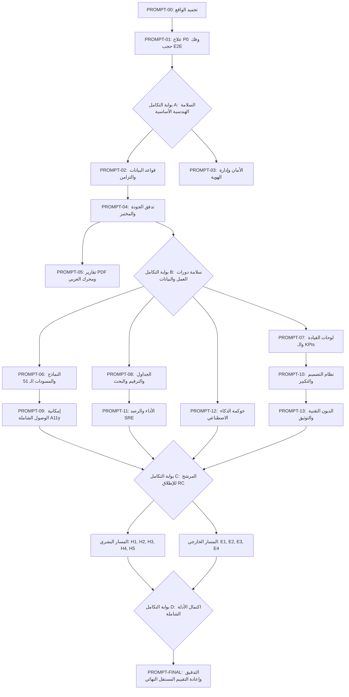

# برنامج العلاج الشامل والإصلاح الجذري — MASTER REMEDIATION PLAN
## QC TASK MANAGER ULTIMATE REMEDIATION PROGRAM (TO PROVABLE 100%)

> **المستودع:** `YEEEAE/BRIGHTAI`  
> **التطبيق:** `apps/qc-task-manager`  
> **المرجع الأساسي:** تقرير التدقيق الشامل المستقل (`audit/qc/QC-Task-Manager/ULTIMATE-AUDIT-2026-09-02/QC-TASK-MANAGER-ULTIMATE-100-PERCENT-AUDIT.md`)  
> **سلطة الصلاحيات الحصرية:** `apps/qc-task-manager/src/lib/permissions.ts`  
> **تاريخ التأسيس:** 2026-09-02T19:45:00+03:00  
> **الهدف الاستراتيجي:** القضاء التام على كافة العيوب المحلية القابلة للإصلاح برمجياً، ورفع درجة النظام الصارمة إلى الحد الأقصى الممكن محلياً، وبناء مسار التحقق البشري والإنتاجي لضمان الوصول إلى 100% حقيقية ومثبتة.

---

## 1. ملخص نتائج التدقيق الأساسي (Audit Score Summary)

استناداً إلى التدقيق المستقل المنفذ عند HEAD `d9a45b07`، هذه هي الدرجات المرجعية الأساسية:
- **الدرجة الصارمة للنظام (System Strict Score):** **73.50%**
- **درجة النضج الإجمالية (System Maturity Score):** **74.75%**
- **الدرجة الموزونة للمجالات الحرجة:** **72.57%**
- **الجاهزية التقنية البرمجية المحلية (Local Technical Readiness):** **97.33%**
- **الجاهزية البشرية والإثبات الخارجي (Human/External Readiness):** **2.00%**
- **الجاهزية التشغيلية للإنتاج (Production Readiness):** **20.37%**
- **قرار الإطلاق المرجعي:** **⛔ NO-GO (ممنوع الإطلاق نهائياً)**

---

## 2. حصر العيوب والملاحظات حسب الخطورة (Findings Totals)

| درجة الخطورة | العدد الإجمالي | التوصيف العام | القابلية للإصلاح المحلي | يتطلب تدخلاً بشرياً/خارجياً |
|---|---:|---|---:|---:|
| **P0 (Release Blockers)** | **3** | عيوب قاتلة تكسر بوابات التحقق الكنسية التراكمية في HEAD | **3** (100%) | 0 |
| **P1 (Major Defects)** | **7** | عيوب جوهرية في الوصول، الاستعادة، UAT، الفلاتر، النماذج، والتوسع | **3** | **4** (UAT, VoiceOver, Cloud DR, Single-thread) |
| **P2 (Quality & Governance)** | **6** | عيوب متوسطة في الـ PDF العربي، تكرار الـ KPIs، نموذج التغيير، والـ Pentest | **4** | **2** (Pentest, Legal sign-off) |
| **P3 (Material Polish & Debt)** | **3** | ديون تقنية وتنسيقية ومحاذاة تكبير 400% وتنظيف التوكنز | **3** (100%) | 0 |
| **المجموع** | **19** | **19 عيباً صريحاً + المعايير المفتوحة في الـ 100 مجال** | **13** | **6** |

---

## 3. تصنيف المعايير القابلة للإغلاق (Closure Feasibility Breakdown)

1. **النتائج القابلة للإغلاق البرمجي المحلي (Locally Fixable Findings):**
   - إصلاح كسر سويت الرصد `test:observability` (P0-1).
   - إصلاح كسر حارس إمكانية الوصول `test:a11y-ergonomics-100` (P0-2).
   - إصلاح كسر سويت وتوقف مشغل E2E في `e2e:delete-request` (P0-3) وفك حجب 23 سويتاً.
   - إصلاح محرك تشكيل الخط العربي BiDi في توليد PDF (P2-1).
   - إزالة التكرار التعريفي بين الـ KPIs وتوحيد الفلاتر في لوحة القيادة (P1-4, P2-2).
   - إلغاء السقف الصامت لـ 500 صف وتطبيق ترقيم صفحات خادمي (P1-5).
   - تعميم عقد النماذج الموحد وحماية المسودات عبر الـ 51 نموذجاً (P1-6).
   - دعم التزامن الآمن ومفاتيح منع التكرار Idempotency Keys (P2-6).
   - إعادة تصميم نموذج طلب التغيير في المختبر ليكون موجهاً للمستخدم (P2-3).
   - تنظيف الديون التقنية والمسافات الزائدة وتوحيد التوكنز (P3-1, P3-2, P3-3).
   - استيفاء كافة متطلبات إمكانية الوصول الشاملة برمجياً (WCAG 2.2 AA).

2. **النتائج التي تتطلب تدخلاً بشرياً (Human-Required Findings):**
   - تنفيذ خطة أبحاث تجربة المستخدم وقبول النظام (UAT) مع 8 مشاركين فعليين من موظفي الجودة.
   - اختبارات إمكانية الوصول الحية للمكفوفين باستخدام قارئات الشاشة VoiceOver و NVDA بالعربي.
   - فحص بيئة العمل الميدانية في المختبر وارتداء القفازات ومسح الباركود.
   - الرأي القانوني المكتوب لاعتماد التوقيع الإلكتروني حسب الأنظمة السعودية.

3. **النتائج التي تتطلب بيئة إنتاج/سحابية خارجية (External-Required Findings):**
   - تقرير فحص اختراق أمني خارجي مستقل من جهة معتمدة (Penetration Test).
   - تمرين استعادة كوارث فعلي (DR Drill) على خوادم سحابية وقياس RTO و RPO.
   - نشر بيئة التدريج Staging والتحقق من بقاء البيانات في أقراص التخزين المستمرة.
   - مراقبة الأداء للمستخدمين الفعليين عبر شبكات الجوال (RUM).

---

## 4. فهرس برومبتات برنامج العلاج (Remediation Prompts Inventory)

يتألف البرنامج من **24 برومبتاً تنفيذياً مستقلاً وشديد التفصيل**:

### أ. برومبتات التنفيذ البرمجي المحلي (Implementation Prompts — 14 Prompts):
- `PROMPT-00-REMEDIATION-BASELINE-FREEZE`: تجميد واقع الشجرة الحالي وفحص العقود الكنسية.
- `PROMPT-01-P0-CORRECTNESS-GATE-UNBLOCK`: القضاء على عيوب الـ P0 الثلاثة وفك حجب الـ 28 سويت E2E.
- `PROMPT-02-DATABASE-TRANSACTIONS-IDEMPOTENCY`: هندسة موثوقية قاعدة البيانات، مفاتيح Idempotency، ومعالجة التزامن.
- `PROMPT-03-SECURITY-IAM-SECRETS-HARDENING`: تشديد أمن التطبيقات، الصلاحيات، حماية الجلسات، وتدوير الأسرار.
- `PROMPT-04-QC-WORKFLOW-LAB-CHANGE-REQUESTS`: تصحيح دورات عمل الجودة، نماذج طلب التغيير، وتتبع العينات.
- `PROMPT-05-REPORTING-PDF-ARABIC-ENGINE`: إصلاح محرك تشكيل الخط العربي في الـ PDF وتنسيق تقارير التحليل CoA.
- `PROMPT-06-ADVANCED-FORMS-AUTOSAVE-DRAFT`: تعميم العقد الموحد للنماذج الـ 51، حفظ المسودات، ومنع فقدان البيانات.
- `PROMPT-07-DASHBOARD-DATA-VIZ-ANALYTICS`: توحيد فلاتر لوحة القيادة مع المختبر، إزالة تكرار الـ KPIs، وجداول HTML البديلة.
- `PROMPT-08-TABLES-SEARCH-PAGINATION`: إلغاء سقف الـ 500 صف وتطبيق ترقيم الصفحات والبحث العربي الدقيق.
- `PROMPT-09-ACCESSIBILITY-KEYBOARD-SEMANTICS`: إتقان الوصول البرمجي الكامل (WCAG 2.2 AA)، لوحة المفاتيح، ومناطق aria-live.
- `PROMPT-10-DESIGN-SYSTEM-UI-CONSISTENCY`: تنظيف توكنز التصميم، التوافق مع تكبير 400%، وتوحيد مساحات اللمس.
- `PROMPT-11-PERFORMANCE-OBSERVABILITY-SRE`: تطبيق ميزانيات الأداء الرقمية، التتبع المرئي، ونقاط فحص الصحة.
- `PROMPT-12-AI-GOVERNANCE-EVALS-HITL-UX`: ضبط حوكمة الذكاء الاصطناعي كأداة استشارية فقط وسجلات التدقيق ونماذج التقييم.
- `PROMPT-13-TECH-DEBT-HYGIENE-DOCS`: معالجة الديون التقنية، توثيق الحقيقة الأحادية، ونظافة الشجرة.

### ب. برومبتات وإجراءات التحقق البشري (Human Validation Runbooks — 5 Prompts):
- `PROMPT-H1-QC-STAFF-UAT`: إجراء اختبارات قبول المستخدمين الميدانية وقياس درجات SUS ومعدلات الإنجاز.
- `PROMPT-H2-ACCESSIBILITY-VOICEOVER-NVDA`: بروتوكول اختبار قارئات الشاشة الحقيقية باللغة العربية مع فاقدي البصر.
- `PROMPT-H3-FIELD-LAB-ERGONOMICS-WALK`: الجولة الميدانية لبيئة المختبر، فحص القفازات، الإضاءة، وقراءة الباركود.
- `PROMPT-H4-PENETRATION-TESTING-SECURITY-AUDIT`: تنفيذ وإدارة فحص الاختراق الأمني الخارجي المستقل.
- `PROMPT-H5-QC-LEGAL-REGULATORY-SIGNOFF`: إجراءات الاعتماد القانوني والامتثال التنظيمي (21 CFR Part 11 & PDPL).

### ج. برومبتات العمليات وبيئة الإنتاج (External / Production Runbooks — 4 Prompts):
- `PROMPT-E1-STAGING-DEPLOYMENT-SMOKE-TEST`: نشر النظام على بيئة Staging وتشغيل اختبارات الدخان وفحص التخزين الدائم.
- `PROMPT-E2-PRODUCTION-DISASTER-RECOVERY-DRILL`: تمرين استعادة الكوارث والنسخ الاحتياطي في السحابة وقياس RTO/RPO.
- `PROMPT-E3-PRODUCTION-RUM-LOAD-BASELINE`: إعداد مراقبة الأداء الحقيقي (RUM) واختبار تحمل الأحمال.
- `PROMPT-E4-INCIDENT-RESPONSE-ROLLBACK-DRILL`: تمرين الاستجابة للحوادث الطارئة واستعادة الإصدار السابق.

### د. برومبت التدقيق وإعادة القياس المستقل النهائي (Final Independent Re-Audit — 1 Prompt):
- `PROMPT-FINAL-INDEPENDENT-100-REAUDIT`: التدقيق النهائي المستقل والشامل من الصفر لإصدار قرار الإطلاق النهائي.

---

## 5. رسم بياني للاعتماديات ومراحل التنفيذ (Dependency Graph & Execution Phases)

---

## 6. بوابات التكامل الإلزامية (Mandatory Integration Checkpoints)

### بوابة التكامل A (Gate A — Core Correctness Gate)
- **الموقع:** بعد إنجاز `PROMPT-01`.
- **المتطلبات الإلزامية:**
  - `pnpm run test:observability` يمر بنجاح تام بنسبة 100%.
  - `pnpm run test:a11y-ergonomics-100` يمر بنجاح تام بنسبة 100%.
  - `scripts/e2e-delete-request.mjs` يمر بنجاح، وجميع سويتات E2E الـ 28 تعمل بنجاح دون أي توقف أو مهلة زمنية.
  - نجاح كامل للسلسلة الكنسية: **74/74 سويت وحدة + 28/28 سويت قبول E2E**.

### بوابة التكامل B (Gate B — Workflows & Data Gate)
- **الموقع:** بعد إنجاز `PROMPT-02`, `PROMPT-03`, `PROMPT-04`, `PROMPT-05`.
- **المتطلبات الإلزامية:**
  - نجاح كافة اختبارات التزامن والمعاملات الذرية والـ Idempotency.
  - نجاح محرك تشكيل الخط العربي في PDF واجتياز `scripts/test-report-pdf-arabic.mjs`.
  - سلامة كافة مسارات الصلاحيات ومنع الالتفاف عبر الروابط المباشرة.

### بوابة التكامل C (Gate C — Release Candidate Gate)
- **الموقع:** بعد إنجاز كافة برومبتات التنفيذ البرمجي المحلي (`PROMPT-00` إلى `PROMPT-13`).
- **المتطلبات الإلزامية:**
  - اجتياز `ASTRO_TELEMETRY_DISABLED=1 pnpm astro check` بصفر أخطاء وصفر تحذيرات عبر كافة الملفات.
  - اكتمال البناء الإنتاجي `pnpm build` بنجاح وسرعة استجابة فائقة.
  - خلو كافة مسارات النظام الـ 115 من أي عيوب برمجية أو موانع وصول.
  - وصول **الجاهزية التقنية المحلية (Local Technical Readiness) إلى 100%**.

### بوابة التكامل D (Gate D — External Evidence & Human Sign-off Gate)
- **الموقع:** بعد إنجاز برومبتات المسار البشري والمسار الخارجي (`H1-H5` و `E1-E4`).
- **المتطلبات الإلزامية:**
  - اكتمال محاضر جلسات UAT ونقاط SUS > 80.
  - محضر فحص قارئات الشاشة VoiceOver و NVDA معتمد.
  - تقرير فحص الاختراق الخارجي وتمرين استعادة الكوارث موثق مع RTO < 15 دقيقة.

---

## 7. معايير تعريف الاكتمال (Definitions of Completion)

### أ. تعريف "اكتمال الهندسة المحلية" (Definition of Local Engineering Complete):
- تصفير كافة عيوب الـ P0 و P1 و P2 و P3 المحلية بنسبة 100%.
- اجتياز 100% من سويتات الاختبارات الكنسية (74 وحدة + 28 E2E).
- خلو النظام من أي تسريب لقاعدة البيانات للواجهة أو تشتت لسلطة الصلاحيات.
- كود نظيف تماماً في فحص الأنواع والبناء الإنتاجي.

### ب. تعريف "اكتمال التحقق البشري" (Definition of Human Validation Complete):
- توقيع محاضر UAT من 8 مستخدمين ممثلين لكافة الأدوار التشغيلية.
- تسجيل جلسات فحص سهولة الوصول مع مستخدمين مكفوفين بالصوت والفيديو.
- اعتماد تقرير بيئة العمل الميدانية ومطابقة إجراءات التوقيع مع الأنظمة.

### ج. تعريف "اكتمال الإثبات الإنتاجي" (Definition of Production Evidence Complete):
- توفر تقرير فحص اختراق خارجي خالٍ من أي ثغرات حرجة أو عالية.
- إثبات نجاح استعادة قاعدة البيانات من نسخة احتياطية مشفرة على بيئة خادم سحابي مستقل.
- تسجيل قراءات الأداء الحقيقي RUM وضمان LCP < 1.5s و FID < 50ms.

### د. تعريف "التحقق النهائي بنسبة 100%" (Definition of Final 100% Verified):
- قيام مدقق مستقل بإعادة تدقيق كافة الـ 100 مجال من الصفر بموجب الـ 400 معيار.
- تحقق شرط أن تكون كافة المعايير إما MET ومثبتة بدليل قاطع، أو غير قابلة للتطبيق بمبرر رسمي.
- صدور قرار الإطلاق النهائي الرسمي: **🟢 GO (موافق على الإطلاق)**.
