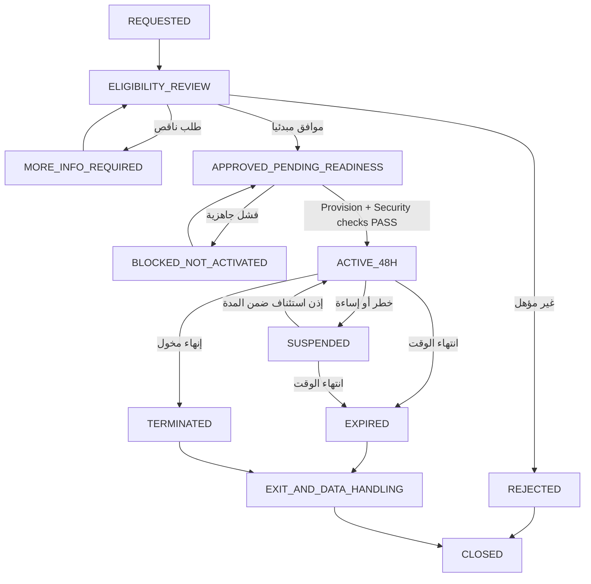

# BRIGHT AI / AIGAS — Enterprise Trial Policy

**اسم الوثيقة:** ENTERPRISE-TRIAL-POLICY.md
**المسار المعتمد داخل المشروع:** `docs/ENTERPRISE-TRIAL-POLICY.md`
**معرّف السياسة:** `AIGAS-COM-TRIAL-001`
**الإصدار:** `1.0.0` — مسودة تشغيلية للمراجعة والاعتماد
**التاريخ المرجعي:** 31 أكتوبر 2026
**اللغة:** العربية السعودية المهنية؛ أسماء الكيانات البرمجية والعمليات بالإنجليزية
**المالك المقترح:** إدارة المنتج والعمليات التجارية، بالتعاون مع الأمن والخصوصية والمالية والشؤون القانونية
**نوع الوثيقة:** سياسة تجارب مؤسسية مستهدفة + متطلبات عمل وتنفيذ، **وليست شروطًا تعاقدية نافذة ولا دليلًا على تفعيل خدمة**
**النطاق:** `AIGAS Kernel` والمنتجات الخمسة، في سياق التجارب المؤهلة فقط
**حالة اعتماد المحتوى:** `APPROVED`
**حالة تشغيل خدمة التجربة:** `NOT VERIFIED / NOT CURRENTLY OFFERED AS ACTIVE ON THE PUBLIC WEBSITE`

> **تنبيه أساسي:** هذه الوثيقة تصف السياسة **المستهدفة عند تشغيل منتج حقيقي**. لا يعني وجودها أن طلب تجربة 48 ساعة أو تفعيل المنتجات أو الدفع أو إرسال نموذج الموقع يعمل حاليًا. لا يجوز نشر وعد بتجربة مفعلة قبل إثبات الجاهزية. لا تتضمن هذه الوثيقة أسعارًا، أو حدود استهلاك رقمية، أو مدد احتفاظ، أو SLA غير معتمدة.

---

## 01. الأساس المرجعي وترتيب السلطة

تُشتق هذه السياسة من:

1. `docs/MASTER-PROJECT-BLUEPRINT.md` — خصوصًا الأقسام **08 و11 و12 و13 و14 و22**، وقبول `AC-08`، والقرارات المعتمدة حتى السؤال **108**.
2. `docs/PRODUCT-MASTER-CATALOG.yaml` — استقلالية المنتجات وKernel، والمتطلبات التجارية والتراخيص.
3. `docs/PLATFORM-ARCHITECTURE.md` — حدود المنصة، الاستقلال والعزل، خيارات النشر، وجاهزية التشغيل.
4. `docs/MASTER-AGENT-CONTEXT.md` — تعليمات سياق العمل والتمييز بين المخطط والمثبت.
5. `docs/WEBSITE-PAGE-REGISTRY.yaml` و`docs/BRAND-AND-DESIGN-SYSTEM.md` — حدود المحتوى والهوية والصفحات العامة، إن توفرت بالإصدار الفعلي.
6. `AGENTS.md` و`.agents/mind/01-mind-latest.md` في المستودع — قيود تنفيذ الوكلاء والحالة الحالية. تحقق من أحدث نسخة قبل أي تطبيق.

**قاعدة التعارض:** أحدث قرار صريح للمالك والعقد/القانون المنطبق والواقع المثبت مقدّم على نص قديم أو افتراض. إذا احتاج التغيير تعديل مدة **48 ساعة** أو منع التحويل التلقائي المدفوع أو سياسة **No-Training**، فلا يُعامل تعديلًا تحريريًا؛ يحتاج قرار مالك جديدًا صريحًا، وبما لا يخالف الالتزامات النظامية.

### 01.1 مستويات اليقين


| الوسم               | المعنى                                                                                                    | المسموح به                                                           |
| -------------------------- | ----------------------------------------------------------------------------------------------------------------- | ------------------------------------------------------------------------------- |
| `APPROVED_POLICY_TARGET` | قرار تجاري أو أمني معتمد في Blueprint                                                     | اعتماده كشرط تصميم وتنفيذ مستقبلي                |
| `IMPLEMENTED`            | يوجد كود/تكامل يؤدي السلوك المطلوب                                                 | لا يكفي وحده لإعلان الجاهزية                          |
| `VERIFIED_OPERATIONAL`   | تم التحقق من السلوك والأمن والنطاق المعلن في البيئة المناسبة | يمكن تقييم النشر حسب الموافقات                      |
| `PENDING_APPROVAL`       | قيمة أو إجراء أو صياغة تحتاج اعتمادًا                                            | لا تُحوّلها إلى التزام عميل أو افتراض ثابت |
| `NOT_AVAILABLE`          | لا توجد خدمة قابلة للتفعيل مثبتة                                                     | لا تعرض زر تفعيل يوهم المستخدم بنجاح عملية |

---

## 02. الهدف والمبادئ غير القابلة للتفاوض

الهدف من التجربة أن تختبر منشأة مؤهلة **قيمة منتج أو أكثر من AIGAS خلال فترة قصيرة ومقيدة**، بتوقعات واضحة ودليل للنتيجة، دون تحويلها إلى بيئة إنتاج أو التزام مالي خفي.

1. **48 ساعة فعلية** من لحظة التفعيل الناجح المسجلة، لا من التسجيل أو أول زيارة أو مجرد إرسال طلب.
2. **لا تحويل تلقائي مدفوع**، ولا حجز/خصم رسوم أو ترقية اشتراك دون طلب شراء مستقل وموافقة صريحة.
3. **لا تدريب للذكاء الاصطناعي ببيانات العملاء مطلقًا**، بما يشمل المحتوى والوثائق والبيانات الوصفية والأدلة، لدى BRIGHT AI أو مزود غير قادر على الالتزام تعاقديًا وتقنيًا.
4. **بيانات اصطناعية افتراضيًا**؛ البيانات الحقيقية تتطلب تصريحًا خطيًا محدد النطاق ومراجعة بيئة المعالجة.
5. **منتجات مستقلة:** يمكن تجربة منتج واحد أو مجموعة منتجات؛ لا يُجبر العميل على تجربة/شراء منتج آخر للاستفادة من الوظيفة الأساسية للمنتج المؤهل. `AIGAS Kernel` مكون مشترك بلا رسم ترخيص منفصل.
6. **لا تحايل أمني:** انتهاء الترخيص، الحصة أو الميزانية لا يفتح طريقًا لتجاوز سياسة حظر إلزامية أو موافقة بشرية لازمة.
7. **وضوح الواقع:** لا يُسمح بتسويق تصور UI أو محاكاة تعليمية بوصفها تجربة فعلية لمنصة عاملة.
8. **عزل وصلاحيات:** لكل جهة سياق مستقل، وأذونات أقل امتياز، وسجل قرارات يمكن الرجوع إليه وفق الاحتفاظ المعتمد.
9. **تحكم التكلفة:** سقف تجربة وحصص وفق سياسة مالية معتمدة؛ لا تكاليف مخفية أو خصم بدون موافقة.
10. **قابلية الخروج:** انتهاء التجربة يؤدي إلى إيقاف الحقوق التجريبية بأمان، مع تصدير/حذف/احتفاظ وفق السياسة والعقد والقانون، وليس حذفًا فوريًا غير مدروس.

---

## 03. المصطلحات والحدود


| المصطلح         | المعنى داخل هذه السياسة                                                                                                                                                  |
| ------------------------ | ---------------------------------------------------------------------------------------------------------------------------------------------------------------------------------------------- |
| `Enterprise Trial`     | تجربة مؤسسية **مجانية محددة بـ48 ساعة** لمنتج/منتجات مؤهلة، محدودة بنطاق وحصص وضوابط معلنة                            |
| `Trial Request`        | طلب أهلية؛ **ليس** موافقة أو تفعيلًا                                                                                                                              |
| `Trial Approval`       | قرار أهلية ونطاق من جهة BRIGHT AI المخولة، أو مسار آلي معتمد لفئات SaaS المؤهلة                                                         |
| `Trial Activation`     | إنشاء بيئة/ترخيص تجريبي صالح، وتحقق أساسيات الأمن والجاهزية، وإثبات بداية المدة                                          |
| `PoV`                  | Proof of Value: وصف أهداف التجربة ومشاهداتها المثبتة وقيودها؛ لا يساوي شهادة امتثال                                                |
| `Pilot`                | تشغيل مؤسسي محدود وفق اتفاق **منفصل**؛ المدة والنطاق والمعايير تحدد تعاقديًا ولا تُستنتج من قاعدة 48 ساعة |
| `BYOK`                 | استخدام مفاتيح مزود AI يملكها العميل ضمن موصل معتمد؛ لا يعني إعفاء BRIGHT AI من الضوابط                                        |
| `Synthetic Data`       | بيانات تعليمية مصطنعة لا تعود إلى أشخاص أو أنظمة حقيقية                                                                                        |
| `Operational Evidence` | دليل حقيقي على تشغيل قدرة معينة، وليس فيديو/مخطط/محتوى تسويقيًا                                                                         |
| `Trial Tenant`         | سياق عميل/مستأجر تجريبي محدود الوصول والصلاحيات في SaaS                                                                                           |
| `Air-Gapped`           | نشر يعمل محليًا دون اشتراط اتصال بالإنترنت للهوية أو التراخيص أو النماذج أو التحقق                                      |

**توضيح:** الموقع `brightai.live` واجهة عامة. `/kernel/` الحالي محاكاة تعليمية وليست منصة تجريبية حقيقية. لا يجوز الاستدلال بوجود صفحة `/pricing/` أو `/contact/` على توفر Trial Provisioning.

---

## 04. الجمهور المستهدف ونماذج الأهلية


| الفئة                                                             | مسار الطلب المستهدف                             | قاعدة الموافقة                                                                        | ملاحظات                                                                                               |
| ------------------------------------------------------------------------ | ------------------------------------------------------------------ | ---------------------------------------------------------------------------------------------------- | -------------------------------------------------------------------------------------------------------------- |
| منشأة خاصة سعودية مؤهلة عبر SaaS قياسي     | Self-service **بعد** تفعيل متطلبات الأهلية | آلي **إذا** اكتملت الضوابط والجاهزية؛ وإلا يدوي               | لا تُضمن الموافقة لمجرد تعبئة النموذج                                        |
| جهة حكومية أو حالة ذات أثر عام                 | Managed enterprise request                                       | مراجعة بشرية إلزامية                                                             | الموافقات المؤسسية والأمنية لا تختزل في بريد مسجل                  |
| منشأة خاصة بتكامل مؤثر أو بيانات حساسة | Managed / Security Review                                        | مراجعة بشرية                                                                            | تحقق المخاطر والبيئة والنطاق أولًا                                             |
| عميل On-Premise                                                    | مشروع تجربة مُدار                                 | مراجعة جاهزية وحقوق وصول وتكاليف وموافقة العميل           | يمكن تحويل التقييم إلى Pilot تعاقدي إذا لم تناسبه تجربة 48 ساعة |
| عميل Air-Gapped                                                    | مسار محلي معزول ومُدار                        | مراجعة بشرية وعقد/اتفاق واضح ومفاتيح/ترخيص محلي مستقل | لا Cloud Check ولا قناة دعم خفية                                                             |
| فرد دون صفة مؤسسية مثبتة                           | غير مؤهل تلقائيًا لهذه السياسة         | يعاد تصنيف الطلب بحسب سياسة مستقلة معتمدة                       | لا تفترض وجود تجربة للأفراد                                                           |

### 04.1 أدلة الأهلية المطلوبة بالحد الأدنى

- تعريف الجهة وبيانات تواصل عمل ملائمة، مع تجنب جمع أرقام هوية شخصية دون أساس واضح.
- صاحب طلب مفوض أو صفة معقولة لإدارة نطاق التقييم، وتعيين مسؤول لدى العميل.
- منتج/منتجات التجربة، حالة الاستخدام، بيئة النشر، وسبب التقييم.
- تقدير نطاق المستخدمين والتكاملات ونوع البيانات، دون إرسال بيانات فعلية في نموذج عام.
- قبول شروط التجربة المعتمدة وبيان الخصوصية المعتمد **عند توفرهما قانونيًا وتشغيليًا**.
- تحقق من منع إساءة الاستخدام وتكرار الطلبات على مستوى المؤسسة بما يتناسب مع الخصوصية.
- تحديد متطلبات موافقة الأمن/الخصوصية/المالك لكل حالة عالية الخطورة.

**غير معتمد بعد:** قائمة مستندات إثبات هوية المنشأة، آلية تحقق إلكتروني محددة، معدل الاستحقاق لكل جهة، وحدود استبعاد المؤسسات. تُعتمد قبل إطلاق التفعيل الذاتي، ولا تُختلق في هذه السياسة.

---

## 05. ما الذي يدخل في التجربة؟

يمكن أن يشمل الطلب **منتجًا واحدًا أو عدة منتجات مختارة** ضمن حدود التجربة الموافق عليها:


| المنتج          | غرض الإثبات أثناء التجربة                                                                                | شرط الصدق الوظيفي                                                                                           |
| ----------------------- | -------------------------------------------------------------------------------------------------------------------------------- | ---------------------------------------------------------------------------------------------------------------------------- |
| **AIGAS Firewall**    | مرور طلب AI عبر فحص وسياسات وإنفاذ قرارات الحماية                                       | يُعرض الإنفاذ الحقيقي فقط بعد ثبوته؛ بخلاف ذلك محاكاة معلنة              |
| **AIGAS Ledger**      | تسجيل وتصدير والتحقق من أدلة ذات سلامة قابلة للإثبات                               | لا وصف مطلق بـ«غير قابل للتعديل» دون ضمانات وآلية تحقق مثبتة             |
| **AIGAS Human Gate**  | طلب موافقة بشرية، تحقق صلاحيات، موافقة/رفض/انتهاء مهلة وتأثير القرار | لا تساوي ضغطة UI موافقة بشرية نافذة دون تنفيذ موثوق                                |
| **AIGAS Risk Engine** | توصيف مخاطر حالة الاستخدام وتفسير أساس التقييم                                         | درجات المخاطر التوضيحية ليست تقييمًا حقيقيًا أو اعتمادًا تنظيميًا |
| **AIGAS Secure Chat** | محادثة AI ضمن بيئة ونماذج وسياسات معتمدة                                                       | لا تُدخل RAG أو رفع ملفات أو وظائف غير معتمدة للمنتج الأساسي                 |
| **AIGAS Kernel**      | هوية/سياسة/ترخيص/عزل/تدقيق أساسي لدعم المنتجات المختارة                         | لا يتطلب اشتراكًا/رسمًا مستقلًا ولا يعني توفر كل المنتجات                  |

- منتجات الموجة الأولى المستهدفة: **Firewall + Ledger + Human Gate** بعد جاهزية Kernel، مع استقلال MVP لكل منتج.
- الموجة اللاحقة: **Risk Engine + Secure Chat**؛ لا يُدرجان في تجربة تشغيلية قبل توفر أدلة جاهزيتهما.
- تكاملات العميل الحساسة، الصلاحيات المؤثرة، الاستيراد التشغيلي، وميزات تحمل المخاطر العالية ليست مفعلة تلقائيًا؛ تحدد بالموافقة ونطاق الحالة.
- أي تكامل بين منتجين يوضَّح للعميل أنه **اختياري وتحسيني** ما لم تكن وظيفة مشتركة أساسية ضمن Kernel.
- توفر وظائف معينة في Trial لا يساوي التزام توافرها تجاريًا ما لم يثبت الإصدار والتعاقد وإعلان حالة المنتج الفعلية.

---

## 06. مدة التجربة وحساب الزمن

### 06.1 القاعدة المعتمدة

**المدة = 48 ساعة متصلة** تبدأ من `activated_at` المثبتة بعد اكتمال التفعيل الفعلي.

`expires_at = activated_at + 48 hours`

- احسب الزمن آليًا بتوقيت موثوق، وخزّنه بصيغة زمنية واضحة مثل UTC، واعرضه للمستخدم بتوقيت السعودية عند الحاجة.
- لا يبدأ العداد من `requested_at`, `approved_at`, أو النقر على رابط التسويق.
- لا تبدأ التجربة إذا فشل إنشاء البيئة أو إصدار ترخيصها أو أمنها الأساسي؛ لا تسجل `ACTIVE` قبل النجاح.
- انتهاء الجلسة أو تسجيل الخروج لا يوقف الساعة.
- لا تعيد ضبط المدة بسبب تحديث المتصفح أو إنشاء مستخدم ثانٍ أو تغيير منتج غير مصرح به.
- انقطاع مزود AI/المنصة لا يؤدي تلقائيًا إلى تمديد؛ يراجع الاستثناء مالك صلاحية وفق الحالة والعقد والتأثير.
- عند تعذر التوقيت الموثوق في بيئة Offline، لا تستخدم اتصالًا سحابيًا خفيًا أو تسمح بتحايل إعادة الساعة؛ استخدم تصميم ترخيص محلي موقّع، وسجل اعتماد محلي ووسيلة تحقق مناسبة، بعد إثباتها.

### 06.2 التمديد والاستثناءات

- لا تمديد تلقائي ولا تجديد صامت.
- يحتاج التمديد **سببًا موثقًا، ومراجعة أهلية ومخاطر وتكلفة، وقرارًا صريحًا من جهة مخولة**، مع إشعار العميل بالحدود الجديدة.
- تحفظ النسخة السابقة من المدة والقرار والدليل، ويُحدّث الترخيص التجريبي لا اشتراكًا مدفوعًا.
- **مدة التمديد القصوى، عدد مرات التمديد، وسلطة توقيع الاستثناء غير معتمدة رقميًا**؛ تعتمد بجدول صلاحيات قبل الإطلاق.
- لا يُحوَّل تمديد تجريبي واسع أو عالي المخاطر إلى بديل دائم عن Pilot/عقد موثق.

---

## 07. دورة حياة طلب التجربة (State Machine)



**شرط التصميم:** `SUSPENDED` لا يعيد ضبط موعد الانتهاء. لا يحوّل `EXPIRED` إلى `ACTIVE` إلا قرار تمديد صريح مع حدث موثق؛ وعندها يمكن إنشاء أهلية/ترخيص محدثين. حالات التمديد والرفض والتسوية المدفوعة تبقى منفصلة عن حالة التجربة نفسها.

### 07.1 انتقالات مسموحة وقيودها


| من                         | إلى                       | الشرط/من يقرره                                                      | الأثر                                                                      |
| ------------------------------ | ------------------------------ | --------------------------------------------------------------------------------- | --------------------------------------------------------------------------------- |
| `REQUESTED`                  | `ELIGIBILITY_REVIEW`         | قبول الطلب مبدئيًا بواسطة CRM/المسار المعتمد | لا منح أي استخدام                                                 |
| `ELIGIBILITY_REVIEW`         | `MORE_INFO_REQUIRED`         | بيانات ناقصة                                                         | طلب معلومات بالحد الأدنى                                   |
| `ELIGIBILITY_REVIEW`         | `REJECTED`                   | سبب أهلية/أمان موثق                                             | إغلاق آمن دون تفعيل                                             |
| `ELIGIBILITY_REVIEW`         | `APPROVED_PENDING_READINESS` | جهة مخولة أو قاعدة آلية معتمدة                         | بدء فحص التهيئة، لا بدء 48 ساعة                          |
| `APPROVED_PENDING_READINESS` | `ACTIVE_48H`                 | جاهزية فعلية + ترخيص + عزل + تحقق أساسي             | تعيين `activated_at` و`expires_at` مرة واحدة                      |
| `ACTIVE_48H`                 | `SUSPENDED`                  | مخالفة أو خطر أو إساءة أو قرار قانوني             | حجب وظائف الاستخدام الخاضعة للتجربة بأمان   |
| `ACTIVE_48H` / `SUSPENDED`   | `EXPIRED`                    | مؤقت موثوق عند 48 ساعة                                          | منع طلبات تجريبية جديدة                                     |
| `ACTIVE_48H`                 | `TERMINATED`                 | عميل مفوض/جهة مخولة وفق الشروط                         | إيقاف منظم مع سياسة البيانات                            |
| `EXPIRED` / `TERMINATED`     | `EXIT_AND_DATA_HANDLING`     | تشغيل الإنهاء والحقوق                                        | تصدير عند السماح، ثم احتفاظ/حذف وفق السياسة |

### 07.2 أحداث التدقيق المتوقعة

`TrialRequested`, `EligibilityChecked`, `TrialApproved`, `TrialRejected`, `ProvisioningStarted`, `TrialActivated`, `QuotaWarning`, `QuotaExhausted`, `TrialSuspended`, `TrialResumed`, `TrialExtensionRequested`, `TrialExtensionApproved`, `TrialExpired`, `TrialTerminated`, `TrialExitRequested`, `TrialExportCompleted`, `TrialDeletionScheduled`, `TrialDeletionCompleted`, `PoVReportApproved`, `QuoteCreated`, `PaidLicenseActivated`.

هذه **أسماء أحداث مقترحة لعقد التصميم**، وليست إثبات وجود Event Bus أو جدول أو API بهذا الاسم.

---

## 08. الموافقات والمسؤوليات (Governance & RACI)


| الإجراء                                         | العميل                                      | المبيعات                      | المنتج/العمليات               | الأمن والخصوصية                               | المالية                              | الشؤون القانونية           |
| -------------------------------------------------------- | --------------------------------------------------- | --------------------------------------- | --------------------------------------------- | ------------------------------------------------------------- | --------------------------------------------- | ------------------------------------------- |
| طلب وتجهيز حالة الاستخدام        | مسؤول                                        | مطّلع/مساعد                 | مُراجع                                | مستشار عند الحاجة                            | —                                          | —                                        |
| تحقق أهلية SaaS بسيط                      | يقدّم بيانات صحيحة                | مُطّلع                          | مسؤول مسار الأهلية          | يحدد شروط الأمان                              | يحدد سقف التكلفة              | يعتمد الصياغات               |
| حكومي/تكامل حساس/بيانات فعلية | يوافق خطيًا                             | منسق                              | مالك الطلب                         | **موافقة نطاق البيانات والمخاطر** | يراجع التكلفة                   | يراجع ما يلزم تعاقديًا |
| صلاحيات وتجربة ونطاق منتجات    | يحدد الأشخاص والأهداف          | لا يقرر الأمان            | **اعتماد تشغيل**                 | **اعتماد أمني قبل التفعيل**             | حد ميزانية                         | صيغة الاتفاق                   |
| تمديد التجربة                              | يطلب/يقبل                                 | ينسق                              | صاحب قرار مخول                  | يعيد التقييم عند الحاجة                 | يوافق على تأثير التكلفة | عند الحاجة                       |
| إيقاف بسبب خطر                             | يتلقى إشعارًا ويمارس حقوقه | مطّلع بالحد اللازم    | ينفذ بأمان                         | **يحدد الاستجابة الأمنية**              | مطّلع                                  | عند التزام أو نزاع         |
| تحويل لشراء                                  | موافقة وطلب شراء صريح           | ينسق العرض                   | يتحقق من جاهزية التفعيل | لا تتجاوز الضوابط                            | يعتمد السعر والفوترة      | يعتمِد العقد                   |
| إغلاق بيانات                                | يطلب/يستلم الحقوق                  | لا يطّلع على المحتوى | ينفذ وفق السياسة              | يشرف على الضوابط                              | سجلات تجارية فقط              | يحدد الحفظ الإلزامي      |

> **ملاحظة:** هذا توزيع **مقترح** للمسؤولية وليس مصفوفة صلاحيات معتمدة بأسماء أشخاص. يجب اعتماد Roles وDelegation وSoD في النظام المؤسسي قبل التفعيل الذاتي أو أي تدفق يغيّر تكاليف أو أذونات.

- لا يستطيع موظف مبيعات الموافقة بمفرده على نشر بيانات حقيقية أو تجاوز Hard Deny أو تكامل خطير.
- لا يمنح CRM وصولًا تلقائيًا إلى المحادثات أو الأدلة الحساسة أو مفاتيح مزود العميل.
- الموافقات الحساسة تحتاج فصل مهام وصلاحيات محددة، ويُسجّل من طلب ومن وافق وما تغير.

---

## 09. التفعيل الفني والأمني

### 09.1 شروط سابقة لا يمكن تجاوزها

1. المنتج المحدد **متاح ومثبت وظيفيًا** على الإصدار المراد تجربته.
2. الإقرار بأهلية العميل ونوع النشر والموافقة على النطاق.
3. عدم استخدام بيانات حقيقية إلا بعد الموافقات الخطية والبيئة الملائمة.
4. عزل المستأجر/البيئة والمفاتيح والتخزين والسجلات والنسخ والحصص عن غيره.
5. هوية مستخدمين وصلاحيات ومصادقة مناسبة تشمل MFA للحسابات ذات الوصول الحساس.
6. سياسات أمان أساسية تعمل ولا يمكن تعطيل الضوابط الإلزامية لإتاحة التجربة.
7. تهيئة مزودي AI أو النماذج المحلية المعتمدة فقط، مع تحقق المعالجة الجغرافية والخصوصية.
8. تفعيل مراقبة استهلاك وكلفة وحدود رفض آمنة عند نفاد الحصص.
9. قناة إخطار ودعم ملائمة، مع قابلية إبلاغ العميل بانتهاء التجربة وتعطّل خدمة مؤثرة.
10. سجل حالة وترخيص صحيح وآلية انتهاء لا تعتمد على مجرد إخفاء زر من واجهة المستخدم.
11. آلية تصدير/حذف واحتفاظ قابلة للتنفيذ، ومتوافقة مع ما عُرض على العميل.
12. مسؤول عميل معتمد ومراجعة للمخطط والبيانات والقيود قبل أول تفعيل.

### 09.2 SaaS

- إنشاء `tenant_id` منفصل، وعزل تطبيقي وبياني عبر الصلاحيات والبيانات والـCache والـQueues والتخزين والمفاتيح والـTelemetry.
- لا تضع معلومات المؤسسة التجريبية في بيانات Demo مشتركة أو فواتير عميل آخر.
- لا يجوز ظهور تجارب مؤسسة أخرى في إعدادات موصلات أو لوحة إشراف أو اقتراحات AI.
- أي Dedicated Infrastructure خيار عقدي عند الحاجة وليس حقًا افتراضيًا مفترضًا لكل Trial.

### 09.3 On-Premise

- دراسة متطلبات المستخدمين ومعدل الطلبات والنماذج والمفاتيح والتخزين والاحتفاظ والتكاملات والتوفر.
- تفعيل تجريبي بعد تأكيد جاهزية العميل ونطاق الدعم وحفظ نسخة التهيئة الضرورية للتراجع.
- لا تفترض أن إصدار SaaS يمكن تشغيله محليًا كما هو دون تحقق.

### 09.4 Air-Gapped

- **لا اتصال سحابي إجباري** للتحقق من صلاحية التجربة أو هوية العميل أو مفاتيحه أو النموذج أو سجلات الاستخدام.
- ترخيص تجريبي محلي موقّع، مفاتيح وهوية محليتان، سجل بداية ونهاية قابلان للتحقق، والتحقق من العبث بالوقت قدر الإمكان ضمن التصميم المعتمد.
- تحديثات/مواد تنصيب محلية موثقة التوقيع، عبر وسيط يتبع سياسة إدخال العميل.
- لا إرسال تلقائي لتقارير الاستخدام أو أدلة العميل إلى BRIGHT AI. أي استخراج يتم بموافقة وعقد وقناة مصرح بها.
- إذا تعذر تشغيل تجربة 48 ساعة بمتطلبات البيئة، **لا تُعرض على أنها مدعومة**؛ اقترح مسار `Pilot` محدود باتفاق منفصل.

---

## 10. البيانات والخصوصية ونقلها

### 10.1 أنواع البيانات


| النوع                                              | وضعه الافتراضي في التجربة                         | ملاحظات                                                                                    |
| --------------------------------------------------------- | ------------------------------------------------------------------------- | --------------------------------------------------------------------------------------------------- |
| بيانات تعريف المؤسسة والتواصل | الحد الأدنى اللازم للأهلية والإخطار      | تفصل عن محتوى AI                                                                       |
| بيانات طلبات AI/المحادثات           | **اصطناعية فقط**                                             | محتوى العميل الحقيقي يحتاج موافقة مكتوبة ونطاق معتمد |
| أحداث الأمان والمراجعة              | أقل Metadata كافية                                              | أي محتوى كامل يحتاج أساسًا واحتفاظًا وضوابط                  |
| بيانات استخدام وحصص وتكلفة       | تجميع مقيد بحدود الحاجة                             | لا تُسجل أسرار أو محتوى محادثات في Analytics                          |
| مفاتيح API وأسرار المزود              | في Secret Store مناسب/بيئة عميل                          | لا تحفظ نصًا مكشوفًا في CRM أو تقارير PoV                              |
| بيانات دعم وتشخيص                        | حد أدنى مع تنقيح                                           | وصول مؤقت ومصرح ومدقق                                                           |
| أدلة Ledger                                         | حفظ حسب النوع والاحتفاظ وسياسة القانون | لا تُحذف أدلة عليها Legal Hold أو التزام نافذ                         |

### 10.2 المعالجة والموقع

- الافتراضي المؤسسي السعودي: مراعاة إقامة بيانات العملاء في السعودية حسب Blueprint؛ **لا يجوز إعلان مكان فعلي دون إثبات فني وعقدي**.
- يفرَّق بين مقر التخزين ومكان معالجة طلب AI وبيانات السجلات والنسخ والموردين.
- لا مورد خارجي، ولا منطقة معالجة، ولا مزود Failover خارج القائمة المعتمدة والعقد والحقوق النظامية المناسبة.
- الالتزام بـPDPL وغيرها **حيث تنطبق**، ولا تُساوى السياسة بإثبات امتثال أو شهادة.
- ضمان منع التدريب يحتاج تحققًا من شروط المورد وتهيئته وسلوك الاحتفاظ ووسائل الحماية؛ لا يكفي شعار تسويقي.

### 10.3 البيانات الحقيقية: قرار استثنائي مشروط

لا يكفي أن يختار العميل خانة «أوافق». قبل السماح بالبيانات الحقيقية يجب وجود:

1. غرض محدد ومبرر ومالك مسؤول.
2. تصنيف بيانات، ونوع أفراد/معلومات متأثرة، وتقييم أثر بحسب الانطباق.
3. موافقة خطية واضحة من الجهة المخولة لدى العميل، وموافقة BRIGHT AI المطلوبة للأمن/الخصوصية.
4. اتفاق معالجة وإشعار مناسب، والموردون ومناطق المعالجة موثقة.
5. سياسة وصول واحتفاظ وتصدير وحذف معتمدة.
6. حدود واضحة للموصلات والتكاملات والمخرجات وأذونات المستخدمين.
7. خطة التعامل مع الخطأ/التسرب والمراجعة/الإلغاء.

**إذا فقد شرط لازم:** لا تفعيل لهذا السيناريو. استخدم بيانات اصطناعية أو أنهِ الطلب بأسباب موثقة.

### 10.4 نهاية التجربة والحقوق

- الحق في تصدير البيانات/السياسات/الإعدادات/الأدلة المتاحة **بحسب النطاق المتفق عليه والحقوق القانونية**.
- لا تستمر صلاحية معالجة أو استدعاء نموذج جديد بعد نهاية الحق التجريبي.
- لا يُفرض حذف فوري يفقد العميل بياناته دون آلية خروج معلنة ومهلة معتمدة عند انطباقها.
- لا يُفرض احتفاظ صفري أو يوم أو شهر أو أي رقم غير معتمد.
- تتحدد سياسة الحذف الفعلي، والاحتفاظ لأسباب قانونية، ومدة النسخ الاحتياطية، وLegal Hold، من تصنيف البيانات والعقد واللوائح والتكوين الموثق.
- تظل صلاحية الاطلاع أو تصدير الأدلة الضرورية بعد انتهاء الترخيص خاضعة للحقوق والسياسة، دون إتاحة وظائف مدفوعة جديدة بلا شراء.

**حقول اعتماد غير محسومة:** `trial_data_retention_period`, `post_expiry_export_window`, `backup_purge_schedule`, `support_log_retention`, `legal_hold_authority`.

---

## 11. حصص الاستهلاك وتكلفة AI

### 11.1 نموذج الضبط

- لكل تجربة: حد أقصى لعدد المستخدمين، الطلبات/الدقيقة، الاستهلاك الكلي، الاستدعاءات المتزامنة، الميزانية ومزايا المنتج والتخزين حسب نوعه.
- الحدود **قيم تكوين معتمدة** تُظهر قبل التفعيل؛ لا تُدخل أرقامًا من عندك أو من صفحة قديمة.
- الحصة والكلفة تتقيد على جهة العميل والمنتج/المزوّد ووقت التجربة، مع حماية من السبام والتكرار.
- يجب احتساب العملية مرة واحدة وفق مقياس المنتج، لا رسم/قياس مزدوج بلا أساس.
- كل تكلفة خارجية تؤثر في سقف BRIGHT AI تُقاس في Backend، وليس بالاعتماد على JavaScript في المتصفح.
- إشعار عند الاقتراب من الحد إن أُقرت عتباته؛ منع تجاوز سقف ملزم مع مسار آمن.
- لا فاتورة أو رسوم إضافية تلقائية أثناء أو بعد تجربة مجانية.

### 11.2 تمويل BRIGHT AI ومفاتيح العميل

- يمكن تقديم حصة/تكلفة API محدودة **تتحملها BRIGHT AI** ضمن السياسة المعتمدة.
- `BYOK` اختياري عندما تتطلب حالة مؤهلة موارد أكبر أو نموذجًا خاصًا؛ بموافقة صريحة على مسؤوليات وتكاليف المزود وتوجيهه وخصوصيته.
- لا يعني BYOK السماح بمزود غير معتمد، أو إلغاء سياسة حجب البيانات، أو مشاركة المفاتيح مع موظفي الدعم دون الحاجة.
- رسوم/فواتير مزود AI الخارجي باستخدام مفتاح العميل قد تكون بين العميل والمزود **بحسب اتفاقهما**؛ يجب توضيحها قبل الاستخدام، ولا يجوز نسبها إلى BRIGHT AI أو إعطاء ضمان تكلفة بغير دليل.
- فشل المزود أو تجاوز الميزانية لا يفعّل Failover غير مصرح به.

### 11.3 وحدات القياس المرجعية


| المنتج | وحدة قياس مقترحة للتجربة       | ملاحظة                                                                                 |
| -------------- | ----------------------------------------------------- | ---------------------------------------------------------------------------------------------- |
| Firewall     | طلب AI محمي                                  | يوضح قرار السياسة، ولا يفوتر عملية مكررة بلا اتفاق |
| Ledger       | حدث دليل/سجل                              | التخزين والاحتفاظ منفصلان عند الحاجة والاعتماد      |
| Human Gate   | عملية موافقة/قرار                    | لا تُحسب إعادة العرض كقرار جديد                                    |
| Risk Engine  | تقييم مخاطر                               | يميز إعادة المحاولة والنسخ                                            |
| Secure Chat  | رسالة أو جلسة مع استهلاك Tokens | فصل تكلفة النموذج عن وحدة المنتج                                  |

هذه **وحدات تصميم مرجعية** وليست حصصًا أو أسعارًا منشورة أو SKUs نهائية.

---

## 12. الأمان أثناء التجربة

- تطبيق سياسات الأمان الأساسية عند كل استدعاء؛ لا توجد فئة Trial تتجاوز القيود الإلزامية من أجل التحويلات التجارية.
- يمكن `Shadow/Monitor` قبل الإنفاذ المؤثر فقط عندما تسمح طبيعة الخطر وموافقة العميل، ولا يجوز له تعطيل `Hard Deny`.
- نموذج AI لا يملك صلاحية اعتماد قرار حساس أو تنفيذ أدوات دون طبقة تصاريح مستقلة.
- موافقات Human Gate مؤيدة بالهوية والصلاحية ونوع العملية والمهلة؛ عند غياب القرار يطبق سلوك آمن.
- Ledger يحفظ Metadata بالحد اللازم ويحافظ على سلامة الأدلة وفق نموذج فني مثبت؛ لا يُخزن نصًا حساسًا افتراضيًا بلا حاجة.
- سجل أحداث الأمان والتجربة يخضع لأقل صلاحيات ولا يُعرض لمستخدمين آخرين أو موظفي مبيعات.
- وصول الدعم `Just-In-Time` ومقيد بموافقة العميل وصلاحيات موثقة ومدة قابلة للإلغاء، ولا يوجد باب خلفي للبيئات المعزولة.
- الاستجابة لحادث تجريبي تتبع الإجراءات الأمنية والتواصل الموجه للعملاء المتأثرين عبر البريد عند الحاجة؛ ولا تفرض إنشاء Status Page عام.
- أي ثغرة تُبلغ عبر قناة البريد الأمني المعتمد؛ لا تُنشأ Bug Bounty كشرط لهذه السياسة.
- لا اختبار اختراق على نظام العميل أو حمل فعلي أو نسخ بيانات دون موافقة وتفويض مكتوب.

---

## 13. التسويق وواجهة الموقع والتواصل

### 13.1 ما يمكن قوله الآن

- «البرنامج المستهدف: تجربة مؤسسية لمدة 48 ساعة بعد تحقق الأهلية والتفعيل، حين تتوفر الخدمة».
- «يمكن الاستفسار عن جاهزية المنتجات أو طلب عرض».
- «لا يوجد تجديد أو اشتراك مدفوع تلقائي من التجربة».
- «الوظائف الموصوفة لا تُعد متاحة إلا بعد إثبات تشغيلها».

### 13.2 ما يُمنع قوله بلا دليل

- «ابدأ تجربتك الآن» إذا لم توجد خدمة تفعيل فعلي.
- «المنتجات الخمسة جاهزة للتجربة» دون تحقق كل منتج.
- «جميع بياناتك داخل السعودية» دون إثبات ومورد وعقد ومنطقة معالجة.
- «امتثال مضمون لـPDPL / NCA / ISO» أو «تشفير/سجل غير قابل للتعديل 100%» بلا تحقق.
- «مجانًا بلا حدود»، أو سعر أو حصة أو SLA غير معتمدة.
- «تم استلام طلبك» إذا كان النموذج يفتح تطبيق البريد فقط.

### 13.3 القنوات والقياس

- نموذج الموقع الحالي `mailto` يعين رسالة لدى العميل؛ **لا يثبت إرسالها أو استلامها** ولا ينشئ `Trial` داخل CRM.
- لا يظهر استحقاق التجربة أو ساعة انتهاء موثوقة إلا بعد ربط فعلي بنظام تراخيص/تفعيل مؤكد.
- Google Search Console لبيانات البحث، وGoogle Analytics 4 لتحليلات الموقع وفق القرار اللاحق. وجود معرّف GA4 في HTML لا يثبت جمع بيانات أو صحة التهيئة.
- يمنع إرسال محتوى AI والهوية الحساسة والمفاتيح ومعلومات المرضى/العملاء والأسرار إلى GA4 أو أي Analytics؛ لا تتبع إضافي دون موافقة.
- موافقة ملف الارتباط/التحليلات، حيث تتطلبها الأنظمة والتكوين، تخضع لمراجعة الخصوصية.

---

## 14. تجربة المستخدم والإشعارات

### 14.1 قبل التفعيل

يجب توضيح: اسم المنتج، وحالته الفعلية، والفترة **48 ساعة**، وما يبدأ العداد، وطبيعة البيانات المقبولة، وحدود الحصة، والمزوّد ومنطقة المعالجة عند الانطباق، وأهلية التمديد، ومسؤوليات BYOK، وحالة المزايا، وطريقة طلب الدعم والخروج.

### 14.2 أثناء التفعيل

- تأكيد حصول التفعيل فعلًا، ووقت البداية والنهاية، والمنتجات المشمولة.
- إظهار المستخدم المخول وقنوات إدارة التجربة؛ لا يساوي رابط بريد تفعيلًا.
- إشعار بالبداية والحدود، مع حفظ إثبات التسليم حين تكون القناة متاحة.

### 14.3 أثناء التجربة

- عرض الوقت المتبقي والحصة المتبقية وحالة المنتج، بشرط اعتماد بيانات Backend لا عداد متصفح فقط.
- إعلام واضح عند توقف مزود أو الوصول للسقف أو تعليق بسبب خطر.
- إرشادات مستخدمين ومصادر دعم تتوافق مع مستوى الخدمة المؤقت المعتمد؛ لا تعد بـ24/7 أو SLA رقمي غير مثبت.
- الإخطارات قبل الانتهاء قد تكون مفيدة؛ **توقيتاتها وتكرارها لم يُعتمدا بعد**.

### 14.4 عند الانتهاء

- إظهار انتهاء الحق التجريبي وتوقف العمليات المؤهلة، دون تهديد المستخدم بفقد البيانات فورًا إلا وفق شروط معتمدة ومعلنة.
- توفير مسار `Export/Exit` أو توجيه واضح لحقوق البيانات، ثم PoV وطلب عرض أو إغلاق.
- لا عرض دفع يزعم الاشتراك تلقائيًا ولا يضطر المستخدم لقبول تجديد من أجل الاطلاع على بياناته التي يحق له استردادها.

### 14.5 نماذج رسائل إرشادية — ليست جاهزة للإرسال

**إشعار قبول مبدئي:** «وصل طلب تجربة AIGAS وبدأت مراجعة الأهلية. هالرسالة ما تعني تفعيل التجربة أو بدء مدة الـ48 ساعة.»

**إشعار تفعيل:** «تم تفعيل التجربة للمنتجات المحددة في نطاقك. تبدأ مدة الـ48 ساعة من الوقت المبين داخل البوابة، وتنتهي تلقائيًا دون اشتراك مدفوع.»

**إشعار قرب انتهاء:** «تجربتك قربت تنتهي. تقدر تراجع النتائج وخيارات التصدير أو تطلب عرضًا مستقلًا. ما راح يُخصم منك شيء أو تتحول التجربة لاشتراك مدفوع تلقائيًا.»

**إشعار انتهاء:** «انتهت تجربة AIGAS. توقف استخدام وظائف التجربة الجديدة، وتظل إجراءات بياناتك خاضعة للسياسة والنطاق المتفق عليه. إذا رغبت بالاستمرار، يلزم إجراء شراء وموافقة مستقلة.»

> هذه نصوص **مقترحة**؛ تعتمد اللغة القانونية وقناة الإرسال وحدود الخصوصية قبل استخدامها.

---

## 15. Proof of Value — تقرير نتيجة التجربة

لا يعتمد القرار التجاري على عدد طلبات مرتفع أو وعود أداء غير مقاسة. يتضمن التقرير:

1. اسم الجهة والمنتجات والإصدار/البيئة وتوقيت البداية والنهاية.
2. هدف تجربة واحد أو أكثر اتُّفق عليه مسبقًا.
3. قدرات جرى تشغيلها فعلًا، وكيف تحقق الفريق من مخرجاتها ضمن النطاق.
4. مشاهدات قابلة للتحقق، مع تجنب إدراج بيانات حساسة أو محتوى العميل دون موافقة.
5. حالات عدم التوفر، أو المسارات التي لم تُختبر، أو تكاملات غير متصلة.
6. الحصص المستخدمة وتكلفة المورد وفق ما يمكن إثباته، دون ادعاء تكلفة نهائية إن كانت تقديرية.
7. المشكلات الأمنية أو الوظيفية الحرجة وحالة معالجتها.
8. ملاحظات العميل ومدى تحقق الهدف بلغة دقيقة.
9. القرار التالي المقترح: إغلاق، Pilot، عرض سعر، أو دراسة متطلبات.
10. صاحب المراجعة/الاعتماد وتاريخها، مع توضيح أن التقرير ليس شهادة امتثال أو ضمانًا إنتاجيًا.

**الاعتماد:** لا يُنشأ التقرير من Mock Events أو محاكاة UI على أنها أدلة إنتاج. لا يجوز جمع أو نشر شهادات أو قصص عميل دون إذن مستقل.

---

## 16. Pilot المؤسسي: الفصل الإلزامي عن Trial


| البعد                        | Trial 48 ساعة                                                              | Pilot مؤسسي                                                         |
| ----------------------------------- | -------------------------------------------------------------------------------- | -------------------------------------------------------------------------- |
| الغاية                      | تعرّف محدود واختبار قيمة أولي                         | تقييم جاهزية التشغيل في نطاق مختار          |
| المدة                        | **48 ساعة ثابتة من التفعيل**                                 | تُحدد في الاتفاق؛ لا رقم معتمد عام           |
| البيانات                  | اصطناعية افتراضيًا                                            | حسب اتفاق وتقييم وموافقات وبيئة جاهزة    |
| التكاملات المؤثرة | مقيدة وتحتاج مراجعة                                           | تُحدد المخاطر والمسؤوليات كتابيًا          |
| التراخيص                  | Trial مؤقت غير مدفوع تلقائيًا                              | حقوق استخدام وفق اتفاق Pilot                          |
| النتيجة                    | PoV يتضمن النتائج والقيود                                   | قبول مختصر معتمد + قرار توسع أو توقف         |
| التوسع                      | لا ينشئ شراءً أو تفعيلًا إنتاجيًا تلقائيًا | يتطلب قرارًا تجاريًا وتشغيليًا مستقلًا |

**قاعدة قبول Pilot المعتمدة من القرار (104)، الخيار (1):** تشغيل الوظائف الأساسية الحقيقية دون عيوب حرجة، ورضا العميل، وتقرير ختامي معتمد قبل التوسع التجاري. **لا تُفرض Scorecards معقدة بحسب المنتج** بوصفها شرطًا عامًا غير معتمد.

لا يُعد Trial تلقائيًا Pilot، ولا يُمدد Pilot بالاستناد إلى صلاحية Trial، ولا تستخدم بيانات تجربة تعليمية لإثبات نتائج تشغيل إنتاجي.

---

## 17. الشراء بعد التجربة ومنع الفوترة الصامتة

1. إتمام التجربة لا ينشئ عملية شراء أو Renewal أو Invoice مدفوعة.
2. ينتقل العميل إلى عرض سعر أو Checkout **منفصل** وفق نموذج SaaS المعتمد، أو عرض/عقد/أمر شراء مناسب للقطاع المؤسسي والحكومي.
3. يجب بيان المنتج والإصدار والنطاق والحصص والسعر والضريبة وشروط الاستخدام والتكامل قبل تأكيد الشراء.
4. يلزم قبول صريح من صاحب صلاحية العميل وإثبات الدفع/العقد حيث ينطبق، ثم إصدار **Paid License** مستقلة أو تغيير حالة الترخيص وفق مسار مأذون ومدقق.
5. لا تُخزن بيانات بطاقة بنكية لمجرد بدء تجربة إذا لم تكن هناك حاجة مشروعة ومعتمدة؛ لا رسوم خفية أو تفعيل مدفوع افتراضي.
6. لا يجعل انتهاء Trial الأدلة القانونية أو حقوق الاسترداد غير متاحة بمجرد إغلاق واجهة التشغيل؛ المعالجة وفق سياسة البيانات.
7. فصل كلفة المورد الخارجي عن رسوم BRIGHT AI، وعدم احتساب استخدام تجريبي على فاتورة مدفوعة إلا إذا كان ذلك منصوصًا وموافقًا عليه بصورة صريحة ومشروعة.
8. لا يعاد احتساب أحداث تجريبية بغير سند عند انتقال العميل لمنتج مدفوع.

**حالة الدفع والتحويل في الموقع الحالي:** غير مثبتة. لا تتظاهر صفحة `/pricing/` أو رسالة بريد أنها Checkout أو Provisioning ناجح.

---

## 18. إنهاء التجربة والقيود التشغيلية

### 18.1 ما يحدث وقت الانتهاء

- يرفض خادم الترخيص أو المكون المحلي المرخص **بدء استخدام جديد يتطلب Trial Entitlement** بعد `expires_at`.
- لا يتجاوز الطلب المحظور أو Pending Approval سياسته فقط لأن Trial انتهت؛ يطبق إجراء آمن، ولا يُفرج عن عملية حساسة صامتًا.
- العمليات الجارية تتبع سياسة انتهاء آمنة موثقة؛ لا يُسمح بتجاوز الإنفاذ بسبب سباق توقيت.
- تبقى واجهة العميل لعرض حالة التجربة وإدارة الحقوق والبيانات، حسب صلاحية المستخدم والقانون والسياسة.
- تقفل قدرات التجربة الجديدة دون محو مفاتيح/أدلة ضرورية لإثبات تشغيل أو لطلب خروج/تحقق مشروع.
- يُفصل تعليق الدخول الاستثنائي عن انتهاء الترخيص وعن إلغاء العقد؛ لكل حالة سبب وسجل مستقل.

### 18.2 منع التحايل

- لا يبدأ Trial جديد لنفس المؤسسة تلقائيًا بعد انتهاء السابق.
- ربط الأهلية بالمؤسسة ونطاقها، لا بمُعرّف متصفح أو عنوان IP وحده.
- قيود إعادة المحاولة وIdempotency: تكرار استدعاء التفعيل لا يصنع رخصة ثانية أو يعدّل `activated_at`.
- تغيير ساعة الجهاز أو إعادة تشغيل حاوية محلية يجب ألا يحوّل 48 ساعة إلى مدة مفتوحة دون تدخل معتمد.
- لا تتحول صلاحية Trial إلى ترخيص دائم تلقائيًا بعد نفاد عدد الطلبات أو انتهاء مدة الدعم.

---

## 19. الربط المستهدف مع CRM والترخيص وMetering

### 19.1 سلسلة الكيانات

`Organization → Contact → Opportunity → TrialRequest → EligibilityDecision → TrialAgreement → TrialEntitlement → Deployment/Tenant → TrialUsage → PoV → Quote/Contract → PaidLicense`.

**هذه سلسلة بيانات مستهدفة، وليست إثبات وجود قاعدة بيانات أو CRM أو أسماء جداول في المشروع الحالي.**

### 19.2 حقول دنيا مقترحة — ليست API مستقرة


| الكيان          | الحقول المفاهيمية الأساسية                                                                                                            |
| ----------------------- | --------------------------------------------------------------------------------------------------------------------------------------------------------------- |
| `TrialRequest`        | `request_id`, `organization_id`, `requester_id`, `products_requested`, `deployment_mode`, `use_case_summary`, `data_classification`, `submitted_at`, `status` |
| `EligibilityDecision` | `decision_id`, `request_id`, `outcome`, `reason_code`, `approved_by`, `approved_at`, `security_conditions`                                                    |
| `TrialEntitlement`    | `trial_id`, `organization_id`, `product_ids`, `deployment_id`, `license_version`, `activated_at`, `expires_at`, `state`, `limits_version`                     |
| `TrialUsage`          | `trial_id`, `product_id`, `meter_key`, `quantity`, `provider_cost_category`, `event_id`, `recorded_at`                                                        |
| `TrialExtension`      | `request_id`, `trial_id`, `reason`, `previous_expires_at`, `proposed_expires_at`, `approval_id`, `approved_at`                                                |
| `TrialExit`           | `trial_id`, `export_request_id`, `data_category`, `retention_rule_id`, `legal_hold`, `deletion_status`, `completed_at`                                        |
| `PoVReport`           | `report_id`, `trial_id`, `goals`, `verified_observations`, `limitations`, `customer_feedback`, `approved_by`, `status`                                        |

**ضوابط تصميم:**

- معرفات الأحداث والطلبات تساعد على منع التكرار، وأي انتقال حالة يجب أن يكون ذريًا/Idempotent بحسب التقنية.
- لا تخزن مفاتيح مزود AI أو نصوص بيانات حساسة في جداول CRM أو Usage Metering.
- افصل هوية طالب التجربة عن حساب المشرف ذي الصلاحية العالية عند الحاجة.
- اربط حدث التفعيل بسجل إصدار الترخيص والمنتج/الإصدار والحدود التي وافق عليها العميل.
- تعالج البيانات المخزنة والتحليلات طبقًا للحد الأدنى والاحتفاظ المعتمد.
- لكل ترخيص وتجربة سجل تغيير مستقل وقابل للتدقيق؛ لا تعديل صامت للمواعيد أو الحصص.

### 19.3 حدود واجهات النظام

- `Request Trial` لا يصنع ترخيصًا بالضرورة.
- `Approve Eligibility` لا يبدأ الساعة.
- `Provision Tenant` دون تحقق جاهزية لا يبدأ الساعة.
- `Activate Trial` هو انتقال الحالة الفعلي المصرح بعد إنجاح شروط الأمن والتهيئة.
- `Expire Trial` ينفذ في Backend/الترخيص المحلي، وليس مجرد Countdown UI.
- `Convert to Paid` لا يوجد كحدث تلقائي؛ يحتاج مسار شراء/عقد وموافقة مستقلة.
- REST/SDK/MCP المعتمد للمؤسسات لا يتجاوز هوية المستخدم والحصة والسياسة.

---

## 20. مصفوفة الفشل والاستثناءات


| الحالة                                                | التصرف المستهدف                                               | شرط الحماية                                                                                       |
| ------------------------------------------------------------- | ----------------------------------------------------------------------------- | ------------------------------------------------------------------------------------------------------------- |
| موافقة الأهلية لكن فشل التهيئة    | `BLOCKED_NOT_ACTIVATED` ولا بدء للساعة                          | إصلاح الجاهزية أو رفض الطلب                                                          |
| انقطاع API خارجي معتمد                      | رسالة خطأ/تعليق العملية أو مسار معتمد فقط | لا مزود بديل غير مصرح                                                                      |
| نفاد حصة/ميزانية BRIGHT AI                    | رفض طلبات جديدة تخضع للحصة                            | لا رسوم أو مزود مجهول تلقائيًا                                                     |
| تكرار طلب تفعيل                                | إعادة نتيجة الأصل دون تكرار                          | `idempotency` وتثبيت البداية                                                                   |
| ضغط زر موافقة دون صلاحية                | رفض وتدقيق                                                         | لا اعتبار UI موافقة نافذة                                                                |
| انتهاء Trial أثناء عملية                    | سياسة آمنة موثقة للطلب الجاري                      | لا تخطي سياسة أمان إلزامية                                                            |
| انقطاع سجل مركزي                              | استخدام fallback آمن إن تحقق تصميمه                   | إذا تعذر حفظ دليل إلزامي، امنع العملية الحساسة بدل التجاوز |
| فشل تصدير/حذف                                    | حالة خطأ وإعادة محاولة آمنة ومراجعة           | لا إعلان حذف ناجح قبل الدليل                                                         |
| تغيير ساعة Air-Gapped                              | استجابة ترخيص محلية آمنة وفحص عبث معتمد    | لا اتصال إنترنت خفي                                                                         |
| اشتباه إساءة استخدام                      | تعليق مدقق وإشعار الجهة المخولة                  | الحد الأدنى من بيانات التحقيق                                                      |
| تعارض طلب العميل مع قانون احتفاظ | تطبيق القانون/العقد مع بيان الحدود             | لا حذف لأدلة تحت Legal Hold                                                                    |
| تجربة غير مشغلة بالموقع                 | طلب معلومات فقط                                                | لا رسالة تفعيل أو صفة Active مزيفة                                                    |

---

## 21. معايير الجاهزية والقبول عند تطوير الخدمة

هذه **حالات قبول مستهدفة** ولا تعني أنها اجتازت اختبارات أو أن النظام الحالي يقدمها:


| ID            | معيار قبول                                                                                                             |
| --------------- | --------------------------------------------------------------------------------------------------------------------------------- |
| `TRIAL-AC-01` | لا تفعيل لمنشأة غير مؤهلة أو منتج غير متحقق تشغيليًا                                 |
| `TRIAL-AC-02` | يبدأ عداد الـ48 ساعة عند التفعيل الناجح، وتظل البداية ثابتة في السجلات |
| `TRIAL-AC-03` | انتهاء الحق بعد 48 ساعة دون شراء/تحويل/خصم تلقائي                                         |
| `TRIAL-AC-04` | منع استخدام بيانات حقيقية بلا تصريح خطي ونطاق وبيئة مناسبين                   |
| `TRIAL-AC-05` | منع أي تدريب ببيانات العملاء؛ والتحقق من عقود/إعدادات مزودي AI                |
| `TRIAL-AC-06` | عدم تجاوز حصص الطلبات أو الميزانية أو تكاملات العميل المعتمدة               |
| `TRIAL-AC-07` | عزل مؤسستين مستقلتين في الهوية والبيانات والمفاتيح والأدلة                   |
| `TRIAL-AC-08` | عدم بدء تجربة حكومية/تكامل مؤثر دون موافقة بشرية مخولة                             |
| `TRIAL-AC-09` | عمل تجربة منتج واحد دون شراء أو تفعيل بقية المنتجات                                   |
| `TRIAL-AC-10` | ترخيص Air-Gapped يعمل مستقلًا دون تحقق سحابي إلزامي في النطاق المعتمد          |
| `TRIAL-AC-11` | تصدير بيانات مسموحة وإجراءات احتفاظ/حذف مثبتة بعد انتهاء التجربة         |
| `TRIAL-AC-12` | إشعارات حالة التجربة لا تدّعي نجاحًا دون حدث Backend فعلي                              |
| `TRIAL-AC-13` | عدم إرسال بيانات AI/PII أو مفاتيح إلى GA4 أو سجل تسويقي                                     |
| `TRIAL-AC-14` | امتداد التجربة يخضع لقرار صريح مدقق ولا يعيد منح تجربة تلقائيًا            |
| `TRIAL-AC-15` | PoV يميز الدليل الفعلي عن النماذج والمخططات ويظهر القيود                           |
| `TRIAL-AC-16` | توقف الإنفاذ/الحماية لا يحدث نتيجة انتهاء Trial بطريقة تتجاوز Hard Deny          |
| `TRIAL-AC-17` | لا كشف لمحتوى التجربة لموظف المبيعات من CRM أو Support دون تصريح                     |
| `TRIAL-AC-18` | زر الموقع لا يسوق Trial غير متاحة على أنها Activated                                               |
| `TRIAL-AC-19` | استيراد سياسات أو مستخدمين للتجربة يمر بـDry Run وموافقة قبل أي حظر مؤثر  |
| `TRIAL-AC-20` | منتجات الموجة الأولى تحقق وظائفها الأساسية الحقيقية قبل بدء Trial تجاري |

### 21.1 حالات تحقق مقترحة

- طلب تجريبي مكرر بالمعرّف نفسه وبمعرّفين مختلفين لنفس المؤسسة.
- تفعيل بعد تأخر موافقة الأهلية، والتأكد أن 48 ساعة لم تبدأ قبل النجاح.
- إعادة تشغيل التطبيق/بيئة العميل أثناء تجربة نشطة.
- انتهاء التجربة منتصف طلب حساس ينتظر موافقة Human Gate.
- فشل موصل AI ثم محاولة Failover إلى مزود غير معتمد.
- موافقة بيانات حقيقية ناقصة أو موقعة من غير مخوّل.
- استنفاد ميزانية BRIGHT AI، ثم محاولة استخدام BYOK دون موافقة.
- بيانات تجريبية لمؤسستين وقياس انعدام التسرب عبر API والـLogs.
- تجربة Offline مع انقطاع كل وسائل الاتصال الخارجي.
- طلب حذف أدلة خاضعة لاحتفاظ إلزامي أو Legal Hold.
- ظهور معلومات تجارية فقط لموظف المبيعات دون محتوى الرسائل/المفاتيح.
- تدفق قبول عرض مدفوع منفصل بعد انتهاء Trial.

تُحدد آليات الاختبار وفق بيئة التنفيذ ومقتضيات مشروع التطوير؛ لا تُنشئ الوثيقة نتائج اختبار وهمية.

---

## 22. نماذج تشغيل داخلية مقترحة

### 22.1 بطاقة طلب تجربة

```yaml
trial_request_template:
  organization_reference: REQUIRED
  request_owner_reference: REQUIRED
  deployment_mode: SAAS_OR_ON_PREMISE_OR_AIR_GAPPED
  requested_products: []
  business_goal: REQUIRED_NON_SENSITIVE_SUMMARY
  intended_data_classification: SYNTHETIC_DEFAULT
  requested_integrations: []
  customer_security_contact: REQUIRED_IF_RELEVANT
  customer_authorization: PENDING
  operational_availability_check: NOT_VERIFIED
  trial_limits_profile_id: PENDING_APPROVAL
  privacy_processing_approval: PENDING_IF_REAL_DATA
  decision: PENDING
```

### 22.2 بطاقة التفعيل

```yaml
trial_activation_template:
  trial_id: REQUIRED
  organization_id: REQUIRED
  approved_products: []
  release_versions: []
  deployment_mode: REQUIRED
  security_readiness: NOT_VERIFIED
  data_mode: SYNTHETIC
  quota_profile: PENDING_APPROVAL
  entitlement_version: REQUIRED
  activated_at_utc: SET_ONLY_AFTER_SUCCESS
  expires_at_utc: ACTIVATED_AT_PLUS_48_HOURS
  customer_acknowledgement: REQUIRED
  customer_contact_channel: PENDING_APPROVAL
  activation_status: NOT_ACTIVATED
```

### 22.3 طلب تمديد

```yaml
trial_extension_template:
  trial_id: REQUIRED
  reason: REQUIRED
  current_expiry: REQUIRED
  proposed_new_expiry: PENDING_APPROVAL
  security_impact: REVIEW_REQUIRED
  financial_impact: REVIEW_REQUIRED
  customer_acknowledgement: REQUIRED
  approval_authority: PENDING_APPROVAL
  decision: PENDING
```

### 22.4 إغلاق ومتابعة

```yaml
trial_closure_template:
  trial_id: REQUIRED
  terminal_state: EXPIRED_OR_TERMINATED_OR_REJECTED
  entitlement_disabled: NOT_VERIFIED
  export_state: PENDING_IF_APPLICABLE
  retention_policy_reference: PENDING_APPROVAL
  legal_hold_status: REVIEW_REQUIRED
  deletion_evidence: NOT_APPLICABLE_UNTIL_DONE
  pov_report_status: PENDING
  next_commercial_action: NONE_BY_DEFAULT
  paid_conversion: EXPLICIT_PURCHASE_ONLY
```

النماذج أعلاه **قوالب توثيق وليست مخططات قاعدة بيانات أو API صالحة للإنتاج تلقائيًا**. الحقول التي تحتوي `PENDING_APPROVAL` تمنع تشغيلًا تلقائيًا حتى اعتماد القيم اللازمة.

---

## 23. قائمة قرارات واعتمادات مفتوحة — لا تفترض إغلاقها


| البند                                                                                     | الحالة              | جهة الاعتماد المقترحة           |
| ------------------------------------------------------------------------------------------------ | --------------------------- | ---------------------------------------------------- |
| إثبات تشغيل منتج أو أكثر وKernel في بيئة Trial                      | `NOT VERIFIED`            | المنتج/الهندسة/الأمن             |
| تفعيل خدمة طلب/موافقة/إصدار Trial تلقائيًا                      | `NOT VERIFIED`            | المنتج/العمليات                      |
| متطلبات إثبات أهلية المنشأة وحدود إعادة التجربة       | `PENDING_APPROVAL`        | العمليات/الخصوصية                  |
| قيم الحصص وسقف API وتكلفة BRIGHT AI                                          | `PENDING_APPROVAL`        | المالية/الهندسة/المنتج         |
| كتالوج النماذج ومزودي AI ومناطق المعالجة                      | `PENDING_APPROVAL`        | الأمن/الخصوصية/القانوني       |
| شروط BYOK وتحمّل تكاليف المورد                                           | `PENDING_APPROVAL`        | المنتج/المالية/القانوني       |
| صيغة شروط التجربة وإشعار الخصوصية ومعالجة البيانات | `PENDING_APPROVAL`        | القانوني/الخصوصية                  |
| مدة الاحتفاظ والتصدير والنسخ والحذف                             | `PENDING_APPROVAL`        | الخصوصية/العمليات/القانوني |
| جدول صلاحيات الموافقة والتمديد والتعليق                     | `PENDING_APPROVAL`        | الإدارة/الأمن                          |
| توقيتات إشعارات قرب الانتهاء وقنواتها                         | `PENDING_APPROVAL`        | المنتج/العمليات                      |
| دعم On-Premise/Air-Gapped للـTrial ونموذج التفعيل المحلي              | `PENDING_READINESS`       | الهندسة/الأمن/العمليات         |
| رسائل التسويق وأهلية الإعلان عن Trial متاحة                    | `PENDING_LAUNCH_APPROVAL` | المنتج/التسويق/القانوني       |
| التحقق من جمع GA4 والامتثال للخصوصية                               | `NOT VERIFIED`            | التسويق/الخصوصية                    |
| مواصفات سجل PoV ونقل العميل لعقد Pilot أو شراء                   | `PENDING_APPROVAL`        | المنتج/المبيعات                      |

إذا بقيت العناصر الأمنية أو القانونية اللازمة مفتوحة، **لا تُشغّل تجربة حقيقية** ولا تُعلن جاهزيتها، حتى لو نجحت واجهة المستخدم في عرض العداد.

---

## 24. قواعد تنفيذ Codex والوكلاء عند استخدام الوثيقة

1. اقرأ `AGENTS.md` و`.agents/mind/01-mind-latest.md` كاملين قبل تعديل أي ملف في المشروع.
2. تحقق من حالة ملفات `docs/` الحالية؛ لا تفترض أن الوثيقة موجودة داخل GitHub لمجرد أنها قابلة للتحميل هنا.
3. استخدم الوثيقة **كمتطلبات وظيفية وسياسة مستهدفة**؛ افصل تنفيذ الخدمة عن المصادقة على شروط العملاء.
4. لا تضف مسارات API أو نظام فوترة أو قاعدة بيانات أو مفاتيح مزود أو مدفوعات بوصفها موجودة دون فحص حقيقي.
5. ابدأ بأهلية التجربة، حدود البيانات، التراخيص وقرار البداية/النهاية، ثم الحصص والتقارير وربط CRM عند جاهزية اعتماداتها.
6. أي نشر `Trial` يحتاج تحقق أمان وخصوصية ووظائف المنتج/Kernel والتمكين الحقيقي لمسار العمل.
7. لا تلمس `Hero` الرئيسية أو هيدر الموقع دون طلب مالك منفصل يتجاوز القيود الحالية.
8. لا تعدّل GitHub البعيد أو تنفذ Commit/Push/Merge/Deployment دون تفويض منفصل وصريح؛ في هذه المهمة الوثيقة **ملف محادثة فقط**.
9. لا تُحوّل المسارات المقترحة أو النماذج والأحداث التجريبية إلى حقائق تنفيذ أو إصدارات API رسمية قبل التحقق والاعتماد.
10. لا تستخدم بيانات العملاء للتدريب تحت أي ظرف؛ هذا شرط من أساس نطاق AIGAS.
11. لا تستخدم ملفات توثيق عامة منشورة ضمن `/docs/` على الموقع كمكان تلقائي لنشر الوثائق الداخلية؛ `docs/` في جذر الريبو مجلد مختلف.
12. عند بناء أي مرحلة، سجل ما هو: `IMPLEMENTED` و`VERIFIED_OPERATIONAL` و`PENDING_APPROVAL` و`NOT_VERIFIED`، بالأدلة لا بالتخمين.

---

## 25. الخلاصة التنفيذية

**قاعدة تجربة BRIGHT AI المؤسسية:**

> **48 ساعة من تفعيل حقيقي ومصرّح، بحدود موثقة وكلفة مقيدة وبيانات اصطناعية افتراضيًا، ولا خصم ولا ترقية مدفوعة تلقائيًا.** الجهات الحكومية والتكاملات الحساسة تخضع لمراجعة بشرية، وAir-Gapped لا يعتمد على سحابة خارجية. عند انتهاء التجربة يتوقف الحق المؤقت بأمان، مع احترام حقوق بيانات العميل والاحتفاظ الملزم. التشغيل لا يُعلن إلا بعد دليل على الخدمة والمنتج والضوابط.

**حالة الملف:** جاهز كمرجع مستهدف للمراجعة والإضافة المحلية إلى `docs/ENTERPRISE-TRIAL-POLICY.md`؛ **ليس عقدًا أو اتفاقية خصوصية مكتملة أو خدمة إنتاج مفعّلة**.
