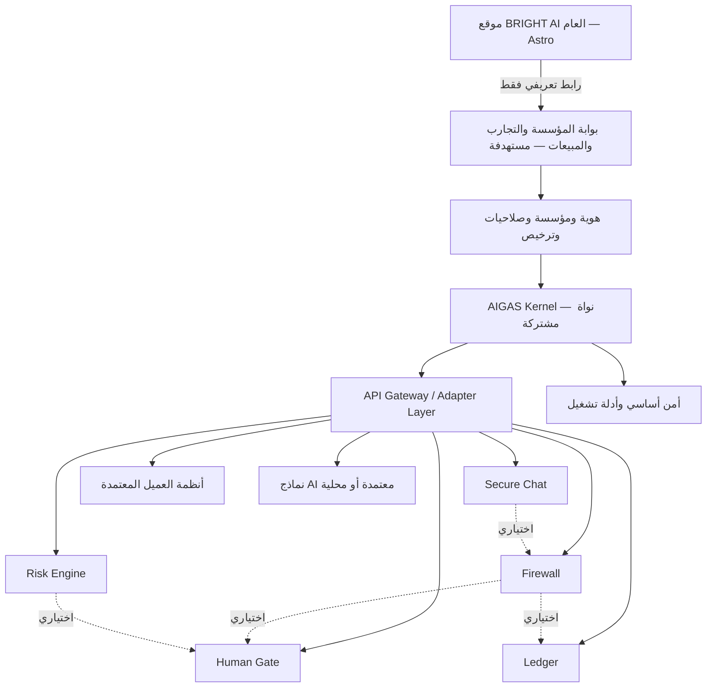
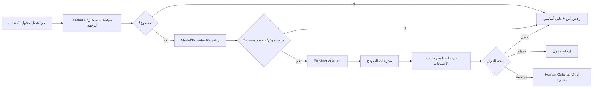
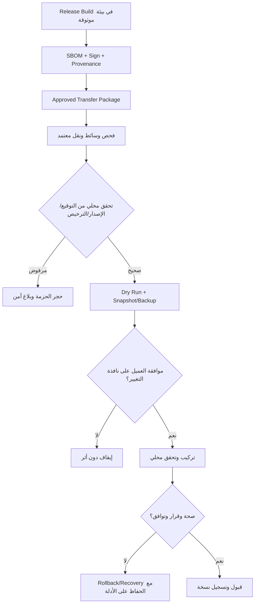
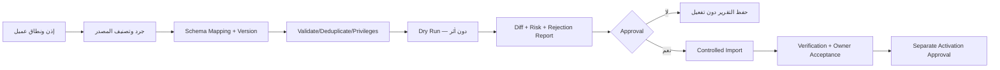

# INTEGRATION-AND-DEPLOYMENT.md

**BRIGHT AI | مؤسسة مُشرقة — AIGAS (AI Governance and Safety)**  
**نوع الوثيقة:** مرجع هندسي تنفيذي لتكامل الأنظمة، وحزم النشر، والتشغيل، والتسليم المؤسسي  
**الإصدار:** Draft 1.0  
**تاريخ الإعداد:** 2026-11-01  
**المسار المستهدف في المشروع:** `docs/INTEGRATION-AND-DEPLOYMENT.md`  
**المالك المعني:** Architecture / Product / Security / Operations  
**حالة الاعتماد:** `DRAFT — ENGINEERING & CONTRACTUAL REVIEW REQUIRED`  
**حالة التشغيل:** `TARGET ARCHITECTURE — NOT VERIFIED AS DEPLOYED`  
**النطاق:** AIGAS Kernel + Firewall + Risk Engine + Human Gate + Ledger + Secure Chat، بوابة المؤسسات، التكاملات الخارجية، والنشر SaaS / On-Premise / Air-Gapped.

> **قاعدة القراءة:** هذا المستند يحدد كيف *ينبغي* بناء وتشغيل التكاملات والنشر وفق قرارات BRIGHT AI المعتمدة. وجود متطلب أو واجهة أو مخطط هنا لا يعني أن الخدمة مطبقة أو مطروحة للبيع. لا تتعامل مع الأمثلة بوصفها API منشورة أو إعدادات إنتاج فعلية. لم يتم نشر أو تعديل أي ملف في مستودع GitHub لإعداد هذه النسخة.

---

## 00 — المصادر وحدود الدليل

### 00.1 مصادر القرار

| المصدر | دوره الملزم | ملاحظة |
|---|---|---|
| `docs/MASTER-PROJECT-BLUEPRINT.md` | قرارات المنتج والتشغيل والنشر وحتى القرار 108 | المعتمد في مسائل النطاق والسياسة |
| `docs/PLATFORM-ARCHITECTURE.md` | الحدود المنطقية للخدمات، الاستقلال، التدفقات والبنية المرجعية | ما زال تصميمًا مستهدفًا |
| `docs/PRODUCT-MASTER-CATALOG.yaml` | IDs المنتجات، القدرات والحالات التجارية | لا تستنتج تنفيذ القدرات من وجودها بالكتالوج |
| `docs/DATA-PRIVACY-AND-SECURITY.md` | الخصوصية، منع التدريب، الإقامة، المفاتيح، السجلات والعزل | تتطلب أدلة تنفيذ وعقودًا |
| `docs/PRICING-AND-LICENSING.md` | حدود التراخيص، منتجات مستقلة، Metering، حقوق الترخيص الدائم | أرقام الأسعار والحصص غير محسومة |
| `docs/ENTERPRISE-TRIAL-POLICY.md` | دورة تجربة 48 ساعة، الأهلية، البيانات والانتهاء | التجربة الحالية غير مثبتة التشغيل |
| `docs/MASTER-AGENT-CONTEXT.md` و`AGENTS.md` و`.agents/mind/01-mind-latest.md` | تعليمات الوكيل والحالة الحالية والقيود | تُقرأ عند أي تنفيذ لاحق |

### 00.2 فحص الواقع الحالي — قراءة فقط

جرى الاطلاع على ملفات المشروع في المستودع `YEEEAE/BRIGHTAI`، خصوصًا `astro.config.mjs` و`render.yaml` و`src/middleware.ts` وملفات Project Mind، إضافة إلى المستندات المحلية المرتبطة. ما يمكن توثيقه من **المصدر** حاليًا:

- يوجد موقع عام مبني بـ **Astro 6** مع `@astrojs/node` في وضع `standalone`، و`trailingSlash: 'always'`، وتهيئة sitemap.
- يتضمن `render.yaml` خدمة موقع Node باسم `brightai-site`، وأوامر بناء وتشغيل منشورة في *الإعدادات*: `npm ci && npm run build` ثم `node ./dist/server/entry.mjs`، وفحص صحة للموقع عبر `/`.
- يتضمن `src/middleware.ts` منطق تحويل مسارات `.html` القديمة اعتمادًا على `redirects.json`. وجوده في المصدر لا يثبت نجاح كل تحويل في الإنتاج؛ تشير ملاحظات Project Mind إلى فشل سابق لتحويلات في تحقق محلي.
- يحتوي المستودع على وثائق وملفات `kernel/` قديمة، وقد تتضمن أوصافًا تاريخية لواجهة Chat أو Redis أو مزودين. **لا تُعد هذه الأوصاف دليلًا على أن API أو محركات المنتجات الخمسة تعمل حاليًا**.
- `healthCheckPath: /` يفحص **توفر الموقع العام فقط**، ولا يعني جهوزية Gateway أو Kernel أو قاعدة بيانات أو منتج AI.
- توجد قرارات بشأن استخدام **Google Search Console وGoogle Analytics 4** للموقع العام؛ لا تُنقل بيانات محادثات العملاء أو أسرار التكامل إلى أي منهما.
- حالة نشر منتجات AIGAS الحقيقية، وبوابة المؤسسات، ومنطقة قواعد البيانات، والمفاتيح والتراخيص والنسخ الاحتياطية التشغيلية: **`NOT VERIFIED`** حتى يبرز دليل تشغيل مستقل.

**تحذير:** إعداد Cloudflare/Render/DNS في المستودع أو README هو سياق بنية الموقع التسويقي، وليس تفويضًا باستخدام هذه الخدمات لاستضافة بيانات العملاء أو الوعود بإقامة بيانات AI داخل السعودية. يُتحقق من منطقة كل مسار بيانات على حدة.

### 00.3 مستويات الحالة التي تُستخدم هنا

- `APPROVED_REQUIREMENT`: قرار عمل أو سياسة معتمدة من المشروع؛ لا يعني التنفيذ.
- `TARGET_DESIGN`: مقترح تقني لتلبية قرار معتمد؛ يحتاج مراجعة أو ADR قبل التثبيت.
- `EVIDENCED_CURRENT`: حقيقة مستندة إلى ملف مصدر حالي محدد؛ لا تثبت تلقائيًا ما يجري في الإنتاج.
- `NOT_VERIFIED`: لم تتوفر أدلة تشغيل كافية.
- `BLOCKED_FOR_APPROVAL`: يتطلب موافقة المالك أو العميل أو المختص القانوني أو الأمني.

---

## 01 — النطاق، الأهداف، وما هو خارج النطاق

### 01.1 الأهداف الهندسية

1. تمكين تشغيل أي من منتجات AIGAS الخمسة بصورة مستقلة تجاريًا ووظيفيًا، مع **AIGAS Kernel** مشترك لا يحمل رسم ترخيص مستقلًا.
2. تقديم واجهات تكامل موثقة وقابلة لإدارة النسخ، دون فرض طريقة اتصال واحدة لكل عميل.
3. دعم ثلاثة أنماط تشغيل فعلية: **SaaS** و**On-Premise/Private Cloud** و**Air-Gapped**، مع خصوصية وعزل وتحديثات ملائمة لكل نمط.
4. حماية قرارات الأمن والموافقات والأدلة عند فشل الاتصالات أو المزودين أو الأنظمة المساندة.
5. توفير مسارات إصدار وتثبيت وترقية وتراجع واستعادة وتسليم قابلة للتحقق والأرشفة.
6. تمكين الترحيل من أنظمة أخرى بموافقة العميل وDry Run وعدم تفعيل ضوابط مؤثرة تلقائيًا.
7. تقديم أدلة تشغيلية قابلة للتحقق، لا مجرد صور أو عروض توضيحية.

### 01.2 خارج النطاق المباشر

- اختيار مزوّد سحابي أو قاعدة بيانات أو Kubernetes أو Broker باعتبارها تقنيات معتمدة دون ADR وقياس.
- افتراض جاهزية ترخيص أو منتج أو مزود نموذج أو نظام CRM/ERP غير مثبت في المشروع.
- إعلان سعر أو SLA أو RPO/RTO أو سعة/Latency رقمية دون قبول تجاري وقياس.
- تغيير مستودع GitHub أو نشر الخدمة أو ضبط الإنتاج. هذه الوثيقة لا تفوّض أيًا من ذلك.
- تحويل سياسة مكتوبة إلى ضمان امتثال قانوني أو شهادة ISO/NCA/PDPL.

---

## 02 — مبادئ التصميم غير القابلة للتجاوز

1. **أمن أساسي مستقل عن البيع:** عدم شراء Firewall أو Ledger لا يلغي حماية Kernel الدنيا اللازمة أو سجل الأمان الأساسي.
2. **Fail-Closed للضوابط الإلزامية:** لا يسمح خطأ في التكامل أو مزود بديل أو Ledger مطلوب بتجاوز حظر أو موافقة ملزمة.
3. **Provider-Agnostic لكن ليس Provider-Unrestricted:** لا يُستخدم نموذج أو منطقة أو مزود إلا بعد اعتماد فني وتعاقدي وأمني مناسب.
4. **Zero cross-tenant access:** الهوية والسياسات والمفاتيح والبيانات وQueues وLogs والنسخ معزولة حسب السياق.
5. **No Training مطلق:** لا تستخدم BRIGHT AI أو مورّدوها محتوى العملاء أو بياناتهم لتدريب/تحسين النماذج، بلا استثناء.
6. **Offline means offline:** لا Cloud Check أو Telemetry مخفية أو DNS خارجي أو NTP سحابي إلزامي لتشغيل Air-Gapped.
7. **أحداث وأدلة موثوقة:** الربط الزمني والتوقيع والتصنيف والاحتفاظ وسبب القرار يُبنى ضمن النموذج ولا يُستنتج من ظهور UI.
8. **نطاق المنتج واضح:** عدم فرض شراء منتج آخر لا يلغي اعتماد Kernel الضروري، ولا يلغي التكامل الاختياري حين يشتريه العميل.
9. **Configuration First:** التخصيص المؤسسي عبر إعدادات وسياسات معتمدة مع توثيق الأصل والإصدار، لا تفريع برمجي دائم لكل عميل.
10. **التراجع الآمن ليس دائمًا تراجع قاعدة البيانات:** يجب تصميم توافق المخطط والبيانات والإصدارات قبل الترقية، وتحفظ الأدلة من الانقطاع أو العبث.

---

## 03 — الحدود المعمارية ومناطق الثقة



**المخطط مستهدف؛ لا يدل على خدمات موجودة.** الحدود:

| نطاق الثقة | ما يدخل | ما يُحظر |
|---|---|---|
| Public Marketing | محتوى عام، طلب استفسار أولي، GA4/GSC وفق سياسة الخصوصية | جلسات المستأجرين، أسرار التراخيص، بيانات AI، صلاحية تنفيذ العمليات |
| Enterprise Control | إنشاء المؤسسة، طلب التجربة، الترخيص، موافقات الإدارة | الوصول الشامل لمحادثات العميل أو مفاتيحه كأثر جانبي للمبيعات |
| Tenant Data Plane | تنفيذ السياسات، التقييم، الموافقات، الأدلة، المحادثات | مشاركة البيانات/الذاكرة/التخزين بين المؤسسات |
| Provider / Connector Boundary | خروج معتمد لغرض محدد ومقيد بسياسة | توجيه تلقائي لمزود غير معتمد أو تصدير صامت للمحتوى |
| Customer Local / Air-Gapped | هوية/نماذج/مفاتيح/أدلة/ترخيص محلي | اعتماد تشغيلي خفي على اتصال BRIGHT AI الخارجي |

### 03.1 فصل Control Plane عن Data Plane

- يحتفظ Control Plane بما يلزم لإدارة العملاء والتراخيص والحوكمة والتكوين؛ لا يتطلب ذلك امتلاك نصوص الطلبات والمحادثات.
- تتعامل Data Plane مع بيانات المؤسسات المحمية فقط ضمن حدود بيئتها وموافقتها.
- أي قناة لنقل بيانات بينهما يلزمها غرض وحد أدنى من الحقول وصلاحية وتسجيل وموافقة عند الحاجة.
- في Air-Gapped لا تكون هناك قناة مباشرة مع Control Plane سحابي أصلًا؛ تستبدلها آليات إدارة وترخيص محلية.

---

## 04 — مصفوفة واجهات المنتجات والاعتماديات

| المكوّن | المسؤولية المباشرة | وارد نموذجي | صادر نموذجي | تكاملات اختيارية | شرط السلامة |
|---|---|---|---|---|---|
| **AIGAS Kernel** | هوية سياقية وسياسات أساسية وتراخيص وأمن أساسي | هوية الفاعل، Tenant، entitlement، طلب محكوم | قرار سلطة، سياق سياسة، سجل أساسي | مزود هوية، محولات، SIEM | لا تعطيل الضوابط اللازمة بسبب نقص ترخيص منتج إضافي |
| **Firewall** | اعتراض/فحص وإنفاذ قرارات AI | طلب، نتيجة، سياسة، سياق الأداة | Allow/Warn/Redact/Review/Block | Human Gate، Ledger، Provider Adapter | لا تجاوز للمنع عند مهلة/عطل |
| **Risk Engine** | سجل أصول وتقييم المخاطر وتغييرها | بيانات أصل AI، غرض، سياق، ضوابط | تقييم مفسر، توصية مراجعة | Human Gate، Ledger | لا تقديم التقييم كحكم تلقائي ملزم بلا سياسة |
| **Human Gate** | صلاحية المراجع وقرار الموافقة | طلب محكوم، سبب، مهلة، سياسة | موافقة/رفض/انتهاء موثق ومربوط بالعملية | Firewall، Risk Engine، Ledger، ITSM | الموافقة تخص عملية/نطاق/نسخة بعينها؛ عدم الرد لا يعني القبول |
| **Ledger** | أدلة موثوقة والتحقق من سلامتها | حدث مصنف ومخول وتوقيع/Hash | إثبات واسترجاع وتحقق مستقل | المنتجات، SIEM، Audit Export | لا قبول دليل مستورد على أنه صادر أصلاً من AIGAS |
| **Secure Chat** | واجهة محادثة مؤسسية محكومة | مستخدم مصرح، نموذج معتمد، رسالة | استجابة محكومة وسجل أساسي | Firewall، Ledger، Human Gate | الحد الأدنى من الحماية يبقى مع غياب منتجات إضافية |

> كل صف **عقد قدرات مستهدف** وليس API أو Service موجودًا. يجب ربطه لاحقًا بمعرفات المنتجات والقدرات في `PRODUCT-MASTER-CATALOG.yaml` دون إنشاء تسميات بديلة تُسبب انفصال المراجع.

---

## 05 — أنماط التكامل المعتمدة والمقترحة

| النمط | التصنيف | الاستخدام | قيد رئيسي |
|---|---|---|---|
| REST/HTTPS مع OpenAPI بإصدارات | `APPROVED_REQUIREMENT` | API العامة والداخلية الموثقة | AuthN/AuthZ وTenant Context وRate Limit |
| SDK لـPython وTypeScript | `APPROVED_REQUIREMENT` | تكامل المطورين مع عقود API | تطابق الإصدارات والعقد وعدم تضمين أسرار |
| MCP/Tool Gateway | `APPROVED_REQUIREMENT` | حوكمة عمليات AI Agents | صلاحية لكل أداة/فعل/وجهة/بيانات |
| Webhooks موقعة | `TARGET_DESIGN` | إشعار الأنظمة الخارجية بالحالات والأحداث | توقيع، replay protection، idempotency وتسجيل |
| تكاملات SIEM/SOAR/ITSM | `APPROVED_REQUIREMENT` | المراقبة/الاستجابة/التذاكر | تصنيف الأدلة وتقليل البيانات، لا تفويض تلقائي |
| موصلات CRM/ERP/IAM | `TARGET_DESIGN` | تفعيل/إدارة وتكامل مؤسسي | أقل صلاحية وموافقة ومراجعة المورد |
| Event Queue / Broker | `TARGET_DESIGN` | أعمال طويلة الأمد وفصل الخدمة | اختيار التقنية بعد sizing وADR |
| Offline file exchange | `APPROVED_REQUIREMENT` | نقل بيانات/تحديثات/رخص Air-Gapped | وسائط موقعة/مشفرة وخطوات استلام وتحقق |
| A2A | `FUTURE / NOT_VERIFIED` | تطبيقات وكلاء إضافية | لا تعلن كتوافق قائم |

**مبدأ التكامل:** API Gateway نقطة تطبيق حدود وصول وليست بديلًا عن التفويض داخل كل منتج. تُعاد مراجعة صلاحية الفاعل والهدف على مستوى الخدمة نفسها لمنع Confused Deputy.

### 05.1 أنماط الاتصال

- **Synchronous:** عند الحاجة لقرار منع/سماح قبل وقوع الأثر، مع زمن مهلة محدد لكل سياسة وسلوك آمن عند الفشل.
- **Asynchronous:** عند نشر أدلة غير حاجزة أو إشعارات أو إعادة تقييم، باستخدام طابور مع ضمان عدم تكرار الأثر.
- **Human-in-the-Loop:** انتقال دائم للحالة، إشعار مخول، انتهاء مهلة، تحقق من هوية الموافق والعملية، ثم استئناف محكوم.
- **Import/Export:** ملفات مع Schema Version وChecksum وموافقات وتصنيف ومصدر وحماية من إعادة الاستيراد الضار.

---

## 06 — عقد API المرجعي

> **الأسماء التالية أمثلة تصميمية وليست Routes منشورة أو تعهدًا ببنائها بنفس التسمية.** يصدر العقد النهائي في OpenAPI بعد ADR ومراجعة المصدر والتهديدات.

### 06.1 متطلبات كل طلب

- هوية معتمدة من Token/Client Credential/Mutual TLS أو قناة مناسبة، مع expiry وتدوير موثق.
- `tenant_id` يُشتق من سياق مصادق ويتحقق داخل المنتج؛ لا يُقبل حقل مرسل من العميل وحده لإثبات المستأجر.
- هوية الفاعل `actor_id` ونوعه (`user`, `service`, `agent`, `connector`) وصلاحية Scope/Role.
- تعريف المورد/العملية/النموذج/السياسة والمصدر والوجهة مع تصنيف البيانات.
- `correlation_id` لربط العمليات وتوضيح مسار القرار دون تضمين بيانات حساسة.
- `idempotency_key` لكل أثر قابل للتكرار (مثل إصدار ترخيص/موافقة/فاتورة/تشغيل أداة).
- سياسة Timeouts/Retry محددة حسب أثر العملية، مع منع إعادة تنفيذ فعل مالي/مؤثر مرتين.

### 06.2 نموذج مفاهيمي للاستدعاء

```json
{
  "request_context": {
    "tenant_id": "derived-from-authenticated-context",
    "actor_type": "service",
    "correlation_id": "example-non-secret-id",
    "operation_id": "example-operation-id"
  },
  "target": {"product": "firewall", "action": "evaluate"},
  "policy_version": "approved-version-reference",
  "data_classification": "tenant-policy-classification",
  "payload_reference": "scoped-reference-not-raw-content"
}
```

**هذا مخطط تفسير لا مثال صلاحية:** لا تعتمد أي قيمة فيه منطقًا فعليًا دون إثبات مصدرها ومصادقتها؛ خصوصًا `tenant_id`. لا توضع PII أو Prompts أو API Keys في عناوين URL أو Trace/Analytics.

### 06.3 سياسة الإصدارات والأخطاء

| الموضوع | قاعدة مطلوبة |
|---|---|
| Versioning | نسخة واضحة لكل API وSDK وConnector وعقود الأحداث؛ SemVer أو سياسة معلنة ومعتمدة |
| Backward compatibility | مهلة انتقال وتوافق معلن وإلغاء تدريجي بعد إشعار العملاء والعقود |
| Validation errors | أخطاء قابلة للمعالجة دون تسريب مخطط داخلي أو بيانات حساسة |
| Authorization | تمييز عدم وجود هوية وعدم كفاية الصلاحية دون تسريب وجود مورد تابع لمستأجر آخر |
| Throttling | رفض/تأخير مقيد بحصة المستأجر والمنتج والعملية؛ لا أثر جانبي غير معرّف |
| Provider failure | رمز/حالة فشل آمن؛ لا fallback غير معتمد |
| Retry | Exponential backoff مع jitter حيث يلائم؛ لا يعيد تنفيذ موافقة أو شراء أو Tool Action غير idempotent |
| Duplicate requests | تخزين/تعريف نتيجة العملية بالهوية وScope لفترة مُعتمدة، لا احتساب أو تنفيذ مكرر |
| Security decision | `deny` و`pending` و`timeout` حالات صريحة؛ لا تفسير `null` أو خطأ 500 على أنه سماح |

### 06.4 التوثيق المطور

- OpenAPI عام للواجهات المصرح بنشرها فقط؛ أدلة مستقلة للأدوار والحدود الأمنية.
- أمثلة Python/TypeScript ببيانات اصطناعية وأسماء مقنعة غير حقيقية، مع توضيح الـScopes والـRate Limits وحدود الأسرار.
- نسخ Offline للـOpenAPI والـSDK ووثائق التشغيل للعميل Air-Gapped.
- Sandbox منفصل بمفاتيح وبيانات وحصص لا تصل للإنتاج؛ لا يُسوّق كدليل جاهزية منتجات غير مثبتة.

---

## 07 — هوية المؤسسات والتفويض والتكامل مع IAM

### 07.1 متطلبات الهوية

1. SSO وMFA وفق نوع الحساب ومخاطره، مع دعم مصدر هوية محلي عند الحاجة.
2. RBAC قابل لتخصيص الأدوار مع صلاحيات أدق لكل إجراء/سياسة/منتج، وفصل المهام (SoD) حيث يلزم.
3. توثيق حدود جلسات الإدارة، إعادة المصادقة للأفعال الحساسة، إبطال الحساب/الجلسة/المفتاح، وتسجيل السبب.
4. توكيل الموافقات محدد النطاق والمدة والمنتج، مع منع الحساب من الموافقة على قراره عند تطبيق SoD.
5. لا يفترض وصول موظف BRIGHT AI إلى IAM العميل؛ الدعم له هوية وصلاحيات منفصلة.

### 07.2 بروتوكولات تكامل الهوية

| الواجهة | التصميم المقترح | حالة القرار |
|---|---|---|
| OIDC/SAML | اختيار بروتوكول يدعمه IdP العميل والتحقق من التوقيع والـAudience والـIssuer | `TARGET_DESIGN — PROTOCOL NOT SELECTED` |
| SCIM | مزامنة إنشاء/تعطيل المستخدمين عند الحاجة وبموافقة العميل | `OPTIONAL — NOT_APPROVED_AS_MANDATORY` |
| Local IdP / Users | مسار أصيل للبيئات المعزولة بدون SSO خارجي | `APPROVED_REQUIREMENT` |
| Workload Identity | شهادة/Token قصير الأجل لكل خدمة أو Connector بدل مفاتيح مشتركة طويلة العمر | `TARGET_DESIGN` |

**الممنوع:** اعتماد بريد إلكتروني أو اسم مؤسسة في Body لتحديد صلاحية الوصول، أو إسناد حقوق عبر Tenant Name نصي، أو إبقاء حسابات دعم دائمة خفية.

---

## 08 — أمن الموصلات وWebhooks وMCP

### 08.1 سجل موصلات معتمدة

لكل موصل/مزود يسجل: `connector_id`, version، الشركة، الغرض، Owner، Tenant/Scope، البيئة/المنطقة، البيانات المقروءة والمرسلة، طريقة الاعتماد، مدة صلاحية المفتاح، مخاطر المورد، حالة الاعتماد، تاريخ المراجعة وأثر الإيقاف.

### 08.2 سياسة التنفيذ

- **Default Deny:** أي أداة أو Endpoint أو مجال egress غير مسجل وغير مصرح به يُرفض.
- **Least Privilege:** السماح بالفعل المطلوب على المورد المطلوب فقط، بما في ذلك أدوات AI Agent / MCP.
- **Destination Validation:** حماية SSRF وDNS Rebinding وRedirect-based Egress، وتثبيت الحدود مع ملاحظة أن IP Allowlist وحدها ليست كافية.
- **Inbound Validation:** مصادقة وتوقيع وقواعد Payload Size وSchema/Content-Type والتحقق من Origin/Replay وفق القناة.
- **Outbound Scrubbing:** تقليل بيانات الطلب ومراعاة تصنيفها وسياسة مزود AI.
- **Circuit Breaker:** يوقف موصلًا متعثرًا دون تحويله إلى مصدر موثوق بديل بلا تصريح.
- **Operator Control:** إمكانية إيقاف/عزل/تدوير سر الموصل، مع حفظ دليل القرار.

### 08.3 نموذج Webhook مقترح

```text
[Product Event]
   -> [Tenant Policy + Data Minimization]
   -> [Signed Outbox Item]
   -> [Delivery with bounded retry + jitter]
   -> [Receiver signature/timestamp/event-ID verification]
   -> [Idempotent processing + audited result]
```

- لا تؤكد خدمة الاستقبال وقوع إجراء ما لم يُثبت تنفيذ الإجراء نفسه.
- لا تحذف أدلة الحدث عند تعذر تسليم Webhook؛ سجل الاستلام منفصل عن Ledger.
- Dead Letter Queue أو بديل موثوق يحدد إعادة المحاولة وآلية معالجة الحدث دون مضاعفة الأثر.
- يُحظر إرسال Prompts/Responses الخام عبر Webhook افتراضيًا؛ تصدير المحتوى يحتاج غرضًا وموافقة وسياسة احتفاظ.

---

## 09 — الربط مع مزودي ونماذج AI



### 09.1 شروط اعتماد النموذج

- مراجعة شروط المورد وعدم استخدام بيانات العملاء للتدريب/تحسين النماذج.
- إثبات منطقة التخزين **ومنطقة الاستدلال/المعالجة**، بما فيها أي Logging أو Support أو Fallback لدى المورد.
- نموذج وسياق AI معتمد لكل استخدام؛ ليس كل نموذج صالحًا لكل فئة بيانات.
- استخدام BYOK عند اعتماد الجهة والعقد؛ لا تظهر مفاتيح العميل في UI أو Logs/Telemetry.
- حصة وتكلفة وحدود استهلاك وTimeouts وسياسة تراجع منسجمة مع ترخيص العميل.
- لا يوضع Fallback تلقائي إلى Groq أو Gemini أو أي مورد تاريخي دون الاعتماد الحالي؛ أسماء الموردين في وثائق قديمة لا تثبت تشغيلهم أو صلاحيتهم.

### 09.2 Air-Gapped

- يعتمد على Inference محلي ونماذج وأوزان مرخصة ومتحقق منها Offline.
- لا Remote Model Registry أو Feature Flags أو Authorization أو Usage Metering يستلزم الإنترنت.
- يثبت استقلال التشغيل باختبار فعلي ضمن شبكة مقطوعة ومنع الاتصالات الصادرة.
- التحديثات وLicense Refresh يتمان بإجراءات محلية موثقة، وليس بواجهة خلفية خفية.

---

## 10 — التدفق الحرج للقرار والموافقة والدليل

| مرحلة | شرط القرار | سلوك الفشل الآمن |
|---|---|---|
| استقبال الطلب | Tenant وActor وScope معتمدة | رفض قبل التنفيذ |
| قراءة سياسة معتمدة | نسخة وسياسة سارية مثبتة | رفض أو حالة آمنة محددة بالخطر؛ لا افتراض سماح |
| Firewall / حماية أساسية | تقييم المحتوى والوجهة والأداة | Block إذا الحظر إلزامي، ولو تعطل محرك مخصص |
| Risk Assessment | استدعاء تقييم حيث تشترطه السياسة | عدم المضي في قرار يستوجب تقييمًا سابقًا |
| Human Gate | موافق مخول على العملية والنطاق والنسخة | Pending/Denied؛ Timeout لا يعني Approval |
| Ledger / دليل إلزامي | Commit/Receipt صالح أو احتياطي معتمد | وقف العملية التي تتطلب دليلًا موثوقًا عند تعذر المسارين |
| تنفيذ Tool/Model | صلاحية آنية وتحقق وجهة/حصة | رفض عند تغيير السياق أو الوجهة/الحصة |
| إرجاع نتيجة | سياسات مخرجات، تنقيح، حد تسجيل | عدم تسريب نتيجة قد تكون حساسة |

**نقطة تصميم حرجة:** إذا انتهت صلاحية قرار الموافقة أو تغيرت السياسة/الطلب/الوجهة قبل التنفيذ، يجب إعادة التقييم بدل إعادة استخدام موافقة قديمة. يجب تعريف الهوية المستقرة للـDecision وتوثيق Cancel/Retry/Expiry/Delegation.

---

## 11 — نموذج الأحداث وإدارة الاتساق

### 11.1 الحد الأدنى المفاهيمي للحدث

`event_id`, `event_type`, `tenant_id`, `source`, `actor`, `occurred_at`, `recorded_at`, `correlation_id`, `causation_id`, `product_id`, `product_version`, `policy_id`, `policy_version`, `classification`, `retention_class`, `integrity_reference`, `payload_reference` عند الحاجة.

### 11.2 القواعد

- لا تفترض Exactly-Once Delivery من Transport؛ صمّم الآثار على **at-least-once مع مستهلك idempotent** أو ضمان مكافئ مثبت.
- Outbox/Inbox أو نمط Transactional مناسب لتجنب فقد حدث عند نجاح DB وفشل Queue.
- تحقق من ترتيب الأحداث ضمن Aggregate مؤثر؛ ترتيب وصول الرسائل لا يعني بالضرورة ترتيب وقوعها.
- حفظ توقيتين مختلفين عند الحاجة، وتحديد Clock Source وحدود فرق الساعات في Air-Gapped.
- الحدث التشغيلي لا يُساوي Evidence مخوّلًا؛ تعريف الإثبات والتوقيع والتسلسل والتصدير جزء مستقل.
- لا تُخلط فاتورة الاستخدام مع حدث تقني مكرر؛ Metering له تعريف Operation واحد قابل للمراجعة المالية.

### 11.3 أحداث مرجعية

`AIRequestReceived`, `PolicyEvaluated`, `ProtectionDecisionApplied`, `HumanApprovalRequested`, `HumanApprovalResolved`, `AuditEvidenceCommitted`, `RiskAssessmentCompleted`, `LicenseStateChanged`, `SecurityIncidentDetected`.

هذه **مسميات تصميمية مرجعية** واردة في Blueprint وليست Topics أو Tables أو APIs موجودة مثبتة.

---

## 12 — الخصوصية ونقل البيانات في التكاملات

### 12.1 Data Flow Record لكل اتصال

قبل تفعيل أي تكامل، يصدر سجل يشمل:

| الحقل | السؤال المطلوب |
|---|---|
| Controller/Processor Roles | من المسؤول عن الغرض والمعالجة وفق الحالة والعقد؟ |
| Data Categories | ما أنواع البيانات المصنفة (شخصية/حساسة/سرية/تشغيلية)؟ |
| Purpose & Legal Basis | ما الغرض والأساس وشروط المعالجة؟ |
| Source/Destination | من يرسل؟ ومن يستقبل؟ وهل يوجد معالج فرعي؟ |
| Storage vs Processing Region | أين تحفظ البيانات وأين تعالج فعليًا، بما فيها نموذج AI؟ |
| Subprocessors | ما جهات SDK/Hosting/Inference/Telemetry/Support المشاركة؟ |
| Security Controls | كيف يطبق التشفير والهوية والعزل وتقليل البيانات؟ |
| Retention & Deletion | ما مدة الاحتفاظ المعتمدة لكل فئة وآلية المحو والتحفظ القانوني؟ |
| Exit & Export | كيف يستعيد العميل بياناته ومتى وكيف يتحقق من المحو؟ |
| Approval & Evidence | من اعتمد التدفق؟ وأين وثيقة الاعتماد والتقييم؟ |

### 12.2 أحكام ثابتة

- السعودية هي الخيار الافتراضي **المستهدف** لإقامة بيانات SaaS السعودية، ولا يُفترض أن الموقع التسويقي يثبت إقامة كل تدفق محمي داخل المملكة.
- لا نقل/معالجة خارج السعودية دون مراجعة اللوائح والقطاع والعقد والموافقات الواجبة.
- تحظر بيانات العملاء والمحادثات والمطالبات والمخرجات والأدلة الحساسة في GA4/GSC أو أدوات التسويق.
- اشتراط **No Training** يسري على مزودي النماذج والموصلات ومزوّدي المعالجة الفرعيين متى عالجوا بيانات العميل.
- لكل فئة احتفاظ معتمد أو حالة `PENDING_APPROVAL`؛ لا تُختلق أيام أو أشهر، ولا يعني انتهاء الترخيص الحذف الفوري دون مراعاة حقوق العميل والتزامات الحفظ.
- محتوى المحادثات لا يدخل سجل الأمن الأساسي أو التشخيص الافتراضي إلا لضرورة وموافقة وتدابير معلنة.

---

## 13 — مفاتيح التشفير والأسرار والهوية التقنية

- استخدم تشفير نقل وتخزين ملائمين لنوع البيانات والبيئة؛ اختيار خوارزمية/نسخة وأسلوب تدوير المفاتيح يمر عبر مراجعة أمنية.
- عزل مفاتيح العملاء عن مفاتيح توقيع حزم التحديث والتراخيص والأدلة، وعدم استخدام مفتاح مشترك لأغراض مختلفة.
- تدعم خيارات **BYOK / KMS / HSM** عندما تتطلبها السياسة والعقد، مع إثبات صلاحية المزود وموقعه.
- لا تخزن Secret في Code أو CI Logs أو المتصفح أو ملف .env ملتزم به في Git أو مستند التسليم.
- مفاتيح خدمة/موصل قصيرة الصلاحية قدر الإمكان، مع Rotation وإبطال وعزل بحسب Tenant.
- إذا فقد مفتاح ترخيص/تحديث Offline أو انكشف، توجد آلية إصدار/تراجع وإثبات ثقة محلية ضمن تصميم الثقة المعتمد.
- سجل وصول مفاتيح وظيفي وأدلة فصل مهام؛ لا تنقل المواد السرية لفرق المبيعات/التصميم/SEO.

---

## 14 — خيارات النشر والحدود التشغيلية

| المجال | SaaS | On-Premise / Private Cloud | Air-Gapped |
|---|---|---|---|
| تشغيل الخدمة | BRIGHT AI/مُشغِّل معتمد بالعقد | بنية العميل أو مُشغِّل معتمد | مستقل داخل بيئة العميل |
| اتصال إنترنت | بحسب الخدمات المعتمدة | قد يكون موجودًا لكن ليس حقًا ضمنيًا في إرساله | لا اعتماد إنترنت مطلقًا |
| الهوية | IAM وSSO/MFA وفق النطاق | IdP العميل أو محلي | حسابات أو IdP محلي بالكامل |
| الترخيص | إدارة إلكترونية وفق العقد | محلي موقّع ضمن التعاقد | تحقّق محلي موقّع فقط |
| AI Inference | مزود معتمد وبمنطقة مصرح بها | محلي أو خارجي مصرح | محلي مرخص فقط |
| أسرار وتشفير | KMS/HSM مناسب وBYOK إن اعتمد | مفاتيح العميل أو مُدارة بالعقد | مفاتيح محلية دون تبعية شبكة خارجية |
| المراقبة | مركزية مع عزل وتصنيف | محلية أو مشاركة اختيارية | محلية بالكامل دون Telemetry صامتة |
| التحديث | دفعات مُدارة وموقعة | حزمة موقعة ونافذة العميل | حزمة Offline موقعة وتحقق محلي |
| النسخ والاستعادة | خطة مُثبتة بحسب العقد | مسؤوليات مفصلة بالعقد | خطة مستقلة محلية |
| الدعم | وصول JIT موثق | وصول مؤقت بموافقة العميل | دعم محلي/وسائط، دون Backdoor |
| البيانات | السعودية افتراضيًا مستهدفًا | بحسب مكان عميل/عقد | تبقى محليًا إلا بإذن نقل منفصل |

### 14.1 وحدات النشر المطلوبة

- **Core Bundle:** Kernel مع وحداته المشتركة الضرورية للأمن والترخيص والتدقيق.
- **Product Modules:** تثبيت وتمكين كل منتج على حدة، مع Manifest يوضح نسخته وحقوقه والاعتماديات الإلزامية.
- **Provider Adapters:** حزم موصلات مقيدة بإصدارات ودعم المناطق/النماذج.
- **Management Functions:** IAM محلي عند الحاجة، Audit Export، Backup/Restore، Metering Offline، إدارة المفاتيح.
- **Optional Integrations:** هوية المؤسسة، SIEM/ITSM، Webhooks/SDKs، وفق العقد والصلاحيات.

**لا يفترض هذا التقسيم أن كل وحدة Microservice مستقل أو Pod.** قد تُعبأ الوحدات محليًا مع الحفاظ على الحدود المنطقية واختلاف التراخيص.

---

## 15 — SaaS: نموذج التشغيل المستهدف

### 15.1 التهيئة

1. إنشاء مؤسسة/مستأجر بعملية محكومة بعد استيفاء الهوية والحق التجاري أو أهلية التجربة.
2. تهيئة عزل منطقي صارم للبيانات والمفاتيح والـCaches والـQueues والمراقبة والنسخ والموارد الخاصة.
3. تعيين مسؤول المؤسسة ومنحه أقل صلاحيات لازمة مع MFA.
4. ربط المنتجات المرخصة والنواة الأساسية، مع عدم السماح بتجاوز ضوابط الأمن عند تغيير الخطة.
5. تثبيت سياسات البيانات والمناطق والمزودين المعتمدين وميزانيات الاستخدام قبل أول طلب.
6. تفعيل قنوات الأدلة والتشخيص المنقحة والتنبيهات اللازمة وعملية استعادة مثبتة.
7. تسجيل الانتقال من Provisioned إلى Security Ready إلى Customer Accepted إلى Production Active **كل حالة بصورة مستقلة**.

### 15.2 نشر الإصدارات

- ترقية Canary/Phased عند نضج البنية، مع بوابات صحة للخدمة الفعلية وليس فقط `/` للموقع.
- فصل هوية الوصول والإعدادات والأسرار عن public website.
- مراقبة فشل الأمن والعزل والموافقات وLedger قبل زيادة نسبة المرور.
- عند تراجع إصدار، لا تُسقط migration أو policy changes إلا وفق Runbook مثبت وغير متلف للبيانات.
- التوسع أفقيًا أو تخصيص موارد عميل حساس يقرر بعد قياس وسعة وخطة عقدية؛ لا أرقام افتراضية للمنصة.

### 15.3 فصل الموقع التسويقي

`brightai.live` يمثل واجهة عامة. قرار استخدام نطاق أو subdomain لبوابة المؤسسات، ومزود الاستضافة ومكان البيانات وآلية الجلسات المحمية، **قرار تنفيذ مفتوح**. لا تُنشأ جلسات أو أسرار مشتركة مع الموقع العام لمجرد سهولة التطوير.

---

## 16 — On-Premise وPrivate Cloud

### 16.1 ملف الجاهزية

- هوية مالك البيئة ومسؤوليات الصيانة/العزل والدعم.
- Topology للشبكة وDNS/PKI الداخلي وFirewall/Egress.
- متطلبات CPU/RAM/GPU/Storage والذروة والتزامن؛ تخرج من Sizing Workload وليس قائمة أجهزة عامة.
- اختيار نظام تشغيل/Runtime/Container Registry بحسب البيئة وتقنيات الإصدار المعتمد.
- هوية المستخدمين وSSO أو Local IdP؛ إدارة الأدوار والصلاحيات وإعادة التسجيل.
- مفاتيح/أسرار وKMS/HSM أو بديل مناسب، مع خطة تدوير واستعادة.
- تخزين الأدلة والاحتفاظ والـLegal Hold ونسخ احتياطي وتصدير وخطة ترحيل.
- ربط مزود AI محلي أو خارجي مصرح، مع سياسة egress مكتوبة.
- استراتيجية التراخيص وتبادل/تجديد الرخص الموقعة ومواعيد التحديث المتفق عليها.

### 16.2 تسلسل التسليم

`Discovery → Solution Design → Sizing → Security & Legal Review → Contract Scope → Installation Plan → Signed Package Verification → Install → Configure → Integrate → Validate → Customer Acceptance → Operate`.

- نموذج المسؤوليات Shared Responsibility مصفوفة تعاقدية، ولا يفترض أن العميل يتحمل كل العطل لمجرد أنه يستضيف محليًا.
- لا اتصالات صامتة للمطورين أو الشركة إلى البيئة.
- دعم الوصول المؤقت JIT بموافقة العميل وسبب/مدة وحد وصول وسجل، مع قدرة العميل على الإيقاف.

---

## 17 — Air-Gapped: شرط الاستقلال الكامل

### 17.1 مكونات يجب أن تعمل دون اتصال خارجي

- هوية المؤسسة والحسابات/SSO المحلي وMFA الملائم.
- Kernel وسياساته الأساسية، والمنتجات المرخصة ووظائف الإنفاذ الحرجة.
- ترخيص محلي موقّع مع تحقق كامل، بما فيه حق الترخيص الدائم المحلي وفق العقد.
- النماذج وأوزانها وRuntime والاستدلال المحلي ومخازن البيانات اللازمة.
- الأسرار ومفاتيح التشفير والتوقيع والتحقق المحلي.
- دليل الأحداث والـLedger الأساسي أو مسار حفظ محلي بديل معتمد.
- Metering والحصص المحلية والتقارير والنسخ والاستعادة والمراقبة/التنبيه المحلي.
- Admin/Support الأدنى بدون اعتماد سحابي، وتثبيت Offline للحزم والوثائق.

### 17.2 مسار الحزم المعزولة



### 17.3 ضمانات التثبيت

- Manifest موقع، Hash للملفات، مصدر ومكونات SBOM، نسخ Kernel والمنتجات والنماذج والموصلات والتراخيص المعنية.
- تحقق من Chain of Trust وExpiry/Revocation حيث تسمح سياسة الثقة Offline، وتصميم آمن عند فقد إشارات خارجية.
- وسائط نقل معتمدة ومشفرة وفحص برمجيات خبيثة وفق سياسة عميل والقطاع.
- لا تكتب تقارير تشخيص أو Telemetry على وسيط خارجي إلا بطلب منفصل ومراجعة بيانات.
- يمكن تصدير Evidence/Log عند موافقة العميل وبعد تصنيف وتنقيح؛ لا يوجد Upload تلقائي للمطور.
- اختبار عملي بـNetwork Isolation لإثبات الاستقلال، وليس استنتاجًا من إعداد `AIR_GAPPED=true`.

---

## 18 — هندسة السعة والتوافر — القرار (107)

### 18.1 مدخلات Sizing

| البعد | معلومات يجب طلبها |
|---|---|
| المستخدمون | عدد المسجلين والمتزامنين وأنواع الأدوار |
| الطلبات | متوسط/ذروة API، طول المحتوى، تدفق محادثات/استجابات |
| النماذج | عدد النماذج وحجم الأوزان والتوازي والـContext ومتطلبات GPU |
| Firewall | حجم/نوع الفحص، المدخلات/المخرجات، السياسات المطبقة |
| Human Gate | قرارات معلقة، مستويات اعتماد، مهلة واستجابة وتنبيهات |
| Ledger | معدل الأدلة/حجمها، التوقيع، التحقيق، البحث، الاحتفاظ |
| Risk Engine | عدد أصول AI، حجم تقييمات ومراجعات التغيير |
| Storage | قاعدة بيانات، ملفات، كاش، أرشيف، نسخ احتياطية |
| Network | الاتصالات المسموحة، خطوط الربط، Latency، DNS/PKI |
| Availability | توافق HA، عزل المناطق، سيناريوهات فشل |
| Recovery | RPO/RTO المطلوب عقديًا ثم اختبار إمكان تحقيقهما |
| Residency | موقع كل معالجة واستضافة ونسخة وLog/Provider |

### 18.2 المخرجات

- **Minimum / Recommended / High Availability**، كل واحدة بشروط حمل معلنة وحدودها وتكلفة تقديرية مميزة عن السعر الملزم.
- عرض ما يُوفره العميل وما يُوفره BRIGHT AI، مع تأهيل أصحاب المسؤولية.
- قائمة Dependency/Failure Modes ومفاتيح وسعة ومحددات نمو لكل منتج.
- لا تجعل تقدير سعة غير مختبر أساسًا لادعاء Throughput أو SLA أو latency مضمونة.
- حساب العبء وقت التشفير/التوقيع/النسخ الفعلي، لا وقت رسم واجهة المستخدم.

---

## 19 — تراخيص المنتجات والفوترة والحدود

1. كل منتج مرخص مستقلًا ويمكن شراؤه وتشغيل وظائفه الأساسية دون فرض بقية المنتجات.
2. Kernel مشترك وأساسي ولا يُدرج كترخيص مستقل مفوتر على العميل.
3. يدعم نموذج البيع اشتراكات SaaS، وترخيص On-Premise سنويًا أو دائمًا، وترخيصًا محليًا لـAir-Gapped وفق العقد.
4. License Manifest يحدد المنتج/الإصدار/الحقوق/المدة/البيئة/الـTenant أو الجهة والقيود المعلنة؛ التوقيع والتحقق المحلي مستهدفان.
5. تعطيل المنتج عند انتهاء حق مدفوع لا يُعطّل سياسة الأمان الدنيا أو يحذف أدلة لازمة أو يمنع حق تصدير مقرر.
6. انقضاء دعم الترخيص الدائم لا يُبطل بذاته حق استخدام النسخة الدائمة المتفق عليها.
7. Metering يميّز العمليات الفريدة ويُعزل حسب الجهة والمنتج، ويمنع ازدواجية الحساب مع retries أو Webhooks.
8. حدود الإنفاق والزيادة تعتمد لاحقًا كتابة؛ لا تُنشأ رسوم تجاوز تلقائية غير معتمدة.
9. تكاليف مزود AI الخارجي تفصل عن رسوم BRIGHT AI وحصص API والتكامل والدعم بحسب عقد العميل.
10. لا تتحول التجربة المجانية تلقائيًا إلى رخصة مدفوعة ولا تُخصم رسوم دون إجراء شراء صريح.

### 19.1 نموذج دورة الترخيص

`Pending → Active → Renewal Due → Contractual Grace (if agreed) → Restricted/Suspended → Expired/Terminated` مع توثيق الاستثناءات والتسوية وحق الخروج. **لا تفترض Grace Period كقاعدة عامة.**

---

## 20 — تجربة المؤسسة والتفعيل المؤقت

### 20.1 Trial 48 Hours

- تبدأ **48 ساعة متصلة من `activated_at`** المثبت بعد تحقق الإعداد والتراخيص والأمن، وليس من استلام الطلب أو الموافقة الأولية.
- بيانات صناعية/اصطناعية افتراضيًا؛ أي بيانات عميل حقيقية تحتاج موافقة مكتوبة وبيئة مراجعة وموافقة معالجة.
- تجربة القطاع الخاص الذاتية مشروطة بهوية وأهلية ومكافحة إساءة الاستخدام؛ الحكومي والتكاملات المؤثرة بمراجعة بشرية.
- حدود التكلفة/الاستهلاك والمعدل والتزامن تُعتمد مسبقًا، ولا تُخترع أرقام عند التوثيق.
- الانتهاء يوقف **بدء عمليات جديدة تتطلب entitlement التجربة**، دون تحرير أي عملية خطرة معلقة أو حذف سجل يلزم حفظه.
- تقرير Proof of Value يوضح ما نُفذ فعلًا وما تعذر، ويُميّز النتائج المحققة عن الواجهة التعليمية.

### 20.2 Pilot مؤسسي

مشروع محدد بعقد ونطاق ومخاطر ومدة وخطة قبول وخروج ومسؤوليات، وليس إعادة تسمية تجربة الـ48 ساعة. نجاح Pilot يستند إلى تشغيل الوظائف الأساسية دون مشكلات حرجة، ورضا العميل، وتقرير نهائي معتمد؛ لا Scorecard معقدة مفروضة دون حاجة.

---

## 21 — Migration & Secure Import — القرار (108)

### 21.1 الأشياء المسموح بتصميم استيرادها

- AI Assets / Inventory.
- السياسات وقواعدها وترتيبها وتاريخ التغييرات المصرح.
- المستخدمون والأدوار والتعيينات وفق IdP والـScopes.
- مسارات الموافقة والجهات المخولة وSoD.
- الإعدادات المختارة والموصلات والحدود الآمنة دون أسرار مكشوفة.

### 21.2 خطوات الاستيراد الإلزامية



**قواعد:**

- لا يعد Dry Run نجاحًا تشغيليًا أو تغييرًا مباشرًا؛ تظهر أعداد صحيحة/مرفوضة/محولة وتفسير المخاطر.
- لا تفعّل سياسات Block أو موافقات مؤثرة فور الاستيراد دون موافقة تنفيذ منفصلة.
- يحفظ مصدر الملف وHashه وتوقيته والـMapping والفاعل والنسخة والتراخيص والتغييرات، مع Rollback/Restore خطة معتمدة.
- لا تضع Imported Legacy Logs داخل Ledger بوصفها أدلة أصلية موثوقة موقعة من AIGAS؛ توصف بأنها سجلات خارجية بمصدرها وحدود تحققها.
- في Air-Gapped تتم الاستفادة من وسائط مأذون بها ومشفرة ومحلية؛ لا اتصال Connector SaaS خفي.

### 21.3 تنبيه لصلاحيات البيانات

استيراد المستخدمين لا يعني نسخ كلمات مرور أو Secrets أو منحهم أدوارًا عالية تلقائيًا. يجب الرجوع إلى Identity Owner، ويفضل إعادة ربط الهويات/المجموعات عبر مصدر موثوق، والمراجعة قبل التنشيط.

---

## 22 — سلسلة التوريد وإنتاج حزم النشر

### 22.1 فصل بيئات العمل

`Development → Staging → Production` مع فصل قواعد البيانات والمفاتيح والهويات والأسرار والموارد؛ **Synthetic Data** افتراضيًا في Dev/Staging.

### 22.2 إصدار صالح للنشر

يحتوي Release Package المستهدف على:

- Build reproducibility/provenance بما يتفق مع البيئة المعتمدة.
- قائمة Kernel والمنتجات والموصلات وSDKs وإصداراتها وتوافقاتها.
- SBOM للمكونات البرمجية ومراجعة التراخيص والثغرات والمصادر.
- إصدار النماذج/الأوزان والتراخيص ذات الصلة عند دعم الاستدلال المحلي.
- توقيع Artifact والـManifest وChecksums ومعرّفات المفاتيح العامة للتحقق.
- Migration plan وخطة Backup/Restore/Rollback وترتيب التنفيذ ونسخ الـSchema.
- تعليمات تركيب وتكوين لا تكشف أسرارًا، وتحديد Dependencies والمنافذ والـEgress.
- قائمة التحقق من القبول الأمني والتشغيلي، وملاحظات إصدار بالعربية، وOpenAPI/SDK متوافقة.
- تعليمات Air-Gapped Offline عند انطباقها، تشمل التحقق والموثوقية والتحديث دون اتصال.

### 22.3 حوكمة الإصدارات

- Versioning مستقل للمنتجات الخمسة وKernel وSDKs/Connectors، مع **Compatibility Matrix** واضحة.
- Upgrade/Degrade Path معلن ودعم الترقية التدريجية والتراجع حين يكون آمنًا.
- لا فرض تحديث جميع المنتجات عند تحديث منتج واحد ما لم تثبت اعتمادية فنية موثقة.
- مسار طوارئ للثغرات الحرجة مع مراجعة أثر الأمن وتوقيع وصلاحيات إصدار مناسبة.
- الحزمة لا تُنشر تلقائيًا إلى إنتاج أو العميل دون تفويض ونوافذ اعتماد.

---

## 23 — Compatibility Matrix وRollout

### 23.1 قالب التوافق

| الوحدة | النسخة الحالية المثبتة | نطاق Kernel المتوافق | API/Event schema | Migration Required | Offline Package | حالة الدليل |
|---|---|---|---|---|---|---|
| Kernel | `NOT_VERIFIED` | — | `TBD` | `TBD` | `TBD` | `NOT_VERIFIED` |
| Firewall | `NOT_VERIFIED` | `TBD` | `TBD` | `TBD` | `TBD` | `NOT_VERIFIED` |
| Ledger | `NOT_VERIFIED` | `TBD` | `TBD` | `TBD` | `TBD` | `NOT_VERIFIED` |
| Human Gate | `NOT_VERIFIED` | `TBD` | `TBD` | `TBD` | `TBD` | `NOT_VERIFIED` |
| Risk Engine | `NOT_VERIFIED` | `TBD` | `TBD` | `TBD` | `TBD` | `NOT_VERIFIED` |
| Secure Chat | `NOT_VERIFIED` | `TBD` | `TBD` | `TBD` | `TBD` | `NOT_VERIFIED` |

هذه ليست أرقام إصدارات فعلية. تُستبدل بالقيم المثبتة **من نفس Release Artifact** عند وجودها.

### 23.2 ترقيات صفر فقد عند الإمكان

1. قبل الترقية: مراجعة التوافق والاعتمادات وتغير Data Contract وتوثيق Backup/Restore.
2. Expand: إضافة مخططات أو حقول متوافقة واستمرار القراءة القديمة عند الحاجة.
3. Deploy: توزيع الخدمة الجديدة تدريجيًا مع Monitoring وقياس أخطاء/تراجع أمان.
4. Migrate: نقل البيانات بخطوة قابلة للتتبع وتوافق واضح.
5. Contract: إزالة السلوك القديم بعد تحقق عدم الاعتماد عليه ومراجعة فترة الدعم.
6. Rollback: خطة منفصلة لتراجع تطبيق وتراجع بيانات؛ قد تحتاج Restore أو Roll-Forward بدل Down Migration.
7. Evidence: لا تُكسر سلاسل أدلة Ledger أو تواريخ اعتماد الموافقات عند إعادة النشر.

### 23.3 مراحل نشر مقترحة

`Preflight → Signed Artifact Verified → Backup/Checkpoint → Staging Validate → Security Gate → Approved Window → Deploy → Product Health & Transaction Check → Monitor → Customer Acceptance`.

عند فشل بوابة أساسية: **STOP/ROLLBACK** حسب نوع التغيير وسياسة الأدلة، مع إشعار ومراجعة لا إكمال تلقائي.

---

## 24 — المرونة والأخطاء واستمرارية العمل

| الفشل | القرار المستهدف | الدليل المطلوب |
|---|---|---|
| مزود AI معتمد غير متاح | استخدم فقط بديلًا معتمدًا لنفس البيانات/المنطقة أو امتنع بأمان | سجل سبب وفشل وخيار مستخدم |
| تعطل Human Gate | إبقاء الإجراء عالي المخاطر معلقًا أو مرفوضًا؛ لا إجازة صامتة | حالة طلب الموافقة والتوقيت |
| تعطل Ledger الأساسي | تحويل لمسار احتياطي **معتمد** إن وجد؛ وإلا وقف ما يلزمه دليل | وصل التخزين/فشل وسجلات القرار |
| نفاد الحصة/الميزانية | منع الاستخدام الجديد أو إجراء مصرح مسبقًا؛ لا رسوم مفاجئة | Metering موحد وتسعير معتمد |
| فشل IdP خارجي | صلاحيات التشغيل تتبع سياسة موثقة؛ لا Admin bypass | سبب الدخول/الرفض وسجلاته |
| انقطاع الإنترنت عن Air-Gapped | استمرار التشغيل المحلي الأساسي | نتيجة تحقق فعلية دون اتصال |
| فشل استيراد | لا تفعيل لسياسات جزئية؛ rollback أو reconcile | Diff + تقرير رفض + مراجعة |
| فشل التحديث | استعادة إصدار/بيانات بأمان مع حفظ الأدلة | Release ID, signatures, runbook |
| انتهاء Trial أثناء Pending Approval | رفض/تعليق العملية وفق سياسة انتهاء آمنة، دون تحريرها | Trial/Approval state |
| انكشاف مفتاح موصل | إبطال/تدوير وعزل وبلاغ حسب أثر الحادث | هوية المفتاح والإجراءات |

### 24.1 HA / Backup / DR

- تُحدد أهداف RPO/RTO وHA ومستويات التوفر بناءً على عقد وأثر وتكلفة وقياسات؛ لا نسب رقمية افتراضية.
- يجب فحص **استعادة فعلية** لقواعد البيانات والأدلة ومفاتيح التشفير والرخص والتكوين، لا الاكتفاء بنجاح نسخ Backup.
- لا تختلط المفاتيح المستخدمة للاستعادة مع حزم النسخ بشكل يتيح لمطلع واحد تجاوز ضوابط الحماية.
- تحترم النسخ الاحتياطية العزل والموطن الجغرافي والاحتفاظ/Legal Hold وآلية المحو المعلنة.
- لكل نشر محلي خطة مسؤوليات، وتوثق قيود الاستعادة عند عدم توفر الإنترنت في Air-Gapped.

---

## 25 — المراقبة والدعم والتشخيص

### 25.1 قنوات منفصلة

1. **Product/Security Telemetry:** صحة وLatency/Errors/Quota ضمن مستأجر ومخاطر، دون محتوى حساس افتراضيًا.
2. **Auditable Decision Evidence:** سجل قرار/توقيع/سلسلة وتوثيق تفصيلي وفق المنتج والسياسة؛ ليس Debug Log.
3. **Commercial Metering:** أحداث تكلفة/حق استخدام مستقلة عن المحتوى، قابلة للمطابقة المالية.
4. **Public Web Analytics:** GA4 للزيارات والتفاعل، وGSC للبحث والفهرسة؛ لا تُستخدم لأحداث استخدام AIGAS السرية.

### 25.2 حدود وصول الدعم

- JIT بطلب/سبب وموافقة العميل ومهلة ونطاق محدد وMFA وسجل جلسة.
- لا Full-Access دائم ولا قناة منفصلة مخفية، لا سيما في Air-Gapped.
- بيانات التشخيص تنقح ويحدد لها نقل/استضافة/احتفاظ مستقل قبل المشاركة.
- دعم وإشعارات الأعطال ينظمان بالعقد ودرجة الحادث؛ لا تعهّد SLA أو قناة Incident Status عامة بلا قرار.

---

## 26 — إجراءات Runbook الدنيا عند أي نشر

### 26.1 Preflight

- [ ] معرّف العميل/المستأجر والبيئة ونطاق العقد معتمد.
- [ ] Architecture/Security Owner وChange Approver محددان، وفصل الصلاحيات محقق.
- [ ] مواصفات السعة والمتطلبات متفق عليها؛ فحص منطقة بيانات كل مزود وتمكين BYOK/Local Secrets عند الحاجة.
- [ ] SBOM والتوقيع والـManifest وإصدارات التوافق متاحة.
- [ ] احتياطي واستعادة مقيّمان وخطة رجوع موثقة وموافق عليها.
- [ ] عدم وجود أسرار أو بيانات حقيقية داخل الحزمة، ومراجعة Migration/Policy Changes.
- [ ] تراخيص المنتجات وKernel الأساسية متوافقة، وNo-Training/Privacy/Retention مُثبتة تعاقديًا وتقنيًا قبل بيانات العميل.

### 26.2 Install / Configure

- [ ] تحقق توقيع الحزمة والمصدر والمكونات.
- [ ] تهيئة Tenant/Identity/Secrets والحدود الأمنية؛ عدم السماح لمسؤول نطاق بأن يفعّل نفسه كمراجع مستقل.
- [ ] تمكين المنتجات المرخصة فقط مع إبقاء حماية Kernel اللازمة.
- [ ] تسجيل Registry للمزودين/الموصلات المعتمدة مع منع أي Egress غير مصرح.
- [ ] ضبط Quotas/Spend Caps/Retention/Logging حسب القيم المعتمدة.
- [ ] منع اتصال Internet عند Air-Gapped وإثبات كل الوظائف المحلية الأساسية.

### 26.3 Validate / Handover

- [ ] نجاح عملية أصلية مخولة في المنتج المستهدف، وليس Animation/UI Mock.
- [ ] رفض عملية غير مصرح بها وبيانات Tenant آخر.
- [ ] تحقق سياسات Firewall وحالات Block/Review/Timeout/failure.
- [ ] تحقق Human Gate/SoD وعلاقة الموافقة بالعملية.
- [ ] تحقق Evidence من Ledger وفق السياسة عند شراء المنتج، وسجل الأمان الأساسي دون شراء Ledger.
- [ ] تحقق الاستيراد Dry Run وعدم تفعيل السياسات المؤثرة تلقائيًا.
- [ ] تحقق محدود لسيناريو Provider Failure/Quota/Offline License.
- [ ] إثبات الوصول للدعم JIT أو إجراء دعم محلي مستقل، وعدم وجود قناة مخفية.
- [ ] تحقق استرجاع النسخ وحقوق تصدير البيانات حسب العقد.
- [ ] تقرير قبول عميل/مسؤول موقع/منتج/إصدار/قضايا مفتوحة وتوقيع معتمد.

---

## 27 — معايير قبول التكامل والنشر

| ID | الحالة | معيار النجاح المطلوب | مصدر إثبات عند التنفيذ |
|---|---|---|---|
| `ID-01` | ترخيص Firewall وحده | يؤمن طلبًا حقيقيًا دون شراء بقية المنتجات | Trace مع UI/API وحالة رخصة |
| `ID-02` | مستأجر يحاول بيانات غيره | رفض عبر API/DB/Cache/Logs/Export | إثبات عزل متعدد الطبقات |
| `ID-03` | Policy Deny مع Provider Fallback | منع إرسال أي بيانات لبديل غير معتمد | سجل توجيه واعتماد المصدر |
| `ID-04` | Human Gate Timeout | عدم تنفيذ العملية أو تحريرها تلقائيًا | سجل طلب وقرار ونسخة سياسة |
| `ID-05` | دليل Ledger إلزامي تعذر | إيقاف العملية الحرجة عند فشل المسارات المعتمدة | Receipt/Failure evidence |
| `ID-06` | Webhook مكرر | لا حدث تجاري أو موافقة أو ترخيص مكرر | Idempotency tracking |
| `ID-07` | نسخة API أقدم مدعومة | توافق وفق مصفوفة ومدة انتقال موثقة | Contract verification |
| `ID-08` | عميل غير مشترك في Ledger | يبقى التدقيق الأمني الأساسي الضروري | Minimum security evidence |
| `ID-09` | تجربة 48h | تنتهي من `activated_at` دون شراء صامت | Trial state/entitlement record |
| `ID-10` | بيانات تجربة حقيقية | لا تمر دون موافقة مكتوبة وبيئة معتمدة | Customer approval/privacy gate |
| `ID-11` | ترخيص محلي دائم بعد انتهاء الدعم | الحق المتعاقد عليه يعمل محليًا | Signed license + contract mapping |
| `ID-12` | Air-Gapped منفصل كليًا | لا فشل لـIdentity/License/AI/Metering/Audit | Offline deployment evidence |
| `ID-13` | حزمة تحديث Air-Gapped مبدلة | رفض تحقق التوقيع أو النزاهة | Local verifier result |
| `ID-14` | محاولة Migration مؤثرة | Dry Run وApproval منفصل قبل تفعيل سياسة | Diff, mapping, approval log |
| `ID-15` | اعتماد Legacy Evidence | لا يظهر كدليل موقّع أصلي من AIGAS | Provenance classification |
| `ID-16` | نشر نسخة جديدة لمنتج واحد | باقي المنتجات تستمر دون ترقية إجبارية غير موثقة | Compatibility matrix + evidence |
| `ID-17` | Rollback | إرجاع آمن/Recovery دون فقد أدلة أو تفسير قرار | Restore/rollback report |
| `ID-18` | دعم دون موافقة | لا يصل لأصول أو بيانات العميل | JIT access log |
| `ID-19` | ربط GA4 بالموقع | لا تنتقل إليه بيانات محادثات أو أسرار أو PII حساسة | Analytics payload review |
| `ID-20` | هجرة/تحديث مكتبة متأثرة | التعرف على المنتجات المتأثرة وإصدار حزمة موقعة | SBOM/Provenance verification |
| `ID-21` | سعة بيئة عميل | وثيقة Minimum/Recommended/HA وحدودها | Sizing worksheet + approval |
| `ID-22` | Handover | محضر قبول تشغيلي لا يساوي مجرد عرض UI | Signed acceptance & findings |

**كل الصفوف حاليًا `ACCEPTANCE CRITERIA — NOT VERIFIED`.** لا تُغلق بوابة لمجرد وجود اختبار نظري أو Screenshot.

---

## 28 — مصفوفة المسؤوليات وتوقيع القبول

| القرار/المهمة | BRIGHT AI Product | Architecture/Security | Customer IT/Security | Legal/Commercial |
|---|---|---|---|---|
| قبول متطلبات المنتج | Owner | Consulted | Customer Approval | Terms when applicable |
| اختيار موطن المعالجة/المزود | Scope Owner | Risk/Technical Approval | Approve Data & Region | Contract & Legal Review |
| Sizing & HA | Requirements | Design & Evidence | Validate Environment | Cost/SLA Scope |
| SSO/Identity & Roles | Product Contract | Security Controls | Identity Owner | Contract Boundaries |
| ترخيص/Trial/رسوم | Product Rules | Enforcement Design | Customer Entitlement Owner | Commercial Approval |
| ترحيل سياسات وأصول | Scope & Mapping | Review & Safe Dry Run | Explicit Activation Approval | Data/Contract Scope |
| Deployment / Upgrade | Release Approver | Security/Compatibility Gate | Change Window & Acceptance | Support Agreement |
| Incident & Support Access | Service Owner | Security Incident Gate | Authorize Local Access | Notices / SLA |
| خروج البيانات والتوقف | Product & Export Features | Erasure/Integrity Controls | Accept Export & Retention | Contract/Regulatory Review |

> هذه مصفوفة **مسؤوليات مستهدفة وليست اتفاقية RACI قانونية نافذة**. يجب اعتماد المسمّيات والسلطات وأسماء الأطراف حسب عقد العميل.

---

## 29 — مخاطر مفتوحة وقرارات هندسية تحتاج اعتماد

| ID | الموضوع | الخطر إذا افترضنا الجواب | جهة الحسم | الحالة |
|---|---|---|---|---|
| `ADR-INT-01` | API Gateway/Service topology | تعقيد أو عزل ضعيف | Architecture/Security | `OPEN` |
| `ADR-INT-02` | الهوية SSO/OIDC/SAML/SCIM | اعتماد تقنية لا يدعمها العميل | IAM/Security | `OPEN` |
| `ADR-INT-03` | قاعدة البيانات وEvent Broker | ضمانات اتساق/تكلفة غير مثبتة | Architecture/Operations | `OPEN` |
| `ADR-INT-04` | حدود API ورموز الأخطاء وتوافق SDK | Breakage وإساءة تفسير القرار | Product/API Owner | `OPEN` |
| `ADR-INT-05` | زمن مهلة قرار الأمن/الموافقة | موافقة صامتة أو تعطيل غير محسوب | Security/Product | `OPEN` |
| `ADR-INT-06` | إدارة التوقيع والمفاتيح Offline | حزم غير قابلة للتحقق أو إبطال غير ممكن | Crypto/Security | `OPEN` |
| `ADR-INT-07` | مناطق SaaS/MLOps/Providers/Backups | وعود إقامة بيانات غير صحيحة | Privacy/Security/Legal | `OPEN` |
| `ADR-INT-08` | معايير Sizing وSLO وRPO/RTO | التزامات غير قابلة للوفاء | Operations/Commercial | `OPEN` |
| `ADR-INT-09` | Compatibility Matrix وEOL | فقد توافق لدى عميل محلي | Product/Release | `OPEN` |
| `ADR-INT-10` | فترات الاحتفاظ والحذف وLegal Hold | فقد دليل أو حفظ زائد | Privacy/Legal | `OPEN` |
| `ADR-INT-11` | حدود Trial وOverage/Cost Caps | تكلفة مفتوحة أو فواتير صامتة | Commercial/FinOps | `OPEN` |
| `ADR-INT-12` | نقل البيانات والتكاملات الفرعية | خروج حساس غير مرخص | Security/Privacy | `OPEN` |
| `ADR-INT-13` | نموذج Customer Support/JIT وOffline Service | وصول غير مشروع أو تعذر دعم | Support/Security | `OPEN` |
| `ADR-INT-14` | منهج تحقق المكوّنات/النماذج SBOM | مخاطر سلسلة التوريد | Release/Security | `OPEN` |
| `ADR-INT-15` | حدود CRM/Portal/Public Website | خلط بيانات التسويق والعميل | Architecture/Privacy | `OPEN` |
| `ADR-INT-16` | إجراءات الاستيراد/التحويل/الرجوع | تفعيل سياسة ضارة بعد Migration | Product/Security/Customer | `OPEN` |

لا تُحوّل هذه القرارات المفتوحة إلى ثوابت تكوين أو متطلبات عقد قبل اعتمادها. تكرار `OPEN` لا يعني تأخرًا محسوبًا أو فشلًا تشغيليًا؛ هو وسيلة منع تخمين.

---

## 30 — استراتيجية التنفيذ المرحلي

### P0 — Establish verifiable foundation

- فصل الموقع العام عن مسار Enterprise Protected Plane.
- تحديد عقود Tenant/Identity/Kernel/License/Policy/Audit الدنيا.
- توثيق وعزل Dev/Staging/Prod، وتعريف دليل تشغيل MVP حقيقي.
- اعتماد Secret Handling، Provider Registry، No-Training، ومسؤوليات البيانات.
- اعتماد Release Signing/Provenance/SBOM وعمليات أساسية للاستعادة.

**Exit:** يستطيع الفريق التمييز بدليل بين كود واجهة وبيئة تشغيل محكومة، وتوجد حدود أمن أساسية لا تتجاوزها أي منتج.

### P1 — Kernel + Firewall + Ledger + Human Gate

- تنفيذ كل مسار مستقل أولًا مع وظائف Kernel الدنيا.
- تصميم العقود الحقيقية للإدخال/القرار/الموافقة/الأدلة، وتجربة فشل آمنة.
- SDK/OpenAPI أساسية موثقة للنطاق الذي يعمل بالفعل.
- Pilot محدود بعد قبول العميل مع Evidence وSafety Gates.

**Exit:** مسارات وظيفية حقيقية للمنتجات الثلاثة، لا رسوم توضيحية، مع ضوابط مستقلة لكل واحد.

### P2 — Risk Engine + Secure Chat + Commercial Platform

- استكمال المنتجين بوظائف فعلية وحدود خصوصية.
- CRM / Trial 48h / Billing / Licensing / Self-Service بعد اعتماد الشروط والجاهزية.
- توحيد Metering وQuota وتكلفة المزود وربط CRM بالترخيص دون مشاركة المحتوى.

**Exit:** تدفق تجاري وتشغيلي قابل للتحقق دون تحويلات مالية صامتة أو تجاوز لسياسات العملاء.

### P3 — Mature On-Premise / Air-Gapped / Enterprise Integrations

- حزم محلية موقعة، Verification مستقل، Sizing/HA/Backup/DR ومراقبة محلية.
- Migration مؤسسي محكوم، Offline Licensing، نماذج محلية، SDKs/Docs Offline.
- برامج دعم وتدريب وصيانة وفق عقود محددة وتحقق ميداني.

**Exit:** استقلال فعلي للعميل المعزول، ومعايير قبول تشغيل وتحديث/تراجع وحماية قابلة للتدقيق.

> ترتيب هذه المراحل مرن بحسب الاعتماديات وحالات Pilot، ولا يعلن أي منتج متاحًا بناءً على وجوده في Roadmap وحدها.

---

## 31 — سجلات لازمة قبل فتح بوابة إنتاج

يجب إرفاق أدلة حالية، لا تعهدات عامة:

1. Architecture Decision Records مع أصحاب الاعتماد.
2. Product/Kernel Compatibility Matrix مستخرجة من Release Artifact.
3. Integration Registry (موصل، غرض، مالك، Scope، مزود، مناطق معالجة، بيانات).
4. Data Flow Register وPrivacy/Security Review لكل نقل أو معالجة خارج الحدود.
5. وثيقة Customer Sizing/Readiness واستضافة وتشفير ونسخ واستعادة.
6. موافقات عقد وترخيص وحصص وصلاحيات المنتجات المحددة.
7. SBOM وتوقيع إصدار وManifest وSCA/License Review.
8. سياسة تشغيل/احتفاظ/تصدير/حذف وحالة Legal Hold.
9. خطة ترقية وتراجع وChange Window ومسؤوليات الدعم.
10. سجلات نتائج القبول الحرجة: Tenant Isolation، Deny/Fail-Closed، Human Gate، Ledger، Offline عند انطباقها.
11. محضر قبول عميل وإعلان دقيق عن المنتجات المفعلة وما لم يُفعّل.
12. إثبات منطقة تخزين/استدلال/نسخ لكل Provider مؤثر، وشروط No-Training لدى المورد.
13. تقرير PoV/Pilot عند انطباقه، دون خلط بالتجربة التعليمية للموقع.

**Release Gate:** عند غياب دليل أمان أو خصوصية حرج، يمنع وصف الخدمة بأنها جاهزة للإنتاج أو تسليم نطاق المعالجة الحقيقية قبل حسمه؛ يظل التسليم محصورًا بما تم التحقق منه وببيانات مصرح بها.

---

## 32 — ملاحق وقوالب تسليم

### 32.1 نموذج بطاقة تكامل

```yaml
integration_id: PENDING_ASSIGNMENT
name: PENDING_APPROVAL
owner: PENDING_APPROVAL
status: TARGET_DESIGN
product_scope: []
tenant_scope: PENDING_APPROVAL
actor_identity_source: PENDING_APPROVAL
allowed_actions: []
data_categories: []
source_region: PENDING_VERIFICATION
destination_region: PENDING_VERIFICATION
processing_region: PENDING_VERIFICATION
provider_no_training_evidence: NOT_VERIFIED
auth_method: PENDING_ADR
secret_storage: PENDING_ADR
rate_limit_policy: PENDING_APPROVAL
idempotency_policy: PENDING_ADR
retry_timeout_policy: PENDING_ADR
failure_behavior: FAIL_CLOSED_IF_MANDATORY
retention_class: PENDING_APPROVAL
logging_scope: METADATA_MINIMIZATION
approval_reference: NOT_AVAILABLE
compatibility_reference: NOT_AVAILABLE
security_review_reference: NOT_AVAILABLE
```

هذه القيم **قالب توثيق فقط** وليست تكوينًا حقيقيًا جاهزًا للتشغيل؛ `FAIL_CLOSED_IF_MANDATORY` مبدأ لا يغني عن سياسة معتمدة لكل حالة.

### 32.2 نموذج محضر نشر وقبول

```text
Customer / Tenant:
Deployment Type: SaaS | On-Premise | Air-Gapped
Environment / Region / Site:
Contract / Privacy Approval Reference:
Installed Kernel Version:
Installed Product(s) and Version(s):
Compatibility Matrix Reference:
Signed Artifact / SBOM / Checksum:
License / Entitlement Reference:
Approved Provider & Processing Region:
Key Ownership / Local KMS/BYOK:
Policy Baseline / Effective Version:
Identity Integration and Admin Handover:
Data Migration Dry Run / Approval / Result:
Backup / Restore / Rollback Evidence:
Functional / Security / Offline Acceptance Results:
Support Channel / JIT Procedure / Contacts:
Known Issues and Restrictions:
Customer Security/IT Acceptance:
BRIGHT AI Delivery/Architecture Approval:
Date / Evidence Repository Reference:
```

### 32.3 دليل أمر تنفيذ للوكيل (في مهمة لاحقة فقط)

عند تحويل هذه الوثيقة إلى عمل تطوير أو تدقيق: اقرأ `AGENTS.md` و`.agents/mind/01-mind-latest.md` أولًا، ثم قارن الـBlueprint ووثائق المنتج والخصوصية والترخيص، وافحص الكود والبيئة الحية **بصلاحيات مناسبة**. صنف كل مطلب إلى `IMPLEMENTED / PARTIAL / MISSING / NOT VERIFIED / BLOCKED` مع دليل؛ لا تعلن إنجازًا بلا تنفيذ؛ لا تنشر أو تدفع تغييرات للمستودع دون تفويض صريح وفق تعليمات المالك.

---

## 33 — المصطلحات

| المصطلح | المقصود في الوثيقة |
|---|---|
| **Control Plane** | إدارة الهوية والتراخيص والتكوين دون حاجة لامتلاك محتوى AI |
| **Data Plane** | مسار طلبات العميل الفعلية ومعالجة البيانات داخل حدود المؤسسة |
| **Provider-Agnostic** | دعم عدة مزودين عبر محولات مع اعتماد مسبق، وليس إرسالًا عشوائيًا لأي مزود |
| **Fail-Closed** | رفض أو تعليق الفعل المحكوم عند فشل ضابط إلزامي، لا السماح بالصمت |
| **Air-Gapped** | تشغيل محلي دون اتصال شبكي خارجي إلزامي لأي وظيفة أساسية |
| **BYOK** | استخدام مفاتيح يملكها العميل ضمن عقد وتحكم وصلاحيات معتمدة |
| **SBOM** | بيان مكونات البرمجية وتبعياتها وإصداراتها وتراخيصها |
| **Provenance** | إثبات مصدر الإصدار وعلاقته بعملية البناء المعتمدة |
| **Idempotency** | منع أثر أو تكلفة مكررة من إعادة إرسال العملية ذاتها |
| **Dry Run** | تقييم تحويل/تغيير وتقرير فروقات دون تطبيق أثر إنتاجي |
| **JIT Support** | وصول دعم مؤقت ومحدود بموافقة وسبب وسجل |
| **RPO / RTO** | حد فقد البيانات وزمن الاستعادة المستهدفان، يقرران ويختبران حسب العقد |
| **Legal Hold** | التزام حفظ يمنع المحو حتى تزول أسبابه المعتبرة |
| **PoV / Pilot** | إثبات قيمة قصير، أو تشغيل مؤسسي محدود بعقد ونطاق؛ ليسا إثبات تشغيل كل المنتجات |

---

## 34 — التبعية والتحديث والمراجعة

- تُراجع الوثيقة عند اعتماد قاعدة بيانات/بنية نشر/مزود AI/بروتوكول SSO/منهج توقيع أو إصدار API جديد، أو عند إدخال منتج حقيقي إلى الإنتاج.
- عند التعارض مع تغييرات حديثة، لا تصحح حقائق الكود بالتخمين؛ اربط كل تعديل بتاريخ وقرار موثق ومصدر من نفس الإصدار.
- تغييرات السياسة التجارية أو احتفاظ البيانات أو الموطن الجغرافي أو النقل خارج السعودية لا تصبح نافذة بمجرد تعديل تصميم تقني؛ تتطلب الجهات المفوضة.
- لا تُنشَر الوثيقة علنًا إذا احتوت تفاصيل تشغيل داخلية أو أسماء مفاتيح أو بنية عملاء؛ تصدر نسخة عامة منقحة إذا لزم.
- **حقوق GitHub:** هذه الوثيقة منشأة محليًا فقط، وأي نسخ أو رفع إلى `docs/` داخل المستودع يتم بواسطة المالك أو وكيل مفوض وفق القيود المعتمدة.

**END OF DOCUMENT — INTEGRATION-AND-DEPLOYMENT.md**
