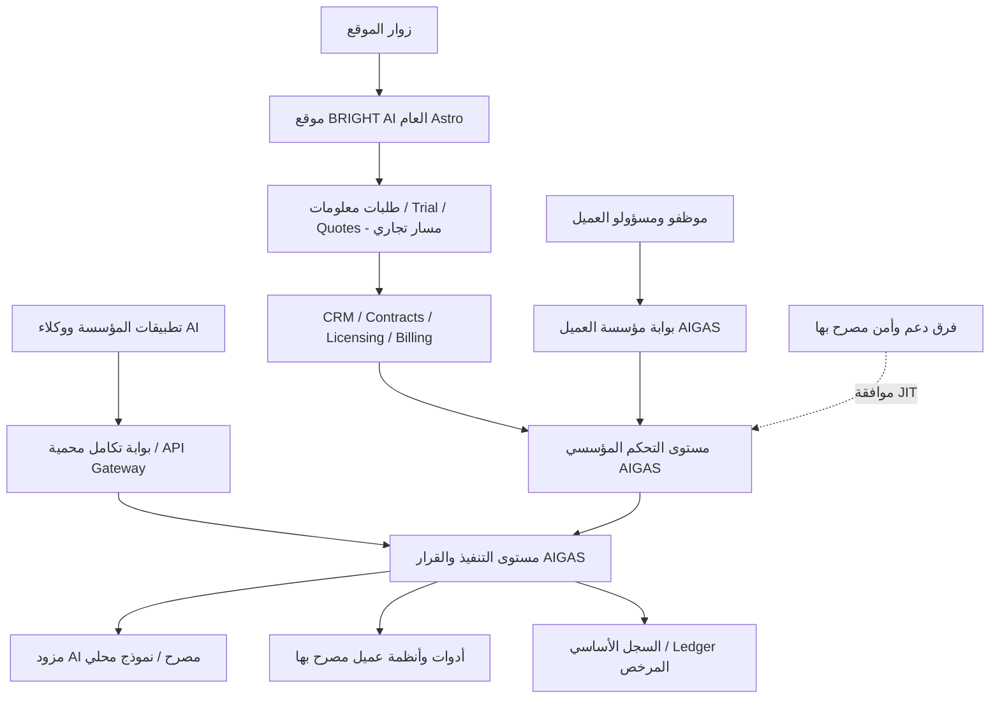
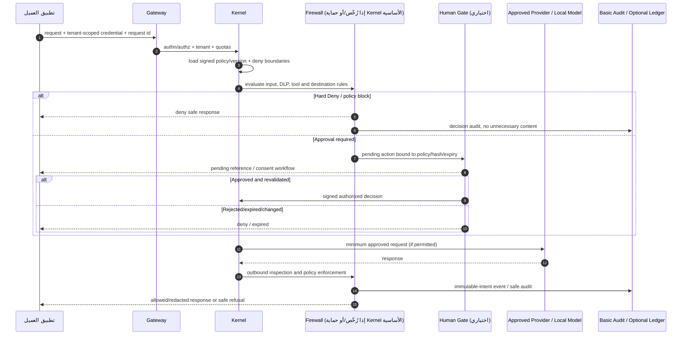
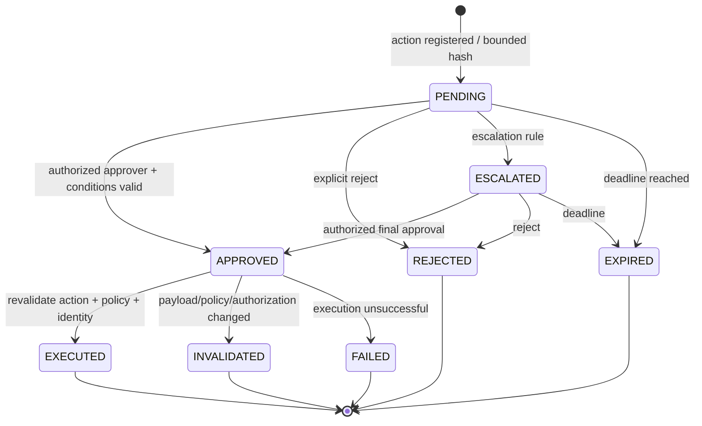
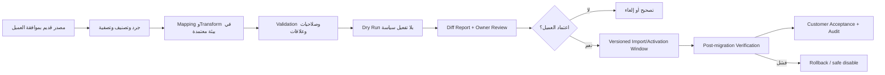

# PLATFORM ARCHITECTURE — BRIGHT AI / AIGAS

> **المسار التنظيمي المعتمد:** `docs/PLATFORM-ARCHITECTURE.md`  
> **النسخة:** `1.0.0` — Architecture Baseline / Target Design  
> **تاريخ التحرير:** 31 أكتوبر 2026  
> **اللغة:** العربية السعودية المهنية، وأسماء العقود والبروتوكولات باللغة التقنية الأصلية  
> **المشروع:** مؤسسة مُشرقة **BRIGHT AI** — **AIGAS: AI Governance & Safety**  
> **المستودع (قراءة فقط):** [`YEEEAE/BRIGHTAI`](https://github.com/YEEEAE/BRIGHTAI) — الفرع `main`  
> **نطاق الاعتماد:** قرارات المشروع حتى السؤال **108**؛ الوثيقة مشتقة ومعمارية **مستهدفة**، وليست اعتمادًا لتفاصيل التنفيذ أو شهادة تشغيل أو بيانًا بوجود منصة مكتملة.  
> **الأثر:** تم إنشاء هذا المستند خارج المستودع فقط. **لا Commit، لا Push، لا تعديل في GitHub أو الإنتاج.**

---

## 00. كيف تُقرأ هذه الوثيقة — عقد الحقيقة المعمارية

هذه الوثيقة تُترجم قرارات المشروع إلى حدود خدمات وعقود ومسارات قرار وضوابط تشغيل. يجب عدم الخلط بين أربع حالات:

| التصنيف | المعنى | ما يجوز قوله |
|---|---|---|
| `APPROVED_REQUIREMENT` | متطلب أو قرار تجاري/هندسي معتمد | «المطلوب تصميمه وتنفيذه» |
| `PROPOSED_DESIGN` | اختيار فني مقترح يحتاج اعتمادًا بعد تحليل البدائل | «توصية معمارية» فقط |
| `IMPLEMENTED_IN_SOURCE` | كود أو أصل موجود في فرع جرى فحصه | «موجود في المصدر الذي فُحص» لا «يعمل بالإنتاج» |
| `VERIFIED_OPERATIONAL` | وظيفة اختُبرت فعليًا في بيئتها المستهدفة بدليل حديث | يجوز وصفها كقدرة تشغيلية **ضمن نطاق الدليل** |

**الحقيقة الحاسمة:** المتطلب المعتمد ليس ميزة منفذة؛ ووجود واجهة أو README أو مخطط لا يثبت سلوك الأمن أو التكامل أو جاهزية بيع المنتج. الأسعار والشهادات ومواعيد الإطلاق وSLA وقياسات الأداء لا تُخترع.

**تسلسل مصادر الحقيقة حسب نوع المسألة:**

1. طلب المالك الأحدث والقرار المعتمد، ضمن الحدود الأمنية والتنظيمية الفعلية.
2. `AGENTS.md` وتعليمات النطاق المحددة، و`.agents/mind/01-mind-latest.md` لتاريخ الحالة والتوجيهات الحالية، مع تحقق من المصدر عند تعارضها.
3. `docs/MASTER-PROJECT-BLUEPRINT.md` لحدود المنتج والتجارية والقرارات حتى 108.
4. `docs/PRODUCT-MASTER-CATALOG.yaml` لأسماء المنتجات، وحدود الوظائف ومعايير MVP والقدرات المرمزة.
5. **هذه الوثيقة** لتقسيم الأنظمة وحدود الثقة والعقود المعمارية.
6. `docs/BRAND-AND-DESIGN-SYSTEM.md` لهوية الموقع والبوابة، و`docs/WEBSITE-PAGE-REGISTRY.yaml` لمسارات الموقع والمحتوى.
7. **الكود الفعلي ومخرجات تشغيل موثقة** لإثبات الحالة الحالية؛ لا تُستخدم الوثائق لتجاوز واقع التنفيذ.

عند تعارض المواصفة الفنية المقترحة هنا مع Blueprint المعتمد، تُراجع المواصفة ولا يُعاد تفسير قرار المالك بصمت. تغيّر المعمارية المعتمدة يحتاج ADR وتقييم أثر وإقرارًا قبل ترسيخه.

---

## 01. الهدف، الحدود والمبادئ غير القابلة للتفريط

**الهدف:** منصة حوكمة وأمان للذكاء الاصطناعي تتيح للمؤسسات السعودية ضبط حركة AI المتكاملة، وتقييم المخاطر، واشتراط مراجعات بشرية، وتوثيق أدلة قابلة للتحقق، واستخدام واجهة محادثة مؤسسية آمنة؛ مع التشغيل سحابيًا أو على بنية العميل أو معزولة تمامًا عن الإنترنت.

**النطاق المدفوع: خمسة منتجات مستقلة:**

| رمز | المنتج | الدور الأساسي | موجة الإطلاق المستهدفة |
|---|---|---|---|
| `AIGAS-FW` | **AIGAS Firewall** | إنفاذ سياسات حماية طلبات AI/ردودها عبر نقاط تكامل معتمدة | 1 — P0 |
| `AIGAS-LD` | **AIGAS Ledger** | أدلة أحداث ذات سلامة تشفيرية والتحقق المستقل والتصدير | 1 — P0 |
| `AIGAS-HG` | **AIGAS Human Gate** | موافقة بشرية فعلية، فصل واجبات، تصعيد وحسم مأمون | 1 — P0 |
| `AIGAS-RE` | **AIGAS Risk Engine** | جرد الأصول والتقييم المفسّر والمراقبة على دورة الحياة | لاحقًا — P1 |
| `AIGAS-SC` | **AIGAS Secure Chat** | محادثة مؤسسية أساسية عبر مزود/نموذج معتمد | لاحقًا — P1 |

**`AIGAS Kernel`** طبقة تأسيسية مشتركة لازمة لكل منتج؛ **ليست منتجًا يُباع برسوم مستقلة**. لا يجوز فرض شراء منتج آخر حتى تعمل وظيفة المنتج الأساسية. ويستمر التدقيق الأمني الأساسي دون Ledger، وحماية المحادثة الأساسية دون Firewall التجاري.

**قواعد ثابتة:**

- **No-Training نهائي:** لا استخدام لمحادثات العميل أو ملفاته أو أحداثه أو Metadata حساسة لتدريب/تحسين نماذج BRIGHT AI أو مورديها، بلا استثناء؛ المورد الذي لا يمكن ضبطه تعاقديًا وتقنيًا لا يمر إليه محتوى العميل.
- **Saudi-first residency:** السعودية افتراضيًا لبيانات SaaS السعودية؛ مكان **التخزين** ومكان **الاستدلال/المعالجة** وسلاسل الدعم/النسخ عناصر منفصلة يجب التحقق منها بحسب العقد والنظام.
- **Fail Secure:** لا تجاوز لحظر سياسة عليا أو حدّ بيانات أو منطقة معالجة بسبب تعطل خدمة أو مزود AI أو Failover.
- **No hidden access:** لا وصول صامت أو باب خلفي إلى أنظمة العميل المحلية والمعزولة.
- **Configuration-first:** تهيئة سياسات وأدوار ومسارات عبر إعدادات، وامتدادات معزولة عند الحاجة، لا Fork منفصل افتراضي لكل عميل.
- **Evidence before claim:** لا شهادات أو نسب دقة أو توفر أو أسعار منشورة قبل الإثبات والاعتماد.
- **Separation of concerns:** الموقع العام وعملية تسويق العملاء منفصلان أمنيًا عن مستوى التحكم المؤسسي ومسار البيانات الحساسة.

---

## 02. صورة الحالة الحالية مقابل المنصة المستهدفة

### 02.1 ما أمكن إثبات وجوده في مستودع GitHub وقت المراجعة

| عنصر | الدليل المصدرِي | قراءة الحالة |
|---|---|---|
| واجهة الموقع | `src/pages/*.astro`, `src/components/*`, `src/styles/*` | موقع عربي Astro وصفحات محتوى/منتجات وتصميمات تفاعلية موجودة في **المصدر** |
| إطار التشغيل للموقع | `package.json`, `astro.config.mjs` | Astro `^6.0.0`، Node `22.x`، Node adapter بنمط `standalone`، Sitemap، `output: server`؛ **لا يثبت تفعيل خدمات AIGAS الخلفية** |
| صفحات المنتجات | `src/pages/products/[product].astro` | خمس صفحات منتجات بمحتوى توضيحي يُصرّح بأن الإتاحة التشغيلية غير متحققة |
| محاكاة Kernel | `src/pages/kernel.astro` | محاكاة محلية لشرح تنقيح بيانات، `noindex`؛ ليست إثباتًا لبوابة AI فعلية |
| مواد Kernel | `kernel/README.md`, `kernel/assets/css/`, `kernel/tests/` | README تاريخي (يوليو 2026) يذكر مسارات API ومكتبات وتكاملات غير مثبتة بشجرة المصدر الحالية؛ لا تعتمد وصفه كحقيقة تشغيلية |
| محتوى SEO | `src/pages/knowledge/`, `src/pages/docs.astro` | مركز معرفة عربي ومحتوى توعوي ضمن حدود الإفصاح |
| GA4 | `src/layouts/BaseLayout.astro` في مراجعة سابقة | وسم `G-9LMB4PGTWJ` موجود بالمصدر؛ رصد فعال لوصول القياسات يحتاج تحقق مستقل، وGSC أداة منفصلة لبحث Google |
| بيانات وخدمات إنتاج AIGAS | لا توجد شواهد كافية في الشجرة المفحوصة | **NOT VERIFIED**؛ لا تفترض DB أو KMS أو IdP أو نموذج Local AI أو خدمات إنتاج أو استضافة سعودية |

**حدود المراجعة:** فحص قراءة فقط لفرع `main` وبنية الملفات/ملفات التهيئة ذات الصلة، مع الرجوع إلى وثائق المشروع المعتمدة. لم يُفحص حساب البنية السحابية أو قاعدة بيانات إنتاج أو مفاتيح أو سجلات تشغيل حية. تاريخ التحقق هو تاريخ إعداد المستند؛ يجب إعادة الفحص عند بدء التنفيذ.

### 02.2 ملاحظة حرجة حول تزامن المستندات

وجود ملفات `docs/` في GitHub أصبح مثبتًا؛ لا يجوز كتابة وصف قديم يقول إن المجلد غير موجود. يجب التحقق من **كل مستند على حدة** قبل افتراض أنه رُفع، أو أن آخر نسخة في المحادثة مساوية لنسخة `main`.

### 02.3 النتيجة الهندسية

**الحالي = موقع وتصورات ومراجع**. **المطلوب = منصة منتجات خلفية مستقلة**. لا يُبنى قرار النشر أو عقد العميل أو مسار البيانات الحقيقي اعتمادًا على الصفحة التسويقية أو README تاريخي.

---

## 03. المخطط العام — C4 Level 1: سياق النظام



**حدود الثقة:** (أ) الإنترنت العام والموقع، (ب) نظام التجارة، (ج) Tenant control plane، (د) مسار القرار الذي قد يحمل بيانات حساسة، (هـ) مزود AI أو أدوات طرف ثالث، (و) أدلة وسجلات محمية، (ز) بيئة نشر العميل. لا يوجد اتصال تلقائي بين هذه الحدود دون مصادقة وتفويض وسياسة وجهة.

---

## 04. الطبقات المنطقية — C4 Level 2

```text
PUBLIC ZONE — website.brightai.live / الموقع العام (عنوان افتراضي للمفهوم فقط)
  Astro Website · Arabic Editorial CMS · SEO / AEO / GEO · GSC + Approved GA4
                  │ lead/quote/trial request (minimal permitted data)
                  ▼
COMMERCIAL ZONE — CRM / Quotations / Contracts / Invoicing / Trial / Licenses
                  │ signed entitlements / provision workflow
                  ▼
CUSTOMER CONTROL PLANE (authorized, per tenant)
  Identity & MFA / SSO / Local IdP
  Organization & Tenant / ABAC+RBAC / Policies & Exceptions
  Product Entitlements / Version Compatibility / Budgets
  AI Asset Inventory / Models & Provider Approvals
  Approval Workflow Definitions / Retention & Export / Dashboards
                  │ signed/versioned policies + scoped identities
                  ▼
ENFORCEMENT & DATA PLANE (tenant-scoped, restricted egress)
  Gateway → Kernel Decision + Essential Safety/Audit
       ├── Firewall  : enforce/protect only integrated paths
       ├── Risk Engine: assess/monitor (licensed, optional)
       ├── Human Gate: authorize high-impact actions (licensed, optional)
       ├── Ledger    : verifiable evidence (licensed, optional)
       └── Secure Chat: approved-model conversation (standalone)
                   │
         Provider Adapter / Local Model / Authorized Tools
                   │
  Basic Security Audit + Optional Ledger Evidence

CROSS-CUTTING: KMS / secrets / RLS & storage isolation / queues / backups /
               telemetry / incident handling / licensing / signed release bundles
```

> الأسماء داخل هذا الرسم **حدود مسؤولية تصميمية**، وليست أسماء Services أو Endpoints أو DNS موجودة. لا تُنشأ Microservices لكل صندوق من دون قرار سعة وأمان وتكلفة معلل.

### 04.1 خيار تقسيم التنفيذ المقترح

- **MVP:** وحدات Modular Monolith أو خدمات قليلة محددة الحدود، مع مسار مستقل لطلبات Firewall/موافقات Human Gate وتخزين Ledger بحسب الحاجة. الحفاظ على العقود أهم من كثرة العمليات.
- **SaaS عند التوسع:** يمكن فصل Gateway/Policy Evaluation/Approval Workers/Evidence Ingest عند ثبوت اختلاف متطلبات التوسع والفشل والتشغيل؛ لا فصل شكلي.
- **On-Prem/Air-Gapped:** حزمة خدمات محلية قابلة للتثبيت بنطاق العميل، مع الهوية والترخيص والمراقبة محليًا، وبدون تبعية Control Plane سحابي.
- **قواعد البيانات والوسطاء:** نوع DB/Queue/Cache/Orchestrator **غير معتمد**. تنص الوثيقة على خصائصها المطلوبة لا على منتج أو مزود إلزامي.

---

## 05. حدود AIGAS Kernel — ما يجب أن يملكه وما لا يملكه

| نطاق | وظيفة Kernel الأساسية | ممنوع الاعتماد عليه بديلًا عن |
|---|---|---|
| Identity/Tenant | تعريف Tenant/User/Session/ServiceAccount وMFA/SSO أو Local Identity | شراء منتج آخر للتوثيق الأساسي |
| Authorization | RBAC/ABAC وإنفاذ سياسات عليا وScopes/SoD | Risk Engine التجاري الكامل |
| Licensing | ترخيص موقّع، Entitlements، حصص، توافق إصدار، تحقق Offline | اتصال دائم بخادم تراخيص SaaS في Air-Gapped |
| Secrets/Connectors | هويات موصلات، مفاتيح مع تدوير/إبطال وصلاحية | مشاركة مفتاح واحد عبر مؤسسات |
| Essential Security | حدود استعمال آمنة، فحص أساسي يناسب المنتج، منع تجاوز الحظر | Firewall التجاري المتقدم كشرط لكل منتج |
| Basic Audit | تسجيل حد أدنى آمن ومحمى للأحداث الضرورية | Ledger التجاري ذي التحقق المستقل والاحتفاظ والإصدارات |
| Reliability | Health/Telemetry/compatibility/fail-secure بحسب النوع | الاعتماد على خدمة غير مرخصة في المسار الحرج |
| Offline | تشغيل محلي مستقل بما يلزم: حسابات، هوية، مفاتيح، تراخيص | Cloud Check أو وصول دعم خفي |

**قاعدة الاستقلالية:** إذا اشترى العميل Ledger وحده أو Human Gate وحده، يجب أن تعمل وظائفهما المعلنة مع Kernel اللازم وموصلاتهما المعتمدة. إذا تعذر عنصر أساسي، يُوثق كاعتمادية تقنية ضمن Kernel وليس كبيع إلزامي لمنتج آخر.

---

## 06. حدود المنتجات الخمسة وعقود الاستقلال

### 06.1 Firewall — `FW-*`

- **يستقبل:** هوية مستأجر ومُستدعي، محتوى/مرجع الطلب عند السماح، الوجهة، نوع البيانات، سياق السياسة، `correlation_id`.
- **يقرر وينفذ:** `ALLOW`, `WARN`, `REDACT`, `REQUEST_APPROVAL`, `BLOCK`؛ لا يمكن لمخرجات نموذج أن تنسخ `Hard Deny`.
- **حد الفاعلية:** حركة AI المارة بنقاط تكامل مفعّلة ومصرح بها فقط؛ لا حماية سحرية لتطبيقات خارج التغطية.
- **MVP:** إنفاذ السماح والرفض في طلب حقيقي، سياسة بإصدار، عزل وAudit أساسي، وسلوك تعطل آمن. المراقبة Shadow قبل Enforcement وفق موافقة العميل وحدود السياسة، لا لتجاوز محظور.
- **اختياري:** Risk Engine لتقييمات متقدمة، Human Gate للموافقات المنظمة، Ledger لتوثيق أدلة متقدمة؛ ليست شروطًا للبيع المستقل.

### 06.2 Ledger — `LD-*`

- **يستقبل:** أحداث ذات أصل موثوق وتوقيت وتعريف منتج وTenant وتتابع مناسب ومراجع القرار والسياسة؛ **metadata أولًا** وتقليل المحتوى.
- **ينتج:** أدلة قابلة للتصدير والتحقق المستقل من سلامتها عبر Hash/Signature/Chain أو تصميم مكافئ موثق؛ لا يُسوّق على أنه «غير قابل لأي تعديل مطلقًا» بلا حدود تهديد واضحة.
- **الاحتفاظ:** سياسات حسب العميل/نوع الدليل، Legal Hold، حدود الحذف والتصدير وسلامة سلسلة التحقق بعد تدوير المفاتيح.
- **الفشل:** عند تعطل التخزين الأساسي، يُستخدم مسار محلي/احتياطي موثوق إن كان مسموحًا ومهيأً؛ إذا فشل كل مسار لتسجيل حدث **إلزامي**، يُوقف الفعل الخاضع لهذا الإلزام (fail closed) ولا يُزوّر إثبات نجاح.
- **MVP:** تسجيل حدث حقيقي، تحقق مستقل يكشف العبث، تصدير/استرجاع بصلاحيات، واختبار عزل Tenant.

### 06.3 Human Gate — `HG-*`

- **يستقبل:** طلب قرار مُجمّد المعلمات `pending_action`, `policy_version`, `risk_context`, `requester`, `target_system`, `expiry`.
- **ينفذ:** Approval/Reject/Escalation/Timeout ضمن هوية واعتماد MFA عند الحاجة؛ Separation of Duties فلا يعتمد صاحب الطلب بنفسه حالة يمنعها الضابط.
- **قاعدة P0:** **الموافقة لا تعني تنفيذًا افتراضيًا ناجحًا**؛ يجب إعادة التحقق من صلاحية القرار وتغيّر المعلمات/التوقيع/السياسات قبل استدعاء الأداة. انتهاء المهلة يُحسم آمنًا وفق السياسة، ولا يتحول لسماح صامت.
- **MVP:** طلب/اعتماد/رفض حقيقي ومتحقق السلطة، حالة يمكن تتبعها، منع الفعل قبل الموافقة، وتوثيق أساسي.

### 06.4 Risk Engine — `RE-*` (لاحقًا)

- **الدور:** جرد أصول AI المعتمد يدويًا أو المكتشف في نطاق إذن، تقييم مفسر بالأسباب والضوابط، متابعة drift، ونطاق قواعد وضوابط مستمرة.
- **حده:** تقييم متخصص مساعد للقرار؛ لا ينبغي أن يُحوَّل فشل خدمته إلى تجاوز سياسة إلزامية في Kernel/Firewall.
- **MVP لاحق:** تقييم موثق بمنهج ونسخة وأدلة، دورات موافقة وإعادة تقييم، وعدم نشر درجة رسمية غير معتمدة.

### 06.5 Secure Chat — `SC-*` (لاحقًا)

- **الدور:** واجهة محادثة أساسية خاصة بالمؤسسة، توجيه لمزود/نموذج معتمد، وحماية أساسية وتقليل بيانات حسب Kernel.
- **لا يتضمن نطاقًا إلزاميًا:** RAG، Knowledge Base، رفع ملفات مؤسسة، مشاركة عامة، أو مزايا ضخمة لم يُعتمد تنفيذها.
- **الخصوصية:** محادثات خاصة افتراضيًا، سجل اختياري مضبوط، وصول إداري استثنائي مخول ومدقق، ولا تدريب للمزوّد أو لـBRIGHT AI.
- **الاستقلال:** لا يُشترط شراء Firewall التجاري لعمل المحادثة الأساسية الآمنة؛ التكامل معه يزيد مستوى الحماية عند الترخيص.

### 06.6 تصنيف الاعتماديات

- `HARD_SHARED`: مكون Kernel أساسي للهوية/الصلاحية/الترخيص/الحماية/الأثر الأدنى.
- `OPTIONAL_LICENSED`: اتصال بين منتجين مدفوعين، يُفعّل فقط عند توفر ترخيص وقرار صريح.
- `EXTERNAL_APPROVED`: مزود AI/أداة/SSO/منصة بيانات مصرح بها.
- `LOCAL_RUNTIME`: موارد داخل نشر العميل، ذات مالك ومسؤولية واضحة.

لا تعيد واجهة المستخدم تسمية الاعتمادية الاختيارية إلى «شرط لتشغيل المنتج» دون موافقة لتعديل كتالوج المنتجات.

---

## 07. مسارات البيانات وحدود الثقة

| معرف | مسار | ما يُسمح بنقله | نقطة قرار أمنية |
|---|---|---|---|
| `F-01` | تطبيق عميل → Gateway → Kernel | هوية/Scope وسياق طلب أدنى | Authentication, tenancy, budget, allowed integration |
| `F-02` | Kernel → Firewall → مزود AI | محتوى بعد سياسة DLP والتوجيه/الموافقة | Policy version, Hard Deny, provider/region approval |
| `F-03` | Runtime → Human Gate → Tool | بصمة/مرجع/معلمات فعل وموافقة | Bind approval to action & identity & expiry |
| `F-04` | Runtime → basic audit → Ledger اختياري | Metadata وEvidence مصنف بأقل محتوى | retention/immutability/key scope/legal hold |
| `F-05` | Portal → Control Plane | إعدادات وصلاحيات بدون أسرار مباشرة | authenticated admin, MFA/SoD, policy changes audited |
| `F-06` | Commerce → Licensing | Entitlements وأثر العقد والفوترة | signed license, no raw payment card data as required |
| `F-07` | Onboarding → Migration → Policy | ملفات Mapping وحزم مراجَعة | dry run, diff, approval, staged activation |
| `F-08` | Operations → Customer support | نطاق دعم مؤقت وموافقة | JIT grant, no covert offline access |

**البيانات لا تنتقل إلى جهة خارجية تلقائيًا لمجرد أن المستخدم اختار نموذجًا داخل واجهة.** السياسة والعقد ومكان المعالجة واعتماد المزوّد تحكم الإرسال.

---

## 08. دورة طلب AI محمي — المسار الآمن الأساسي



**ملاحظات أمنية إلزامية:**

1. التحقق من JWT/API key وحده لا يكفي؛ لا بد من Tenant Scope وسياسة المورد والوجهة والبيانات.
2. يطبق المنع على **المدخلات والمخرجات** وعند استدعاء أدوات وكلاء AI.
3. `WARN` لا يساوي `ALLOW` إذا كان سبب التحذير سياسة منع إلزامية.
4. `REDACT` يجب أن يكون له معيار تحقق وإلا يتحول إلى تسريب متبقٍ؛ لا ضمان كشف كامل.
5. التدقيق يُحفظ دون إدراج Prompt حساس كامل افتراضيًا؛ توثيق المحتوى الكامل يتطلب سياسة وأساسًا وصلاحية.
6. فشل المزود أو الاعتمادية لا يبرر استدعاء مزود غير معتمد أو الرجوع لنقطة حماية أضعف.
7. نتيجة Approval مقيدة بنفس `action_payload_digest` و`policy_version` والجهة والمهلة، مع إعادة تحقق عند أي تغير.

---

## 09. محرك السياسات — Policy-as-Data مع تفسير القرار

**الوراثة المعتمدة:** `Enterprise → Department → Product → User`. لا يسمح للمستويات الأدنى برفع الحظر الصادر من الأعلى. ترتيب النزاع المقترح:

1. متطلبات تقنية/تنظيمية **إلزامية قابلة للتطبيق** وHard Deny موثق.
2. سياسة المؤسسة العليا مع حد البيانات ومزود/منطقة معالجة معتمدة.
3. سياسة القسم/حالة الاستخدام.
4. سياسة المنتج.
5. تفضيلات المستخدم التي لا تخفف القيود.

**عقد سياسة مستهدف، وليس مخطط DB نهائيًا:**

```yaml
policy_id: example-policy-identifier
version: example-version
scope: ENTERPRISE | DEPARTMENT | PRODUCT | USER
owner_role: authorized-policy-owner
conditions: [data_class, actor, provider, region, tool, action]
action: ALLOW | WARN | REDACT | REQUIRE_APPROVAL | BLOCK
mandatory: true # عند الحاجة؛ لا يقبل تجاوزه استثناء غير مصرح
approval_reference: optional-approved-record
rollback_reference: optional-previous-version
```

**تدقيق التغيير:** إنشاء/مراجعة/اعتماد/نشر/تراجع. في السياسات الحساسة فصل دور المراجع عن المنفذ، ومعرّفات وتوقيع سياسة معتمد إن دعت الحاجة. سياسة `Shadow` للقياس قد تتخذ نتائج موازية، **لكن لا تعطل Hard Deny المفعل**.

---

## 10. الهوية والسلطة والاستقلال المؤسسي

- **Tenant Root:** كل طلب/حدث/مورد يعبر عن `tenant_id` موثوق لا يؤخذ من حمولة العميل وحدها.
- **User & Service Identity:** مستخدم بشري، خدمة، وكيل، موصل؛ كل فئة لها اعتمادياتها وScopesها.
- **Authentication:** MFA لمسارات الإدارة والقرارات الحساسة؛ Entra/SSO عند التهيئة؛ Local IdP/Accounts لـAir-Gapped.
- **Authorization:** RBAC + ABAC حسب الدور، المؤسسة، التصنيف، الإجراء، البيئة، والوقت عند الحاجة؛ Zero Trust لكل أداة Agent.
- **SoD:** فصل إنشاء السياسة واعتمادها؛ فصل طلب المساعدة والوصول لمحتوى العميل؛ فصل تسعير/اعتماد خصومات حساسة؛ لا موافقة ذاتية على الحالات المحظورة.
- **Session/Key:** مدة محدودة، إبطال وتدوير وتدقيق؛ لا أسرار في المتصفح أو الموقع العام أو Logs.
- **Support Access:** طلب JIT بصلاحية قصيرة ومحددة وبموافقة العميل وأثر تدقيقي؛ في Air-Gapped موافقة محلية ودعم دون شبكة خفية.
- **Emergency:** إجراء طوارئ تعاقدي ومُدقق ومقيد، لا مفتاح تحكم دائم لدى BRIGHT AI.

---

## 11. عزل المستأجرين والبيانات

**SaaS الافتراضي:** عزل منطقي صارم لكل مستأجر، مع تقنيات مثل Row-Level Security **إذا اختيرت DB مناسبة**، وتفويض على مستوى الخدمات. شرط `tenant_id` في التطبيق لا يكفي وحده.

| الطبقة | الضابط المطلوب |
|---|---|
| Database | Tenant authorization عند كل قراءة/كتابة، سياسات على مستوى البيانات أو عزل مكافئ، منع Cross-Tenant joins غير المصرح بها |
| Object Storage | نطاقات وصول ومسارات/MAC أو buckets منفصلة عند الحاجة، روابط مؤقتة وصلاحيات دقيقة |
| Cache | مفاتيح Namespaced + TTL + منع cache poisoning/tenant mixups |
| Queue/Events | tenant-scoped envelopes, worker verification, tenant-aware DLQ/retention |
| Secrets/KMS | فصل المفاتيح ونطاق استخدامها وتسجيل الوصول |
| Telemetry & Search | منع وصول مستخدم عميل لسجلات عميل آخر، وتقليل حساسية الـtraces |
| Backup & Restore | إمكان استعادة مستأجر أو موارد وفق العقد دون كشف غيره؛ اختبار الخطة |
| Admin/Support | JIT + customer approval + audit; no cross-tenant superuser by default |

**Dedicated resources** لعميل مؤسسي حسّاس عند شرط عقدي أو نتيجة تقييم مخاطرة. الاستضافة المحلية تُطبق تقسيمًا محليًا وعزلًا داخليًا بحسب بيئة العميل، ولا يُفترض أنها Multi-tenant بالمعنى السحابي إلا إذا صُممت لذلك.

---

## 12. الخصوصية وتصنيف البيانات ودورة الحياة

**فئات نموذجية:** `PUBLIC`, `INTERNAL`, `CONFIDENTIAL`, `RESTRICTED`, إضافة إلى فئات بيانات شخصية/صحية/مالية بحسب سياسة الجهة والنظام المنطبق. التصنيف **قابل للتهيئة** وليس قانونًا عامًا يطبق آليًا على الجميع.

### 12.1 سياسة التجميع والاحتفاظ

- Collect minimally؛ احفظ مراجع وبصمات عند كفايتها بدل محتوى كامل.
- حقول `prompt_body`, `chat_history`, `tool_arguments`, `audit_content` حساسة افتراضيًا؛ لا تخلطها مع سجلات أداء عامة.
- retention settings للرسائل، الأحداث، الأدلة، الـCRM، الفوترة، النسخ الاحتياطية، مع `Legal Hold` وصلاحياته.
- مراجعة الموردين، DPA، No-Training والتخزين والمناطق والتصرف بالبيانات قبل أي API AI خارجي.
- **حق الخروج:** تصدير منظم للبيانات والسياسات والأصول والأدلة حسب العقد، حذف آمن وحدود النسخ الاحتياطية بعد انتهاء الحق والالتزام.
- لا استخدام لبيانات عملاء حقيقية في Non-Production إلا بحالة مصرح بها وضوابط معتمدة؛ افتراضيًا بيانات اصطناعية.

### 12.2 No-Training Enforcement

بجانب التعهد التعاقدي، تتطلب العمارة Provider Allowlist وشروط DPA مثبتة وتوثيق سياسة المعالجة، ومنع تحويل البيانات إلى Logs تدريب/Telemetry خارجية. مجرد اختيار متغير `training: false` في واجهة غير مثبتة لا يغني عن موافقة وضوابط المزود.

---

## 13. إدارة مزودي AI والنماذج وتوجيه الطلبات

**Provider Registry** هدف تصميمي يتضمن على الأقل: معرف المورد، إصدار النموذج، منطقة المعالجة، شروط التدريب والاحتفاظ، فئات بيانات مسموحة، حالة اعتماد، طريقة مصادقة/تكلفة، وحدود العطل.

**قرار اختيار نموذج:**

```text
1. تحقق من عقد العميل ونوع البيانات والغرض.
2. ارفض المورد أو منطقة المعالجة غير المعتمدة.
3. طبّق قيود السياسة والترخيص والميزانية والحصة.
4. اختر المورد/النموذج من الخيارات المسموحة فقط.
5. عند تعطل المورد، انتقل فقط إلى بديل معتمد بنفس حدود البيانات/المنطقة؛ وإلا امنع الطلب بأمان.
6. سجل metadata كافيًا للدليل والتكلفة دون تخزين prompt خام افتراضيًا.
```

- **BYOK** اختياري وفق العقد والإعداد، بمفاتيح مشفرة ومحفوظة في KMS/HSM محلي أو مستضاف حسب وضع النشر.
- **Air-Gapped** نماذج محلية فقط، مع فحص تراخيص النموذج وحقوق الاستخدام وأوزانه وإمدادات GPU والـSBOM/Model BOM عند الحاجة.
- **لا ادعاء أن Groq/Gemini نشطين** لمجرد وجود وصف في `kernel/README.md`؛ لا يوجد إثبات كافٍ بمكونات المصدر الحالية.
- أي استدعاءات تدريب أو Fine-Tuning بمحتوى العميل **محظورة** ضمن السياسة المعتمدة.

---

## 14. التحكم في أدوات AI Agents وواجهات التكامل

- نقاط تكامل مقترحة: REST APIs، SDK لـTypeScript/Python، Webhooks آمنة، MCP Server/Connector عند ثبوت الحاجة؛ A2A لاحقًا وغير معتمد كميزة متاحة.
- كل عملية Tool Call لها فاعل وTenant وScope وDestination وAction وBudget وقابلية عكس وتصنيف خطر.
- **فصل قراءة مستند عن صلاحية تنفيذ أداة:** المحتوى المسترجع غير الموثوق لا ينشئ صلاحيات.
- عمليات ذات أثر خارجي أو غير قابل للعكس يمكن أن تُحال إلى Human Gate مع إعادة تحقق قبل التنفيذ.
- Zero Trust للموصلات: مفاتيح مستقلة، دوران، إعادة محاولة محدودة، timeouts، circuit breakers ومراجعة موفري الأطراف الثالثة.
- لا ادعاء حماية مسارات AI غير المدمجة. يجب توثيق **Integration Coverage** لكل عميل ومصدر حركة.

---

## 15. العقود والأحداث والاتساق

### 15.1 معايير مشتركة للرسائل — تصميم لا Schema نهائي

| حقل | الغرض | ملاحظة |
|---|---|---|
| `event_id` | إزالة التكرار / correlation | UUID/ULID أو بديل معتمد، بلا قيمة نهائية مقررة |
| `tenant_id` | عزل وربط | من سياق مصادق لا من Input فقط |
| `actor_id`, `actor_type` | من قام بالفعل | بشري/Service/Agent/Connector |
| `correlation_id`, `causation_id` | تتبع سلسلة القرار | لا تكشف محتوى حساسًا |
| `policy_id`, `policy_version` | إعادة تفسير القرار | Preserve effective version |
| `product_id`, `product_version` | المصدر والتوافق | قابل للتحقق من release metadata |
| `occurred_at`, `recorded_at` | وقت الحدث/التسجيل | تحديد مصدر الوقت وحدود اختلافه |
| `classification`, `retention_class` | التحكم في المحتوى والعمر | لكل Tenant ونوع حدث |
| `payload_digest` | ربط Integrity | لا يستخدم hash غير محمي لإخفاء PII حساسة |
| `decision_id` | ترابط الإجراء والنتيجة | لا خلط مع Approval ID |

### 15.2 أنماط الاتصال المقترحة

- **Synchronous** في التحقق والإنفاذ والقرار الذي يحدد السماح بإرسال بيانات أو تنفيذ أداة.
- **Durable Asynchronous** للأحداث الثانوية والتقارير والفوترة ومهمات Risk Engine، بشرط ألا يصبح تأخيرها وسيلة لتجاوز الدليل الإلزامي.
- **Outbox/Inbox أو بديل موثوق** لتحقيق تسليم آمن للأحداث عند اختلاف مخازن الكتابة؛ لا نفترض Exactly-Once عبر كل الأنظمة.
- `idempotency_key` لاستدعاءات الأوامر/الفوترة/ترحيل البيانات؛ تعالج عمليات Retry بتأكيد آخر حالة قبل إعادة تنفيذ عمل خارجي.
- **API Versioning:** OpenAPI + backward compatibility حسب سياسة الإصدار وتوافق Kernel/Products؛ لا نفترض مسارات REST موجودة.

### 15.3 أحداث تجارية/أمنية نموذجية

`AIRequestReceived`, `PolicyEvaluated`, `ProtectionDecisionApplied`, `ApprovalRequested`, `ApprovalResolved`, `EvidenceCommitted`, `RiskAssessmentCompleted`, `AIAssetRegistered`, `UsageRecorded`, `LicenseStateChanged`, `SecurityIncidentOpened`, `MigrationDryRunCompleted`, `CustomerAcceptanceRecorded`.

هذه **أسماء أحداث مستهدفة** وليست Queue Topics أو Payloads جاهزة في المستودع.

---

## 16. تصميم أدلة Ledger والتحقق من السلامة

**خصائص ملزمة:** مصدر موثوق للأحداث، سلامة يمكن التحقق منها مستقلًا، فصل توقيع الدليل عن مفاتيح التشفير، تصدير قابل للتحقق، احتفاظ حسب العقد، ومنع مسح أثر الحوادث دون مسار قانوني.

**ترشيح فني يحتاج ADR:** سلسلة Hash أو Merkle Tree مع توقيع رقمي دوري ومرجع ترتيب موثوق داخل نطاق tenant/partition، وتوثيق تغيّر المفاتيح وإصدارات الصيغة. تستخدم تلك الآليات لإظهار **التلاعب أو النقص** وفق نموذج التهديد؛ لا تعني «استحالة تعديل» كل طبقات التخزين.

**Workflow مستهدف:**

1. تصنيف الحدث وتحديد الحد الأدنى من البيانات المرخصة.
2. ربط `event_id`, `tenant_id`, `policy_version`, `source`, `timestamp` والتحقق من إدخال مكرر.
3. إيداع دائم/مؤقت موثوق حسب تصنيف الحدث؛ تعذر الإيداع الإلزامي يوقف الفعل الخاضع له.
4. حساب بصمات وتوقيع ضمن مفتاح مسموح وحفظ سلسلة إثبات ودليل تدوير مفاتيح.
5. تصدير Bundle فيه Proof وManifest وأدوات/صيغة تحقق مستقلة عن المنتج قدر الإمكان.
6. تحقق العميل أو المدقق من سلامة الدليل مع إثبات سبب رفضه عند العبث أو انقطاع التتابع.

التوقيع/الختم لا يثبت **صحة القرار الواقعي** أو نزاهة مصدر غير موثوق؛ هو يثبت فقط حدود سلامة الأثر الموثقة.

---

## 17. Human Gate — نموذج الحالات ومنع السباق



**ضوابط:** CAS/Concurrency control أو Transactional State، ومنع الاعتماد المكرر، واستدعاء الأداة مرة واحدة بمفتاح Idempotency عند ملاءمة الواجهة. `APPROVED` ليست `EXECUTED`، و`TIMEOUT` لا ينتقل إلى سماح تلقائي. كل قرار له سجل أساسي وقد يتكامل مع Ledger حسب الترخيص.

---

## 18. نموذج البيانات المرجعي — Conceptual Data Architecture

| المجال | كيانات منطقية | محددات مهمة |
|---|---|---|
| Tenant / IAM | `Organization`, `Tenant`, `User`, `Role`, `Membership`, `ServiceAccount`, `IdentityProvider` | نطاق Tenant، أقل صلاحية، جلسات قصيرة |
| Governance | `Policy`, `PolicyVersion`, `PolicyException`, `Control`, `ApprovalWorkflow` | Versioned policy، reviewer، effectivity/rollback |
| Product | `Product`, `Entitlement`, `License`, `Compatibility`, `Deployment` | كل منتج مرخص ومستقل، Kernel included |
| AI Control | `AIAsset`, `AIModel`, `ProviderApproval`, `ToolPermission`, `RiskAssessment` | منطقة المعالجة، الغرض، مالك، نسخ |
| Decision | `RequestContext`, `ProtectionDecision`, `ApprovalRequest`, `ApprovalResolution` | idempotency، سياسة مؤثرة، فصل SoD |
| Evidence | `BasicAuditEvent`, `EvidenceBundle`, `EvidenceProof`, `RetentionPolicy`, `LegalHold` | Content minimization + hash/signature lifecycle |
| Commercial | `Lead`, `Trial`, `Quote`, `Contract`, `Subscription`, `UsageRecord`, `Invoice`, `Budget` | لا ازدواجية فوترة، تجربة محدودة بلا ترقية صامتة |
| Lifecycle | `Onboarding`, `ReadinessAssessment`, `MigrationJob`, `DryRunReport`, `CustomerAcceptance` | جداول mapping، تفويض/موافقة، تراجع |
| Operations | `Incident`, `SupportGrant`, `ProductRelease`, `SBOM`, `BackupArtifact` | صلاحيات مؤقتة وإصدارات موقّعة |

**غير محسوم:** DB vendor, schema names, normalization, partition keys, index strategy, encryption algorithm details, deployment orchestrator. لا يُفترض أن أسماء هذه الكيانات جداول موجودة.

---

## 19. خيارات النشر — SaaS / On-Premise / Air-Gapped

| المكوّن | SaaS | On-Prem/Private Cloud متصل | Air-Gapped |
|---|---|---|---|
| إدارة Tenant | Cloud Control Plane مع عزل | داخل بيئة العميل | داخل بيئة العميل فقط |
| الهوية | MFA + SSO مرخص | SSO أو Local IdP | حسابات أو IdP محلي مستقل |
| تراخيص المنتجات | Entitlements عبر التجارة | ترخيص محلي موقّع، تحقق وفق العقد | رخصة محلية موقّعة **دون تحقق سحابي دوري** |
| النماذج | مزود معتمد/مصرّح إقليميًا | نموذج محلي أو مزود خارجي مصرح | **نماذج محلية فقط** |
| الأسرار/المفاتيح | KMS/HSM مناسب أو BYOK | نظام مفاتيح العميل/خدمة محلية | KMS/HSM أو بديل محلي موثق بلا Cloud |
| سجل القرار | عزل Tenant | داخلي/محلي | محلي بالكامل، تصدير يدوي مصرح |
| Telemetry | مراقبة مع عزل | محلية أو مشاركة اختيارية | محلية دون إبلاغ خارجي افتراضي |
| Support | JIT مقيد بعميل | جلسة مأذون بها ضمن نافذة | حضور/حزمة offline، بلا Remote Backdoor |
| تحديثات | نشر متدرج مع rollback | حزمة معتمدة وفق نافذة | حزمة **موقّعة** تُنقل وتتحقق محليًا |
| Backup/DR | RPO/RTO وفق عقد وقياس | حسب مسؤولية العقد | محلي بالكامل وفق خطة العميل |

### 19.1 حدّ Air-Gapped غير قابل للتفاوض

تشغيل بدون DNS/Internet/Cloud Licence/Cloud IdP/Telemetry vendor/online CRL أو Model API. يجب أن تظل آليات التحقق من الرخص والتحديثات والأدلة والمفاتيح متاحة محليًا وتحت سيطرة العميل، مع خطة لإلغاء/تدوير الثقة عبر حزم محلية مدققة. **لا يوجد إرسال صامت لـBRIGHT AI تحت أي ظرف.**

### 19.2 الترخيص الدائم

إذا كان الترخيص `perpetual` بعقد صحيح، انتهاء رسوم الصيانة **لا يلغي وحده حق استعمال النسخة المرخصة**، مع استمرار حدود الترخيص الأصلية وعدم افتراض حق ترقيات أو دعم إضافي.

---

## 20. مسؤوليات البنية التقنية للعميل — Shared Responsibility

> **هذه مصفوفة اقتراح تنظيمي** (لم تُعتمد كعقد مستقل ضمن القرارات حتى 108)، وتضبطها اتفاقية العميل وتفاصيل النشر. لا تعتبرها نقلًا تلقائيًا للمسؤولية القانونية.

| المجال | SaaS | On-Prem / Air-Gapped |
|---|---|---|
| تطبيق AIGAS وتصحيحات الأمان للبرمجية | BRIGHT AI وفق SLA | BRIGHT AI يوفر الحزم/الإرشاد وفق العقد؛ العميل يتحكم بالنشر |
| خوادم/شبكة/Storage/Backup | المشغل المستضيف المتعاقد ضمن مسؤولياته | العميل غالبًا مسؤول عن الموارد والمراقبة المحلية بموجب العقد |
| مفاتيح التشفير | خدمة مُدارة أو BYOK حسب العقد | إدارة العميل أو تفويض محدد، Offline مستقلة |
| السياسات وتعريف المستخدمين | عميل ومفوضوه؛ BRIGHT AI يدعم بالأدوات | عميل ومفوضوه |
| اعتماد الموردين/مناطق البيانات | التزام متبادل بعقد ومعالجة | بحسب اختيار العميل واعتمادات التهيئة |
| الاستجابة للحوادث | تقسيم أدوار وتبليغات حسب العقد | تقسيم صريح للأدلة والوصول والإصلاح |
| تفعيل تحديث أو Rollback | المشغل ضمن خطة نشر | موافقة/تشغيل العميل وفق Runbook |
| وصول الدعم | موافقة JIT | موافقة صريحة محلية، **لا وصول ضمني** |

القرار الفني/التجاري لكل نشر يخرج في وثيقة Customer Deployment Responsibility Matrix موقعة وقت التهيئة، ولا يُحسم هنا باسم كل جهة مسبقًا.

---

## 21. البنية التحتية وتخطيط السعة — القرار (107)

**موافَق عليه:** مواصفات مرجعية لكل منتج + تقييم فعلي لكل عميل قبل عرض السعر والتفعيل. **لا أرقام CPU/RAM/GPU/Latency/SLA مُختلقة.**

**مدخلات sizing:** عدد المستخدمين والمتزامنين، طلبات AI ومعدل الذروة، حجم Prompt/Response، المنتجات المختارة، أنواع التكامل، حجم بيانات Ledger/Retention/Legal Hold، تخزين النموذج المحلي وأوزانه ومتطلبات GPU/CPU والـVRAM، HA/DR، مواقع/شبكات العميل، التشفير والمفاتيح ونسخ البيانات.

**مخرجات إلزامية:** `Sizing Worksheet` مع الافتراضات ووحدة القياس، Profile تشغيل أولي منخفض المخاطر، شبكة وقائمة منافذ واعتماديات، اختبار قبول/قدرة تحت بيانات صناعية مناسبة، حدود الأداء المرصودة، إجراءات الزيادة، تقدير تكاليف وعناصر العقد؛ ثم `Readiness Sign-off` قبل تفعيل الإنتاج المحلي. لا يُزعم أن Benchmark لسيناريو يمثل جميع العملاء أو الأحمال.

**قرار GPU:** لوجود نماذج محلية فعلية فقط؛ لا يُفرض على منتجات تعتمد سياسات/أحداث حتمية إلا إن احتاج تصميمها المعتمد إلى inference محلي مثبت.

---

## 22. التخزين، النسخ الاحتياطي، HA، DR

- اختيار آليات تخزين Transactional للحالة/الموافقات/التراخيص، وObject Storage للأدلة عند الحاجة، وQueue/Cache **بحسب حجم الحمل** لا كشرط تقني مسبق.
- تمييز `backup` من `evidence`: النسخة الاحتياطية ليست Ledger ولا تبرهن سلامة الحدث بمفردها.
- شمول الأسرار ومفاتيح التحقق وسجلات تراخيص Offline وأدلة/سياسات Tenant في خطط الاستعادة حسب صلاحية العقد.
- RPO/RTO/SLA أرقام **تُحسم تعاقديًا بعد تحقق قدرة التشغيل والاستعادة**، ولا يُنسخ رقم موحد على جميع البيئات.
- تشغيل HA لا يعفي من فحص Split-Brain، Duplicate Approvals، Event Ordering وLedger Chain Continuity.
- لا يجوز فقدان Hard Deny أو إتاحة الوصول إلى Tenant آخر عند استرداد الخدمة.
- يجب اختبار إعادة التشغيل/النسخ والتراجع في بيئة آمنة مع بيانات لا تتضمن أسرار عميل غير مصرح بها.

---

## 23. استراتيجيات التعطل الآمن — Failure Mode Matrix

| نوع الفشل | التصرف المعماري المستهدف | السبب |
|---|---|---|
| تعذر المصادقة/التفويض | رفض الفعل المحمي | لا سلطة دون إثبات |
| سياسة عليا غير قابلة للتحقق أو نسخة متعارضة | رفض أو اعتماد نسخة سليمة موثقة وفق سياسة cache موقعة ومدتها | عدم التنازل عن الحدود الإلزامية |
| تعطل Risk Engine الاختياري | تبقى الضوابط الأساسية؛ لا يُتخذ قرار إباحة يخالف قاعدة إلزامية | استقلال المنتج |
| تعطل Human Gate في إجراء يحتاج موافقة | Pending/رفض آمن، لا تنفيذ | بشرية الموافقة شرط للإجراء |
| Ledger تعطل والتدقيق الأساسي متاح | يستمر فعل لا يشترط Evidence متقدم وفق السياسة؛ لا تُفترض قدرات Ledger | استقلال المنتج وحفظ الحد الأدنى |
| جميع مخازن الدليل **الإلزامي** معطلة | منع الفعل الذي يلزم إثباته | عدم تنفيذ إجراء بلا أثر موثوق |
| مزود AI معتمد غير متاح | Failover إلى مزود **معتمد مكافئ** فقط أو رفض آمن | منع تسريب إلى مورد غير مصرح |
| بلوغ الميزانية/Quota | سياسة حصة واضحة؛ لا إلغاء حماية الأمن | شفافية الإنفاق |
| انقطاع الإنترنت في Air-Gapped | لا أثر على الوظائف الأساسية المحلية | تعريف Air-Gapped الحقيقي |
| تلف رخصة محلية/انتهاء دعم perpetual | تحقق وفق نص الترخيص؛ لا سحب صامت لحق دائم | الحقوق التجارية/العقدية |
| خلل في Observability | أثر إنذار محلي/إجراء استعادة؛ لا استخدام Telemetry كبديل للـAudit | فصل الضمانات |
| فشل ترحيل سياسة | عدم تفعيل/الرجوع لنسخة معتمدة | منع حظر أو إباحة خاطئة |

تُحوّل هذه المصفوفة إلى ADRs وفحوص قبول عند بناء كل مكوّن، وتختلف استجابة Availability غير الأمنية بحسب العقد.

---

## 24. الأمان والتشفير وإدارة المفاتيح

- مفاتيح منفصلة للتشفير عند السكون، توقيع الأدلة، توقيع الإصدارات، وتوقيع التراخيص.
- KMS/HSM أو BYOK حسب وضع النشر وتهديداته؛ لا حفظ Private Keys في repo أو العميل العام أو ملفات build.
- تدوير وإبطال ومراجعة وصول، مع بقاء مسار تحقق من **الأدلة الموقعة بمفاتيح تاريخية**.
- TLS للأطراف المتصلة، mTLS أو إثبات هوية خدمة متكافئ للربط الحساس عند الملاءمة؛ **أجهزة Air-Gapped لا تحتاج خدمة شهادات سحابية وقت التشغيل**.
- حوكمة تحديثات SDK/Models/Dependencies وتوثيق SBOM، والتحقق من التواقيع/Checksums عند تنزيل الحزم.
- حماية DDoS/WAF/API abuse في حدود البيئة المتصلة، Rate Limits حسب tenant/user/key/product، مع fairness وعدم حجب مستأجر بسبب حمل آخر.
- تصنيف الثغرات ومسار بريد أمني داخلي واستجابة، من دون فرض Bug Bounty أو منصة إفصاح عامة لم يُعتمد إنشاؤها.

---

## 25. Observability مقابل Audit وFinOps

| التدفق | الغرض | حدود التخزين |
|---|---|---|
| Metrics | حمل/زمن استجابة/نجاح/فشل/سعة | Aggregate وLabels لا تحمل بيانات حساسة |
| Logs | التشخيص والأمان | Masked/structured/minimal مع عزل Tenant |
| Traces | تتبع طلبات متعددة خدمات | لا تخزين Prompt/PII خام افتراضيًا |
| Basic Audit | أثر تشغيلي أمني إلزامي | Protected, retained by policy |
| Ledger Evidence | أدلة سلامة وتحقق مستقل | مخزن/توقيع/احتفاظ منفصل مع صادرات محكومة |
| Usage Metering | احتساب استهلاك المنتجات والفوترة | Idempotency/deduplication، فصل عن تكلفة API المورد |
| Cost/FinOps | تكاليف نموذج/مزود/منتج/قسم | صلاحيات وتحكم ميزانية إنفاق |

**GA4 + GSC** يختصان بالموقع التسويقي العام فقط: GSC للظهور والفهرسة والبحث، وGA4 للزيارات والأحداث بالموقع، مع ضوابط إشعار الخصوصية والأساس القانوني والإعدادات. **لا تُرسل محادثات العملاء أو أحداثهم الحساسة إلى أدوات تحليلات الموقع.** ووجود Tag في كود Astro لا يثبت وصول البيانات إلى حساب تحليلات.

---

## 26. التجارة والتراخيص ومقياس الاستخدام

**التصميم المعتمد:** SaaS ذاتي الخدمة حيث يمكن تفعيله بأمان، ومعه عروض وعقود حكومية ومؤسسية، تراخيص لكل منتج، شراء مستقل أو باقات اختيارية، فترات سنوية/دائمة حسب العقد، متطلبات الفواتير والضرائب السعودية ذات الصلة.

- `Trial`: 48 ساعة **بعد التفعيل الفعلي** فقط، لا تحويل مدفوع تلقائيًا، وتسوية/حذف بيانات وفق السياسة.
- `License/Entitlement`: signed, tenant-bound, version-aware, product-specific; offline verification.
- `Metering`: وحدة مختلفة لكل منتج حسب Catalog، وقاعدة deduplication للفعل الواحد، ولا تُخلط رسوم المورد/التوكن مع رسوم منتجات BRIGHT AI إلا وفق اتفاق واضح.
- `Budget Controls`: Limits وتنبيهات، وإجراءات عند تجاوز الإنفاق، مع سجل قرار دقيق ومصالحة فاتورة.
- `CRM`: من Lead/Opportunity/Trial إلى Quote/PO/Contract/Invoice/License/Provisioning/Support؛ أقل صلاحية ومراجعة تغييرات الأسعار والاسترداد.
- الأسعار النهائية/الحصص والاشتراكات ونسب التشغيل **غير معتمدة**؛ لا يُعرض «شراء الآن» أو «تجربة مفعّلة» قبل readiness تجاري/تقني حقيقي.

---

## 27. تأهيل العميل وترحيل البيانات — القراران (107–108)

**Onboarding مساران:** SaaS ذاتي الخدمة بعد استيفاء التحقق والسداد/الترخيص والأمان؛ وEnterprise Managed للنشر المحلي/الحكومي مع فحص البنية وخطة تكامل ودليل جاهزية وموافقة استلام.

### 27.1 Migration Pipeline — `APPROVED_REQUIREMENT`



**أنواع البيانات ضمن التفويض:** AI Asset Register والسياسات والأدوار وأصحاب الموافقات والقواعد وإعدادات التشغيل المرتبطة؛ لا نقل أعمى لكل سجلات قديمة أو ملفات حساسة.

**قواعد خاصة:**

- `Mapping` و`Validation` ينتجان تقرير اختلاف ولا يُسقطان أعمدة/قيودًا بلا موافقة.
- `Dry Run` لا يفعل `BLOCK`, `ALLOW`, `REQUIRE_APPROVAL` مؤثرة تلقائيًا على طلبات حقيقية.
- اعتماد السياسات يتضمن مالكًا مؤهلًا ومراجعة أثر على مسارات الإنفاذ وتوثيق السياسات القديمة والجديدة.
- Reconciliation للمستخدمين والمفاتيح والصلاحيات يمنع توارث صلاحيات واسعة غير مدروسة.
- Air-Gapped يدعم import/export محليًا عبر حزم موثوقة **دون اتصال إنترنت**.
- إمكانية rollback ضمن قيود التغييرات وحفظ أدلة التدقيق؛ استرجاع الحالة ليس مسحًا لتاريخ الأفعال.

---

## 28. التشغيل والدعم والحوادث والتواصل

- **التشغيل:** Runbooks للرخص والمفاتيح وIncident/DR/Backup وReplay الآمن والإصدارات المحلية.
- **الحوادث:** تصنيف واحتواء وتحليل وCAPA وأدلة وبلاغات حسب الالتزام العقدي/التنظيمي الفعلي.
- **إبلاغ العميل (قرار 96 — خيار 1):** بريد إلكتروني للأعطال الرئيسية والصيانة المخططة ونتيجة الاستعادة؛ **لا Status Page عامة إلزامية**.
- **الإفصاح عن الثغرات (قرار 97 — خيار 1):** عنوان بريد أمني محدد، فرز وتقييم وإصلاح داخلي وإخطار المتأثرين عند الحاجة؛ **لا Bug Bounty إلزامي**.
- **الدعم:** موافقة مسبقة/مؤقتة JIT، تسجيل الوصول وتقليل جمع البيانات، دون فرض شبكة دعم عبر Air-Gapped.
- **التدريب والتوثيق:** محتوى عربي بإصدارات، صلاحيات وصول مناسبة، نسخ Offline للعميل المعزول، وتدريب تعاقدي حيث ينطبق.

---

## 29. SDLC وبيئات التشغيل وسلسلة التوريد

1. `Development`, `Staging`, `Production` منفصلة في بياناتها وأسرارها وصلاحياتها؛ بيانات اصطناعية Non-Production افتراضيًا.
2. فحوص أمن واعتماديات وترخيص ونزاهة حزم/SBOM ومراجعة لتغيرات السياسات والبيانات قبل النشر.
3. Artifact signing ونسخ قابلة للرجوع، مع Provenance يربط كل إصدار بمنتج وKernel وموصلات.
4. Release Version مستقلة لكل منتج وCompatibility Matrix، مع SemVer أو سياسة صريحة.
5. SaaS نشر متدرج؛ On-Prem نوافذ معتمدة؛ Air-Gapped حزم موقعة وتحقق Offline دون خلفية سحابية.
6. Emergency Security Patches بمسار عاجل لا ينتظر Roadmap الاعتيادية.
7. لا Developer Access مباشر إلى بيانات العملاء الحية إلا بتفويض ضيق مثبت عبر إجراءات الدعم.
8. شمول اعتماديات نماذج AI وملفات الأوزان وحقوق الاستخدام وتقنيات inference في المراجعة؛ SBOM البرمجي لا يغطيها وحده.

---

## 30. المعايير المعمارية للـMVP — موجة 1

| رمز قبول | النتيجة التي يجب إثباتها | المسؤولية التصميمية |
|---|---|---|
| `AC-01` | Firewall مستقل يفرض قرار سياسة حقيقي على طلب متكامل | Kernel + FW |
| `AC-02` | منع لا يمكن لسياسة أقل تجاوزه | Kernel policy enforcement |
| `AC-03` | رفض Failover إلى مزود/منطقة غير معتمدين | Provider adapter + policy |
| `AC-04` | فعل مشروط بالموافقة لا ينفذ قبل اعتماد مخول | Human Gate + tool gateway |
| `AC-05` | دليل Ledger المتلاعب به يفشل التحقق المستقل | Ledger integrity/export |
| `AC-06` | تعطل التدقيق الإلزامي يمنع الفعل الملزم | Kernel audit + Ledger optional |
| `AC-07` | منع Cross-Tenant في API وStorage والأحداث | IAM + persistence + gateway |
| `AC-08` | تجربة 48 ساعة دون تجديد مدفوع صامت | Trial & licensing |
| `AC-09` | حصص وميزانية دقيقة بلا ازدواج | Metering & FinOps |
| `AC-10` | الرخصة الدائمة تعمل بالحدود المتعاقد عليها Offline | License verifier |
| `AC-11` | الدعم دون إذن لا يصل إلى بيانات العميل | JIT grants |
| `AC-12` | ترحيل سياسات Dry Run ومراجعة قبل الإنفاذ | Migration |
| `AC-13` | Air-Gapped يعمل مع انقطاع كامل للشبكة الخارجية | Local runtime |
| `AC-14` | الادعاء غير المثبت يُمنع نشره | Content governance |
| `AC-15` | تحديد أثر CVE ومكونات SBOM وإصلاح موقّع | Supply chain |
| `AC-16` | بلاغات أعطال بالبريد وفق السياسة | Incident communication |
| `AC-17` | لا يسمح بتدريب مورد على بيانات العميل | Privacy/provider controls |
| `AC-18` | كل منتج مستقل وظيفيًا دون شراء منتجات أخرى | Kernel + licensing |
| `AC-19` | تصدير وحذف/احتفاظ بيانات بعد إنهاء العقد | Data lifecycle |
| `AC-20` | Pilot لا مشاكل حرجة + رضا العميل + تقرير ختامي | Deployment rollout |

هذا **سجل معايير قبول مستهدف** وليس نتائج فحوص أجريت. معيار Pilot المعتمد **مبسّط** (السؤال 104 — خيار 1) ولا ينبغي إلزام المشروع بلوحة KPI معقدة لم يطلبها المالك. عند التحقق لا يُقبل Mock/HTML Demo كدليل تنفيذ خلفي.

---

## 31. التدرج المرحلي وخريطة الاعتماديات

```text
Phase 0 — Inventory / evidence / gap analysis / claims & legal baseline
  ↓
Phase 1 — Shared Kernel: IAM · tenants · policies · audit · secrets · licenses
  ↓
Phase 2 — Firewall MVP + Ledger MVP + Human Gate MVP
         (كل منتج قابل للبيع والاستعمال الأساسي بصورة مستقلة)
  ↓
Phase 3 — Controlled Customer Pilot + Acceptance + staged commercial launch
  ↓
Phase 4 — Risk Engine + Secure Chat + approved integrations + billing/CRM depth
  ↓
Phase 5 — Enterprise deployment breadth / capacity / advanced operations
```

**بوابات التقدم:** التحقق الأمني والخصوصية والعزل وNo-Training والعقد والبيانات والتراخيص وإنفاذ الوظيفة الفعلية قبل عرض المنتج كمتاح؛ النسخة الأولى لا تحتاج كل P2 كي تُطلق، لكنها لا تستثني P0.

**Roadmap Governance — القرار 105:** Backlog موحد، تقييم أثر الأمن والقيمة/التكلفة والاعتمادية وقرار `Accept/Defer/Reject`، لا مواعيد خارجة عن اعتماد الإدارة، ومسار عاجل للثغرات الحرجة.

---

## 32. Architecture Decision Records — قرارات ما زالت بحاجة حسم

| ADR | الموضوع | معايير المفاضلة | الوضع |
|---|---|---|---|
| `ADR-001` | Modular Monolith مقابل فصل خدمات محددة | استقلال المنتج/التوسع/التكلفة/التشغيل | `PROPOSED_DESIGN` |
| `ADR-002` | قاعدة البيانات/RLS vs isolated DB | العزل/التشفير/النسخ/التكلفة/الخدمة المحلية | `OPEN` |
| `ADR-003` | Durable events/outbox وDLQ | ضمان evidence، ordering، retries، offline | `OPEN` |
| `ADR-004` | Ledger hash-chain/Merkle/signing | Threat model، independent verifier، key lifecycle | `OPEN` |
| `ADR-005` | Local AI serving & GPU sizing | model terms، capacity، data residency | `OPEN` |
| `ADR-006` | KMS/HSM & BYOK | SaaS vs customer-managed/offline | `OPEN` |
| `ADR-007` | API versioning & SDK compatibility | customer integration stability | `OPEN` |
| `ADR-008` | Feature/license enforcement policy | standalone products, perpetual offline, grace | `OPEN` |
| `ADR-009` | SaaS isolation & dedicated tenant option | security, contracts, operational readiness | `OPEN` |
| `ADR-010` | HA/backup/DR strategy per deployment | verified recovery ability and contract | `OPEN` |
| `ADR-011` | CMS/Marketing integration | public/secure separation, SEO, GA4/GSC privacy | `OPEN` |
| `ADR-012` | Agent tool governance / MCP | scopes, side effects, prompt injection defenses | `OPEN` |

لا تُحوّل الأدوات أو المنتجات المقترحة إلى افتراضات إلزامية في العقود قبل اعتماد ADR مربوط باختبار وسعة وتكلفة.

---

## 33. قائمة المخاطر والثغرات المعرفية — لا تحوّلها إلى ادعاءات

| ID | الفجوة أو عدم اليقين | الأولوية | الدليل المطلوب لإغلاقها |
|---|---|---|---|
| `GAP-A01` | API Backend الفعلي للمنتجات غير مثبت | P0 | Source + runtime integration evidence |
| `GAP-A02` | عزل Tenant وDB/RLS ومخازن الأحداث غير مثبت | P0 | ADR + integration results + isolation proof |
| `GAP-A03` | No-Training ومناطق معالجة الموردين غير متحققين | P0 | DPA/provider config + network/egress evidence |
| `GAP-A04` | الرخص Offline والتوقيع والتحقق غير مثبت | P0 | signed license verifier + disconnect scenario |
| `GAP-A05` | Human Gate الحقيقي وانعدام bypass غير مثبت | P0 | bound approval + side-effect test |
| `GAP-A06` | سلامة Ledger والتحقق المستقل غير مثبت | P0 | tamper verification/export evidence |
| `GAP-A07` | توفر الأسعار والاشتراكات وسداد/فواتير غير معتمد | P0 قبل البيع | commercial approval + implementation evidence |
| `GAP-A08` | نصوص الخصوصية/الشروط وهوية الكيان تحتاج اعتمادًا قانونيًا | P0 قبل نشر التزام | signed review |
| `GAP-A09` | مقاييس الأداء والتوافر وRPO/RTO غير مثبتة | P1/حسب العقد | scoped benchmarks and recovery evidence |
| `GAP-A10` | Air-Gapped نموذج/مفاتيح/تحديث/دعم مستقل لم يُبرهن | P0 للنشر المعزول | isolated environment evidence |
| `GAP-A11` | Kernel README يصف مسارات/اعتماديات لا تتضح في الشجرة | P0 للصدق التقني | reconcile README vs current source |
| `GAP-A12` | التوافق بين مستندات docs ومحتواها مع الفرع الحالي | P1 | document checksum/version cross-check |
| `GAP-A13` | حالة GA4/الخصوصية ووصول البيانات لحساب التحليلات | P1 | owner consent/privacy validation + GA4 check |
| `GAP-A14` | ترحيل Legacy Mapping والتحقق/التراجع يحتاج تنفيذًا | P0 لأول ترحيل | dry-run evidence + signed customer acceptance |
| `GAP-A15` | نظام مراقبة/SBOM/إصدارات موقعة لم يثبت | P1 ثم P0 حسب النشر | pipeline, manifest, signature verification |

**تحذير:** تصنيف P0 يعني شرطًا قبل طرح الوظيفة/النشر المعني، وليس أن كل عمل في هذه القائمة يجب إنجازه قبل إظهار موقع تسويقي أو محتوى توعوي صحيح.

---

## 34. تصميم بوابة المؤسسة مقابل موقع BRIGHT AI العام

**الموقع التسويقي الحالي:** Astro عربي، RTL، Dark-only، متوافق مع Design System، SEO/AEO/GEO ومركز معرفة؛ GA4 وGSC متكاملان وظيفيًا مع غرضهما فقط عند التحقق من الربط والخصوصية. **لا تُستخدم جلسة زائر الموقع كهوية دخول محمية.**

**البوابة المستقبلية:** بوابة Tenant آمنة للتحكم في سياسات وأصول AI ومنتجات وتراخيص وتنبيهات، وفق الأدوار وأقل صلاحية، ونظام تصميم مرتبط بالعلامة لا بمشاركة أسرار أو Cookies عامة. يمكن نشر الواجهة وServices محليًا في بيئة العميل.

**توجيه تصميم حالي من Project Mind في المستودع:** لا تغيّر **Hero الرئيسية أو Header** خلال أعمال مرتبطة بالمعمارية أو البناء إلا بطلب جديد وصريح من المالك. وينطبق هذا حتى لو رأى منفذ آخر أن إعادة التصميم أنسب.

**الحد التجاري:** الاتصال في الموقع الحالي يفتح برنامج البريد؛ لا يعتبر إثبات وصول Lead إلى CRM، ولا تتظاهر أزرار Demo/Trial بتفعيل منتج حقيقي. الصفحات العامة تميز `AVAILABLE`, `BETA`, `PLANNED` وفق الدليل، ولا تشير لوجود اعتماد تنظيمـي لم يتحقق.

---

## 35. وثائق التسليم المرتبطة وكيف يستعملها Codex

| المستند | الدور | التعامل معه |
|---|---|---|
| `docs/MASTER-PROJECT-BLUEPRINT.md` | المرجع الاستراتيجي وقرارات 1–108 ضمن المتاح | لا تخترع خيارات قديمة أو تغيّر قرارًا معتمدًا |
| `docs/PRODUCT-MASTER-CATALOG.yaml` | حدود وMVP كل منتج | طابق Product IDs وCapability IDs قبل التنفيذ |
| `docs/BRAND-AND-DESIGN-SYSTEM.md` | الهوية والـUI/UX والـMotion | فصل تصميم الموقع عن Runtime الأمني |
| `docs/WEBSITE-PAGE-REGISTRY.yaml` | المسارات وSEO ونوايا البحث | تحقق من وجود النسخة في الفرع ومطابقة الكود |
| `docs/MASTER-AGENT-CONTEXT.md` | تعليمات سياق مختصرة للوكلاء | لا يحل محل `AGENTS.md` أو المصدر الفعلي |
| **`docs/PLATFORM-ARCHITECTURE.md`** | حدود التنفيذ والتكاملات والخصوصية والنشر | يجب تحديثه بقرارات ADR وأدلة التشغيل بعد التنفيذ |
| `AGENTS.md` | قواعد العمل والاكتشاف والتوثيق | قواعد صارمة مع تعليمات المالك الحالية |
| `.agents/mind/01-mind-latest.md` | الحالة الجارية والتوجيهات الأخيرة | اقرأه كاملًا قبل كل مهمة حسب قاعدة المستودع |

### طريقة بدء مهمة هندسية جديدة

1. اقرأ تعليمات المشروع ذات الصلة وMind الحالي، وراجع الملفات المرجعية المطلوبة.
2. افحص `git status` والمسار المستهدف وفروق المصدر أولًا في بيئة يصرح لك العمل فيها؛ **هذه الوثيقة بحد ذاتها لا تخول تعديل GitHub**.
3. أعلن حد الثقة والمنتج والسيناريو ووضع النشر وما هو مثبت وما هو مقترح.
4. أنشئ ADR عندما يطلب التنفيذ اختيارًا معماريًا غير محسوم؛ لا تستخدم تقنية افتراضية وكأنها معتمدة.
5. أثبت تشغيل العقد الحقيقي بعينة مناسبة قبل تسمية القدرة Available، مع ضبط أسرار/مواقع/No-Training.
6. وثّق الدليل وموعد التحقق ونطاقه والتبعيات والفجوات، ولا تُدخل نسب إكمال تخمينية.

---

## 36. سياسة التغيير واعتماد هذه الوثيقة

**نوع الوثيقة:** Architecture Baseline مقترح مشتق من Blueprint، قابل للمراجعة. **لا تُعد موافقة على Procurement أو مستضيف أو DB أو عرض سعر أو ترخيص أو انتشار إقليمي أو شهادة.**

التغيير المعماري الذي يؤثر على قرار من 108 قرارًا معتمدًا يحتاج مراجعة المالك. التغيير التنفيذي الداخلي الذي لا يمسها يحتاج ADR ومراجعة أمن وموافقات المشروع. عند مراجعة المستند يُحدّث: `version`, `review_date`, `source_revision`, قائمة ADRs، الأدلة، وتوافقه مع Catalog وAgent Context.

### قائمة تحقق الاعتماد قبل التحويل إلى تصميم إنتاج

- [ ] جميع حدود المنتجات الخمسة وKernel متسقة مع Catalog المعتمد.
- [ ] كل نقطة خروج بيانات إلى مورد AI مشروطة بمنطقة/عقد/No-Training.
- [ ] أوضاع SaaS/On-Prem/Air-Gapped قابلة للتشغيل دون تبعيات مخالفة.
- [ ] تجربة العميل/الترخيص والفوترة لا تتجاوز واقع التنفيذ.
- [ ] سياسات القرارات وتعطل الاعتماديات لا تسمح بـHard Deny bypass.
- [ ] مخططات البيانات وأحداث الاعتماديات معرّفة في ADR وعقود صريحة.
- [ ] يوجد مسار إثبات للتوقيعات والأدلة وتدوير المفاتيح.
- [ ] يوجد فحص عزل Tenant ومتطلبات دعم JIT وحقوق التصدير والحذف.
- [ ] الترحيل يمر بـDry Run وموافقة وتراجع وفق القرار 108.
- [ ] لا يقال في الموقع أو العقد إن بنية مستهدفة أصبحت خدمة عاملة دون Proof.

---

## ملخص الاعتماد التنفيذي

**المعتمد:** خمسة منتجات مدفوعة مستقلة + Kernel مجاني ضمنها؛ موجة أولى Firewall/Ledger/Human Gate؛ SaaS/On-Prem/Air-Gapped؛ No-Training؛ عزل وهوية وصلاحيات؛ تكاملات محكومة؛ مراجعة بشرية وأدلة قابلة للتحقق؛ تراخيص Offline؛ Sizing للمؤسسات (107) وترحيل Dry Run بموافقة (108)؛ GA4 + GSC على الموقع العام؛ لا إدعاءات تشغيل غير مثبتة.

**المقترح فنيًا ولم يُعتمد كتقنية نهائية:** قاعدة البيانات والـQueues والمضيف وKMS والـOrchestrator ونمط فصل الخدمات وتقنية توقيع Ledger وتفاصيل API وطرق الإنفاذ في كل Integration. تُحسم بقرارات موثقة بعد تدقيق واقعي.

**الحالة التشغيلية:** ما أمكن تأكيده في فرع GitHub هو موقع Astro ومحتواه وأصوله وبعض مواد Kernel التاريخية؛ المنصة الخلفية الكاملة وعمليات SaaS/Offline والضوابط والأداء **NOT VERIFIED**. لا تُسوّق كمنتجات تعمل قبل دليل متحقق.

**حدود الإجراء:** هذا الملف أُنشئ كأثر مستقل قابل للتحميل. لم يُغيّر المستودع أو التطبيق الحي.
