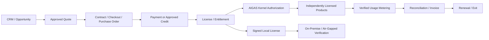

# BRIGHT AI / AIGAS — PRICING & LICENSING POLICY

> **المسار المعتمد داخل المشروع:** `docs/PRICING-AND-LICENSING.md`  
> **الإصدار:** `1.0.0` — Target Commercial & Licensing Baseline  
> **تاريخ الإصدار:** 2026-10-31  
> **المالك الوظيفي المقترح:** Commercial / Finance / Product / Legal / Security — تتحدد جهات الاعتماد الفعلية تنظيميًا  
> **المصدر:** قرارات `MASTER-PROJECT-BLUEPRINT.md` حتى القرار 108، و`PRODUCT-MASTER-CATALOG.yaml`، و`ENTERPRISE-TRIAL-POLICY.md`، و`PLATFORM-ARCHITECTURE.md`، و`DATA-PRIVACY-AND-SECURITY.md`.  
> **الحالة:** سياسة تصميم وتشغيل مستهدفة **غير معتمدة بوصفها عرضًا ملزمًا أو عقدًا**. لا أسعار نهائية، ولا SKUs تجارية معتمدة، ولا قيود دفع/ترخيص فعلية مثبتة من المستودع.  
> **حدود العمل:** مستند محلي للتحميل؛ لا تعديل على GitHub أو الموقع أو خدمات الدفع والإنتاج.

---

## 00 — الغرض وقواعد الحقيقة

هذه الوثيقة هي مرجع موحد لتصميم وتسويق وتسعير وترخيص واحتساب استخدام منتجات **AIGAS** الخمسة. تحوّل المبادئ التجارية إلى قواعد واضحة لفريق المنتج والمالية والمبيعات والهندسة والقانون، **بدون اختلاق أسعار أو وحدات فوترة نهائية أو جاهزية دفع**.

| الوسم | تعريفه | القرار المسموح |
|---|---|---|
| `APPROVED_REQUIREMENT` | قاعدة مثبتة في قرارات الماستر | تُنفّذ بعد تحديد أصحاب الصلاحية والتفاصيل اللازمة |
| `PROPOSED_CONTROL` | تصميم أو آلية مقترحة في هذه الوثيقة | تحتاج مراجعة واعتمادًا قبل اعتبارها سياسة نافذة |
| `PENDING_COMMERCIAL_APPROVAL` | قيمة أو شرط اقتصادي/تعاقدي لم يعتمد | يبقى غير منشور وغير مفوتر |
| `NOT_VERIFIED_OPERATIONAL` | ميزة أو خدمة لا يوجد دليل حديث على تشغيلها الفعلي | لا تُعلن جاهزة أو تُستخدم لتحصيل رسوم |
| `CONTRACT_SPECIFIC` | حق أو التزام تحدده اتفاقية عميل محددة | لا يعمم خارج ذلك العقد |

**قاعدة ملزمة:** لا يصبح تصور أو وحدة قياس أو نموذج تسعير «سعرًا»، ولا يصبح ملف إعدادات «ترخيصًا إنتاجيًا»، ولا تصبح صفحة أسعار «بوابة دفع» من دون اعتماد وتنفيذ ودليل صالح.

**أولوية المصادر:** الطلب الأحدث والأوامر الأعلى صلاحية؛ العقود والقواعد النظامية المنطبقة؛ `AGENTS.md` وتعليمات نطاق العمل؛ `01-mind-latest.md` للحالة الحالية؛ Blueprint للأهداف والحدود؛ Product Catalog لنطاق كل منتج؛ Trial Policy للتجربة؛ Privacy & Security لأمن البيانات؛ Architecture لتصميم الخدمات. واقع الكود والإنتاج يُثبتان بالفحص وليس بالتوثيق التاريخي.

---

## 01 — المبادئ التجارية غير القابلة للتنازل

1. **استقلال البيع:** كل منتج AIGAS قابل للترخيص بمفرده أو داخل باقة؛ لا اشتراط شراء منتج آخر لأداء الوظيفة الأساسية المرخصة.
2. **Kernel مشمول:** `AIGAS Kernel` أساس مشترك إلزامي دون **رسم ترخيص منفصل**؛ تدخل تكلفته التشغيلية في اقتصاديات المنتج أو الباقة.
3. **الفصل المحاسبي:** تمييز رسوم BRIGHT AI عن رسوم مزودي النماذج وAPI والخدمات الخارجية والتكامل والتنفيذ والصيانة والدعم والضرائب.
4. **أسعار مدروسة:** لا اعتماد قبل نموذج `Cost + Value + Market`، وتحليل الهامش والمخاطر وسياقات السوق السعودي.
5. **لا ازدواجية فوترة:** لا يُحتسب طلب مكرر أو retry أو حدث داخلي مرتين دون أساس تعاقدي واضح وقاعدة عدّ معلنة.
6. **لا رسوم صامتة:** لا تجاوز لسقف إنفاق ملزم أو رسوم استخدام إضافية دون القواعد والإشعارات والموافقات المنصوص عليها.
7. **التجربة منفصلة عن البيع:** الـ48 ساعة لا تتحول تلقائيًا إلى اشتراك مدفوع، ولا تنشئ وحدها تفويض تحصيل.
8. **النشر يغيّر العقد:** SaaS وOn-Premise وAir-Gapped لها التزامات تشغيل وفوترة وترخيص ومسؤوليات مختلفة.
9. **الحقوق لا تسقط بصمت:** الفاتورة المتأخرة أو نهاية الدعم لا تلغي تلقائيًا الحقوق القانونية في الأدلة والبيانات أو حقوق ترخيص دائم قائم.
10. **الأمن لا يتوقف بالفاتورة:** انتهاء ترخيص أو تعطل عدّاد الاستهلاك لا يجيز تجاوز حظر أمني ملزم، أو فقدان أدلة إلزامية.
11. **لا ادعاءات تنظيمية:** لا تسعير لقيمة «اعتماد» أو «امتثال مضمون» أو شهادة لم تثبت، ولا تواريخ SLA/الاستضافة بلا عقد ودليل.
12. **الشفافية للمشتري:** صفحة الدفع والعرض والعقد والفاتورة يحدد كل منها ما يدفعه العميل ولماذا وبأي إصدار وشروط.

---

## 02 — خريطة المنظومة التجارية

```text
مؤسسة مُشرقة — BRIGHT AI
└─ AIGAS: منظومة حوكمة وأمان الذكاء الاصطناعي
   ├─ AIGAS Kernel: مشمول مع كل منتج، بلا ترخيص مستقل
   ├─ AIGAS Firewall: قابل للشراء منفردًا
   ├─ AIGAS Ledger: قابل للشراء منفردًا
   ├─ AIGAS Human Gate: قابل للشراء منفردًا
   ├─ AIGAS Risk Engine: قابل للشراء منفردًا
   └─ AIGAS Secure Chat: قابل للشراء منفردًا
```

- الوحدات الخمس مستقلة تجاريًا؛ الترابط المتقدم بينها خيار له شروط ترخيص وتكامل واضحة.
- تبقى وظائف Kernel الأمنية والتدقيقية الأساسية اللازمة لتشغيل كل منتج حتى إن لم يشترِ العميل منتجات متخصصة أخرى.
- **لا يسقط الحد الأدنى من سجل الأمان والتدقيق** إذا لم يُرخّص Ledger؛ و**لا تُحجب حماية Secure Chat الأساسية** لعدم شراء Firewall، حسب حدود المنتج المعتمدة.
- قد تُقدَّم باقات تجمع عدة منتجات؛ الباقة لا تعيد تعريف المنتج المستقل ولا تمنع شراءه منفردًا.

### 02.1 حالة المنتجات التجارية

| المنتج | الأهلية التجارية المستهدفة | حالة الإصدار / السعر المنشور |
|---|---|---|
| Firewall | فردي أو باقة | إتاحة الإنتاج **NOT VERIFIED**؛ سعر **NOT APPROVED** |
| Ledger | فردي أو باقة | إتاحة الإنتاج **NOT VERIFIED**؛ سعر **NOT APPROVED** |
| Human Gate | فردي أو باقة | إتاحة الإنتاج **NOT VERIFIED**؛ سعر **NOT APPROVED** |
| Risk Engine | فردي أو باقة | إتاحة الإنتاج **NOT VERIFIED**؛ سعر **NOT APPROVED** |
| Secure Chat | فردي أو باقة | إتاحة الإنتاج **NOT VERIFIED**؛ سعر **NOT APPROVED** |
| Kernel | مكوّن مشترك، غير معروض للبيع منفصلًا | لا رسم ترخيص منفصل؛ جاهزية خدماته التشغيلية تحتاج أدلة |

**الأولوية المستهدفة:** Wave 1 = Firewall + Ledger + Human Gate، ثم Risk Engine + Secure Chat. الأولوية لا تعد بتوافر أو موعد إطلاق.

---

## 03 — نماذج البيع والترخيص المعتمدة كاتجاه

| نموذج النشر/العقد | نموذج التسعير المستهدف | تحصيل/تعاقد | متطلبات مميزة |
|---|---|---|---|
| **SaaS Standard** | اشتراك قياسي لمنتجات مختارة وباقة/حصة معتمدة | Checkout إلكتروني **بعد الجاهزية والاعتماد** | مدة اشتراك، حدود الاستخدام، بيانات الفوترة والضرائب، تغيير أو إلغاء |
| **SaaS Enterprise** | عرض تعاقدي يراعي الاستخدام والحوكمة وSLA والتكامل | Quote + Contract + PO/Payment حسب الاتفاق | التزام موقع البيانات، صلاحيات إدارية، نطاق الدعم |
| **On-Premise Annual** | ترخيص محلي محدد المدة لكل منتج/باقة | عقد وعرض وموافقة شراء | ترخيص موقّع؛ مسؤوليات البنية والتحديث والدعم |
| **On-Premise Perpetual** | حق استخدام النسخة المرخصة دائمًا ضمن العقد | ترخيص أولي + دعم/صيانة مستقلان حسب الاتفاق | انتهاء الصيانة **لا يلغي وحده حق استعمال النسخة المرخصة** |
| **Private Cloud** | تعاقد مؤسسي وفق البيئة والحقوق | حسب العقد | التحديد الدقيق لمالك التشغيل والبنية والنسخ الاحتياطي |
| **Air-Gapped** | ترخيص محلي مستقل بعرض مؤسسي | عقد + إصدار/تجديد Offline مصرح به | **لا اتصال سحابي للتحقق**، حزم موقعة وتحديثات محلية |
| **Custom Enterprise / Government** | عرض خاص حسب الحوكمة والمشتريات والمخاطر | Quote + Contract + PO + تحويل/آلية معتمدة | مراجعة بشرية، وثائق اعتماد وأمن وتسليم وقبول |

> أنواع العقود أعلاه مستهدفة، **ليست** إعلانًا بتوفر كل خيار اليوم. لا تعميم لترخيص دائم على SaaS، ولا افتراض اشتراك متجدد تلقائيًا لكل عميل.

---

## 04 — قواعد تحديد الأسعار: Cost + Value + Market

### 04.1 نموذج التكلفة الكاملة

تكلفة المنتج أو الخدمة تتضمن حسب الحالة:

- تشغيل Kernel الضروري، وعزل الهوية والبيانات، وتخزين الإعدادات والسياسات والتدقيق الأدنى.
- الاستضافة، المعالجة، CPU/GPU/RAM، الشبكة، نقل البيانات، قواعد البيانات، النسخ الاحتياطية واستعادة الخدمة.
- تكلفة مزود AI، وتكاليف Tokens أو استدعاء API، وأنظمة KMS/HSM أو الخدمات الأمنية الخارجية.
- تخزين الأدلة والسجلات وتصديرها والتحقق التشفيري والتخزين طويل الأجل وفق العقد.
- مراجعة البشر للمخاطر أو الموافقات عندما تتحمل BRIGHT AI تكلفة خدمة فعلية متفقًا عليها.
- الدعم الفني والصيانة والتصحيحات، مراقبة الحوادث، الاستجابة، إدارة الإصدارات، وخدمة العملاء.
- التنفيذ والهجرة والتدريب والتأهيل والاتصالات وتكاليف المبيعات والتحصيل.
- التكاليف الثابتة المشتركة، ورسوم بوابة الدفع والتحصيل، والمخاطر والتعثر والضرائب والالتزامات النظامية المنطبقة.

**اقتراح مالي:** اعتمد حاسبة داخلية بالإدخال التالي بدل تقرير أرقام ثابتة: `deployment + product_set + expected_volume + peak_concurrency + model_mix + data_region + retention_class + support_tier + setup_scope + currency + taxes + collection_risk`.

### 04.2 تحليل القيمة

- طبيعة الضرر الذي يقلله المنتج وآلية الحد منه **بأدلة قابلة للتحقق**، وليس بوعد مطلق بمنع جميع المخاطر.
- ساعات مراجعة أو توثيق أو اعتماد يمكن قياسها بصورة صحيحة عند العميل.
- تقليل أخطاء السياسة أو ازدواجية العمل والقدرة على التتبع، بشرط وجود قياس/اتفاق على خط الأساس.
- طلبات القطاع السعودي واشتراطات السوق والتكامل والشراء والخدمات المستهدفة.

### 04.3 المقارنة السوقية

- المقارنة مع بدائل قابلة للمقارنة حسب النطاق/الترخيص/الاستضافة/الاستهلاك وليس الاسم التجاري فقط.
- فصل السعر المعلن عن السعر التعاقدي، والمزايا الأساسية عن الإضافات.
- توثيق المصدر والتاريخ وحدود المقارنة؛ لا اختلاق أسعار منافسين.

### 04.4 معادلات نموذجية — لا تعني سعرًا فعليًا

```text
Total Delivery Cost
  = Allocated Shared Costs
  + Product Direct Costs
  + External AI / Infrastructure Pass-through (where applicable)
  + Implementation & Support Obligations
  + Sales / Payment / Risk Allowances

Proposed Pre-Tax Price
  = Pricing Function(Cost, Verified Customer Value, Market Evidence, Risk, Target Margin)

Quoted Total
  = Approved Product Fees
  + Approved Services & Support
  + Disclosed External Costs Charged by BRIGHT AI
  + Applicable Taxes and Fees
  - Approved Discounts / Credits
```

قيمة هامش الربح، والخصومات، وأوزان المفاضلة وسعر الصرف والضريبة **ليست معتمدة هنا**. يجب مراجعة طريقة تطبيق الضرائب ومتى يكون العميل مسؤولًا مباشرة عن مزوده الخارجي.

### 04.5 اعتماد نموذج التسعير

لا يعتمد جدول أسعار حتى تتوفر: Cost Model موثَّق، تعاريف الوحدات، حدود التكلفة والذروة، سيناريوهات ربحية، مقارنة سوقية، شروط دعم، تقييم مخاطر عدم السداد، نصوص تعاقدية، مراجعة ضرائب وفوترة، وموافقة تجارية موثقة من أصحاب الصلاحية.

---

## 05 — وحدات القياس المرجعية حسب المنتج

| المنتج | Candidate Billing Unit | شروط منع سوء العدّ | كلفة منفصلة محتملة |
|---|---|---|---|
| **Firewall** | `PROTECTED_AI_REQUEST` أو عملية إنفاذ حماية | عدم احتساب HTTP retries/نفس request ID/التحويلات الداخلية مرتين؛ تحديد متى يكون الحظر محسوبًا | تكلفة تنفيذ التكامل، مزود AI عند الحاجة |
| **Risk Engine** | `RISK_ASSESSMENT` | التمييز بين تقييم جديد وإعادة تحليل أو عرض؛ التحديث المجدول يحتاج قاعدة معلنة | استدعاء نماذج خارجية/تحليلات |
| **Human Gate** | `APPROVAL_DECISION` أو عملية موافقة | الظهور المتكرر/الإشعارات/الرفض والإلغاء لا تتحول تلقائيًا إلى أحداث مدفوعة مستقلة | تكلفة خدمة مراجعة بشرية إذا تعاقد عليها |
| **Ledger** | `AUDIT_EVIDENCE_EVENT` وربما تخزين | تمييز الدليل المنفذ عن محاولات الكتابة الفاشلة/التكرار، وحدود التخزين والاحتفاظ | تخزين، تحقق وتصدير خاص |
| **Secure Chat** | `CHAT_MESSAGE_OR_SESSION` مع usage attribution | التمييز بين طلب المستخدم، أجزاء البث، ورسالة النموذج؛ لا عدّ token stream كرسائل متعددة | Tokens/AI provider، نماذج محلية محكومة |

**ملاحظة:** جميع الوحدات **مرشحات تصميم** وليست تعريفات فواتير نهائية. يلزم اعتماد وحدة أولية/ثانوية واحدة أو أكثر لكل SKU وتوثيق ما يدخل وما لا يدخل في الاستهلاك.

### 05.1 قواعد Metering الأساسية

1. العدّ من **الجهة الخادمة/المكوّن الموثوق**، لا أرقام قابلة للتلاعب من المتصفح.
2. لكل حدث: Tenant + Product + Contract/Entitlement + Timestamp + Operation/Correlation ID + Metric Type + Quantity + Version + Source.
3. `idempotency_key` أو معرّف مستقر يمنع تحصيل العملية المتكررة؛ ويُحتفظ بسجل تصحيح/تسوية لكل حالة اختلاف.
4. افصل `raw usage` و`validated usage` و`billable usage` و`invoice adjustment`؛ لا تمسح الأثر الأولي بصمت.
5. أحداث الأمن الأساسية في Kernel لا تتحول إلى منتج Ledger مدفوع بمجرد وجودها.
6. لا يُضاعف استهلاك خدمة مشتركة عبر منتجين ما لم يكن لكل منهما حدث مستقل وحق فوترة ظاهر وموافق عليه.
7. التعامل مع الوقت والحدود بالعقد: المنطقة الزمنية والدورة والتوقيت المرجعي وعمليات نهاية الشهر ووحدات التقريب.
8. أي تصحيح مالي يجب أن يكون قابلاً للتتبع وبموافقة مناسبة، وبلا كشف تفاصيل محتوى العميل للمبيعات.
9. يجب دعم مطابقة الاستهلاك المعلن للعميل، والأحداث المعتمدة، والفاتورة، ودفاتر الدخل دون تعارض.
10. التوقف الآمن عند عطل metering: لا فتح إنفاذ غير مصرح، ولا استمرار إنفاق خارجي غير محدود؛ عالج الحالة وفق fail-safe والعقد.

### 05.2 مثال سجل تصميم — ليس API مثبتًا

```json
{
  "event_id": "illustrative-uuid",
  "tenant_id": "illustrative-tenant",
  "product_id": "AIGAS-FW",
  "entitlement_id": "illustrative-entitlement",
  "operation_id": "illustrative-operation",
  "metric": "PROTECTED_AI_REQUEST",
  "quantity": 1,
  "billable": null,
  "unit_price": null,
  "pricing_version": null,
  "recorded_at": "illustrative-ISO-8601-timestamp",
  "source_version": "illustrative"
}
```

لا يتضمن المثال بيانات prompt أو ملفات أو نصوص العميل ولا يعني أن جدولًا بهذا الاسم أو API موجود اليوم.

---

## 06 — الباقات، الإضافات والحقوق

### 06.1 منتجات منفردة

- لكل منتج مستقل مواصفة capabilities أساسية وحصص وفئة دعم وخيار نشر؛ غير المصرح به واضح.
- في باقة المنتج الواحد تبقى النواة Kernel مشمولة بلا SKU مفوتر منفصل.
- لا يُشترط تفعيل Ledger ليعمل السجل الأمني الأدنى، ولا تفعيل Firewall المدفوع لتعمل حماية Secure Chat الأساسية.

### 06.2 حزم متعددة المنتجات

- الحزمة تذكر **المنتجات المختارة بالاسم والحق المنفصل لكل منتج** ومدة الترخيص وحدود الاستهلاك وسيناريو التكامل.
- قد تتضمن خصمًا أو حصة مجمعة أو دعمًا مخصصًا **فقط بعد اعتماد الشروط**.
- حصة منتج غير قابلة للنقل تلقائيًا لمنتج آخر دون نص واعتماد؛ لا خلط بين `Protected Requests` و`Approval Decisions` أو غيرها.
- لا يجوز استخدام اسم «Enterprise» كوعاء مبهم لتقييد حقوق العميل من دون Annex واضح.

### 06.3 الإضافات المدفوعة المحتملة

- تكاملات/موصلات خاصة، نشر محلي، خدمة تنفيذ، هجرة بيانات، تدريب، دعم مُدار، سعات أعلى، مستويات احتفاظ إضافية ضمن السياسة.
- كل إضافة لها نطاق ومخرجات واعتماد وسعر وحقوق إلغاء منفصلة؛ **وجودها في الوثيقة اقتراح، لا إعلان توفرها للبيع**.
- BYOK ليس إعفاءً من ضوابط الأمن أو من رسوم منتج AIGAS المتفق عليها.

### 06.4 تجنب Vendor Lock-in

- توضيح حقوق تصدير البيانات والأدلة قبل نهاية العقد، وفق سياسة بيانات العميل والالتزامات النظامية.
- لا تعطيل للتصدير الواجب لمجرد عدم تجديد منتج متخصص إذا كان السجل الأساسي محكومًا بحق قائم.
- فصل رسوم الخروج/النقل المخصصة، إن اعتمدت تعاقديًا، عن الحق في استعادة بيانات مؤهلة وفق العقد والقانون.

---

## 07 — قواعد التسعير حسب نموذج النشر

### 07.1 SaaS Standard

- اشتراك بمدة وحصة وحقوق محددة للمنتجات المختارة.
- SaaS ذاتي الشراء لا يُفعّل قبل اعتماد صفحة العرض والقيم القانونية والتنظيمية والتشغيلية.
- حالات ترقية/تخفيض/زيادة استخدام تحتاج تعريفًا مسبقًا لوقت السريان والاحتساب النسبي وحقوق الإلغاء.
- لا افتراض دفع شهري أو سنوي أو تجديد تلقائي ما لم يعتمد نظام الاشتراك والعقد والعميل عليه.

### 07.2 SaaS Enterprise

- عرض مؤسسي يتضمن حدود Tenant أو الفصل المخصص والهوية والضوابط والتكاملات والدعم وملحق البيانات.
- لا إدراج إقامة بيانات أو مناطق معالجة أو توافر SLA ما لم توجد بنية وعقد ودليل.
- التغييرات الكبيرة في الحجم أو الوجهات أو مزودي AI تخضع لتعديل عرض وتقييم تكلفة ومخاطر.

### 07.3 On-Premise Annual

- ترخيص محلي موقّع يحدد المنتجات والإصدار والنطاق ومدة الحق وحدود الموارد والتحديثات.
- المراقبة المحلية والهوية والمفاتيح والصيانة والنسخ الاحتياطي ومسؤوليات الاستجابة توثق بمصفوفة مشتركة.
- آليات تجديد محلية لا تعتمد على وصول غير متفق عليه إلى بيانات العميل.

### 07.4 On-Premise Perpetual

- حق استعمال النسخة **المرخصة تعاقديًا** يستمر وفق شروطه المحددة ولو انتهت الصيانة المنفصلة.
- الدعم والترقيات والإصدارات الكبرى وSLA **ليست** حقوقًا دائمة تلقائيًا؛ يحددها العقد.
- لا حجب خلفي مبهم أو تعطيل للنسخة الدائمة عند انقضاء عقد صيانة فقط.
- يجب تعريف ما يتطلب حقًا جديدًا: إضافة منتج، توسعة نطاق، أو إصدار رئيسي غير مشمول.

### 07.5 Air-Gapped

- التحقق من رخصة موقّعة **محليًا بالكامل** بلا اتصال بـDNS/Cloud licence/Online CRL/Telemetry خارجي.
- آليات إصدار وتجديد/توسعة وإلغاء موثقة لحزم Offline مصرح بها، مع سلسلة توقيع وتحقق وتدوير مفاتيح مناسبة.
- لا قنوات تجديد خفية ولا «اتصال مرة كل مدة» تحت مسمى Air-Gapped.
- سعة النماذج المحلية CPU/GPU/Memory والنسخ الاحتياطي والدعم حسب الدراسة والعقد، وليس سعرًا أو حدًا افتراضيًا.
- إن انتهى ترخيص محدد المدة، تطبق قواعد تقييد آمن وحقوق خروج/دليل؛ لا إطفاء فوري يخالف حقًا تعاقديًا قائمًا.

---

## 08 — تكلفة الذكاء الاصطناعي الخارجي وBYOK

### 08.1 Attribution

يلزم الفصل الصريح بين:

1. **AIGAS product fee** — حق المنتج والخدمة المباعة من BRIGHT AI.
2. **External provider consumption** — تكلفة مزود النموذج أو API بحسب اتفاق من يدفع له.
3. **Infrastructure cost** — موارد استضافة/تشغيل أو موارد محلية لدى العميل.
4. **Professional services** — تنفيذ أو دعم أو تكامل متعاقد عليه.

لا يُعرض «استهلاك مجاني» إذا كانت رسوم المورد على حساب العميل دون توضيح. ولا يُمرَّر كامل تكاليف المزود إلى العميل تلقائيًا إلا بشرط واضح وموافق عليه.

### 08.2 Provider-funded versus BYOK

| الوضع | جهة تحمل تكلفة المزود | القاعدة |
|---|---|---|
| حصة تجربة ممولة من BRIGHT AI | BRIGHT AI ضمن سقف معتمد | لا تجاوز صامت أو تحصيل تلقائي |
| SaaS بمزود تديره BRIGHT AI | حسب المنتج/العقد | الإفصاح عن التكلفة والحصة والزيادة |
| BYOK بمفتاح وحساب العميل | العميل أمام مزوده عادةً وفق اتفاقه | موافقة على نوع البيانات والوجهة والاحتفاظ وعدم التدريب |
| نموذج محلي On-Prem/Air-Gapped | تكلفة البنية حسب المسؤوليات والعقد | لا API خارجي في Air-Gapped |

- BYOK يخضع لمراجعة مزود/نموذج/منطقة وتعليمات عدم استخدام بيانات العملاء في تدريب النماذج دون استثناء.
- لا تفويض تلقائي لمفاتيح المورد لدعم BRIGHT AI، ولا كشف أسرار في الواجهة أو logs أو الفواتير.
- توجيه failover لا يختار مزودًا غير معتمد ولا منطقة غير مصرح بها لمجرد تخفيض التكلفة.
- التنبيه عند سقف الميزانية والتوقف الآمن عند تجاوزه حسب طبيعة الخدمة والسياسة، **قبل** استهلاك غير مأذون به.

---

## 09 — قيود الحصص والاستهلاك وOverage

كل عرض أو اشتراك أو ترخيص يستخدم سجلًا معتمدًا للحق (`Entitlement`) يحدد المنتجات والوحدات والدورة والحصص والزيادة وحدود التزام الإنفاق والإنذارات وشروط الإيقاف.

### 09.1 قبل الشراء

- أظهر `included_allowance` و`metering_unit` و`billing_period` و`hard_cap` أو سياسة الزيادة ورسومها المعتمدة، ومتى تُطلب موافقة.
- إذا كانت التفاصيل غير معتمدة، **لا تسمح Checkout أو فوترة آلية** على أساسها.
- وضح أثر تجاوز الاستخدام على الطلبات الجارية، والانتهاء، وقابلية قراءة البيانات وتصديرها.

### 09.2 أثناء الاستخدام

- استخدام قراءات خادم موثوقة ومطابقة، مع مراقبة تكلفة مزودي AI المستقلة.
- الإنذارات قبل التجاوز وفق العتبات المعتمدة، وواجهة للمسؤول المخول بمتابعة الاستهلاك.
- التغيير في سقف إنفاق أو حصة يخضع لموافقة صاحب الصلاحية، وسجل تعديل مع نسخة الأسعار.
- عدم احتساب retries أو أحداث وهمية أو refresh للواجهة كاستهلاك مدفوع.

### 09.3 عند التجاوز

- `hard-cap`: ارفض/أجّل العملية التي تتطلب استهلاكًا جديدًا ما لم تسمح السياسة بعلاج صريح.
- `approved overage`: استمر فقط ضمن السعر والسقف والموافقة المرتبطة بنفس الترخيص أو تعديل موثّق.
- إن تعطل العداد أو حدث تنازع، لا تجعل الفشل ثغرة لتجاوز ضوابط الأمن أو الإنفاق.
- القيود تفرق بين قدرة جديدة مدفوعة وبين مراجعة دليل أو تصدير بيانات يملك العميل حقًا في الوصول إليها.

### 09.4 النزاعات والتسوية

- استعلام مفصل قابل للتدقيق يعرض الكميات والفترة والنسخة والسبب دون كشف محتوى AI الخاص.
- الاسترداد/الرصيد الدائن/التعديل عبر مسار صلاحيات منفصل وآثار محاسبية قانونية متوافقة.
- المدة والآليات والإشعارات تعتمد في العقد ولا تُختلق في هذا المستند.

---

## 10 — تجربة المؤسسات 48 ساعة (Trial)

هذا الفصل **ملخص ملزم للاتساق**؛ المرجع التفصيلي `ENTERPRISE-TRIAL-POLICY.md`.

- المدة **48 ساعة من التفعيل الفعلي**، لا من مجرد التسجيل أو فتح صفحة الموقع.
- قد تدعم المنشآت الخاصة المؤهلة تجربة ذاتية بعد تحقق المؤسسة ومنع الإساءة **عند الجاهزية**؛ الحكومية والتكاملات المؤثرة تحتاج مراجعة بشرية.
- بيانات التجربة **اصطناعية افتراضيًا**؛ بيانات حقيقية لا تستخدم إلا بتصريح خطي واعتماد بيئة مناسبة.
- سقف تكلفة/حصة تموّلها BRIGHT AI في الحدود المعتمدة. BYOK خيار مشروط وليس موافقة عامة لإرسال بيانات.
- مدة وصلاحيات وتقييد وبيانات انتهاء التجربة تحدد بوضوح قبل التفعيل.
- انتهاء Trial لا ينشئ اشتراكًا ولا فاتورة ولا خصمًا آليًا ولا تجديدًا مدفوعًا.
- حساب العميل لا يُحصل منه مبلغ بناءً على حفظ بطاقة أو قبول تجربة فقط.
- تقرير PoV يلخص الأهداف والأدلة والنتائج المقاسة والحدود؛ لا يختلق نتائج أو بيانات إنتاج.
- الانتقال التجاري يتطلب **قرار شراء منفصل** مع المنتج والنطاق والسعر والضريبة والحقوق وشروط العقد، وتحقق تفويض المشتري.
- يمنع إعادة فوترة أحداث تجريبية عند تحويلها إلى اشتراك إلا بسند تعاقدي صريح ومشروع.
- تظل حقوق خروج/أدلة/احتفاظ معلنة بحسب سياسة البيانات والقانون.

### 10.1 Trial مقابل Pilot مقابل Contract

| البند | Trial | Pilot | Paid Contract |
|---|---|---|---|
| الغرض | تعرّف قصير محدود | إثبات قيمة على نطاق مؤسسي متفق عليه | تشغيل مدفوع ضمن نطاق تعاقدي |
| المدة | 48 ساعة من التفعيل | حسب اتفاق المؤسسة | حسب العقد |
| البيانات | اصطناعية افتراضيًا | وفق موافقات وتدابير/عقد | وفق DPA/العقد والسياسات |
| المقابل | مجاني وفق الحصة المعتمدة | مجاني أو مدفوع **حسب الاتفاق** | مدفوع بشروط واضحة |
| التحويل | **لا انتقال مدفوع تلقائي** | لا انتقال مدفوع تلقائي | حسب الشروط والإجراءات المعتمدة |
| دليل النجاح | PoV مقيّد بما تحقق | معايير قبول موثقة من الجهة | SLA/التزامات تعاقدية حيث تنطبق |

---

## 11 — رحلة البيع والتعاقد والتحصيل

```text
Lead → Organization Verification → Qualification → Product Scope
  → Trial / Pilot (optional) → Quote Draft → Commercial Approval
  → Approved Quote → Customer Acceptance → Contract / PO / Checkout
  → Payment or Contractual Credit Approval → License Issuance
  → Provisioning → Security Readiness → Customer Acceptance
  → Production Active → Invoicing/Reconciliation → Renewal/Exit
```

**تسلسل مستهدف** وليس إثباتًا لوجود CRM أو بوابة دفع أو قاعدة بيانات أو Workflow فعلي.

### 11.1 عناصر CRM المرجعية

`Lead`, `Organization`, `Contact`, `Opportunity`, `Trial`, `QuoteVersion`, `CommercialApproval`, `Contract`, `PurchaseOrder`, `Payment`, `Invoice`, `CreditNote`, `License`, `Entitlement`, `Onboarding`, `Renewal`, `ActivityLog`.

### 11.2 صلاحيات مبدئية (تصميم، لا تعريف أدوار حالي)

| الإجراء | متطلب حوكمة مقترح |
|---|---|
| إعداد عرض | مبيعات مخولة ضمن الكتالوج المعتمد |
| اعتماد أسعار خارج النطاق | اعتماد مالي/تجاري وفق Delegation of Authority |
| خصم أو تعديل خاص | موافقة مستقلة وبسجل سبب؛ حدود الخصم لم تُعتمد |
| استرداد / Credit Note | اعتماد مالي مستقل عن منشئ الطلب حيث يلزم |
| تفعيل مدفوع | دليل شراء/عقد معتمد، تحصيل أو سياسة ائتمان معتمدة |
| وصول إلى بيانات المنتج التشغيلية | **غير مخوّل للمبيعات افتراضيًا** |
| تغيير ترخيص Air-Gapped | توقيع وصلاحية وحزمة محلية وإثبات تسليم |

---

## 12 — تصميم عرض السعر Quote

### 12.1 بيانات العرض المطلوبة

| الحقل | الغرض | وضعه قبل النشر |
|---|---|---|
| Quote ID + Version | تتبع نسخة ملزمة/غير ملزمة | مطلوب |
| Customer Legal Entity | هوية المشتري وعنوان الفوترة | تحقق |
| Products + Editions + Release | ما الذي يحصل عليه العميل فعلاً | لا إتاحة دون دليل |
| Deployment Model | SaaS / On-Prem / Air-Gapped | مطلوب |
| License Type and Term | مؤقت/سنوي/دائم وفق العقد | مطلوب |
| Billing Metric + Included Allowance | قاعدة القياس والحصة | **PENDING APPROVAL** |
| Overage & Spend Caps | رسوم التوسع والسقف | **PENDING APPROVAL** |
| Provider AI Costs / BYOK | من يدفع للمزود | مطلوب حسب الحالة |
| Implementation & Training | نطاق التسليم والتكلفة | معتمد حسب الاتفاق |
| Support / Maintenance / SLA | حدود الخدمة ومسؤولياتها | معتمد بعقد مستقل/ملحق |
| Data Location & Processor List | موقع الحفظ والمعالجة والموردون | إثبات/ملحق معتمد |
| Price / Currency / Taxes | الأرقام والمراجعات الواجبة | **PENDING FINANCE APPROVAL** |
| Quote Validity | نهاية صلاحية العرض | مدة معتمدة لا تُفترض |
| Terms / DPA / Order Form | المستندات المرجعية | مراجعة قانونية |
| Acceptance & Signature | الجهة والصلاحية والتاريخ | مطلوب للتعاقد |

### 12.2 دورة حياة Quote المقترحة

`DRAFT → PRICING_REVIEW → APPROVED → SENT → CUSTOMER_ACCEPTED / REJECTED / EXPIRED → CONTRACTED`.

- كل تعديل في السعر أو الوحدة أو النطاق ينتج **نسخة جديدة**، مع منع تغيير عرض وافق عليه العميل دون توثيق.
- العرض الملغى أو منتهي الصلاحية لا يُستخدم لتوليد رخصة جديدة.
- السعر المؤكد يرتبط بإصدار pricing policy/price book معتمد وبالمستند التعاقدي النهائي.
- إن تعارض عرض قديم مع اتفاق موقع، يُفسر وفق ترتيب أولوية المستندات المحدد في العقد والقانون؛ لا افتراض ترتيب موحد لكل الحالات.

---

## 13 — العقد وOrder Form وملحقات الخدمة

الحد الأدنى المقترح لملحقات الصفقة، بعد مراجعة قانونية متخصصة:

1. **Order Form:** المنتجات والحقوق والمدد والنشر والسعر والحصص والرسوم والضرائب والتجديد.
2. **License & Use Terms:** المستخدمون/المؤسسة/نطاق الأجهزة/المثيلات والتغيير والمراجعة والتعليق والإنهاء.
3. **Service Description:** وظائف مثبتة، استثناءات، حدود المزود والنماذج، المتطلبات السابقة للتفعيل.
4. **Security & Data Processing Addendum:** حماية البيانات، المعالِج/المتحكم بحسب الواقع، موقع البيانات، الموردون، الحوادث، التصدير والحذف.
5. **SLA & Support Schedule:** فئات الاستجابة وحدود الخدمة والوقت والاستثناءات بعد اعتمادها، دون أرقام مفترضة.
6. **Deployment / Sizing / Acceptance:** سعات مشروطة بقياس/افتراضات، مسؤوليات الموارد، إجراءات التسليم والقبول.
7. **Change Order:** إجراءات توسعة الاستهلاك والنطاق/الترخيص/الهجرة والدعم والتأثير التجاري.
8. **Exit & Retention:** نقل البيانات والأدلة، القانون والاحتفاظ والنسخ الاحتياطية وLegal Hold.

لا تعتبر هذه القائمة عقودًا جاهزة للتوقيع. عند الجهات الحكومية والمؤسسات الكبرى، تتبع إجراءات المشتريات والصلاحيات والأنظمة المنطبقة فعليًا.

---

## 14 — الفوترة والمدفوعات

### 14.1 وسائل التحصيل المستهدفة

- **SaaS القياسي:** دفع إلكتروني ذاتي عندما تنضج البنية والسياسات والفوترة.
- **المؤسسي والحكومي:** عرض سعر، عقد، أمر شراء، تحويل بنكي أو وسيلة متفق عليها، بحسب الإجراءات المعتمدة.
- **On-Prem/Air-Gapped:** مراحل دفع/تسليم وقبول وفق العقد دون افتراض توقيت أو دفعات محددة.
- استخدام مزود دفع مناسب بدل تخزين بيانات البطاقة الخام أو CVV ضمن تطبيق BRIGHT AI.

### 14.2 Invoice lifecycle المقترحة

`DRAFT → VALIDATED → ISSUED → PARTIALLY_PAID / PAID / OVERDUE → ADJUSTED / CREDITED / CANCELLED` وفق القواعد المحاسبية الفعلية، مع تمييز الحالات التي لا يجوز إلغاؤها بعد الإصدار إلا بأداة محاسبية نظامية.

### 14.3 متطلبات الفاتورة

- هوية البائع القانونية وبيانات المشتري اللازمة وشروط العقد وأمر الشراء إن وجد.
- رقم/تاريخ فاتورة فريد، العملة والوحدات والكميات ومعدل/سعر الوحدة والخصومات والضرائب المنطبقة والإجمالي.
- الربط بالعرض/العقد/الترخيص/الدورة والاستحقاق والأدلة المحاسبية.
- تطبيق قواعد الفوترة الإلكترونية والضرائب **السعودية المنطبقة** بعد تحقق مالي وقانوني وتقني، وعدم اعتبار وجود PDF فاتورة إلكترونية متوافقة تلقائيًا.
- عدم استخدام Analytics لقياس أحداث تتضمن بيانات بطاقة أو مستندات فواتير أو أسرار عميل.

### 14.4 المطابقة المالية

مطابقة ثلاثية/رباعية حسب نوع الصفقة: `Approved Contract/Order → Entitlement/Usage → Issued Invoice → Payment/Bank Reconciliation`.

- التعديلات والاستردادات عبر مستند مالي/ائتماني مناسب، مع أثر تدقيق موثوق.
- منع تكرار invoice runs لنفس الدورة ونفس العقد دون مفتاح مطابقة.
- المبالغ المتنازع عليها تُفصل عن المبالغ غير المتنازع عليها وفق العقد، ولا يُنفذ تعليق جماعي تلقائي لكل المؤسسات.

---

## 15 — اشتراكات SaaS والتغييرات الدورية

### 15.1 أنواع الأحداث

- تفعيل مدفوع جديد.
- ترقية/تخفيض منتج أو باقة.
- إضافة حصة أو مستخدم/قدرة وفق قياس المنتج المعتمد.
- تجديد أو انتهاء أو عدم تجديد.
- تغيير جهة الفوترة أو معالجة ضريبية.
- تعديل تعاقدي أو رسوم مزود/دعم.

### 15.2 قواعد التغيير

- توثيق تاريخ السريان وتأثير الرصيد/الدورة والضرائب والفاتورة قبل قبول التغيير.
- `Proration` — الاحتساب النسبي **خيار يحتاج اعتماد**؛ لا تفترض طريقة أو تقريبًا محددًا.
- التجديد التلقائي للمدفوع قد يختلف حسب نموذج العقد والقبول والتشريع؛ **لا تطبقه افتراضيًا**.
- لا تخلط فشل مزود دفع مع رفض أمني أو تعليق بسبب إساءة استخدام؛ لكل سبب حالة مستقلة ومسار مراجعة.

---

## 16 — دورة حياة الترخيص

### 16.1 الحالات المستهدفة

```text
PENDING
  → ACTIVE
  → RENEWAL_DUE
  → CONTRACTUAL_GRACE (only where agreed)
  → RESTRICTED_OR_SUSPENDED
  → EXPIRED_OR_TERMINATED
```

قد توجد انتقالات مباشرة أو عودة إلى Active بعد تسوية معتمدة، لكن لا تُختلق فترات سماح أو حقوق استرداد أو شروط تعليق من دون عقد معتمد.

### 16.2 مبادئ التنفيذ

1. الترخيص يحدد الجهة/البيئة/المنتجات/النسخ/المدة/الحقوق/الحصة/الدعم؛ يتبع `contract_version` مثبتًا.
2. التحقق من Entitlement يتم في جهة موثوقة وقبل تفعيل القدرة التي تتطلبه.
3. الرخصة المحلية موقعة وقابلة للتحقق دون اتصال سحابي في Air-Gapped.
4. انتهاء الحق لا يعطّل ضوابط أمن إلزامية ولا يفتح عمليات كانت تتطلب موافقات بشرية.
5. التقييد الآمن يخص بدء أعمال مدفوعة جديدة حسب العقد؛ لا حذف صامت للأدلة ولا إسقاط حقوق تصدير أو Legal Hold.
6. تعليق الأمان/الإساءة مختلف عن التأخر المالي وله أسباب وموافقات وفترة مراجعة منفصلة.
7. حقوق الترخيص الدائم القائمة تُحترم حتى بعد نهاية الصيانة؛ لا license kill switch مبهم.
8. لا ترخيص منفصل لـKernel؛ يفعّل تلقائيًا بحدّه اللازم لكل منتج مستحق.
9. توسعة المنتج/البيئة/النسخة تحتاج موافقة وتسعيرًا جديدًا حيث ينطبق، لا تتم بصمت.
10. لا يعد entitlement متحققًا إذا ظهر زر في الواجهة فقط؛ التنفيذ على طبقة API والقرار والخدمات ذاتها.

### 16.3 نموذج License / Entitlement — تصميمي فقط

```yaml
license_id: ILLUSTRATIVE
customer_tenant: ILLUSTRATIVE
contract_version: NOT_APPROVED
license_model: SAAS_SUBSCRIPTION  # or local annual/perpetual/offline
products:
  - product_id: AIGAS-FW
    edition: TO_BE_APPROVED
    feature_set_version: TO_BE_APPROVED
    metric: PROTECTED_AI_REQUEST
    included_allowance: null
    overage_policy: NOT_APPROVED
term:
  starts_at: null
  ends_at: null           # perpetual use rights defined by contract
status: PENDING
kernel_core_included: true
signature_proof: NOT_IMPLEMENTED_BY_THIS_DOCUMENT
```

**تنبيه:** المخطط ليس ملف ترخيص صالحًا ولا schema لقاعدة بيانات موجودة.

---

## 17 — تجديد الرخص والتعثر والتعليق

- إشعارات التجديد والاستحقاق والمخاطر تُرسل وفق القنوات والمواعيد المعتمدة بالعقد والخصوصية؛ لا أرقام تنبيه مفترضة.
- Grace Period لا تُنشأ تلقائيًا لكل العملاء؛ لا تستعمل كتحايل على رخص انتهت أو متطلبات أمن.
- في التعثر المالي: مراجعة الحالة، الإشعار، مسار التحصيل/التسوية، التقييد الآمن حسب العقد، حقوق التصدير والاحتفاظ.
- أحداث الاعتراض أو النزاع تسجّل مع سبب ومصدر مالي وصلاحية قرار.
- الخدمات المعزولة لا تتطلب اتصالًا خفيًا لتحديث حالة الرخصة؛ التجديد يتم بحزم/إجراءات محلية موثقة.
- التعاقد قد يحدد استمرار دعم أو وصول محدد لغرض الخروج أو التحقيق؛ لا يفهم كحق استخدام مدفوع جديد.

---

## 18 — الدعم والصيانة وSLA

### 18.1 باقات الدعم المقترحة

| عنصر العقد | معيار التصميم |
|---|---|
| مستوى الدعم | نطاق الاستجابة والاتصال والاستثناءات وأصحاب الصلاحية |
| الصيانة | إصلاحات أمان، تحديثات، توافق إصدارات، مواعيد نافذة |
| الدعم المُدار | يحتاج تفويضًا خاصًا وسياسات وصول JIT ومددًا محدودة ومسجّلة |
| دعم Air-Gapped | زيارة ميدانية أو حزم آمنة/إجراء محلي مصرح، بلا Remote Backdoor |
| SLA | مقاييس وتعاريف استثناءات/تعويضات بعد تحقق وتشغيل واتفاق |
| BCP/DR | RTO/RPO ومسؤوليات حسب خطة عميل معتمدة وليس وعدًا عامًا |

### 18.2 قواعد مالية

- الفصل بين سعر المنتج والترخيص وبين خدمات الدعم والتنفيذ؛ قد تُجمع في باقة إذا وصفت البنود بشفافية.
- لا تضمين دعم مدى الحياة أو ترقية مدى الحياة ضمن perpetual license بلا نص تعاقدي.
- توثيق تكلفة الدعم في الدراسة الاقتصادية وسقف التزامات الخسائر/التعويض وفق القانون والعقد.
- لا مشاركة لبيانات العميل التشغيلية مع فرق المبيعات من أجل التسعير أو الدعم دون حق وصلاحية.

---

## 19 — التسعير القطاعي والمؤسسات الحكومية

- الحكومات: عروض وعقود وموافقات مشتريات خاصة، وليست Checkout ذاتيًا تلقائيًا.
- القطاعات الصحية والمالية: تقييم نطاق البيانات ومزودي AI والضوابط، ثم تكلفة النشر والدعم حسب حالة الاستخدام؛ لا اختلاق رسم «اعتماد».
- جهات عالية الحساسية: بيئات خاصة/محلية وعزل معزز ودعم وتقييم سعة قد يغير السعر، على أساس تكلفة موثقة.
- لا مقارنة أو ادعاء امتثال عام لـPDPL/NCA/SDAIA/ISO مقابل دفع رسوم؛ المتطلبات تتحدد حسب الجهة والسياق.
- تسعير المشاريع الكبيرة أو إعادة التوزيع/المقاولين يتطلب سياسة حقوق ومشتريات وملكية بيانات مستقلة.

---

## 20 — العملة والضرائب والفوترة السعودية

- **العملة المرجعية المستهدفة للسوق السعودي: SAR**، لكن اعتماد عملة العقد والمعالجة المحاسبية النهائية لكل عرض يحدده القسم المالي والعقد.
- لا تكتب نسب ضريبة ثابتة أو تفترض الإعفاء أو أرقام التسجيل النظامية؛ تحقق من الحالة والنظام الساري وبيانات الكيان.
- الالتزام بمتطلبات **هيئة الزكاة والضريبة والجمارك (ZATCA)** والفوترة الإلكترونية عند انطباقها وبحسب مرحلة التنفيذ والأنظمة السارية.
- راجع الإشعارات والفواتير المبسطة/الضريبية والخصومات والإشعارات الدائنة ومعالجة التوريد حسب نوع العميل، وفق رأي مختص.
- لا تدّعِ أن بوابة الدفع أو منصة BRIGHT AI مرتبطة بالفعل بأنظمة الفوترة الإلكترونية دون دليل تقني فعلي.
- لا تخزن بيانات بطاقة خام أو CVV أو tokens دفع خارج نموذج مزود معتمد وغرض موثق؛ افصل معرفات المعاملة عن بيانات العميل الحساسة.

**مصادر رسمية للمراجعة قبل الاعتماد:** [ZATCA](https://zatca.gov.sa/)؛ [هيئة البنك المركزي السعودي](https://www.sama.gov.sa/) بحسب نوع الدفع؛ نظام حماية البيانات الشخصية لدى [سدايا](https://sdaia.gov.sa/). هذه إشارات للجهات المختصة، وليست إثبات انطباق نص محدد أو مراجعة قانونية مكتملة.

---

## 21 — الخصوصية والأمن في المبيعات والفوترة

- احتفظ بالحد الأدنى اللازم من بيانات الاتصال والجهة والفواتير والعقود، وافصل نطاق CRM عن محتوى AI التشغيلي.
- التزم بسياسة **منع استخدام بيانات العملاء في تدريب أو تحسين النماذج لدى BRIGHT AI أو مورديها دون استثناء**؛ يجب التحقق من العقود والإعدادات التقنية.
- اعزل الحسابات والمفاتيح والحصص والسجلات والتكلفة والتقارير على مستوى Tenant والحقوق الصحيحة.
- تستخدم فرق المبيعات بيانات مستوى حساب/فاتورة/حق فقط؛ لا قراءة للمحادثات أو ملفات العميل أو أدلة حساسة افتراضيًا.
- مراجعة الوصول للدعم JIT، موافقات صريحة، Least Privilege، سجلات تدقيق وحماية بيانات مقدمي الطلبات.
- لا تُحدد مدد احتفاظ للتعاقد أو Usage أو الفواتير من دون تصنيف وموافقة قانونية ومحاسبية وسياسة احتفاظ معتمدة.
- `Google Search Console` و`GA4` معتمدان ضمن توجيه الموقع، لكن **لا ترسل معاملات مالية أو معلومات تعريفية أو مدخلات AI إلى Analytics**، مع مراجعة إشعارات الخصوصية/الموافقة عند الحاجة.
- الفوترة أو الإحصاءات التجارية لا تمنح حقًا بنقل بيانات العميل خارج المملكة أو إلى مزود AI إضافي دون مراجعة تعاقدية/نظامية.

---

## 22 — واجهة أسعار الموقع العامة

### 22.1 الحالة الحالية

بحسب مراجعة مستندات المشروع، صفحة `/pricing/` تعرض أن السعر النهائي غير معتمد وتقدم مسار استفسار، وتجربة الـ48 ساعة مخططة وغير مثبتة التشغيل. نموذج `/contact/` يعتمد على تجهيز رسالة `mailto` ولا يؤكد إرسالها أو استلامها. **هذه ليست مسارات دفع أو تفعيل ترخيص مثبتة**.

### 22.2 قبل اعتماد أسعار SaaS عامة

- لا تنشر سوى سعر SaaS قياسي **معتمد رسميًا** ومرتبط بـSKU/إصدار/وحدة قياس واضحة.
- افصح عن السعر الأساسي والدورة والحصة والزيادة والرسوم الإضافية والضرائب والشروط ومتى تبدأ الفوترة والتجديد أو الإلغاء.
- وجود خيار «طلب عرض سعر» للجهات الحكومية والمؤسسية وOn-Prem/Air-Gapped والتكاملات الخاصة.
- الحاسبة المستقبلية لا تعرض التزامًا نهائيًا قبل الإفصاح عن الفرضيات وكونها تقديرًا، وتمنع نتائج أسعار مبنية على قيم غير معتمدة.
- لا تضع أختام اعتماد أو مؤشرات «عميل فعال» أو عروضًا تجارية تشغيلية وهمية.
- أي مسار Checkout فعلي يحتاج إثبات الدفع والتفعيل والموافقات والخصوصية وحقوق العميل قبل النشر.

### 22.3 نسخ عربية واضحة مقترحة — ليست عرضًا تجاريًا

> «أسعار منتجات AIGAS النهائية ما زالت قيد الدراسة والاعتماد. تقدر تطلب عرضًا بحسب المنتجات التي تحتاجها وبيئة النشر ونطاق الاستخدام. تجربة الـ48 ساعة جزء من الخطة المستهدفة، وليست مفعلة حاليًا ولا تتحول إلى اشتراك مدفوع تلقائيًا.»

هذه صياغة اقتراح لمراجعة المحتوى وليست تعديلًا للموقع أو ادعاء توفر الخدمة.

---

## 23 — حوكمة الأسعار والتعديلات

### 23.1 Price Book

سجل النسخ التجاري المقترح يتضمن:

- `price_book_id`, `version`, `effective_from`, `effective_to`.
- `sku`, `product_id`, `deployment_model`, `license_term`.
- `currency`, `pricing_unit`, `price`, `allowance`, `overage_policy`, `tax_treatment`.
- `support_tier`, `custom_service_rate`, `region`, `eligibility`, `approval_reference`.
- مرجع شروط البيع والدعم والخصوصية وإصدارها.

كل الأسعار والخصومات والحدود في هذا السجل **null/غير معتمدة حاليًا**، لا تملأها باستخدام أسعار تاريخية منشورة أو تخمينات.

### 23.2 Change control

`Proposal → Cost Review → Legal/Tax Review → Commercial Approval → Versioned Publication → Monitoring → Reassessment`.

- لا تحرير صامت لسعر نافذ في عقد قائم؛ أي تغيير يحدد الفئة وتاريخ السريان وآلية الإشعار والقبول.
- تحديد أسعار استثنائية أو خصومات أو تمديدات يتبع Delegation of Authority موثق.
- نتائج التجارة والتكاليف تراجع دوريًا بعد توفر بيانات، دون إلزام بدورية غير معتمدة.
- الإصدارات التاريخية تبقى قابلة للاطلاع لدى المخولين لإثبات سبب الفاتورة والحقوق.

---

## 24 — سياسة الخصومات والاعتمادات الائتمانية

**المبدأ المعتمد:** لا خصومات أو استردادات غير موثقة. **التفاصيل التالية ضوابط مقترحة** إلى أن تُعتمد حدود الصلاحيات والنسب والآليات.

- الخصم لا يتجاوز ربحية أو سعرًا مسموحًا دون تصعيد واعتماد مالي.
- لا تجمع خصومات باقات وقسائم ومزايا عقد دون قاعدة تصادم واضحة ومعلنة.
- كل قسيمة أو تعديل له أهلية وحدود ومدة ونسخة وسبب، ويُربط بالعقد.
- رد المبالغ أو إصدار Credit Notes يتطلب تحقق استحقاق ومحافظة على مطابقة السجل والضريبة.
- Credits الناشئة عن SLA أو نزاع أو خطأ احتساب تخضع للشروط والأدلة وليس وعدًا عامًا بالتعويض.
- لا يتاح لمنشئ التسوية منفردًا تعديل سجل الاستخدام الأصلي وفاتورته وإقرار الاسترداد دون فصل مناسب للمهام.

---

## 25 — البيانات والعقود والتصدير عند الخروج

عند انتهاء الاشتراك أو الترخيص:

1. حدد حالة الحقوق التجارية/التعاقدية منفصلة عن حالة وصول العميل للبيانات.
2. طبّق التقييد على قدرات **جديدة تتطلب حقًا مدفوعًا**، مع تجنب فتح أي ثغرة أمنية.
3. حافظ على حقوق التصدير والتحقق من الأدلة وفق سياسة البيانات والعقد والأنظمة.
4. تعامل مع بيانات المنتج والتجربة وCRM والفواتير والنسخ الاحتياطية بأسباب احتفاظ ومهل معتمدة؛ لا حذف فوري مفترض أو احتفاظ أبدي مفترض.
5. وثّق التزامات Legal Hold، وإلغاء مفاتيح/وصول، وحالة النسخ الاحتياطية، وإشعار العميل.
6. في الرخصة الدائمة، يُراعى حق استعمال النسخة المرخصة حتى عند انتهاء الصيانة أو العلاقة الداعمة، بحسب شروط العقد.

---

## 26 — التكاملات المعمارية المستهدفة



**افتراض تصميم وليس إثبات تنفيذ.** توضع نقاط الإدارة المالية في طبقة تجارية منفصلة عن عمليات السياسات الأمنية الحساسة قدر الإمكان؛ لا يُعطى CRM وصولاً مباشرًا إلى أسرار أو محتوى AIGAS التشغيلي.

### 26.1 المكونات المرشحة

| Domain | مسؤولية | عقد الربط المستهدف |
|---|---|---|
| CRM | تأهيل الجهة والفرصة والعرض | `organization_id`, `opportunity_id`, `quote_version` |
| Catalog/Price Book | وصف SKU والأسعار والضرائب المعتمدة | `sku_version`, `price_version`, `metering_definition` |
| Contracts | الموافقة والحقوق القانونية | `contract_id`, `terms_version`, `signed_at` |
| Billing | فاتورة/إشعار/تسوية | `invoice_id`, `billing_period`, `adjustment_id` |
| Payments | تحقق دفع/تسوية مع المزود | `payment_reference`, `payment_status`, `reconciliation_ref` |
| Licensing | حقوق المنتج ونشر محلي ومدة | `license_id`, `entitlement_id`, `deployment_id` |
| Metering | Usage وحصص وتكلفة | `meter_event_id`, `operation_id`, `metric`, `quantity` |
| Customer Portal | إظهار الحقوق والحصص والتكاليف | صلاحيات Tenant/Role ورؤوس بيانات فقط |
| Kernel | إنفاذ الصلاحيات الأساسية والحدود | نسخة رخصة وسياسة فعالة وقرار موثوق |

الأسماء المرجعية ليست تأكيدًا لوجود API أو جداول فعلية. تصميمها النهائي يحتاج ADR ومراجعة معاملات/idempotency والأمن والخصوصية.

---

## 27 — سيناريوهات سلامة تشغيل وفوترة

| السيناريو | السلوك الصحيح المستهدف |
|---|---|
| طلب API مكرر بسبب انقطاع الشبكة | لا فوترة مكررة إن كان نفس operation/idempotency key |
| Webhook دفع مكرر | لا إصدار رخصة أو فاتورة مكررة |
| وصول حصة إلى صفر | إيقاف القدرة الجديدة حسب العقد؛ لا تحويل silent إلى overage |
| تغير نموذج AI إلى مزود أغلى | لا تغيير مالي/نقل بيانات دون اعتماد سياسة العميل وميزانيته |
| مزود AI غير متاح | fallback إلى مزود **معتمد فقط**، أو فشل آمن |
| آخر ساعة من Trial | لا تمديد تلقائي ولا اشتراك مدفوع |
| انتهاء Trial مع طلب Human Gate معلق | لا إفراج صامت عن إجراء عالي المخاطر |
| انتهاء صيانة ترخيص دائم | يبقى حق استخدام النسخة الدائمة بحسب عقده |
| انتهاء رخصة سنوية محلية | تقييد آمن وفق العقد مع إبقاء الحقوق/الأدلة المقررة |
| انقطاع Air-Gapped عن الشبكة | لا يتعطل التحقق بسبب عدم وجود إنترنت من الأساس |
| تعذر تحقق Metering | لا تجاوز سياسات الإنفاق والأمان؛ تسجيل حادث وتسوية لاحقة مصرح بها |
| حدث Ledger مرتبط بعملية Firewall | لا فوترة مزدوجة بلا حدثين مستحقين بوضوح وبموافقة |
| دفع عميلين متزامنين | تظل المعاملات والرخص/الفواتير معزولة لكل جهة |
| استرداد أو خصم | Credit/Adjustment بسجل مراجعة لا تعديل صامت لفاتورة نهائية |
| نزاع مالي | حقوق البيانات والخروج لا تُلغى اعتباطيًا بسبب النزاع |

---

## 28 — متطلبات الإثبات قبل الإطلاق التجاري

رموز المتطلبات هنا **معرّفات تصميم داخل الوثيقة**، لا أرقام اختبارات ناجحة ولا نتائج فحص في البيئة الحالية.

| ID | بوابة الاعتماد | دليل القبول المطلوب | الحالة |
|---|---|---|---|
| PL-G01 | تسعير | نموذج تكلفة/هامش وسوق معتمد بلا أسعار مختلقة | `OPEN` |
| PL-G02 | كتالوج | SKUs وحقوق المنتجات الخمسة وKernel included | `OPEN` |
| PL-G03 | قياس | وحدات قياس وسياسة deduplication مصدّقة | `OPEN` |
| PL-G04 | حدود إنفاق | Budget caps وOverage وموافقات قابلة للإنفاذ | `OPEN` |
| PL-G05 | عروض | Quote versioning واعتماد استثناءات موثق | `OPEN` |
| PL-G06 | عقود | Order Form وLicense/DPA/SLA معتمدة | `OPEN` |
| PL-G07 | ضرائب | آلية فواتير/فواتير إلكترونية حسب انطباق المتطلبات | `OPEN` |
| PL-G08 | دفع | دفع آمن ومطابقة ومنع تكرار webhooks | `OPEN` |
| PL-G09 | ترخيص | تحقق Entitlement من الخدمة لا من UI فقط | `OPEN` |
| PL-G10 | ترخيص محلي | توقيع والتحقق المحلي والإلغاء المصرح | `OPEN` |
| PL-G11 | Air-Gapped | عدم اتصال Cloud/Telemetry/licence مع إثبات مستقل | `OPEN` |
| PL-G12 | Perpetual | عدم تعطيل حق استخدام النسخة بانتهاء الصيانة | `OPEN` |
| PL-G13 | تجارب | 48 ساعة بلا conversion مدفوع، بيانات اصطناعية افتراضيًا | `OPEN` |
| PL-G14 | أدلة | استحقاق التصدير والاحتفاظ والخروج عند التعليق | `OPEN` |
| PL-G15 | أمان | عزل tenants وRBAC والبيانات والمفاتيح | `OPEN` |
| PL-G16 | خصوصية | إثبات no-training والتعاقد ومواقع المعالجة | `OPEN` |
| PL-G17 | Portal | عرض الأسعار/الحصص/الرسوم المعتمدة بدقة | `OPEN` |
| PL-G18 | خدمة | دعم/SLA وسعة بناءً على عقد ودليل | `OPEN` |
| PL-G19 | محاسبة | Reconciliation وcredits/refunds مع سجل تدقيق | `OPEN` |
| PL-G20 | إطلاق | Product readiness + customer acceptance + commercial approval | `OPEN` |

`OPEN` يعني **لم تُقدَّم في سياق إعداد هذا الملف أدلة كافية لإغلاق البوابة**؛ لا يعني فشل الاختبار أو غياب التنفيذ قطعًا.

---

## 29 — سجل القرارات التجارية المفتوحة

| Decision ID | المسألة | القيمة الحالية | صاحب اعتماد متوقع |
|---|---|---|---|
| PL-D01 | لائحة الأسعار القياسية SaaS | `NOT APPROVED` | Commercial + Finance |
| PL-D02 | أرقام SKUs والإصدارات | `NOT APPROVED` | Product + Commercial |
| PL-D03 | وحدات Metering النهائية | `CANDIDATE ONLY` | Product + Engineering + Finance |
| PL-D04 | Included Allowances | `NOT APPROVED` | Product + Finance |
| PL-D05 | Overage & Budget Caps | `NOT APPROVED` | Commercial + Finance + Security |
| PL-D06 | الهوامش المستهدفة والخصومات | `NOT APPROVED` | Finance + Leadership |
| PL-D07 | محاسبة استخدام مزود AI وBYOK | `CONTRACT SPECIFIC` | Finance + Product + Security |
| PL-D08 | اشتراك وتجديد وقواعد prorating | `NOT APPROVED` | Commercial + Legal + Finance |
| PL-D09 | دورية الفوترة والعملات والاستحقاق | `NOT APPROVED` | Finance + Legal |
| PL-D10 | مواعيد grace والإشعارات والتعليق | `NOT APPROVED` | Legal + Commercial + Security |
| PL-D11 | تسعير النشر المحلي والدائم | `NOT APPROVED` | Commercial + Architecture |
| PL-D12 | Air-Gapped rights and offline issuance | `DESIGN REQUIRED` | Architecture + Security + Legal |
| PL-D13 | تكاليف الدعم ومستويات SLA | `NOT APPROVED` | Operations + Finance + Legal |
| PL-D14 | الضرائب والفوترة الإلكترونية | `LEGAL/FINANCE VERIFICATION` | Finance + Tax Specialist |
| PL-D15 | شروط Refunds/Adjustments | `NOT APPROVED` | Finance + Legal |
| PL-D16 | فترات الاحتفاظ/التصدير المالية | `NOT APPROVED` | Privacy + Finance + Legal |
| PL-D17 | صلاحيات خصومات/عروض/استرداد | `NOT APPROVED` | Leadership + Finance |
| PL-D18 | سياسة العروض الحكومية/الشراء | `CONTRACT SPECIFIC` | Commercial + Legal |
| PL-D19 | دمج CRM/Payment/Billing/License | `ARCHITECTURE PROPOSED` | Architecture + Finance |
| PL-D20 | إطلاق الأسعار العامة بعد الجاهزية | `BLOCKED UNTIL APPROVAL` | Leadership + Product + Finance |

**لا تُستخدم مسميات أصحاب الاعتماد كإثبات لوجود هيكل وظيفي أو تفويض قائم**؛ هذه تخصيصات مقترحة تُحوّل إلى Delegation of Authority رسمي.

---

## 30 — خطة تنفيذ مرحلية (لا تعني تغيير المستودع)

### Phase P0 — قواعد تجارية قابلة للتدقيق

- تثبيت Product Catalog وحدود استقلال المنتجات وKernel.
- إعداد Cost + Value + Market وإقرار سياسة الأسعار والخصومات.
- تحديد حقوق كل ترخيص ومواضع الإنفاذ وحالات الإيقاف الآمن.
- صياغة عقود ومسار Quote وOrder Form ومراجعات أمن/ضريبة.

### Phase P1 — إنفاذ البيع المحدود

- Metering موثوق غير مزدوج، Budget Alerts وSpend Caps.
- Trial 48h قابل للإثبات مع حدود أمان وبدون شراء تلقائي.
- SaaS Standard checkout فقط بعد جاهزية أمن/دفع/ضريبة/منتج.
- سجلات حقيقية للتحقق من الترخيص والـUsage والفواتير والتصحيحات.

### Phase P2 — المؤسسات والنشر المحلي

- Quote/Contract/PO وموافقات متعددة بحسب المؤسسة.
- Local annual/perpetual licensing وتوقيعات وفحص Air-Gapped دون اتصال سحابي.
- إعدادات مسؤولية الدعم والسعة والتسليم وCustomer Acceptance.

### Phase P3 — التوسع المحكوم

- Bundles منظمة، محاسبة مزود AI حسب التعاقد، تقارير اقتصاديات الوحدة.
- تكامل CRM/Finance واتساق رخص وحقوق SaaS وOn-Prem.
- مراجعة سلامة البيانات والإفصاحات والأداء وتجديد السياسات دوريًا وفق قرار معتمد.

**خروج المرحلة:** يعتمد على أدلة قبول فعلية للوظائف المعنية، وليس اكتمال صفحة أو عمل موك أب.

---

## 31 — أمثلة غير ملزمة للشفافية التجارية

### 31.1 منتج Firewall مستقل

`Quote = Firewall entitlement + (approved usage allowance / overage) + implementation if contracted + external model charges if BRIGHT AI bills them + applicable taxes`.

لا يضاف رسم `Kernel license` مستقل. لا يفترض شراء Risk Engine أو Ledger أو Human Gate لتشغيل الأساس.

### 31.2 باقة متعددة المنتجات

`Quote = approved bundle rights for named products + approved shared allowance terms + approved support/deployment costs + taxes`.

تُحدد حصة كل منتج بوضوح، ولا يُحاسب طلب واحد مرتين لمجرد مرور أثره بأنظمة مشتركة.

### 31.3 عميل Air-Gapped دائم

`Quote = specified perpetual product use rights + approved local deployment/integration + separately contracted maintenance/support + optional later upgrades + taxes`.

لا رسم تحقق سحابي دوري ولا تعليق حق الاستخدام الدائم بانتهاء الصيانة وحدها.

### 31.4 تجربة 48 ساعة

`Payable Subscription = 0 by default during approved free trial`; أي خدمات استثنائية متعاقد عليها لا تجعل التجربة تتحول تلقائيًا لاشتراك ولا تسمح بتخطي إفصاح الأسعار والموافقة.

**كل الأمثلة علاقات محاسبية تفسيرية، وليس بها سعر معتمد أو وعد تجاري.**

---

## 32 — قواعد العمل للوكلاء والمطورين

أي وكيل يعمل على التسعير أو التراخيص أو الدفع أو الواجهة أو CRM يجب أن:

1. يبدأ بـ`AGENTS.md` و`.agents/mind/01-mind-latest.md` ومراجع الوثائق المعتمدة قبل أي تغيير.
2. يقرأ هذه السياسة و`MASTER-PROJECT-BLUEPRINT.md` و`PRODUCT-MASTER-CATALOG.yaml` و`ENTERPRISE-TRIAL-POLICY.md`.
3. يفحص الكود الحقيقي قبل الجزم بوجود SKU أو API أو ترخيص أو Checkout أو Firebase/Neon/Stripe أو غيرها؛ **لا يفترض مزودًا**.
4. يستخدم هذه الوثيقة لتعريف المتطلبات لا لتزوير دليل التشغيل أو إنشاء أرقام من عنده.
5. لا ينشر عروضًا أو شروطًا قانونية قبل اعتماد أصحاب الصلاحية.
6. لا يضيف تغييرًا على GitHub أو ينشئ commit/push/deploy بالنيابة عن المستخدم دون تفويض صريح؛ في سياق إعداد هذا المستند **لا إذن بأي تغيير على GitHub**.
7. يفصل بين `DRAFT` و`APPROVED` و`ACTIVE` و`VERIFIED` في البيانات والتقارير.
8. يسجل سبب أي تعارض بين العقود والمستندات والتعليمات الحديثة قبل التوصية بالإصلاح.
9. لا ينقل بيانات عميل أو أسعار سرية أو أسرار دفع إلى MCP/Plugin دون صلاحية وغرض مشروع.
10. عند تقديم نتيجة، يذكر ما فُحص وما لم يُتحقق منه بدل نسب تشغيل ناجح لمجرد وجود كود.

---

## 33 — المراجع الداخلية والروابط المرجعية

| الوثيقة | الاستخدام |
|---|---|
| `docs/MASTER-PROJECT-BLUEPRINT.md` | §02 استقلال المنتجات؛ §11 تكلفة AI؛ §12 تجربة 48 ساعة؛ §13 السعر والترخيص والمبيعات؛ §14 التفعيل |
| `docs/PRODUCT-MASTER-CATALOG.yaml` | أسماء المنتجات الرسمية وحالات الموافقة ووحدات Metering المرجعية |
| `docs/ENTERPRISE-TRIAL-POLICY.md` | أهلية Trial ومدته واستهلاكه وانتهاؤه ومنع التحويل إلى اشتراك |
| `docs/PLATFORM-ARCHITECTURE.md` | طبقات CRM/Billing/License، نشر SaaS/On-Prem/Air-Gapped والحقوق |
| `docs/DATA-PRIVACY-AND-SECURITY.md` | الخصوصية والأمن والعزل والأدلة وBYOK والاحتفاظ والخروج |
| `docs/MASTER-AGENT-CONTEXT.md` | تعليمات السياق والسلطة وحالة الموقع والمشروع |
| `docs/WEBSITE-PAGE-REGISTRY.yaml` | دور `/pricing/` و`/contact/` ومسارات الموقع المرتبطة |
| `docs/BRAND-AND-DESIGN-SYSTEM.md` | معايير واجهة الأسعار وRTL وتصميم الإفصاح عن الشروط |
| `AGENTS.md` و`.agents/mind/01-mind-latest.md` | بروتوكول الوكيل والحالة الحقيقية والقيود الحالية |

**ملاحظة مرجعية:** أسماء الملفات أعلاه مواقع تنظيمية معتمدة/مستهدفة داخل مستودع BRIGHT AI؛ وجودها في سياق المستند لا يثبت أن جميعها مرفوعة إلى الفرع الحالي أو أن أي ميزة تشغيلية موجودة.

---

## 34 — الخلاصة التنفيذية

**المعتمد الآن:** خمسة منتجات قابلة للترخيص المستقل، Kernel أساسي بلا رسم منفصل، نماذج SaaS/On-Premise/Air-Gapped مستهدفة، ترخيص محلي سنوي/دائم وفق العقد، منع الفوترة المزدوجة، ضبط الإنفاق، فصل تكاليف مزودي AI، تجربة 48 ساعة بلا تحويل تلقائي، حماية حقوق الدليل والخروج والامتثال للخصوصية.

**ما يحتاج اعتمادًا:** الأسعار والأرقام والحصص والخصومات والباقات التفصيلية ودورات الفواتير والضرائب المعالجة والشروط وSLA وآليات التنفيذ الفعلية وأهلية النشر التجاري.

**ما لم يثبت تشغيله:** بوابة شراء متكاملة أو تحصيل وفواتير وترخيص مؤسسي فعلي، أو أي ادعاء بتوافر جميع منتجات AIGAS؛ التحقق يتطلب دراسة المصدر الحالي وتدقيق تجربة تشغيل بنطاق واضح.

> **قرار النشر:** هذه الوثيقة تُستخدم لتخطيط التنفيذ والمراجعة الداخلية، وليست Price List أو اتفاق ترخيص نهائي أو تفويض تحصيل رسوم. يجب عدم إعلان أي منتج أو سعر على أنه متاح دون إثبات واعتماد.
