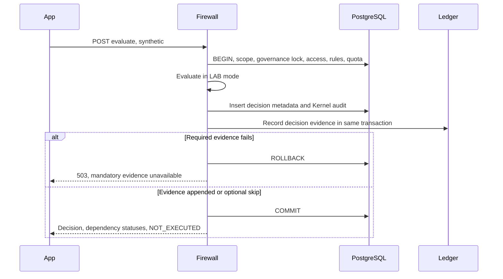
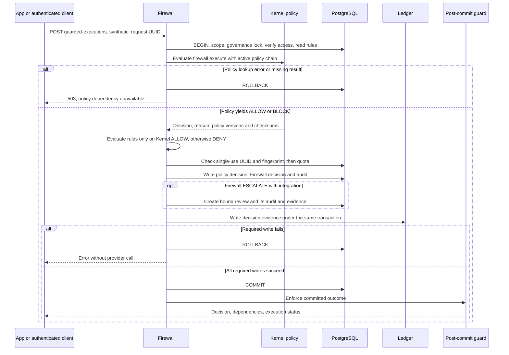
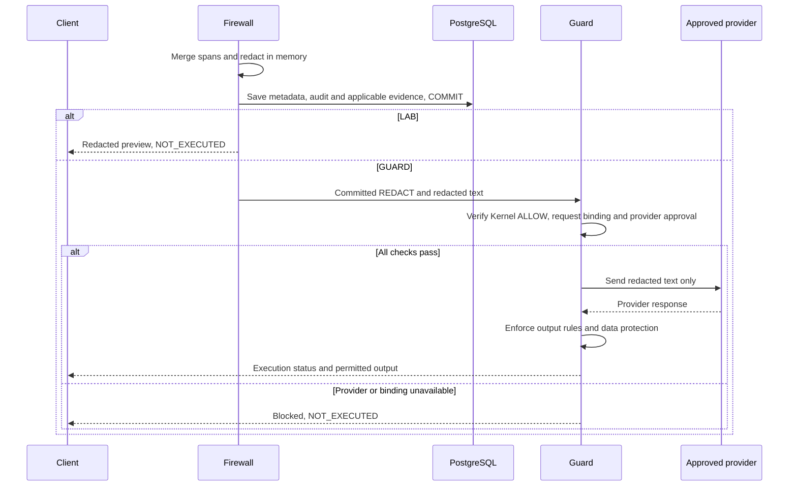
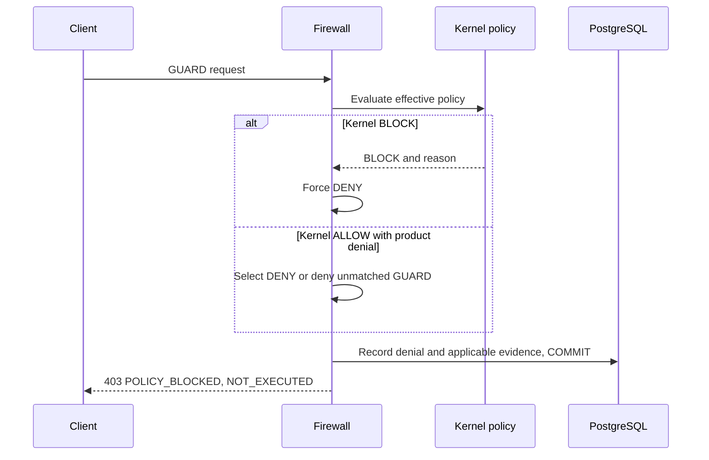
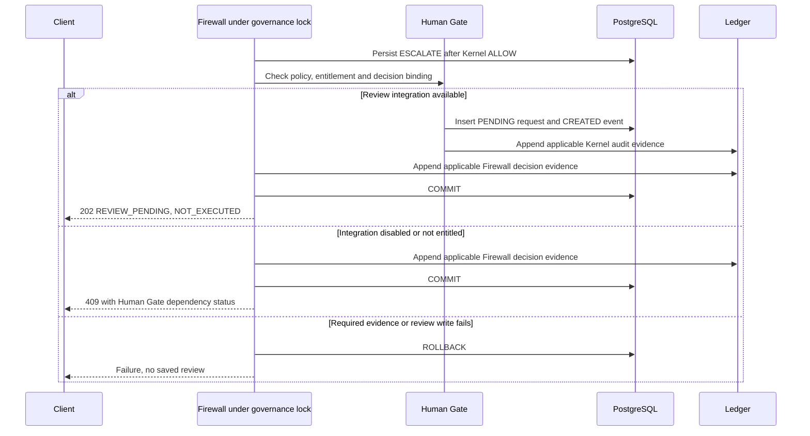
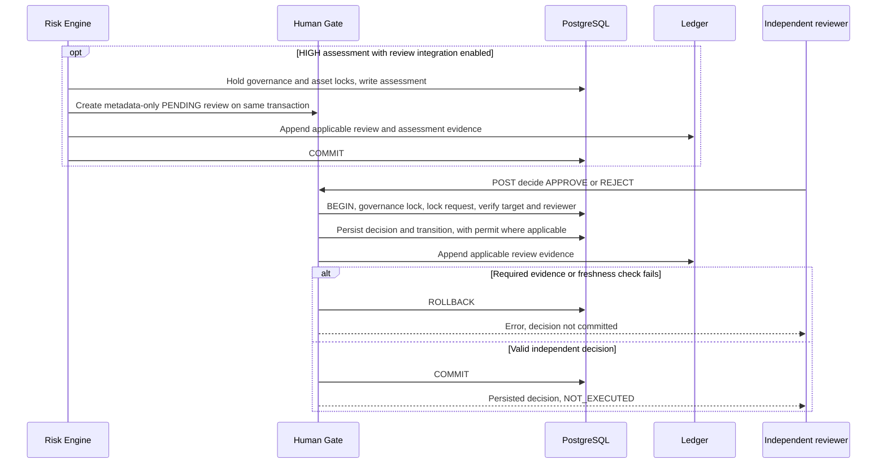
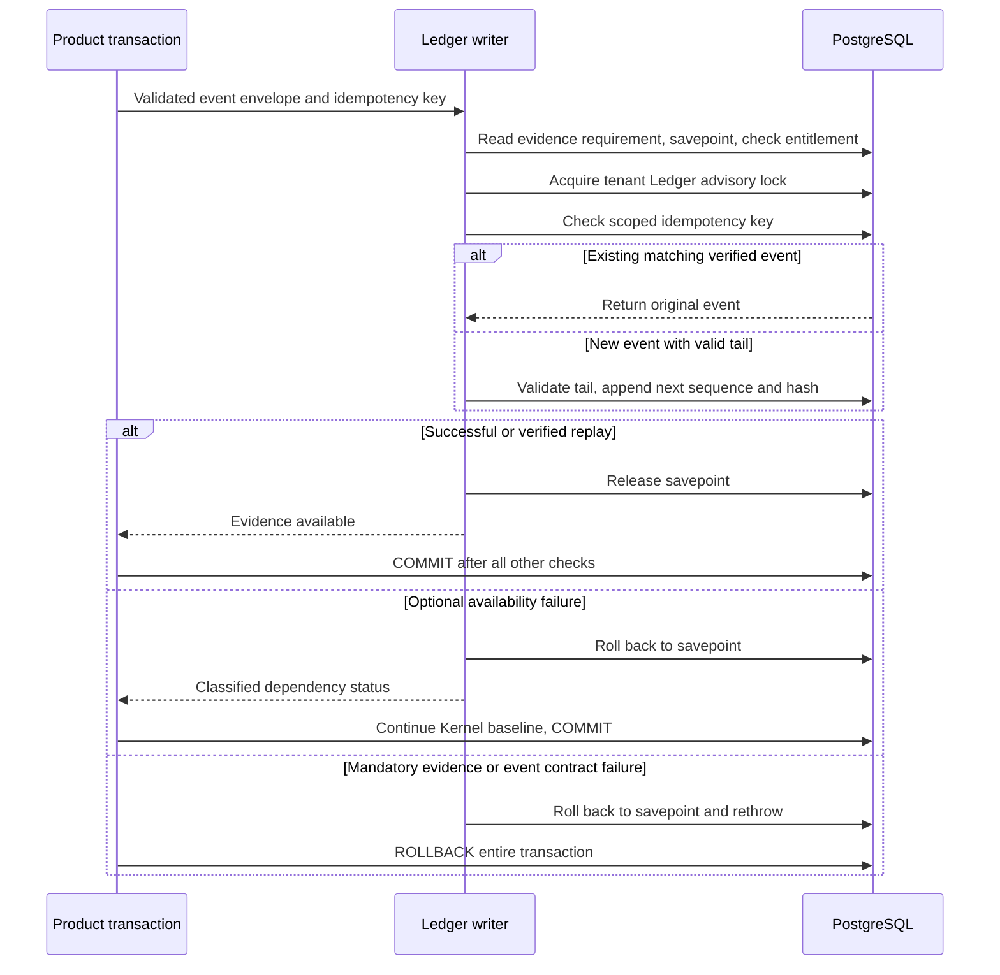

# مصفوفة تكامل منتجات AIGAS

مراجعة 2026-11-24 لمسارات التطبيق ومخطط الترحيلات حتى `0040`. المؤسسة والفاعل من العضوية والهوية الموثّقتين. التقييم والقرار والموافقة ودليل Ledger وحالة التنفيذ حقول مستقلة.

| المسار | شروطه | ما يُحفظ في المعاملة | ما يحدث بعد الالتزام |
| --- | --- | --- | --- |
| LAB | نص اصطناعي، إتاحة Firewall، حصة المؤسسة | نتيجة وصفية وتدقيق Kernel ودليل Firewall إذا أتاحته سياسة Ledger | نتيجة التجربة فقط، `NOT_EXECUTED` |
| GUARD | الشروط السابقة وUUID أحادي الاستخدام وتقييم Kernel | قرار Kernel وقرار Firewall والتدقيق والأدلة المقررة، وقد يُنشأ طلب مراجعة | `ALLOW` و`REDACT` مؤهلان لمسار المزود بعد فحص الربط. السجل الحالي للمزودين فارغ |
| REDACT | تطابق قواعد تنقيح عبر Firewall بعد تجاوز مساري DENY وESCALATE | بيانات القرار، مع مرجع ونسخة القاعدة. يبقى النص المنقّح في الذاكرة | LAB يعرض الناتج. GUARD يمرر النص المنقّح فقط عند اكتمال الشروط |
| DENY | منع Kernel أو قاعدة منع أو غياب قاعدة صالحة في GUARD | قرار المنع والتدقيق والأدلة المشروطة إذا اكتمل الحفظ | GUARD يعيد 403. فشل استعلام سياسة Kernel يعيد 503 قبل أي كتابة |
| ESCALATE | قاعدة Firewall مطابقة وKernel ALLOW وسياسة مراجعة وإتاحة Human Gate | قرار Firewall وطلب `PENDING` مربوط بالقرار والأدلة. عند غياب التكامل يُحفظ قرار Firewall وحده مع تدقيقه | 202 مع طلب صالح أو 409 عند غياب التكامل. يتوقف المسار قبل المزود |
| Human approval | طلب صالح ومراجع مخوّل، مع فصل المهام في المراجعات المتكاملة | القرار وحالة الطلب والتدقيق والأدلة. مراجعة Firewall قد تُنشئ إذنًا محدودًا. Risk review بلا إذن | `NOT_EXECUTED` عند الاعتماد. طلب التنفيذ لـFirewall محجوب وRisk للمراجعة فقط |
| Ledger evidence | مصدر ونوع ومرجع مسموحة. الإلزام بصف اعتماد مطابق للمؤسسة والمصدر ونوع الحدث | حدث وصفي في السلسلة داخل المعاملة المنتجة، أو نتيجة تعذر اختيارية | يمكن قراءة الدليل والتحقق من بادئة السلسلة. تأكيد وصول المزود خارج نطاق سجل القرار |

## 1. LAB evaluation

`POST /app/api/firewall/evaluate/` في التطبيق الموثّق. إذا وجدت قواعد نشطة سليمة ولم يطابق النص أي قاعدة، يظهر `ALLOW / NO_MATCH_LAB_ONLY`. LAB له معرّف قرار من الخادم لكل تقييم.

## 2. GUARD evaluation

`POST /app/api/firewall/guarded-executions/`. أولوية Kernel هي Enterprise ثم Department ثم Product ثم User. المنع يغلب السماح، ويلزم ALLOW صريح ونافذ على مستوى Enterprise. غياب السياسة المطابقة أو خلل تحقق البصمة أو سياق إلزامي ناقص أو التزام `REQUEST_APPROVAL` أو `REDACT` غير مطبّق ينتج `BLOCK`. فشل قراءة السياسة يوقف الطلب بـ503. تحذير Firewall لا يمرر الطلب.

## 3. REDACT

تجمع القواعد نطاقات التنقيح من النص الأصلي وتدمج المتداخل منها. يعاد فحص استجابة المزود بقواعد المخرجات وحماية البيانات قبل عرضها. نتيجة مهلة المزود الخارجي هي `UNKNOWN`، ويُمنع تكرار UUID. `OUTPUT_BLOCKED` يصف حجب الرد بعد الاستدعاء.

## 4. DENY

## 5. ESCALATE

إذا كان سبب التوقف التزام `REQUEST_APPROVAL` العام في Kernel، يبقى القرار `BLOCK` ولا يُفتح طلب تصعيد Firewall. المراجعة المنشأة تتبع سياسة Human Gate، وتحفظ مرجع قرار Firewall ومعرّف ونسخة القاعدة والبصمة. يقرأ الرد معرّف الطلب ومرجع سياسة Kernel من القرار المربوط.

## 6. Human approval

`POST /app/api/human-gate/requests/{requestId}/decide/`. يتحقق Human Gate من صلاحية الطلب والهدف والسياسة والعضوية والتفويض والبصمة قبل القرار، ثم يعيد فحص صلاحية النافذة قبل الالتزام. صف القرار فريد للطلب. بالنسبة لـFirewall يتحقق من القاعدة الفعالة ونسختها، وبالنسبة لـRisk يتحقق من حداثة التقييم ونسخة الأصل وإتاحته. قبول الخطر المتبقي في Risk Engine قرار إداري مستقل عن الاعتماد هنا.

طلب `execute/` مستقل عن `decide/`. يعيد `EXECUTION_INTEGRATION_NOT_CONFIGURED` لاعتماد Firewall و`REVIEW_ONLY` لمراجعة Risk. التنفيذ المدعوم لعمليات Human Gate الأخرى يخضع لإذن مربوط وأحادي الاستخدام، ويطبّق أثرًا محليًا داخل المعاملة، مثل تغيير اسم المؤسسة.

## 7. Ledger evidence

أحداث `firewall.decision.recorded` و`risk_engine.assessment.created` تحمل مراجع وبيانات وصفية للقرار. المراجعات المتكاملة تستخدم `kernel.audit.recorded`، بينما مراجعة الملاحظة الاصطناعية تستخدم أحداث Human Gate. العرض والتحقق والتصدير في `/app/api/ledger/events/` وواجهات الحدث الفرعية. التحقق من البادئة يفحص تجزئة كل صف ورقم تسلسله والربط بالسابق حتى الحد المطلوب، وضمانه محصور في اتساق البادئة المقدَّمة.

## التزامن والبصمة وإعادة الطلب

- تتشارك عمليات كتابة قواعد Firewall وتقييم LAB/GUARD وعمليات سياسة Kernel وتعديل العضوية وHuman Gate وتغييرات أهداف مراجعات Risk قفلًا استشاريًا للمؤسسة من نوع transaction-scoped، قبل أقفال صف المؤسسة أو الأصل أو الطلب وحساب الحصة. يبقى قفل صف المؤسسة حيث يحتاجه التنسيق مع المسارات الحالية وتسمح به RLS. تؤخذ أقفال إذن Human Gate بعد قفل الطلب. يلي ذلك قفل Ledger لكل مؤسسة قبل فحص المفتاح ورأس السلسلة، ويبقى حتى نهاية المعاملة عند نجاح الإلحاق. ترتيب الدليل من `sequence_no`، وترتيب سجل Firewall من `created_at DESC, id DESC`.
- GUARD يوحّد حالة أحرف UUID، ويتحقق من المفتاح المحفوظ قبل تطبيق الحصة على طلب جديد. الطلب المتكرر ببصمة القرار نفسها يعيد `REQUEST_ALREADY_EVALUATED`، وببصمة مختلفة يعيد `REQUEST_ID_CONFLICT`. الفهرس الفريد الشامل يمنع إدراج المعرّف نفسه في مؤسستين حتى إذا حجبت RLS الصف السابق. الفشل قبل الالتزام لا يستهلك UUID. الفشل أو النتيجة المجهولة بعد الالتزام لا يسمحان بإعادة تنفيذ UUID.
- `aigas-fw-binding-v1` هو SHA-256 للترميز المرتب للمؤسسة والفاعل وUUID ومرجع سياسة Kernel ووضع GUARD وفعل القرار وسببه ومعرّف القاعدة ونسختها. مرجع Kernel مشتق من معرّفات السياسات ونسخها وتجزئاتها بترتيب ثابت. يعيد حارس التمرير حساب الربط. البصمة للنتيجة الوصفية ولا يدخل النص أو تجزئته فيها. نص مختلف ينتج نفس الربط يبقى تكرارًا مرفوض التنفيذ. LAB وتقييمات Risk الجديدة تولّد مراجع خادم مستقلة، فلا يُعاد استخدامها كمفاتيح idempotency للمدخلات.
- مفتاح Ledger scoped إلى المؤسسة والمصدر و`idempotency_key`. يعاد السجل الأصلي عند مطابقة الفاعل ونوع الحدث ونسخة السياسة والبيانات الوصفية وسلامة الحدث. اختلاف المضمون أو فشل تحقق الحدث السابق يعيد `EVIDENCE_KEY_CONFLICT`. عند فشل الأدلة الإلزامية، يزيل التراجع القرار والتدقيق والمراجعة وأي حدث Ledger سابق داخل المعاملة نفسها.
- اختيار سياسة Kernel يعتمد على توقيت PostgreSQL بعد الحصول على القفل، ويُثبَّت على لحظة تقييم واحدة. المزود، إذا اعتُمد مستقبلًا، يُستدعى بعد الالتزام خارج قفل المعاملة. يغطي القرار لقطة السياسة المثبّتة وقت التقييم. تعطل العملية بعد الالتزام وقبل الاستدعاء قد يترك قرارًا دون نتيجة تسليم.

## حالات الاعتماد في الواجهة

تظهر من رد العملية في Firewall وHuman Gate وRisk Engine. تُعرض أعطال Ledger المباشرة من حقل الخطأ `dependencyStatus`. الحالات المعتمدة هي `available` و`not configured` و`blocked` و`degraded` و`access denied` و`expired` و`temporarily unavailable`. تعني `evaluated: false` أن الاعتماد خارج مسار العملية. تعني `required` إلزام الاعتماد للمسار المعني، ويعني `blocking` أن حالته الحالية تحجب ذلك المسار. قد يظل Ledger اختياريًا، بينما يحمل العنصر الخاص به حالة الإلزام للحدث الرئيسي للعملية. حالة توفر Human Gate في التصعيد تصف إمكانية إنشاء مراجعة، وتبقى حالتها `PENDING`. يعرض Firewall حالة المزود مستقلة، وتحمل النتيجة `execution_status` و`external_action_executed` لبيان التنفيذ.

## مراجع التحقق المحلي

- Firewall وقفل حصة LAB تحت RLS: [firewall-db.test.mjs](../tests/firewall-db.test.mjs)
- ربط التصعيد، التكرار والتعارض، عطل استعلام السياسة والتراجع بعد كتابة المراجعة: [firewall-review-binding.test.mjs](../tests/firewall-review-binding.test.mjs)
- مسار التنقيح مع محوّل محلي بلا شبكة: [firewall-local-verify.mjs](../scripts/firewall-local-verify.mjs)
- المراجعات وتزامن انتقالاتها وإذن العمليات المحلية: [human-gate-db.test.mjs](../tests/human-gate-db.test.mjs)
- سباقات تعديل الأصل واعتماد المخاطر والتراجع عند فشل الدليل: [risk-engine-db.test.mjs](../tests/risk-engine-db.test.mjs)
- تزامن مفاتيح Ledger وترتيب التجزئات وسلامة التصدير: [ledger-db.test.mjs](../tests/ledger-db.test.mjs)
- عرض حالات اعتماد LAB وGUARD تحت هوية عضو وعلى عروض 390 و1024 و1440 بكسل: [auth-browser.e2e.mjs](../tests/auth-browser.e2e.mjs)

حدود الأدلة المحلية تشمل PostgreSQL 18 ودور `aigas_runtime` وهوية اصطناعية. التحقق من النشر وإرسال المزود الحقيقي خارج نطاق هذه المراجعة.
