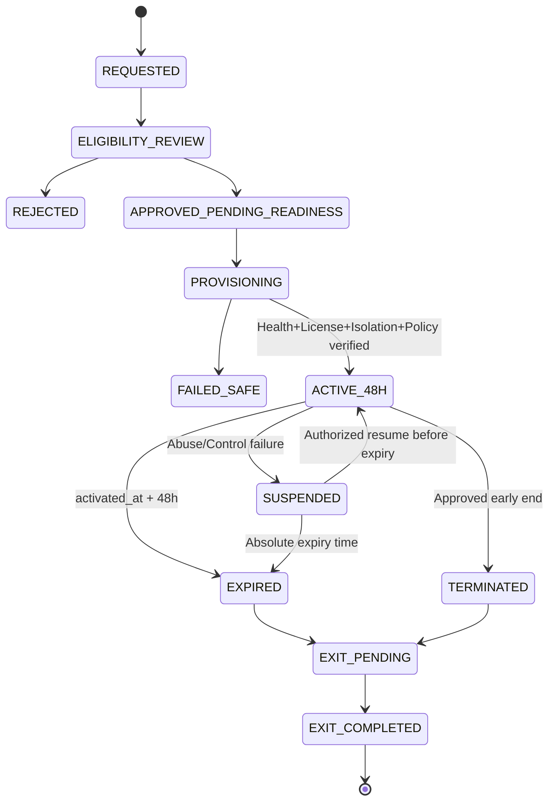

# AIGAS Firewall — 48H-TRIAL-SPEC

> **Document ID:** `AIGAS-FW-TRIAL-001` · **Version:** `1.0.0-draft` · **Date:** 2026-11-01  
> **Path:** `docs/products/firewall/48H-TRIAL-SPEC.md`  
> **Status:** `APPROVED TRIAL POLICY / FIREWALL TRIAL RUNTIME NOT VERIFIED`  
> **Parent policy:** `docs/ENTERPRISE-TRIAL-POLICY.md` · `AIGAS-COM-TRIAL-001`.

## 1. الغرض والحدود

تجربة Firewall المستهدفة **Proof of Value لمدة 48 ساعة** في نطاق محدود، لتمكين مؤسسة مؤهلة من فهم كيف تتعامل طبقة الحماية مع **مسار تكامل فعلي** وبيانات اصطناعية، دون ادعاء حماية شاملة أو تحصيل رسوم صامت. قد تُتاح لمنتج Firewall وحده مع Kernel المشترك، أو في باقة تجربة اختيارية وفق أهلية العميل.

**الواقع الحالي:** موقع `brightai.live` يوضح أن تجربة الـ48 ساعة غير مفعلة؛ محاكاة `/kernel/` واختيار قرارات Firewall بالواجهة تعليمية، وليست Trial تشغيلية. لا يجوز عرض زر «ابدأ التجربة» فعّال قبل إثبات ترخيص وتجهيز بيئة وتجربة منتج حقيقية وتوقيع الضوابط اللازمة.

**الفرق:**
- `Demo`: عرض مرئي/توضيحي لا يختبر محركًا حقيقيًا.
- `48H Trial`: بيئة مؤهلة محدودة بنطاق وحصص، تتيح وظائف مثبتة ومعلنة خلال 48 ساعة من التفعيل.
- `Pilot`: مشروع مؤسسي تعاقدي منفصل، قد يتضمن تكاملات حساسة ومدة/أهداف/موارد مختلفة بحسب الاتفاق، وليس تمديدًا صامتًا لتجربة مجانية.

## 2. مبادئ غير قابلة للتنازل

1. `expires_at = activated_at + 48 hours` **متصلة**، من وقت اكتمال التفعيل الموثق، وليس من طلب التجربة أو دخول الموقع.
2. لا تحويل تلقائي إلى اشتراك مدفوع، ولا سحب رسوم أو تفعيل اشتراك بلا إجراء شراء واعتماد مستقلين.
3. لا تدريب على بيانات العملاء عند BRIGHT AI أو الموردين تحت أي ظرف.
4. **بيانات اصطناعية افتراضيًا.** البيانات الحقيقية تحتاج تصريحًا كتابيًا محددًا، وتحليل نطاق وبيئة ومعالجة وأدوارًا معتمدة.
5. تتطلب تجربة الجهات الحكومية مراجعة بشرية؛ المؤسسات الخاصة المؤهلة يمكنها تفعيلًا ذاتيًا فقط **بعد إثبات آلية التحقق والحماية**.
6. لا تتجاوز Trial القواعد الإلزامية أو Hard Deny أو قيود الأداة/المزود/المنطقة، ولا تجعل Shadow أداة تخطي.
7. حد التكلفة، وRate Limits، وعدد المستخدمين/المسارات/الطلبات، وسياسة التمديد **يجب اعتمادها** قبل تشغيل التجارب. لا تضع أرقامًا مختلقة.
8. لا توصيل ذاتي مع أنظمة مؤسسة حقيقية عالية الحساسية/أثر دون مراجعة بشرية وتفويض مكتوب.
9. يظل Kernel الأساسي دون رسم منفصل؛ أي Risk Engine أو Ledger أو Human Gate متقدم في التجربة يحتاج أهلية ووظائف مثبتة، وليس فرض شراء.
10. الفصل التام بين البيانات والتراخيص وTenant للحسابات المتعددة، مع منع التحايل بإعادة التسجيل أو تغيير الهوية.

## 3. أهلية التجربة

| العميل | مسار الأهلية المستهدف | ما يلزم قبل البدء |
|---|---|---|
| منشأة خاصة سعودية مؤهلة في SaaS القياسي | تحقق مؤسسي آلي **إذا أثبتت الأداة** | هوية، شخص مخوّل، قواعد منع إساءة الاستخدام، شروط بيانات، سياسة حصة، مراجع مخاطر |
| جهة حكومية | مراجعة واعتماد يدوي | نطاق وخطة بيانات وبيئة وموافقة المفوض والضوابط المنطبقة |
| عميل يحتاج On-Premise | ترتيب مُدار | بنية/هوية/موارد/مسؤوليات مثبتة؛ قد يُفضل Pilot باتفاق مستقل |
| عميل Air-Gapped | مراجعة مُدارة وترخيص محلي | تشغيل كامل دون إنترنت، بيئة/نموذج محلي ومفاتيح ومخرجات تصدير؛ لا Cloud Check إلزامي |
| جهة تسعى لاستخدام بيانات واقعية | **لا تفعيل تلقائي** | تصريح كتابي، عقد معالجة وبيئة معتمدة، تقليل بيانات وحقوق وتوثيق أساس المعالجة |

**لا توجد في المصادر المعتمدة قواعد نهائية** لمستندات إثبات الهوية، وإعادة أهلية التجربة لكل مؤسسة أو قائمة وثائق التفعيل الذاتي؛ صاحب القرار يجب أن يعتمدها.

## 4. ما يُعرض في تجربة Firewall

| القدرة | غرض التجربة | طريقة الإثبات | ممنوع عرضه كمثبت قبل التنفيذ |
|---|---|---|---|
| `FW-01` | تمرير طلب مصرح به عبر API/Proxy معتمد | Integration trace + ارتباط الطلب بـDecision ID | عرض SVG وحده |
| `FW-02` | قرارات الحماية التي يدعمها الإصدار التجريبي | قبل/بعد وأثر التنفيذ، لا تغيير نص UI فقط | الادعاء بأن كل القرارات الخمسة تعمل آليًا بدون دليل |
| `FW-03` | اختبار سياسة إلزامية لا تُتجاوز | محاولة سياسة أدنى/مستدعي غير مخول | وضع Shadow يتجاوز الحظر |
| `FW-04` | فحص نص عربي وإنجليزي اصطناعي | عينات ببيانات مصطنعة وقياس نتيجة | «يكتشف كل البيانات الحساسة» |
| `FW-05` | منع أمر أداة غير مصرح به أو حقن معلوم | سيناريو استدعاء مقيد وأثر منع موثق | ضمان منع كل Jailbreak |
| `FW-06` | بيان فرق المراقبة والإنفاذ | مقارنة مشروع Shadow مسموح بالحظر الإلزامي | إلغاء Hard Deny خلال التجربة |
| `FW-07` | حدود الانقطاع والحصص | رفض آمن أو تدهور آمن موثق | إرسال الطلب عند تعطل حماية لازمة |
| `FW-08` | التقاط أدلة قرار مصغرة | Audit records محدودة البيانات بدون Ledger | عرض لقطة UI كدليل تخزين حقيقي |

**لا يُدرج اختبار قدرة غير موجودة في إصدار التجربة.** في التقرير يُذكر ما تم تشغيله وما لم يُختبر وسبب ذلك، دون خلط المتطلبات بنتيجة فعلية.

## 5. الحصص والميزانية — نموذج اعتماد (لا أرقام معتمدة)

| المعرّف | الحقل | القيمة الحالية | مالك الاعتماد | سياسة عند غياب الاعتماد |
|---|---|---|---|---|
| `FW-TRIAL-Q01` | `max_protected_requests` | `TBD` | FinOps/Product | لا تفعيل لتجربة تستهلك موارد مفتوحة |
| `FW-TRIAL-Q02` | `max_api_calls_per_minute` | `TBD` | Security/Platform | حد آمن معتمد مطلوب |
| `FW-TRIAL-Q03` | `max_users` | `TBD` | Product | تحقق هوية وصلاحيات أولًا |
| `FW-TRIAL-Q04` | `max_connectors` | `TBD` | Product/Integration | أنماط/موصلات معتمدة فقط |
| `FW-TRIAL-Q05` | `max_request_payload_bytes` | `TBD` | Security/Platform | رفض غير المحدد عالي المخاطر |
| `FW-TRIAL-Q06` | `max_customer_brightai_cost` | `TBD` | Finance | سقف تكلفة داخلي ملزم |
| `FW-TRIAL-Q07` | `max_provider_ai_cost` | `TBD` | Finance | لا استدعاء مُكلف دون ميزانية |
| `FW-TRIAL-Q08` | `approved_ai_provider_ids` | `TBD` | Security/Privacy | لا مزود خارجي غير معتمد |
| `FW-TRIAL-Q09` | `allowed_regions` | `TBD` | Privacy/Customer | تقييد المنطقة بحسب العقد |
| `FW-TRIAL-Q10` | `extension_policy` | `TBD` | Commercial/Owner | لا تمديد افتراضي |
| `FW-TRIAL-Q11` | `post_expiry_export_window` | `TBD` | Privacy/Legal | لا وعد بمهلة غير معتمدة |
| `FW-TRIAL-Q12` | `trial_data_retention_period` | `TBD` | Privacy/Legal | لا افتراض حذف فوري لكل السجلات |
| `FW-TRIAL-Q13` | `backup_purge_schedule` | `TBD` | Security/Operations | إفصاح صادق عن نسخ احتياطية |

**قاعدة الاستهلاك:** قد تقاس الطلبات المحمية كمرشح `PROTECTED_AI_REQUEST`، ولا يعني هذا وحدة سعر نهائية. يجب منع عد داخلي مكرر لـRetry/المراحل الفرعية. BYOK خيار مشروط بالموافقة وأمن المفاتيح، ولا يحل محل سقف الاستخدام.

## 6. حالة التجربة ودورة حياتها

**التوقيت:** يخزن UTC في سجل موثوق، ويُعرض بتوقيت السعودية عند الحاجة. لا يعاد ضبط الوقت عند تغيير متصفح/جلسة/مستخدم، ويجب إيقاف الاستدعاءات التجريبية الجديدة بعد الانتهاء ولو بقيت واجهة العميل مفتوحة.

### 6.1 نموذج كيان Trial (تصميم مستهدف)

| الحقل | الغرض | من يدخله/يملك تغييره |
|---|---|---|
| `trial_id` | معرف تجربة | النظام |
| `tenant_id` | مؤسسة موثقة | هوية المؤسسة المعتمدة |
| `product_entitlements` | Firewall وربما منتج مختار | Licensing بعد موافقة |
| `requester` / `reviewer` | طلب وأهلية | موظف/جهة مخولة |
| `activated_at` | بداية مثبتة | Orchestrator بعد نجاح التفعيل |
| `expires_at` | `activated_at + 48h` | النظام؛ التمديد قرار منفصل موثق |
| `approved_scope` | الموصل/المزود/البيئة | Security/Product/Customer |
| `approved_quota_set_id` | حصة ذات نسخة | Finance/Platform |
| `data_policy_version` | سياسة بيانات | Privacy/Legal |
| `trial_state` | حالة دورة الحياة | State Machine مثبتة |
| `report_reference` | تقرير PoV معتمد | جهة إصدار التقرير |

## 7. سيناريوهات التجربة

> **ملاحظة:** هذه حالات قبول مستهدفة، وليست نتائج اختبارات حدثت بالفعل. استعمل بيانات اصطناعية فقط إلى حين موافقة بيانات حقيقية خاصة ومثبتة.

| ID | السيناريو | مدخل/شرط مصطنع | النتيجة المطلوبة | الدليل |
|---|---|---|---|---|
| `TR-FW-01` | سماح | نص عام + نموذج معتمد | استدعاء يمر مع decision ID | Trace request → provider + Audit |
| `TR-FW-02` | Hard Deny | وجهة محظورة بسياسة عليا | Block قبل أي ارسال | سجل منع + إثبات عدم provider call |
| `TR-FW-03` | تنقيح | نص تجريبي بمعرّف وهمي | المزود يرى نصًا منقحًا فقط | مقارنة مسار استدعاء موثقة |
| `TR-FW-04` | تحذير | محتوى مسموح بشروط | تحذير مفهومي/عملي مع عدم تجاوز سياسة أعلى | UI/API reason + policy |
| `TR-FW-05` | مراجعة بشرية | Tool Action ذو أثر افتراضي | Pending حتى قرار مخول | Approval state + عدم execution |
| `TR-FW-06` | مهلة مراجعة | لا رد ضمن زمن سياسة معتمد | Deny/Stop safe، لا سماح صامت | Timer + action trace |
| `TR-FW-07` | هجوم Prompt Injection | مصدر غير موثوق يطلب سرًا/أداة | رفض الفعل غير المخول | Tool authorization logs |
| `TR-FW-08` | كشف عربي/إنجليزي | مجموعات بيانات مختلقة متوازنة | نتائج كشف قابلة للتحليل وقيود معلنة | Corpus/FP/FN report |
| `TR-FW-09` | Shadow ضمن نطاق مسموح | سياسة غير إلزامية بالمراقبة | تقرير Shadow فقط + استمرار Hard Deny | نسخة السياسة + نتيجة التنفيذ |
| `TR-FW-10` | تعطل محرك قرار إلزامي | مهلة/عطل خدمة | Fail-Closed وعدم تجاوز | Failure injection record |
| `TR-FW-11` | منع عبور Tenant | مستخدم من مؤسسة A يطلب قرار B | رفض/إخفاء وجود المورد | Access audit + عدم تسرب |
| `TR-FW-12` | اختبار حصص | استدعاءات تتجاوز حصة معتمدة | رفض واضح دون overage صامت | Metering & billing isolation |
| `TR-FW-13` | المزود/المنطقة | طلب توجيه لمنطقة غير مسموحة | رفض، لا fallback لمزود آخر | Egress trace |
| `TR-FW-14` | انتهاء 48 ساعة | وقت `expires_at` موثوق | وقف الاستدعاءات وحالة `EXPIRED` | License events + request blocked |
| `TR-FW-15` | عدم تحويل مالي | انقضاء تجربة بدون شراء | لا فاتورة/رسوم/اشتراك | CRM/Billing records |
| `TR-FW-16` | حفظ/حذف | انتهاء نافذة خروج معتمدة | تصدير محكوم أو حذف موثق حسب السياسة | Export/delete/backup evidence |

**الأولوية:** حالات `Hard Deny` و`Tenant Isolation` و`Fail-Closed` و`No-Training` و`Trial Expiry` تمنع الإطلاق إذا فشلت؛ لا تُعالج بتعديل النص التسويقي فقط.

## 8. سيناريو عرض مقترح للعميل (عند توفر Trial فعلي)

1. **اعتماد النطاق:** سجل `approved_integration_id`, بيئة، نموذج، نوع بيانات، مستخدمين وصلاحيات.
2. **تشغيل مسار سماح:** مرّر نصًا عامًا مصطنعًا عبر Gateway مثبت، وأظهر دليل مرور الطلب.
3. **تشغيل Hard Deny:** أظهر منع الإرسال لمزود معتمد لأنه محظور لهذه السياسة المعتمدة.
4. **تنقيح اصطناعي:** قارن بين النص الأصلي المصطنع والنص المستلم من المزوّد؛ لا تكتفِ برسمة Redact في المتصفح.
5. **مراجعة معلقة:** تأكد أن عدم الرد لا يطلق الفعل.
6. **سجل القرار:** اعرض معرف قرار ونسخة سياسة وأسبابًا لا تحتوي محادثة العميل الخام.
7. **حالة انقطاع:** أظهر سيناريو فشل آمن داخل بيئة اختبار فقط؛ لا توقف نظام عميل حقيقي.
8. **خلاصة PoV:** نتائج مثبتة وحدود وأمور غير مختبرة، دون نسبة إنجاز غير مسنودة.

## 9. التقرير النهائي Proof of Value

### قالب الحد الأدنى

| المجال | الحقل | صيغة الدليل |
|---|---|---|
| هوية التجربة | Trial ID / Tenant (مقنّع) / Scope | سجل اعتماد/ترخيص |
| المدة | activated_at / expires_at / ended_at | أحداث موقعة/موثقة |
| البيانات | Synthetic / Written-approved Real Data | نسخة تصريح وشروط معالجة |
| المعمارية | تكامل ومزود ونموذج/منطقة معتمدة | Configuration reference |
| الوظائف | ماتم اختباره من `FW-01…FW-08` | Case ID, result, evidence ref |
| القرارات | Allow/Warn/Redact/Review/Block المختبرة | Decision ID + enforcement proof |
| القيود | موصلات/لغات/سياسات لا يغطيها المنتج | Scope & limitations |
| الحصص | استهلاك وميزانية وحالات رفض | Metering record |
| المشاكل | Issue/Severity/Owner/Next action | Issue reference |
| القرار | Fit / Needs Pilot / Not Suitable / Not Verified | مراجعة بشرية مخولة |

**لا يُوضع Score أو «نجاح 100%» بدون تعريف ومعيار قبوله وعينات ذات نتائج قابلة للتحقق.** التقرير التنفيذي يجب أن يكون قابلًا للفهم من صاحب قرار، والتقني يحمل الأدلة المناسبة دون كشف أسرار.

## 10. الإنهاء والخروج والبيانات

- عند `EXPIRED` أو `TERMINATED`: يمنع إنشاء عملية تجريبية محكومة جديدة **مباشرة وفق الترخيص**؛ لا تتوقف حماية منتج مرخص آخر قائم لدى العميل.
- تقدم نافذة تصدير/استرداد **إذا اعتمدت** وفق العقد، وليس تلقائيًا على أنها 48 ساعة.
- تحذف البيانات التي يجوز حذفها وفق **مصفوفة احتفاظ معتمدة**، مع استثناءات Legal Hold والنسخ الاحتياطية التي يلزم بيان أثرها.
- سجل الأحداث الأمنية الضروري قد يخضع لاحتفاظ مختلف عن المحتوى، وينبغي تصديره/حذفه حسب صلاحياته دون تسريب PII.
- لا تترك مفتاح مزود/حساب تجريبي فعالًا بعد الإنهاء؛ يراجع الإبطال وإلغاء الموصلات وإزالة الصلاحيات.
- أي إعادة تفعيل تحتاج سجل صلاحية واعتمادًا مستقلًا، لا تمديدًا بالضغط على زر.

## 11. أمن التجربة وإساءة الاستخدام

- هوية المؤسسة ومنع تكرار إنشاء Tenant تحايلي.
- Rate/Spend Limits مع تنبيه قبل سقف التكلفة، وفصل حساب تكلفة AI عن رسوم المنتج.
- لا يفتح النظام اتصالًا لمزود AI غير معتمد إذا عجز عن تشغيل المزوّد الأصلي.
- لا تُستقبل API Keys من نماذج عامة أو تحفظ في المتصفح أو سجلات الأخطاء.
- طلب مراجعة Human Gate اختياري متقدم، ولا يُلغى أساس مسار الإيقاف والمراجعة الدنيا في Firewall.
- إساءة الاستخدام تستدعي `SUSPENDED` مع سبب وأثر قابل للمراجعة، دون إصدار فاتورة جزائية تلقائية.
- إن أُلغي/عُلق التشغيل مبكرًا، يجب تحديد أثر هذا على مدة 48 ساعة؛ **لا تمديد تلقائي** إلا بقرار مخول.

## 12. فروق النشر

| بيئة | المخاطر والاشتراطات | إثبات الجاهزية |
|---|---|---|
| SaaS | عزل Tenant، استضافة سعودية افتراضيًا، معالجة منطقة معتمدة، حد تكلفة BRIGHT AI | tenant/egress/quota/activation traces |
| On-Premise | حقوق وصول، موارد، مراقبة/دعم محلي أو متفق | local license + backup/DR/support agreement |
| Air-Gapped | هوية/تراخيص/سياسة/نموذج/توقيع/سجل محلي، دون Cloud Check | offline activation + egress-negative evidence + export |

لا يعد التوافر على SaaS دليلًا على جاهزية On-Premise أو Air-Gapped تلقائيًا. إذا تعذر تجهيز Trial متصل في موقع عميل، يُعرض Pilot منفصل بعد موافقته بدل اختراع دعم فوري.

## 13. بوابات التفعيل

| Gate | المطلوب | الحالة الآن |
|---|---|---|
| `T-G01` | إثبات وجود Firewall API/Gateway عاملة على طلب حقيقي | `NOT_VERIFIED` |
| `T-G02` | تحقق الهوية والمؤسسة والفصل والصلاحيات | `NOT_VERIFIED` |
| `T-G03` | ترخيص Trial يطبق فترة 48 ساعة من activation | `NOT_VERIFIED` |
| `T-G04` | سياسة بيانات وProvider وRegions مصادق عليها | `APPROVAL_REQUIRED` |
| `T-G05` | حصص وموازنة ومعدل طلبات معتمدة | `APPROVAL_REQUIRED` |
| `T-G06` | تقرير PoV مع أدلة تشغيلية قابلة للمراجعة | `NOT_VERIFIED` |
| `T-G07` | انتهاء/إيقاف/خروج/حذف مثبت | `NOT_VERIFIED` |
| `T-G08` | أمن شامل: Hard Deny، Fail-Closed، No-Training، عدم تحويل مالي | `NOT_VERIFIED` |

**لا تطلق تجربة للعملاء حتى تُغلق بوابات التفعيل الحرجة بأدلتها ويُعتمد النطاق قانونيًا وتشغيليًا.**

## 14. النص العام الصحيح حاليًا

> «تجربة Firewall المؤسسية لمدة 48 ساعة جزء من الخطة المعتمدة، تبدأ بعد أهلية وتفعيل فعلي عندما تصبح الخدمة جاهزة. لا تتوفر حاليًا أدلة تثبت إتاحة التفعيل عبر الموقع. يمكنك إرسال استفسار عام دون بيانات حساسة؛ لا يتحول الطلب إلى اشتراك مدفوع تلقائيًا.»

## 15. القرارات المفتوحة

- سقوف الحصص/الإنفاق والمنصات/النماذج/المناطق المقبولة.
- خطوات تحقق المؤسسات الخاصة، وسلطة استثناءات الجهات الحكومية.
- تسعير/مسؤوليات BYOK في Trial، وقيود المورد إذا استُخدم.
- أوقات/صلاحيات التمديد، وخطة معالجة الانقطاع، وإدارة Suspension.
- نوافذ خروج وحذف البيانات وتخزين نسخ الأدلة وطلبات الحقوق.
- الحد الأدنى من وظائف FW التي تفتح قبل تسمية التجربة «Firewall PoV».

**مراجع:** `docs/ENTERPRISE-TRIAL-POLICY.md`، `docs/PRICING-AND-LICENSING.md`، `docs/DATA-PRIVACY-AND-SECURITY.md`، `FEATURE-STATUS.yaml`، `API-CONTRACT.yaml`، `ACCEPTANCE-AND-EVIDENCE.md`.
