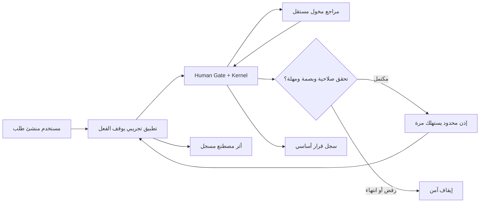

# AIGAS Human Gate — 48H-TRIAL-SPEC

> **Document ID:** `AIGAS-HG-TRIAL-001` · **Version:** `1.0.0-draft` · **Date:** 2026-11-01  
> **Canonical path:** `docs/products/human-gate/48H-TRIAL-SPEC.md`  
> **Parent policy:** `docs/ENTERPRISE-TRIAL-POLICY.md` · **Commercial:** `docs/PRICING-AND-LICENSING.md`  
> **Current state:** `TRIAL_NOT_ACTIVE` / `HUMAN_GATE_RUNTIME_NOT_VERIFIED`.

## 1. الغاية والحدود

الهدف من تجربة **Proof of Value لمدة 48 ساعة** هو إظهار أن Human Gate يحكم **فعليًا** إجراءً تجريبيًا بسيطًا لدى جهة مؤهلة: لا يحدث أثره قبل مراجعة مخولة، ويُرفض بصورة قابلة للإثبات عند غياب القرار أو تغير السياق أو انتهاء المهلة. التجربة تستهدف منتج **Human Gate + Kernel** فقط؛ تكاملات Firewall/Risk Engine/Ledger اختيارية.

**التجربة غير مفعلة حاليًا:** `/products/human-gate/` يقدم نموذجًا توضيحيًا، و`/pricing/` يذكر أن التفعيل المستقبلي يحتاج جاهزية. طلب بريد لا ينشئ مؤسسة أو ترخيصًا أو حسابًا. لا يجوز إصدار رابط Trial أو حالة «نشطة» قبل اجتياز `ACCEPTANCE-AND-EVIDENCE.md` واعتماد شروط التجربة.

## 2. القواعد غير القابلة للتجاوز

1. **48 ساعة متصلة** تبدأ من `activated_at` المثبت بعد جاهزية tenant/ترخيص التجربة والصلاحيات وبيئة البيانات، وليس من التسجيل أو طلب العرض.
2. `expires_at = activated_at + 48 hours` بنظام توقيت موثوق ومحدد؛ أي تأخير قبل التفعيل لا يقلص الـ48 ساعة. لا تمديد إلا بموافقة مستقلة مسجلة.
3. لا اشتراك مدفوع أو خصم أو استهلاك إضافي بعد الانتهاء دون موافقة شراء منفصلة.
4. **بيانات اصطناعية افتراضيًا.** بيانات واقعية فقط بعد موافقة خطية، ودراسة مخاطر، وبيئة وعقد معالجة معتمدين.
5. منع استخدام أي بيانات عميل لتدريب أو تحسين نماذج AI عند BRIGHT AI أو مورديها مطلقًا.
6. الفشل/انتهاء الحصة/الترخيص لا يسمح بتجاوز موافقة بشرية مطلوبة.
7. كل تجربة معزولة الهوية والمستأجر والوظائف؛ الخدمات الداخلية لها صلاحيات service identity منفصلة عن مستخدمي UI.
8. الحد الأدنى لسجل القرار موجود دون اشتراك Ledger.
9. لا تسمح الموافقة بتجاوز `HARD_DENY`، أو تنفيذ عملية تغيرت بعد الموافقة.
10. Human Gate قابل للتجربة وحده؛ من دون شراء Risk Engine أو Firewall أو Ledger.

## 3. أهلية وتفعيل الجهة

| فئة الجهة | المسار المستهدف | قرار المراجعة |
|---|---|---|
| قطاع خاص مؤهل بتكامل اصطناعي ومحدود | SaaS ذاتي **عند اعتماد نظام الأهلية** | آلي فقط إن استوفى منع الإساءة وإثبات الهوية والضوابط |
| جهة حكومية | Enterprise-managed | مراجعة بشرية إلزامية |
| مهمة أو تكامل عالي الأثر | Managed Trial / Pilot | موافقة أمن وحوكمة ومالك العملية |
| On-Premise | تجربة مدارة بعقد ونطاق | تحقق البيئة والتكامل والصلاحيات |
| Air-Gapped | تجربة معزولة محلية/PoV مدارة | ترخيص محلي مستقل وخطة تحديث ودعم دون إنترنت |

### 3.1 بوابات ما قبل التفعيل

- [ ] تعريف الجهة والتفويض التجاري وممثل جهة العميل دون نسخ وثائق شخصية بلا حاجة.
- [ ] نطاق Synthetic Operation **غير إنتاجي** معروف ومنفصل عن موارد حقيقية.
- [ ] حسابات Requester وReviewer وAdmin وService caller منفصلة؛ مراجعة SoD.
- [ ] مسار Trustworthy Enforcement مُنفذ: العملية لا تستطيع تجاوز التوقف.
- [ ] هوية مستأجر وMFA/SSO أو هوية محلية معتمدة بحسب النشر.
- [ ] سياسة مراجعة معتمدة بالمستوى والمهلة والنصاب والتفويض والحدود.
- [ ] ترخيص تجربة محدد المنتج والحصص والتوقيت؛ بدون تحويل تلقائي.
- [ ] ترتيبات بيانات واحتفاظ وحذف وموردين مُعتمدة، حتى لو كانت التجربة Synthetic.
- [ ] سجل أدلة أساسي مع إخفاء معلومات حساسة وحق تصدير مصرح به.
- [ ] قدرة إيقاف التجربة أو سحب صلاحية مستخدم وسيناريو استرداد عند الخطأ.

## 4. ملف تجربة الجهة (Trial Definition)

| الحقل | القاعدة / قيمة الاعتماد |
|---|---|
| `trial_id`, `tenant_id`, `product_id` | من نظام التهيئة الموثوق؛ `AIGAS-HG` |
| `activated_at`, `expires_at` | وقت التفعيل +48 ساعة بالضبط |
| `trial_approver`, `institution_contact` | صفة معتمدة، ليست بيانات Public Event |
| `operation_scope` | Synthetic API محلي/معزول، لا يتسبب بأثر إنتاجي |
| `reviewer_roles`, `sod_matrix`, `escalation_plan` | معتمدة في Policy Version؛ الأعداد لم تحسم بعد |
| `request_quota`, `decision_quota` | **PENDING_APPROVAL** ولا افتراض رقم |
| `user_limit`, `rate_limit`, `max_cost` | **PENDING_APPROVAL** |
| `max_approval_pending_duration`, `grant_ttl` | **PENDING_APPROVAL**، مستقلة عن مدة Trial نفسها |
| `allowed_region`, `network_profile`, `data_class` | افتراضيًا Synthetic + السعودية SaaS المستهدف بحسب العقد |
| `data_retention`, `backup_deletion`, `legal_hold` | سياسة معتمدة؛ لا رقم مفترض |
| `optional_products` | قائمة اختيارية لا تمنع التجربة المستقلة |

## 5. تصميم بيئة PoV



يجب أن يُظهر التطبيق التجريبي في سجل مستقل أن الخطوة المحكومة لم تحدث قبل استهلاك الإذن. لا يجوز أن تكون نتيجة الاختبار مجرد تغيير لون/نص زر. إن كان الاختبار قائمًا على Mock UI فقط تُسجل النتيجة **INVALID_DEMO_ONLY**.

## 6. سيناريوهات التجربة الستة عشر

| ID | السيناريو | ربط المتطلب | المدخل الاصطناعي / الفعل | النتيجة المنتظرة | دليل الإثبات |
|---|---|---|---|---|---|
| `HG-TR-01` | إنشاء طلب من خدمة متكاملة | `HG-01` | طلب عمل اصطناعي يحوي بصمة ومهلة وسياسة | طلب واحد موثق؛ تنفيذ المصدر معلق | سجل create + معرّف عملية + حالة مصدر العمل |
| `HG-TR-02` | الطلب قبل الموافقة | `HG-05` | محاولة المصدر تنفيذ الإجراء وهو PENDING | رفض التنفيذ، لا أثر جانبي | API enforcement deny + proof no-side-effect |
| `HG-TR-03` | موافقة مراجع مخول | `HG-02` | قرار أولي لمهمة أحادية المرحلة | تقبل فقط بعد تحقق الدور والسياسة وتسجيل التعليل | Decision log + policy + identity |
| `HG-TR-04` | رفض مراجع مخول | `HG-02` | طلب مستقل يُرفض بسبب مقنع | REJECTED وإيقاف فعلي | API rejection + downstream state |
| `HG-TR-05` | منشئ الطلب يحاول الموافقة | `HG-02` | صاحب الطلب يملك حسابًا ويجرب الاعتماد ضمن SoD | 403؛ لا تغيير حالة | Access audit + unchanged state |
| `HG-TR-06` | مراجع من مؤسسة مختلفة | `HG-02` | حساب Tenant B يستعلم عن Approval Tenant A | 403/404 بلا تسريب | Isolation deny + tenant-scoped audit |
| `HG-TR-07` | موافقة متعددة المراحل | `HG-02` | سياق خيالي يلزم مرحلتين منفصلتين | لا grant بعد المرحلة الأولى؛ يكتمل بعد الثانية حسب السياسة | Timeline + stage quorum evidence |
| `HG-TR-08` | التفويض المحدود | `HG-03` | مراجعة عبر Delegate مخول ضمن المدة | صلاحية ضمن الدور والمدة فقط؛ سجل وكّل/من قام | Delegation + decision identity |
| `HG-TR-09` | تفويض خارج النطاق/منتهي | `HG-03` | Delegate يحاول قرارًا بعد expiry أو على عملية غير مخولة | رفض دون اعتماد | Forbidden + expiry audit |
| `HG-TR-10` | التصعيد دون توسيع الصلاحية | `HG-03` | طلب متوقف يرسل للمراجع الأعلى وفق شرط | تصعيد مسجل ولا استكمال حتى مراجعة مخولة | Escalation + role permission evidence |
| `HG-TR-11` | انتهاء المهلة بلا رد | `HG-03` | خادم يتحكم بساعة اختبار ينهي Request | EXPIRED + رفض أو إيقاف آمن لا اعتماد صامت | Trusted timestamp + denied effect |
| `HG-TR-12` | قرار يصل بعد انتهاء المهلة | `HG-03` | API قبول بعد expiry | 410/409؛ لا إعادة فتح | Response + unchanged closed state |
| `HG-TR-13` | تغيير نطاق العملية بعد القرار | `HG-05` | تعديل resource_ref أو fingerprint مع grant سابق | 412/423؛ لا تنفيذ | Diff + grant bound mismatch |
| `HG-TR-14` | إعادة استهلاك grant | `HG-05` | تكرار طلب consume نفسه مع محاولة عمل جديدة | لا منح صلاحية ثانية، لا side-effect جديد | Atomic event + idempotency proof |
| `HG-TR-15` | انقطاع خدمة الموافقات/الهوية | `HG-05` | فصل dependencies ضمن بيئة محكومة | Safe stop، لا fallback يسمح بعمل محكوم | Failure evidence + downstream paused |
| `HG-TR-16` | تقرير أثر قرار أساسي دون Ledger | `HG-04` | إصدار موافقة ورفض في tenant تجريبي دون رخصة Ledger | سجل مراجعة بالمعرّف والتوقيت والسبب والسياسة قابل للتصدير المخول | Audit export + license isolation proof |

## 7. مراحل رحلة الـ48 ساعة

- **قبل التفعيل:** طلب أهلية ومراجعة وتهيئة بيانات اصطناعية وتحديد الحصص، دون بدء الساعة.
- **اللحظة `T0`:** تحقق Provisioning وترخيص وعزل وصلاحيات ناجح، وتثبيت `activated_at` و`expires_at` وإرسال إشعار دقيق غير تسويقي.
- **داخل الفترة:** تنفيذ السيناريوهات ومتابعة حد الاستهلاك وحوادث فشل الموافقة والإنفاذ. أي توقف كبير أو اختلاف أساسي يوثق ولا يمحى من تقرير PoV.
- **تذكيرات:** إشعارات آمنة عند قرب الانتهاء وفق عتبات معتمدة لاحقًا؛ لا نختلق وقت تنبيه.
- **عند `T0+48h`:** انتهاء ترخيص التجربة ومنع إنشاء grants أو قرارات جديدة غير مصرح بها؛ الطلبات المعلقة والأذونات غير المستهلكة تُوقف بأمان. أي قرار قانوني لحفظ أدلة الأساس يبقى ضمن السياسة.
- **بعد الانتهاء:** PoV مصدق بالمشاهدات والقيود، عرض تصدير محدود، حذف/احتفاظ وفق السياسة، وإمكانية طلب Pilot/عرض سعر مستقل **دون تفعيل شراء تلقائي**.

## 8. معيار نجاح PoV

| البعد | ما يُعد إثباتًا | ما لا يثبت النجاح |
|---|---|---|
| Decision integrity | هوية وصلاحية وSoD ومرحلة وسبب موثقة | Demo button أو إجابة «موافقة» |
| Enforced stop | إثبات عدم حصول أثر تابع عند PENDING/REJECTED/EXPIRED | رَدّ API فقط بلا فحص أصل العملية |
| Grant control | الربط ببصمة مستأجر/عملية وسياسة والاستهلاك مرة واحدة | token قابل لإعادة الاستخدام |
| Delegation | صلاحية محددة ومدة وإبطال، دون توسع صلاحية | إضافة مستخدم دور Admin دائم |
| Basic audit | سجل قرارات يثبت الزمن والنسخة والفاعل بلا Ledger | سجل واجهة متغير أو وهمي |
| Data security | لم تخرج بيانات لجهة أو إقليم غير معتمد | افتراض الامتثال من وجود تشفير |

**لا تُحسب نسبة نجاح** من سيناريوهات لم تُنفذ أو من أدلة غير مكتملة. يُعرض لكل سيناريو: `PASS` / `FAIL` / `BLOCKED` / `NOT_VERIFIED`، مع SHA/نسخة البيئة والمراجع عند إجراء التنفيذ فعليًا.

## 9. تقرير Proof of Value — قالب إلزامي

```yaml
product: AIGAS-HG
trial_id: <assigned by trial system>
company_display_name: <approved pseudonym>
activated_at: <verified timestamp>
expires_at: <activated_at + 48h>
environment: <verified environment>
release_sha: <deployment hash>
license_scope: <verified product scope>
scenario_results:
  - id: HG-TR-01
    status: NOT_VERIFIED
    evidence_uri: null
security_incidents: []
limit_exceptions: []
readiness: NOT_VERIFIED
reviewers: []
data_disposition: PENDING_POLICY
customer_acceptance: PENDING
```

الرموز الموضوعة بين `<...>` placeholders توثيقية **ولا تعني وجود خدمة**؛ لا تستخدمها في بيانات حقيقية بلا ضبط. يكون التقرير التنفيذي بالعربية وملحق تقني للأدلة والتوقيعات والقيود. يؤكد أن PoV ليس شهادة ISO أو امتثال تلقائي.

## 10. التحكم في الحصص والإساءة

- يُطبق Rate Limiting على API والمهام، وحصص Request/Decision/Grant **فقط بعد موافقة مالية وتشغيلية**.
- لا تبدأ وحدة احتساب الفاتورة بتكرار إعادة طلب Idempotency أو إعادة استدعاء API بعد فشل اتصال؛ آلية Deduplication تُعتمد.
- يجب إيضاح للمؤسسة أن بعض سيناريوهات Trial قد تنتهي بـ`REJECTED` أو `EXPIRED` **بقصد اختبار الضابط**، وليس عطلًا.
- الرسوم الإضافية لا تُفرض تلقائيًا، ولا تُرسل بيانات عبر نموذج LLM خارجي غير معتمد.
- شروط إعادة إصدار تجربة لنفس المؤسسة ومنع تكرار التسجيل تحتاج قرارًا معتمدًا يحترم الخصوصية.

## 11. إنهاء التجربة والبيانات

1. إبطال entitlement التجريبي عند انتهاء 48 ساعة دون تجاوز سلاسل القرار القائمة.
2. منع استكمال pending tasks ومنع استهلاك grants غير صالحة بعد الانتهاء.
3. استخراج تقرير أدلة أساسي بموافقة وصلاحيات محددة، وتسجيل المراجعة.
4. إتاحة تصدير/حذف وفق المواعيد والالتزامات المعتمدة، مع Legal Hold عند الحاجة.
5. توضيح أثر النسخ الاحتياطية وموعد إتلافها وفق سياسة معتمدة، وعدم الوعد بحذف فوري شامل دون دليل.
6. توثيق انقضاء الصلاحية وعدم التحويل إلى اشتراك مدفوع.

## 12. قائمة مخاطر تمنع بدء التجربة

- Endpoint يمنح الموافقة دون أن تكون للمصدر نقطة منع تنفيذ حقيقية.
- عدم قدرة كشف Self-Approval أو تنفيذ موافقة من مستخدم خارج Tenant.
- عدم عمل Expiry / SoD / concurrent decision بصورة مثبتة.
- عدم قدرة التشغيل دون منتجات اختيارية إضافية.
- غياب شروط خصوصية/احتفاظ وتدفق بيانات مشروع.
- تعطل Fail-Closed عند انهيار الهوية/القرار/الترخيص.
- عدم اعتماد حدود الحصص والتكلفة أو عدم وجود قياس دقيق.
- عدم وجود مسار لاستعلام حالة الطلب وتصعيده وتوثيق أدلته ضمن نطاق الجهة.

## 13. سجل ما يحتاج موافقة قبل النشر

| قرار | الجهة المقترحة | الحالة |
|---|---|---|
| حصص عدد الطلبات والمستخدمين والقرارات | Product/Finance | `PENDING` |
| مهلة مراجعة الطلب وGrant TTL | Product/Security | `PENDING` |
| آلية تأكيد المؤسسة وشروط منع إساءة الاستخدام | Commercial/Security/Privacy | `PENDING` |
| معايير إعطاء صلاحية تلقائية للقطاع الخاص | Operations/Security | `PENDING` |
| شروط نشر محلي/معزول وتحديث/ترخيص Offline | Architecture/Legal | `PENDING` |
| الاحتفاظ/الحذف وعقد المعالجة النهائي | Privacy/Legal | `PENDING` |
| النسخة التشغيلية وبيئة الاختبار والـSLA | Engineering/Operations | `NOT_VERIFIED` |

## 14. المراجع المتبادلة

`PRODUCT-SPEC.md` لتحديد النطاق، `FEATURE-STATUS.yaml` للحالات، `API-CONTRACT.yaml` للعمليات المستهدفة، `PAGE-EXPERIENCE.md` لتفريق الواجهة العامة عن Enterprise، `ACCEPTANCE-AND-EVIDENCE.md` لبوابات الإثبات. لا تعتبر وثيقة Trial دليلًا على أن التجربة موجودة.
