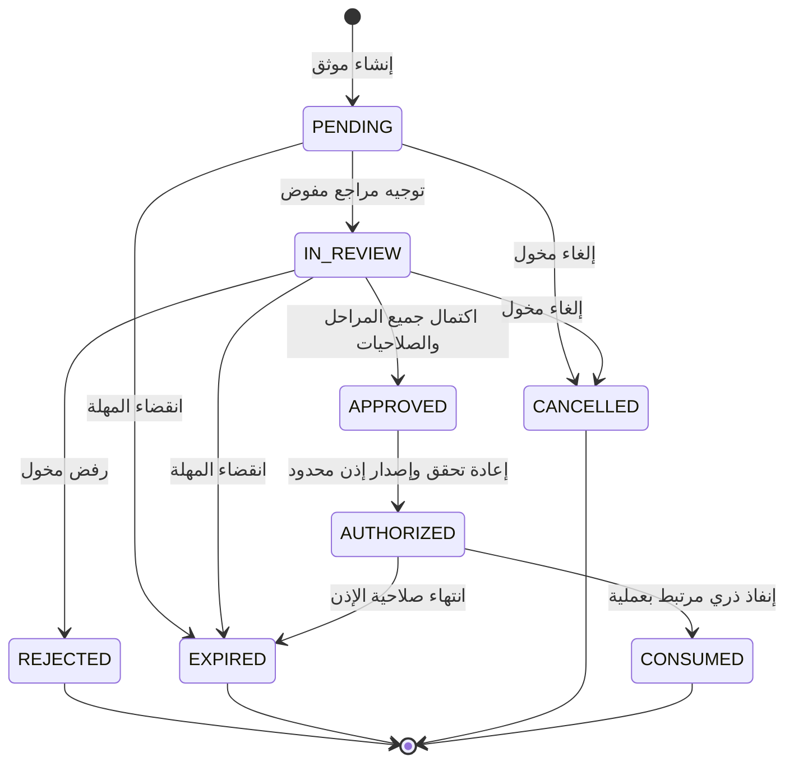

# AIGAS Human Gate — PRODUCT-SPEC

> **معرّف المستند:** `AIGAS-HG-SPEC-001` · **الإصدار:** `1.0.0-draft` · **التاريخ:** 2026-11-01  
> **المسار المعتمد:** `docs/products/human-gate/PRODUCT-SPEC.md`  
> **معرّف المنتج:** `AIGAS-HG` · **الأولوية:** `P0 / WAVE_1`  
> **الحالة:** متطلبات معتمدة في Blueprint؛ جاهزية التنفيذ والإطلاق **NOT_VERIFIED**.

## 0. مصادر الحقيقة والحالة الحالية

المصدر المرجعي هو `docs/MASTER-PROJECT-BLUEPRINT.md` §03.4 (`HG-01` إلى `HG-05`)، و`docs/PRODUCT-MASTER-CATALOG.yaml` (`AIGAS-HG`)؛ وتعتمد تفاصيل التشغيل والبيانات على `PLATFORM-ARCHITECTURE.md` و`INTEGRATION-AND-DEPLOYMENT.md` و`DATA-PRIVACY-AND-SECURITY.md` و`ENTERPRISE-TRIAL-POLICY.md` و`PRICING-AND-LICENSING.md`. العقد في `API-CONTRACT.yaml` **مقترح وليس API عاملة**.

في مصدر GitHub الحالي (`YEEEAE/BRIGHTAI @ main (read-only source review, 2026-11-01)`):

- `src/pages/products/[product].astro` ينشئ صفحة `/products/human-gate/` بعنوان «تصور المنتج» وبشارة «مخطط · غير متحقق تشغيلياً».
- `src/components/ProductExperience.astro` يقدم شرحًا بأربع مراحل (`approval-flow`)، ومعه نموذج تعليمي لانتظار/موافقة/رفض عبر `data-approval-demo`.
- `src/scripts/interior-motion.ts` يحرك نتيجة المثال محليًا؛ **لا دليل أن النقر على زر يغيّر صلاحية نظام أو ينشئ قرارًا معتمدًا**.
- `src/components/ProductContentExtension.astro` يوضح عدم اعتبار الزر إنفاذًا، ويطلب اختبار الصلاحية والتوقيت والنطاق والتفويض.
- لم يظهر في شجرة المستودع المستعرضة `src/pages/api/` يثبت مسار موافقات تشغيليًا. قد توجد أنظمة خارج المستودع؛ لم تُراجع ولم يُثبت تشغيلها.
- صفحة الموقع ليست بوابة اعتماد أو تفعيل تجربة. مصدر `kernel/README.md` تاريخي ولا يثبت وظائف حالية.

**المبدأ:** `APPROVED_REQUIREMENT` ≠ `IMPLEMENTED` ≠ `VERIFIED_OPERATIONAL`. لا يُعرض المنتج للبيع بوصفه متاحًا أو تُعرض نتيجة Demo على أنها قرار فعلي.

## 1. التعريف ومشكلة العمل

**AIGAS Human Gate** منتج مستقل يربط الأعمال المتأثرة بالذكاء الاصطناعي بمراجعة بشرية مخوّلة **قبل تنفيذ الفعل المحكوم**، ويضمن أن الإذن خاص بعملية محددة، وضمن مهلة ونطاق وصلاحية وسياسة معتمدة، ويمكن التحقق من سبب القرار وتاريخه. يتيح موافقات فردية أو متعددة المراحل، وتصعيدًا وتفويضًا مضبوطًا، ويوقف التنفيذ بأمان عند الرفض أو انتهاء المهلة.

**المشكلة:** كثير من التطبيقات تكتفي بزر «موافق» أو تذكرة عمل من دون تحقق من أن المراجع مفوض، أو أن العملية لم تتغير، أو أن الطلب لم ينتهِ، أو أن التطبيق الخلفي ينتظر القرار قبل التنفيذ. هذا يجعل «Human-in-the-Loop» واجهة شكلية لا حاجز حوكمة فعالًا.

**القيمة المستهدفة:** تحويل قرار بشرى مرتبط بهوية ومهمة وسياسة إلى **إذن تنفيذي قابل للإنفاذ والتحقق**، مع إثبات مسار الرفض والتصعيد وآثار القرار الأساسية.

## 2. الجمهور المستهدف

| الدور | الحاجة | ما يُعرض في المنتج |
|---|---|---|
| مسؤول الحوكمة/AI Governance | حصر الإجراءات المشروطة بمراجعة | سياسة مستويات وصلاحيات وتصعيد وقرار قابل للمراجعة |
| CISO / Security Architect | منع تجاوز الاعتماد أو تكراره | فصل المهام وربط الإذن بالسياق وFail-Closed |
| مالك العملية أو مدير الأعمال | عدم تعطيل الأعمال بلا حوكمة | طلب مفهوم بمبررات وموعد ومتابعة وتصعيد |
| المراجع المفوض | قرار ذو سياق كافٍ | نطاق المهمة والمخاطر والأدلة اللازمة وسبب القرار |
| التدقيق والامتثال | سلسلة مساءلة | سجل من وافق أو رفض ولماذا ومتى وبأي سياسة |
| مهندس التكامل | نقطة إيقاف حقيقية | API للتحقق والاستهلاك ومنع Replay |
| المشتريات والقطاع الحكومي | حدود نشر وخصوصية وترخيص | مواصفات دقيقة دون ادعاء اعتماد تنظيمي |

## 3. وظيفة المنتج الأساسية وحدود الاستقلالية

- يباع Human Gate منفردًا أو ضمن باقة؛ يعمل مع **AIGAS Kernel** المشترك دون رسم ترخيص Kernel منفصل.
- لا يعتمد إنشاء الطلب واتخاذ القرار وإنفاذه وتوثيق أثره الأساسي على شراء **Firewall** أو **Risk Engine** أو **Ledger**.
- تكاملات Firewall (إحالة عمليات محمية)، Risk Engine (سياق تقييم متقدم)، Ledger (أدلة أوسع) **اختيارية** وليست مبررًا لتعطيل الوظيفة الأساسية.
- الاستقلال هنا يشمل **إنفاذ** القرار على مسار متكامل مع العميل، ولا يعني التحكم بأي نظام خارجي لم يفعّل تكامله.
- الموافقة البشرية **لا تستطيع** تغيير `HARD_DENY` صادر عن سياسة أعلى أو السماح بعملية غير مشروعة.
- النظام المستهدف يدعم SaaS وOn-Premise وAir-Gapped، والأخير يعمل دون Check سحابي إلزامي للرخصة أو الهوية أو اتخاذ القرار.

## 4. المتطلبات الرسمية `HG-01`–`HG-05`

| المعرف | المتطلب المعتمد | مثال لسلوك يُثبت نجاحه | ما لا يكفي |
|---|---|---|---|
| `HG-01` | إنشاء طلب يتضمن السبب والمخاطر والسياق والسياسة والمهلة والصلاحية | طلب ذو معرّف ثابت ونطاق ومعنى مهني | نموذج HTML دون تخزين/توجيه |
| `HG-02` | موافقات فردية ومتعددة المستويات مع SoD حسب السياسة | منع ذات المنشئ أو مراجع غير مخول من الاعتماد | تغيير شارة Pending إلى Approved |
| `HG-03` | تفويض محدد وتصعيد وانتهاء آمن | رفض/إيقاف عند انقضاء المهلة حتى لو وصل قبول متأخر | تذكير بلا أثر على العملية |
| `HG-04` | إثبات هوية المراجع والوقت والتعليل ونسخة السياسة | استخراج سجل قرار مع من ومتى ولماذا | لقطة واجهة أو Log غير مرتبط بالعملية |
| `HG-05` | استكمال العمل عبر API **فقط** بعد قبول صحيح لمهمة محددة | الإنفاذ يرفض قبل القرار وبعد تغيير النطاق وبعد إعادة استخدام الإذن | Endpoint يعطي `approved=true` ولا يلتزم به التنفيذ |

### 4.1 ضوابط تنفيذية تفصيلية قابلة للتتبع

**HG-01 — طلب موافقة محدد ومكتمل:** `HG-01.01` هوية طلب مستقلة ومعرّف ارتباط للحدث الأصلي؛ `HG-01.02` ربط الطلب بمستأجر ومصدر عملية مصادق عليه؛ `HG-01.03` غرض الطلب وسبب إحالته والسياق والمخاطر؛ `HG-01.04` تثبيت هوية المهمة وبصمة العملية والموارد المستهدفة؛ `HG-01.05` نسخة سياسة الموافقة وحدود الإجراء والمهلة؛ `HG-01.06` إنشاء آمن بتكرار Idempotency Key ومنع الازدواج؛ `HG-01.07` توجيه إشعار مراجعة بلا إفشاء محتوى حساس.

**HG-02 — موافقات بمستويات وفصل مهام:** `HG-02.01` مسار موافقة فردي ومخطط مراحل متسلسل؛ `HG-02.02` مسار مراجعة متعددة المراحل قابل للاعتماد المؤسسي؛ `HG-02.03` التحقق من الدور والصلاحية والنطاق والهوية؛ `HG-02.04` فصل مقدم الطلب عن المراجع حيث تشترط السياسة؛ `HG-02.05` منع المستخدم الواحد من إكمال مراحل تستلزم استقلالية؛ `HG-02.06` تحقق هوية قوي وإعادة مصادقة للقرارات عالية الحساسية؛ `HG-02.07` عدم تجاوز الحظر الأعلى أو التعارض السياسي.

**HG-03 — التفويض والتصعيد والانتهاء الآمن:** `HG-03.01` إنشاء تفويض محدد المجال والعملية والمدة؛ `HG-03.02` رفض تفويض يمنح صلاحية أوسع من صلاحية الموكّل؛ `HG-03.03` إبطال التفويض فورًا ومنع قراراته المستقبلية؛ `HG-03.04` تصعيد طلب مع الحفاظ على الفصل والصلاحية؛ `HG-03.05` انتهاء مهلة القرار إلى رفض أو إيقاف آمن؛ `HG-03.06` منع افتراض الموافقة عند غياب الرد أو الانقطاع؛ `HG-03.07` التعامل الآمن مع التزامن والقرار المتأخر.

**HG-04 — إثبات القرار الأساسي ومساءلة المراجع:** `HG-04.01` ربط قرار قبول أو رفض بهوية مراجع موثقة؛ `HG-04.02` تسجيل التعليل والتوقيت والمرحلة والنسخة والسياسة؛ `HG-04.03` حفظ أثر القرار الأساسي دون ترخيص Ledger؛ `HG-04.04` سجل تاريخ غير قابل للتلاعب الصامت ومنضبط الوصول؛ `HG-04.05` تصدير أثر أساسي مع إخفاء المحتوى الحساس.

**HG-05 — إنفاذ الموافقة الفعلية على العمل المحكوم:** `HG-05.01` ربط الموافقة بعملية واحدة محددة وبصمة نطاق؛ `HG-05.02` بوابة تنفيذ ترفض قبل اكتمال جميع المراحل؛ `HG-05.03` إصدار إذن تنفيذي محدود الصلاحية والسياق؛ `HG-05.04` استهلاك إذن التنفيذ بصورة ذرية مرة واحدة؛ `HG-05.05` منع إعادة التشغيل وإعادة استخدام الإذن أو نقل المستأجر؛ `HG-05.06` إعادة التحقق من الهوية والسياسة والحظر لحظة التنفيذ؛ `HG-05.07` استمرار أمان المسار عند عدم توفر المكوّن أو انتهاء الترخيص؛ `HG-05.08` إثبات إيقاف العملية فعليًا عند الرفض أو انتهاء المهلة.

القائمة التفصيلية في `FEATURE-STATUS.yaml` تربط كل ميزة بمعيار قبول مستقل، لكن لا تغيّر النص المعتمد للمتطلبات الخمسة.

## 5. نموذج حالات الطلب المقترح

**قيود أساسية:** لا يتحول `PENDING` إلى `APPROVED` عند نهاية المهلة؛ لا يبدأ تنفيذ عملية في حالة `APPROVED` دون إثبات إنفاذ/استهلاك موثوق؛ أي تغيير في المهمة أو السياسة يستدعي إعادة التحقق أو إعادة الطلب؛ ولا يُستبدل نقص دليل بفشل آمن جزئي.

## 6. بيانات الطلب اللازمة

| الحقل المنطقي | الغرض | قاعدة الأمان |
|---|---|---|
| `request_id`, `correlation_id` | الربط والتحقيق | فريدان وقابلان للتتبع |
| `tenant_id` | العزل | **من هوية Kernel الموثقة** لا من JSON يحدده المستخدم |
| `requester_id`, `origin_service_id` | مصدر العملية | مشتقان من هوية مصادق عليها |
| `operation_type`, `resource_ref`, `operation_fingerprint` | تحديد العمل بالضبط | مُطابق عند الإنفاذ؛ لا نقل إذن لعملية أخرى |
| `policy_id`, `policy_version`, `approval_plan` | السياسة والاشتراطات | تثبيت النسخة والتعامل مع تغيّر السياسة |
| `risk_context_ref`, `reason`, `summary` | أسباب القرار | الحد الأدنى الضروري بلا أسرار أو بيانات خام |
| `expires_at`, `created_at` | مهلة المراجعة | وقت موثوق وخادم ذو مرجع زمني معتمد |
| `decision_id`, `reviewer_id`, `decision_reason`, `decided_at` | دليل القرار | Immutable history منطقي مع صلاحيات وتصحيح مُسجل |
| `grant_id`, `grant_expires_at`, `consumed_at` | توثيق الاستكمال | إذن موقّع/مرتبط بخادم ومحدود وقابل للاستهلاك مرة واحدة |

**ممنوع في السجلات افتراضيًا:** متن محادثات العملاء، الهويات والأرقام المالية، أسرار API، والتفاصيل الصحية بلا حاجة وسياسة وبيئة مصرّح بها.

## 7. هوية وصلاحيات وحوكمة السياسة

- `approval.request.create`, `approval.request.read`, `approval.review.decide`, `approval.request.cancel`, `approval.escalate`, `approval.delegate.manage`, `approval.audit.read`, `approval.enforce.consume` هي **أسماء صلاحيات مقترحة** لا ادعاء أنها موجودة في Kernel الحالي.
- ربط RBAC بشروط سياقية: الجهة، سير العمل، مستوى المخاطر، القناة، وقت القرار، المراجع المستقل، ومستوى MFA عند اللزوم.
- فصل المهام لا يلغيه التفويض؛ يمنع إنشاء حلقات تفويض أو تفويض الصلاحية إلى منشئ الطلب عند اشتراط الاستقلال.
- اعتماد متعدد المراحل يتطلب تحديد السياسة: الترتيب، النصاب، عدد المخولين، والاستقلال؛ لا يُختزل بموافقة أول مستخدم.
- سياسات أعلى وأحكام `HARD_DENY` تمنع الاستكمال مهما كان قرار المراجع؛ لا تتجاوزها موافقة مدير أو Admin.
- تغيّر الصلاحية أو الدور أو التفويض قبل القرار أو الإنفاذ يلزم إعادة التحقق، وليس الاكتفاء بصلاحية صحيحة عند إنشاء الطلب.

## 8. عقد الإنفاذ Integration Contract

1. التطبيق الأصلي يوقف العمل المحكوم **قبل** تنفيذ الأثر الخارجي.
2. يرسل طلب موافقة مفوضًا يتضمن بصمة العملية، نطاقها، المهلة ونسخة السياسة.
3. يتحقق Human Gate من هوية الجهة وSoD ومستويات القرار ويثبت التاريخ.
4. بعد استكمال الشروط، يمكنه إصدار `execution_grant` **محدودًا بالمستأجر والخدمة والبصمة والإصدار والانتهاء**.
5. نقطة الإنفاذ الموثوقة تتحقق من الإذن وتستهلكه **ذريًا** ثم تستأنف العملية المحددة مرة واحدة فقط.
6. رفض، انتهاء، إلغاء، انقطاع، عدم وجود رخصة أو عدم قدرة التحقق = لا يُستأنف العمل.
7. يمنع Replay واستبدال المورد أو تدوير المعرفات؛ النتائج تظل قابلة للتدقيق دون كشف أسرار.

> **شرط حاسم:** إصدار JSON يحمل `APPROVED` لا يكفي. إذا كانت العملية تُنفّذ خارج نقطة الإنفاذ أو يمكن تجاوزها، يُسجل ذلك حدًّا معيبًا ويُمنع ادعاء المنتج أنه يتحكم في تلك العملية.

## 9. التعامل مع الفشل والتزامن

| الحالة | النتيجة الآمنة |
|---|---|
| قراران متزامنان للمرحلة نفسها | معاملة ذرية/optimistic concurrency، قرار نهائي واحد موثق، الآخر `409` |
| قبول بعد انقضاء المهلة | `EXPIRED`؛ لا إعادة فتح تلقائية |
| تغيّر بصمة العملية بعد موافقة | رفض الاستكمال وطلب موافقة جديدة |
| سقوط Kernel/الهوية/سجل القرار | إيقاف آمن للمهمة، دون fallback سماح |
| تعارض سياسة أعلى | `DENIED_BY_POLICY` حتى عند وجود موافقة |
| تجاوز سقف الترخيص أو الحصة | لا يتجاوز ضوابط الموافقة أو الحظر، ويُعرض السبب دون كشف سياسة العميل |
| اتصال عميل متكرر بعد Timeout | استرجاع نتيجة Idempotency دون طلبين مستقلين |
| انتهاء تفويض أثناء الانتظار | تمنع القرارات الجديدة المستندة إلى التفويض الملغي أو المنتهي |

## 10. الخصوصية والإقامة ونماذج النشر

- استخدام بيانات اصطناعية فقط في العروض والتجارب الافتراضية. البيانات الحقيقية تحتاج تصريحًا مكتوبًا وبيئة وسياسة معالجة معتمدة.
- **منع تدريب أو تحسين نماذج AI ببيانات العميل دون استثناء** لدى المؤسسة أو الموردين.
- الاستضافة داخل السعودية هي الافتراض المستهدف لـSaaS السعودي؛ منطقة معالجة AI لدى الموردين مسألة مستقلة بحاجة موافقة عند الانطباق.
- SaaS: عزل Tenant عبر البيانات وQueues وCaches وLogs وCredentials؛ TLS مناسب؛ مفاتيح KMS/HSM عند الحاجة.
- On-Premise: هوية وربط محلي/معتمد، خدمات التراخيص والتدقيق حسب العقد.
- Air-Gapped: جميع متطلبات الموافقة والتصعيد والتراخيص والسجلات تعمل داخليًا؛ لا خدمة توقيت أو هوية أو تحقق ترخيص تعتمد على الإنترنت. قنوات الإشعار Offline ومحلية.
- الاحتفاظ والتصدير والحذف وLegal Hold ومدد Backup ليست أرقامًا ثابتة؛ تعتمدها سياسة الفئة والعقد والجهة القانونية.

## 11. نموذج التشغيل التجاري

- ترخيص مستقل لـ`AIGAS-HG` مع Kernel دون رسوم منفصلة؛ يمكن بيعه ضمن باقات.
- وحدة احتساب **مرشحة**: `APPROVAL_DECISION`؛ لم تُعتمد سعرًا ولا تعريفًا للفوترة بعد. يلزم منع ازدواج احتساب إعادة الطلب أو التصعيد أو الإلغاء أو عدة مراجعين؛ يُقر تعاقديًا قبل الفوترة.
- SaaS اشتراك، وOn-Premise سنوي/دائم، وAir-Gapped محلي؛ الأسعار والحصص ودورة الفاتورة والدعم **غير معتمدة**.
- تجربة 48 ساعة مخططة غير مفعّلة، لا دفع أو ترقية تلقائيين؛ تفاصيلها في `48H-TRIAL-SPEC.md`.

## 12. MVP الفعلي وممنوعات النطاق

**MVP أول (P0):** إنشاء طلب فعلي؛ توجيهه للمخوّل؛ تحقق الدور وSoD؛ قرار مؤسسّ ومعلّل؛ إنهاء المهلة؛ ربط القرار بإنفاذ العملية الحقيقية؛ تخزين أثر القرار الأساسي؛ دون إلزام شراء منتج إضافي.

**ميزات اختيارية بعد إثبات الأساس:** إثراء سياق المخاطر من Risk Engine، إحالة Firewall، توثيق متقدم من Ledger، تحليلات تشغيل، قنوات إشعارات إضافية. لا تُستخدم لتعويض نقص P0.

**خارج النطاق ما لم يعتمد:** فرض سياسة على تطبيقات غير متكاملة، تغيير القرارات تلقائيًا عبر نموذج LLM، استبدال المراجع البشري بقرار مولد، السماح الصامت، تجاوز الحظر الأعلى، ادعاء امتثال أو SLA دون دليل.

## 13. أمثلة سيناريوهات حاكمة

| سيناريو | النتيجة المطلوبة |
|---|---|
| طلب تصدير ملف مصطنع خاضع لمراجعة | انتظار إلى اكتمال المرحلة اللازمة، لا تصدير قبل الإذن |
| مقدم طلب يحاول اعتماده | `FORBIDDEN_SOD` عند انطباق الفصل |
| مراجع غير مخول حتى لو عرف المعرف | `403` ولا يتغير الطلب |
| مرحلتان مستقلتان؛ موافقة واحدة فقط | `PENDING` ولا استكمال |
| رفض في مرحلة إلزامية | `REJECTED` ويمنع التنفيذ |
| مهلة انقضت قبل الموافقة | `EXPIRED`, safe stop |
| تفويض انتهى قبل استخدامه | رفض القرار الجديد |
| طلب تغيير المبلغ/المورد بعد الموافقة | `OPERATION_MISMATCH` ورفض استهلاك الإذن |
| إعادة تشغيل grant مستهلك | `409 GRANT_ALREADY_CONSUMED` |
| تغيير صلاحية reviewer قبل القرار | يمنع القرار وفق السياسة الحالية أو المرجعية الموثقة |

## 14. معايير عدم إطلاق المنتج

- إنفاذ غير مثبت على عملية حقيقية في بيئة تحقق مسيطر عليها.
- تجاوز SoD أو قبول صاحب الطلب لطلبه حيث يمنع ذلك.
- ترخيص Ledger مطلوب لإتمام وظيفة التدقيق الأساسية.
- انتهاء المهلة أو تعطل الخدمة يؤدي إلى استمرار العملية.
- Replay أو تغيير نطاق العملية يقبل إذنًا قديمًا.
- ادعاء متاح/Certified/متوافق دون أدلة.
- مشاركة بيانات/مفاتيح عميل أو استعمالها لتدريب نموذج.
- عدم اعتماد سياسة احتفاظ/تصعيد/أمن أساسية عند الحاجة للإطلاق.

## 15. القرارات المفتوحة والموافقات

| البند | مالك القرار المقترح | حالة الاعتماد |
|---|---|---|
| عدد المراحل/النصاب/مهل المراجعة الافتراضية | Product + Governance | `PENDING` |
| حدود delegation وحالات الطوارئ | IAM + Security + Legal | `PENDING` |
| نموذج authorization token أو grant transaction | Architecture + Security | `PENDING` |
| هوية الخدمة ونقطة الإنفاذ وAuth issuer | Architecture + IAM | `PENDING` |
| تعريف Billable Decision ومنع Double Counting | Commercial + Finance | `PENDING` |
| مناطق النشر والموردون وDPA والاحتفاظ | Privacy + Legal + Security | `PENDING` |
| حدود Trial والتمديد والتكلفة | Product + Finance + Security | `PENDING` |

## 16. إحالات المستندات الشقيقة

- `FEATURE-STATUS.yaml`: سجل الميزات والحالات والأدلة المطلوبة.
- `PAGE-EXPERIENCE.md`: صفحات الموقع/الكونسول ومفردات الحالات.
- `API-CONTRACT.yaml`: عقد OpenAPI *مقترح* للعمليات والصلاحيات والأخطاء.
- `48H-TRIAL-SPEC.md`: تجربة سيناريوهات غير إنتاجية وحدودها.
- `ACCEPTANCE-AND-EVIDENCE.md`: معيار الإثبات والقرار النهائي.
