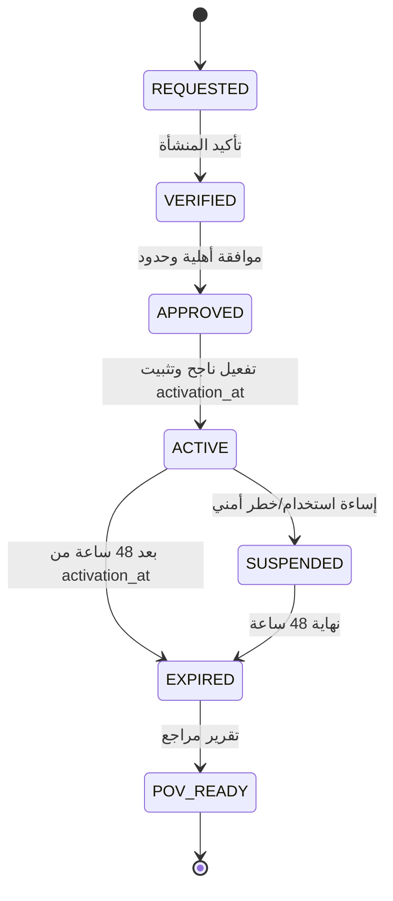

# AIGAS Ledger — مواصفة تجربة 48 ساعة وProof of Value

> **المشروع:** مؤسسة مُشرقة (BRIGHT AI) — AIGAS · **المنتج:** `AIGAS-LD` · **النسخة:** `1.0.0-draft` · **التاريخ:** 2026-11-01  
> **المسار المنطقي:** `docs/products/ledger/48H-TRIAL-SPEC.md` · **الإطلاق:** `WAVE_1 / P0` · **الحالة:** متطلبات مستهدفة معتمدة، **تشغيل المنتج NOT_VERIFIED**.  
> هذه نسخة مستقلة للاعتماد والتنفيذ. لا تعني أن الملفات أُضيفت إلى GitHub أو أن الخدمة منشورة.

## 0. وضع التجربة وحدود السياسة

**هذه مواصفة تشغيل تجريبي مستهدفة، وليست عرضًا حاليًا أو دعوة إدخال بيانات حقيقية.** صفحة `/pricing/` الحالية تعرض أن تجربة الـ48 ساعة مخطط لها ولم تُثبت جاهزيتها أو تفعيلها. لا يُفعّل الوصول قبل توقيع/اعتماد الضوابط والتكاملات ذات الصلة.

**المرجع:** `docs/MASTER-PROJECT-BLUEPRINT.md` §12 و`ENTERPRISE-TRIAL-POLICY.md`، `PRODUCT-SPEC.md` و`DATA-PRIVACY-AND-SECURITY.md`.

## 1. لماذا تجربة Ledger مختلفة؟

تهدف التجربة إلى إظهار قيمة **دليل حدث قابل للفحص المستقل**، لا زيادة عدد السجلات أو عمل واجهة رسومية. يجب أن يخرج المراجع قادرًا على التمييز بين:

1. **حدث موجود** وحدث مؤكد الإيداع الدائم.
2. **Hash مرئي** وآلية توثيق سلامة مطبقة وقابلة للإعادة.
3. **نتيجة خادم تقول «سليم»** وفاحص مستقل يقرأ حزمة وأدلة ثقة خارج الخادم.
4. **حدوث خطأ في السجل** وإيقاف الأعمال التي تستلزم دليلًا إلزاميًا عند فقد جميع مسارات التسجيل اللازمة.
5. **فئة Metadata** ومحتوى محادثة قد يخضع لحماية واحتفاظ مختلفين.

## 2. الأهلية والموافقة

- تجربة لمنشأة موثقة الهوية وبنطاق واضح، منفردة أو ضمن مجموعة منتجات بحسب الأهلية.
- قد تتاح الموافقة الآلية للقطاع الخاص **بعد** تحقق المنشأة وتكلفة التجربة ومنع إساءة الاستخدام وجاهزية منظومة الأمان.
- الجهات الحكومية والتكاملات المؤثرة على عمليات حقيقية تخضع لمراجعة بشرية؛ لا تكفي رسالة «تم التسجيل» لتفعيل صلاحيات.
- جهة الاتصال ومالك التقييم ومسؤول الخصوصية ومراجع الأدلة معرّفون بأدوار مفصولة.
- تتم مراجعة سياسة تصنيف البيانات وأماكن الإقامة/المعالجة قبل أي تفعيل.
- **بيانات اصطناعية افتراضيًا.** بيانات حقيقية تتطلب إذنًا مكتوبًا منفصلًا وبيئة معتمدة ومعالجة قانونية مناسبة؛ لا تُقبل في المسار التعريفي العام.
- تمنع إعادة التجربة للتحايل على الميزانية، والاشتراك المدفوع يتطلب شراءً وموافقة صريحة مستقلة.

## 3. الزمن، التفعيل، الانتهاء

- حساب المدة **48 ساعة حقيقية من `activation_at` من الخادم**، وليس من إرسال الطلب أو فتح صفحة الأسعار.
- وقت نهاية التجربة: `expires_at = activation_at + 48h`، وفق ساعة خادم موثوقة، ويُطبّق التوقف من طبقة الترخيص والتفويض لا من UI.
- تعليق الحساب بسبب خطر لا يعيد ضبط الساعة ولا يمنح تمديدًا تلقائيًا. أي تمديد استثنائي يحتاج موافقة جديدة مسجلة.
- عند الانتهاء: إبطال إمكانية إيداع/تصدير جديد خارج الأذونات المعتمدة، مع الحفاظ على أي التزامات **تصدير/حذف/احتفاظ/Legal Hold** مسموحة وفق السياسة والعقد.
- لا تحويل تلقائي مدفوع ولا حسم رسوم من بطاقة؛ PoV لا يصدر عقدًا أو رخصة مدفوعة.

## 4. نطاق المنتج خلال التجربة

| المجال | ما يُتاح مستقبلاً عند الجاهزية | الحدود |
|---|---|---|
| Source connector | تطبيق مصدر اصطناعي/معزول مرخّص | لا وصول غير مفوض لنظم إنتاج |
| Event ingestion | تسجيل حدث حقيقي من مصدر تجريبي | Metadata مختزلة وهوية مصدر موثقة |
| Integrity | manifest + integrity profile + verifier | لا Blockchain مفروض ولا توقيع «صوري» |
| Protected storage | مخزن تجربة محمي + fallback مشفر | فشل التخزين يوقف الأعمال الإلزامية |
| Retention/Legal Hold | أمثلة في بيئة اصطناعية وآثار تغيير محكومة | مدد السياسة الفعلية تحتاج اعتمادًا |
| Export | حزمة تنزيـل وفاحص مستقل | صلاحية الوصول ومجال البيانات محدودان |
| Product links | أمثلة موافقات/حوادث مرجعية اصطناعية | لا تتطلب تراخيص بقية المنتجات |

## 5. حدود الحصص والتحكم في التكلفة — جميعها غير معتمدة رقميًا

| البند | وحدة مرشحة | من يعتمد القيمة؟ | سلوك تجاوز الحد |
|---|---|---|---|
| عدد أحداث الإدخال | `AUDIT_EVIDENCE_EVENT` | مسؤول المنتج/المالية/التشغيل | رفض/إيقاف محكوم دون فقد صامت للأحداث الإلزامية |
| عدد المصادر المفوضة | Source connector | الأمن والتشغيل | منع إضافة مصدر آخر |
| تخزين الأدلة | Bytes / Tenant | أمن البيانات والمالية | منع استقبال غير موثوق، ومعالجة Fail-Closed للأعمال الملزمة |
| عدد حزم التصدير | Export job | المنتج والأمن | رفض عمليات جديدة مع رسائل صريحة |
| معدل استدعاءات API | requests/window | التشغيل والأمن | 429 دون قبول أحداث غير مسجلة |
| مدة الاحتفاظ | Policy per class | مالك البيانات/الشؤون القانونية | لا رقم افتراضي ثابت |
| التنبيهات والحوادث | security events | الأمن | لا إسقاط أدلة أمنية لازمة على نحو صامت |
| تكاليف AI Providers | n/a في الوظيفة الأساسية | حسب تكامل خاص | لا حاجة لنموذج مدفوع لتوثيق الدليل الأساسي |

**قيم مطلوبة قبل التشغيل:** `max_events`, `max_storage_bytes`, `max_export_jobs`, `rate_limit`, `max_sources`, `allowed_data_classes`, `retention_policy_id`, `spend_cap_sar`, `cost_center`, `action_on_limit`. أي قيمة لم تعتمد تبقى `TBD` في إعدادات التشغيل ولا يُفترض رقم من هذه الوثيقة.

## 6. سيناريوهات Proof of Value الإلزامية

كل سيناريو على **أحداث اصطناعية** وببيئة معتمدة، ولا تعتبر نتيجة ورقة التصميم دليلًا على اجتيازه.

| المعرف | سيناريو التجربة | المتطلب | النتيجة المستهدفة | الدليل المطلوب | إلزامية |
|---|---|---|---|---|---|
| `TR-LD-01` | إيداع حدث حقيقي من Connector مفوض | `LD-01` | ينتج event_id وrecord receipt بعد كتابة حدث اصطناعي من خدمة معتمدة | Event ingest + durable receipt | `BLOCKER` |
| `TR-LD-02` | رفض مصدر غير مصادق عليه | `LD-01` | يرفض الاتصال غير المخول بلا إنشاء دليل مؤكد | 401/403 + no event trace | `BLOCKER` |
| `TR-LD-03` | رفض عبور مستأجر | `LD-01` | لا يطّلع Tenant B على حدث/Export تابع لـA | Cross-tenant negative evidence | `BLOCKER` |
| `TR-LD-04` | Idempotency وإعادة المحاولة | `LD-01` | تكرار نفس المفتاح لا ينشئ حدثين أو قياس استخدام مزدوج | Duplicate submit/replay trace | `BLOCKER` |
| `TR-LD-05` | توليد بصمة سلامة وفحصها | `LD-02` | تُنتج الحزمة profile ومواد تحقق قابلة لإعادة الحساب | Manifest and verifier output | `BLOCKER` |
| `TR-LD-06` | كشف التعديل الصامت | `LD-02` | تعديل نسخة من ملف الدليل يؤدي إلى INVALID لا VALID | Modified artifact + result | `BLOCKER` |
| `TR-LD-07` | حذف ملف من الحزمة | `LD-02` | فقد ملف مطلوب ينتج INVALID/INDETERMINATE لا اعتمادًا أعمى | Missing-file negative trace | `BLOCKER` |
| `TR-LD-08` | عطل التخزين الأساسي | `LD-03` | يستعمل المسار الاحتياطي المشفر إذا كان معتمدًا مع بيان وضع الإقرار | Primary outage failover evidence | `BLOCKER` |
| `TR-LD-09` | عطل المسارين معًا | `LD-03` | العملية المشروطة بتسجيل إلزامي تتوقف فعلًا ولا تتابع | Dual failure and no-side-effect proof | `BLOCKER` |
| `TR-LD-10` | استعادة المسار والترحيل | `LD-03` | إعادة تسوية بلا فقد أو duplicate silent | Recovery reconciliation output | `BLOCKER` |
| `TR-LD-11` | Metadata-only افتراضيًا | `LD-04` | حدث يحوي معرّفًا وهميًا حساسًا يرفض الحقل أو ينقحه قبل التخزين | Redaction and schema evidence | `BLOCKER` |
| `TR-LD-12` | رفض تخزين المحتوى الخام دون تصريح | `LD-04` | لا يُحفظ نص Prompt اختباري إلا عند تحقق سياسة/تصريح في بيئة معتمدة | Denied storage + policy trace | `BLOCKER` |
| `TR-LD-13` | Retention وLegal Hold | `LD-05` | الاحتفاظ يطبق السياسة؛ لا يُحذف حدث مشمول Hold إلا وفق رفع مخوّل | Hold/delete audit and authorizer | `BLOCKER` |
| `TR-LD-14` | تدوير مفتاح سلامة مع فحص الأدلة السابقة | `LD-06` | تظل حزمة سابقة قابلة للتحقق باستخدام مواد ثقة تاريخية معتمدة | Key-rotation + historical verify | `BLOCKER` |
| `TR-LD-15` | تصدير مستقل ومحدود الصلاحية | `LD-06` | يصدّر المراجع المخول حزمة ثم يفحصها بأداة خارج خادم Ledger | External verifier output | `BLOCKER` |
| `TR-LD-16` | روابط موافقات/حوادث/ضوابط | `LD-07` | رابط إداري قابل للتدقيق لا يغير bytes الدليل الأصل، ولا ينتج شهادة امتثال | Evidence link + unchanged origin integrity | `REQUIRED` |

## 7. بروتوكول تشغيل التجربة

### قبل التفعيل

1. إثبات هوية المنشأة ومالك التقييم ودور المراجع ومسؤول أمن المعلومات.
2. الاتفاق على مصدر/مصادر اصطناعية، الصلاحيات، فئات الحدث ونتيجة PoV المقبولة.
3. اختيار SaaS أو بيئة خاصة/On-Premise إذا توفرت فعلًا؛ Air-Gapped تجربة خاصة تحتاج اتفاقًا منفصلًا ونقل حزم موقعة دون اتصال.
4. اعتماد الخصوصية، عزل Tenant، مفاتيح التحقق، الاحتفاظ، الوصول للدعم، سياسة التوقف عند الفشل.
5. إثبات جهوزية التخزين والتوقيع والاحتياطي والتصدير والفاحص مستقلًا قبل تمكين المستخدم.
6. إصدار ترخيص تجربة محدود والتوثيق `trial_id`, `activation_at`, `expires_at`, `tenant_id`, allowed scopes بدون تضمين أسرار في تقرير المستخدم.

### أثناء الـ48 ساعة

- إيداع مجموعة أحداث اصطناعية معلومة المصدر، مع تطابق عدد الـreceipts وأثر السجل/التكلفة.
- إجراء فحص إيجابي وسلبي: تعديل ملف، حذف ملف، محاولة cross-tenant، إعادة إرسال نفس المفتاح.
- إثبات سلوك مسار fallback؛ **حقن الأعطال داخل sandbox معزول فقط**، لا توقف عملاء آخرين أو مخزن إنتاج.
- اختبار عملية مشروطة بوجود دليل إلزامي تفشل عند سقوط المسارين.
- إصدار حزمة يمكن فتحها خارج نظام Ledger، ويُشغّل المُراجع أداة مستقلة ويثبت نتيجة الفحص.
- تجربة سياسات احتفاظ وHold باستخدام فئات ومسارات اصطناعية وموافقات وهمية *ضمن تطبيق حقيقي معزول*، لا مجرد فيديو.

### عند الانتهاء

- إيقاف إنشاء بيانات جديدة بإذن تجربة من طبقة الخدمة، لا مؤقت المتصفح.
- الاحتفاظ فقط بالقدر الذي تسمح به السياسة المحددة والالتزامات، مع توثيق حالة التصدير والحذف والنسخ الاحتياطية.
- عدم تفعيل شراء أو فاتورة تلقائيًا.
- تسليم تقرير مختصر ومرفقات Proof of Value دون بيانات حساسة.

## 8. شروط تقرير Proof of Value

| الحقل | المحتوى |
|---|---|
| `trial_id`, customer_scope | معرف التجربة ونطاق المؤسسة دون بيانات حساسة |
| `activation_at`, `expires_at` | وقت التفعيل الفعلي وانتهاء المدة |
| `product_version`, `environment` | إصدار/بناء مثبت ومكان المعالجة حسب إثبات |
| `scenario_results` | `PASS / FAIL / BLOCKED / NOT_VERIFIED` لكل TR-LD-ID |
| `evidence_manifest` | أسماء مرفقات أدلة ذات معرفات وسلامة محتوى |
| `integrity_test` | الفحص المستقل وما يكشفه وما لا يكشفه |
| `storage_failure_result` | أثر تعطل primary/backup على العمل المعني |
| `privacy_and_retention` | ما خُزن وما نُقح وحالته عند النهاية |
| `limitations` | الوظائف غير المتاحة والقيود التي لم تُفحص |
| `decision` | التوصية بالمرحلة التالية وفق العميل دون موافقة بيع تلقائي |

## 9. حالات الفشل التي تمنع إعلان نجاح التجربة

- العرض يقتصر على Animated Hash أو بطاقة تقرير دون حدث مؤكد إيداعه حقيقيًا.
- فاحص داخل نفس الخدمة وحده يعيد `VALID` دون إمكانية تحقق خارجية.
- بعد تعديل دليل مُصدّر لا يتغير الحكم، أو يُعرض `VALID` مع غياب مفتاح/ملف مطلوب.
- عند عطل المسارين الإلزاميين، يواصل التطبيق المحكوم عمله دون أثر موثوق.
- يسمح API لمستخدم/مستأجر غير مفوض بالتصدير أو القراءة أو تغيير الاحتفاظ.
- يحتفظ بنصوص العملاء الخام افتراضيًا أو يستخدمها لتدريب/تحسين نموذج.
- «إيقاف بعد 48 ساعة» على الصفحة فقط دون إنهاء الرخصة في الخدمة.
- احتساب إيداعات مكررة وتجاوز سقف المبالغ دون موافقة.

## 10. إجراءات الحذف والخروج

- فئات الدليل تختلف عن بيانات تسجيل العميل ومعلومات الفوترة والنسخ الاحتياطية؛ لكل فئة قاعدة معلنة ومعتمدة.
- يمنع الوعد بـ«حذف فوري شامل» دون إثبات أثر الـbackup وLegal Hold والالتزامات النظامية.
- تصدير الأدلة عند انتهاء التجربة يتطلب تحقق هوية وصلاحية وفق سياسة الخروج.
- لا يحتفظ فريق المبيعات بنسخ أدلة خام؛ تقرير PoV يتضمن نتائج ومراجع مختزلة.

## 11. مسؤوليات فرق التنفيذ

| الدور | المسؤولية | قرار الإطلاق |
|---|---|---|
| مدير المنتج | سيناريوهات التجربة ونطاق الميزة والحصص | اعتماد المتطلبات |
| مسؤول أمن المعلومات | العزل والمفاتيح وفشل التسجيل | اعتماد أمني |
| مسؤول الخصوصية/القانوني | معالجة البيانات والاحتفاظ وLegal Hold | اعتماد قانوني بحسب النطاق |
| مهندس Ledger | نموذج الأدلة والفاحص والمخزن | إثبات هندسي |
| مالك المنشأة العميلة | الهوية والغرض وبيانات التجربة والنتيجة | قبول PoV |
| المالية | سقوف التمويل ونموذج التكلفة | لا أسعار غير معتمدة |

## 12. التمييز عن Pilot

**Trial 48h** تجربة تعريفية محدودة ببيانات اصطناعية وحصص معلنة. **Pilot** اتفاق مؤسسي مستقل قد يشمل تكاملات حقيقية أو بيانات فعلية بعد موافقات ومعالجة قانونية، ويحتاج أهدافًا ومسؤوليات ومدة وتكاليف مكتوبة. **لا يتحول أحدهما للآخر تلقائيًا.**
