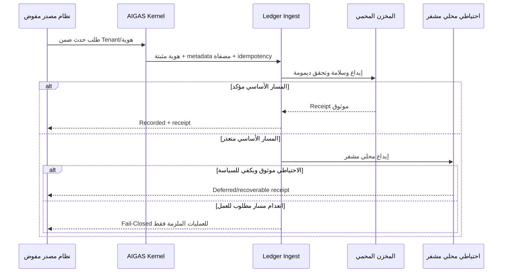

# AIGAS Ledger — مواصفة المنتج ونطاقه

> **المشروع:** مؤسسة مُشرقة (BRIGHT AI) — AIGAS · **المنتج:** `AIGAS-LD` · **النسخة:** `1.0.0-draft` · **التاريخ:** 2026-11-01  
> **المسار المنطقي:** `docs/products/ledger/PRODUCT-SPEC.md` · **الإطلاق:** `WAVE_1 / P0` · **الحالة:** متطلبات مستهدفة معتمدة، **تشغيل المنتج NOT_VERIFIED**.  
> هذه نسخة مستقلة للاعتماد والتنفيذ. لا تعني أن الملفات أُضيفت إلى GitHub أو أن الخدمة منشورة.

## 0. نطاق الوثيقة ومصادرها

**مصادر المتطلبات:** `docs/MASTER-PROJECT-BLUEPRINT.md` §03.3، و`docs/PRODUCT-MASTER-CATALOG.yaml` تحت `AIGAS-LD`. المستندات المؤسسة: `PLATFORM-ARCHITECTURE.md` و`DATA-PRIVACY-AND-SECURITY.md` و`INTEGRATION-AND-DEPLOYMENT.md` و`ENTERPRISE-TRIAL-POLICY.md` و`PRICING-AND-LICENSING.md`. بيانات هذا المستند لا تُعد تصديقًا قانونيًا أو قبولًا أمنيًا.

**مراجعة المصدر الحالي — 2026-11-01:**

- `src/pages/products/[product].astro` ينشئ صفحة `/products/ledger/` بوصف «تصور المنتج» و«مخطط · غير متحقق تشغيليًا».
- `src/components/ProductExperience.astro` يعرض مراحل `evidence-timeline`، مقارنة تعلّمية بين دليل سليم ومعدّل، و`educational-hash` نصيًا؛ النص البرمجي يوضح صراحة أنها **ليست Hash أو توقيعًا محسوبًا**.
- `src/scripts/interior-motion.ts` يضيف سلوكًا بصريًا محليًا في المتصفح ولا يثبت إيداع حدث أو توقيعه.
- `src/components/ProductContentExtension.astro` يشرح الفصل بين بيانات الحدث ومحتوى المحادثة ومبادئ التصدير والتحقق.
- لا يظهر في شجرة المستودع المستعرضة `src/pages/api/`، ولم تُعرض خدمة Ledger خارجية أو بيئة تشغيل يمكن التحقق منها. أوصاف `kernel/README.md` التاريخية **ليست إثبات إنتاج**.

**تمييز ضروري:** مواصفة منتج معتمدة ≠ كود منفّذ ≠ خدمة تعمل مثبتة ≠ إمكانية إطلاق تجاري.

## 1. التعريف والمشكلة والقيمة

**AIGAS Ledger** منتج مؤسسي مستقل لتوثيق **أحداث وقرارات حوكمة الذكاء الاصطناعي** في مسار محمي، مع سلامة قابلة للتحقق، إدارة احتفاظ، وتصدير حزم أدلة يستطيع مراجع مفوض فحصها مستقلًا. يربط من اتخذ قرارًا، ومتى، وبأي نسخة سياسة، ومن أي نظام، دون تخزين محتوى المحادثة افتراضيًا.

**المشكلة:** سجلات التطبيقات العادية قد تكون قابلة للحذف أو غير متسقة أو مبعثرة بين النماذج وأدوات الموافقات والتكاملات. لا تكفي لقطة شاشة أو سجل Debug لإثبات سلسلة قرار. لا يجب مساواة `auditability` بإخفاء أثر الخصوصية أو ادعاء استحالة أي عبث.

**القيمة المستهدفة:** دليل قابل للربط والتصدير وفحص سلامته؛ فشل آمن عند ضياع مسارات التسجيل الإلزامية؛ إمكانية إثبات مسؤوليات الحوكمة بحدود تقنية وقانونية معلنة.

## 2. الجمهور ودوافع الشراء

| الجمهور | المشكلة | الوظيفة المطلوبة |
|---|---|---|
| مسؤول الحوكمة / AI Governance Officer | لا يوجد أثر موحد لسياق القرار | تتبع نسخ السياسات والقرارات والأصول |
| CISO / الأمن السيبراني | تعديل أو فقد سجل دون اكتشاف | سلامة وتشفير وسجل دخول وتدقيق قابل للمراجعة |
| التدقيق الداخلي والخارجي | الاعتماد على تصدير Screenshots غير قابل للتحقق | حزمة تحقق مستقلة مع ملف manifest وفاحص |
| الشؤون القانونية والخصوصية | حفظ بيانات أكثر من اللازم أو مخالفة الاحتفاظ | Metadata افتراضيًا، Retention، Legal Hold عند اللزوم |
| المراجعة التشغيلية / Incident Response | صعوبة ربط الحدث بالحالة والقرار | correlation IDs وروابط أحداث وحوادث |
| مهندسو التكامل | انقطاع مسار السجل أثناء عمل مهم | Receipts، Idempotency، fallback محمي وFail-Closed مشروط |
| المشتريات والتشغيل الحكومي | سيادة بيئة العميل والاعتماد على السحابة | SaaS/On-Premise/Air-Gapped بشروط ورخص محلية |

## 3. حدود المنتج واستقلاله

- منتج مستقل للبيع والترخيص؛ **AIGAS Kernel** مكوّن أساسي مشترك ضمن المنتج دون رسوم ترخيص مستقلة.
- **Kernel يحتفظ بالحد الأدنى من أحداث الأمن اللازمة حتى لو لم يُشترَ Ledger**. لا تُعلّق الأحداث الأساسية أو حماية المنتج الآخر على شراء Ledger.
- الوظائف المتقدمة في Ledger: سلامة الأدلة، إدارة حزم التصدير والتحقق المستقل، احتفاظ/تجميد متقدم، ربط أدلة مؤسسي.
- تكامل Firewall وHuman Gate وRisk Engine وSecure Chat **اختياري**. لا تحتاج وظيفة Ledger الأساسية لشراء أحد هذه المنتجات، ولا يُشترط شراء Ledger لعمل وظائفها الأساسية.
- لا يغطي Ledger تلقائيًا كل تطبيقات المؤسسة؛ فقط الأحداث المرسلة عبر نقاط تكامل مفوضة. لا يحدد بذاته سلامة **القرار** أو شرعيته؛ يتحقق من سلامة **الأثر المسجّل** وفق آلية موثقة.
- لا يُفرض Blockchain أو منصة محددة، ولا يعني التشفير إبطال صلاحيات المسؤولين أو الالتزامات القانونية. لا شهادات امتثال تلقائية.

## 4. المتطلبات السبعة الرسمية

| المعرف | قاعدة المنتج المستهدفة | الحد الأدنى من دليل إثباتها |
|---|---|---|
| `LD-01` | **توثيق الأحداث وهوية مصدرها:** ربط الحدث بموعده وهويته ومصدره والسياسة والقرار والنسخة ضمن متطلبات الخصوصية | سجلات تشغيل/حزمة تحقق وتحكم وصول خاصة به، مع حالة فشل سلبية |
| `LD-02` | **سلامة الدليل والتشفير:** تشفير ونظام كشف تعديل باستخدام Hash أو توقيع أو سلسلة تحقق مناسبة دون وعد بمنع التعديل المطلق | سجلات تشغيل/حزمة تحقق وتحكم وصول خاصة به، مع حالة فشل سلبية |
| `LD-03` | **استمرارية التسجيل الإلزامي:** مسار دائم محمي واحتياطي محلي مشفر؛ توقف الأعمال الملزمة بالسجل عند فشل كلا المسارين | سجلات تشغيل/حزمة تحقق وتحكم وصول خاصة به، مع حالة فشل سلبية |
| `LD-04` | **خصوصية المحتوى وتقليل البيانات:** Metadata افتراضيًا؛ محتوى الطلب أو المحادثة يحتاج أساسًا وموافقة وسياسة محددة | سجلات تشغيل/حزمة تحقق وتحكم وصول خاصة به، مع حالة فشل سلبية |
| `LD-05` | **الاحتفاظ والحذف وLegal Hold:** سياسات لكل مستأجر، حذف وتجميد قانوني حيث ينطبق، وتوثيق تغييرات السياسة | سجلات تشغيل/حزمة تحقق وتحكم وصول خاصة به، مع حالة فشل سلبية |
| `LD-06` | **التصدير والتحقق المستقل:** تصدير حزم قابلة للفحص خارج المنصة مع استمرار التحقق بعد تدوير المفاتيح | سجلات تشغيل/حزمة تحقق وتحكم وصول خاصة به، مع حالة فشل سلبية |
| `LD-07` | **ربط أدلة الحوكمة:** ربط الأحداث بالموافقات والحوادث وملفات الضوابط دون ادعاء شهادة امتثال | سجلات تشغيل/حزمة تحقق وتحكم وصول خاصة به، مع حالة فشل سلبية |

### 4.1 سلوك الميزات التفصيلية

المعرّفات الفرعية `LD-01.01`... صيغ تنفيذية في `FEATURE-STATUS.yaml` قابلة للتعديل بالمراجعة الهندسية، ولا تغير معنى المتطلبات الرسمية. ينبغي ربط كل وظيفة بمعيار `AC-LD-NN` في مستند القبول.

**LD-01 — توثيق الأحداث وهوية مصدرها.** `LD-01.01` اعتماد مُصدِر الحدث؛ `LD-01.02` معرّف الحدث والارتباط؛ `LD-01.03` ختم الوقت ومصدر الزمن؛ `LD-01.04` نسخة السياسة والقرار؛ `LD-01.05` عزل المستأجر والبيئة؛ `LD-01.06` منع التكرار في التسجيل والعداد.

**LD-02 — سلامة الدليل والتشفير.** `LD-02.01` تشفير النقل؛ `LD-02.02` تشفير المخزن والنسخ؛ `LD-02.03` بصمة سلامة بمواصفة مثبتة؛ `LD-02.04` ربط تسلسل/توقيع الدليل؛ `LD-02.05` كشف تعديل نسخة مصدّرة؛ `LD-02.06` مفاتيح وتحكم وثقة.

**LD-03 — استمرارية التسجيل الإلزامي.** `LD-03.01` كتابة دائمة للمسار الأساسي؛ `LD-03.02` احتياطي محلي مشفر؛ `LD-03.03` سعة وتعافٍ دون فقد صامت؛ `LD-03.04` فشل مزدوج يقود لإيقاف انتقائي؛ `LD-03.05` استعادة وإزالة التكرار؛ `LD-03.06` قواعد اختلاف مستوى السجل.

**LD-04 — خصوصية المحتوى وتقليل البيانات.** `LD-04.01` Metadata افتراضيًا؛ `LD-04.02` تخفيف وإخفاء الحقول الحساسة؛ `LD-04.03` محتوى استثنائي بتصريح؛ `LD-04.04` فصل سجلات التشغيل عن الدليل؛ `LD-04.05` منع بيانات العميل من تدريب AI.

**LD-05 — الاحتفاظ والحذف وLegal Hold.** `LD-05.01` سياسة احتفاظ لكل مستأجر وصنف؛ `LD-05.02` تغيير محكوم للسياسات؛ `LD-05.03` تجميد Legal Hold مخول؛ `LD-05.04` رفع التجميد بسجل مستقل؛ `LD-05.05` انتهاء الاحتفاظ والحذف الآمن؛ `LD-05.06` تصدير قبل خروج العميل وفق العقد.

**LD-06 — التصدير والتحقق المستقل.** `LD-06.01` حزمة أدلة ذات Manifest؛ `LD-06.02` فاحص مستقل غير معتمد على خادم Ledger؛ `LD-06.03` فشل واضح عند التلاعب أو نقص ملف؛ `LD-06.04` تاريخ المفاتيح بعد تدويرها؛ `LD-06.05` صلاحية التصدير والعزل؛ `LD-06.06` إثبات حدود التحقق.

**LD-07 — ربط أدلة الحوكمة.** `LD-07.01` ربط أدلة موافقة Human Gate؛ `LD-07.02` ربط حوادث وإجراءات مراجعة؛ `LD-07.03` ربط ضابط/مرجع امتثال؛ `LD-07.04` منع تعديل الدليل الأصل عبر الربط.

## 5. نموذج الدليل المستهدف

| الحقل | المعنى | الحد |
|---|---|---|
| `event_id`, `correlation_id` | هوية مستقلة وربط بسير عمل | لا تنقل PII داخل المعرّف |
| `tenant_id`, `environment_id` | المستأجر والبيئة | يُستمدان من هوية موثقة لا من JSON العميل |
| `event_type`, `source_service_id` | ماذا حدث ومن أرسله | نوع معتمد وهوية مصدر موثقة |
| `occurred_at`, `recorded_at` | وقت الحدث والاستلام | مصدر وقت موثق وفروق مُعلنة |
| `actor_ref` | مرجع مخول للفاعل | مرجع حدّ أدنى وليس اسمًا حساسًا بلا حاجة |
| `policy_ref`, `policy_version`, `decision_ref` | القرار وسياق ضبطه | لا افتراض أن كل حدث يحمل قرارًا |
| `classification`, `retention_policy_ref` | سياسة بيانات | قيمة معتمدة لكل Tenant/فئة |
| `payload_metadata` | بيانات مختزلة | whitelist وتقليل افتراضي |
| `integrity_receipt`, `sequence_ref` | إثبات إيداع/تسلسل | لا يعني أن التسجيل نجح قبل متانة الحفظ |
| `verification_profile`, `key_ref` | آلية فحص الدليل | إصدارات موثقة وإتاحة تاريخ مفاتيح التحقق |

**قاعدة السلسلة:** سياسة تركيب البيانات قبل حساب البصمة يجب أن تكون canonical ومحددة الإصدار. اختيار Hash أو التوقيع أو دفتر متعدد الأجزاء قرار هندسي مفتوح؛ هدف MVP كشف التعديل/العبث في النطاق المشمول بالآلية المستخدمة وتقديم دليل مستقل واضح.

## 6. رحلة حدث أساسي

**لا تساوِ استجابة HTTP 202 بإثبات متانة حفظ** إذا لم تُحدد معاني الديمومة والاستعادة. يجب منع إقرار نجاح كاذب عند فشل الكتابة أو فشل التوقيع.

## 7. سلامة الدليل والمفاتيح

- تشفير النقل والتخزين وحماية المفاتيح ضمن KMS/HSM أو بدائل نشر محلية معتمدة بحسب نموذج التهديد وبيئة العميل.
- فصل مفتاح توقيع الأدلة عن مفاتيح تشفير البيانات والتراخيص، وتقييد كل عملية توقيع بحدود الدور/المستأجر.
- توثيق canonicalization، التسلسل، إصدار التوقيع، الجهة الموقعة، وآلية إدارة إبطال أو تدوير المفاتيح.
- تصدير دليل ثقة قابل للفحص مستقلًا. لا يجوز أن يكفي استدعاء نفس خادم Ledger لإقرار صحة بيانات أنشأها الخادم.
- تمييز **كشف التلاعب** عن ضمان عدم وقوعه، و**سلامة البايتات** عن صحة الواقعة التاريخية، و**دليل الامتثال** عن شهادة امتثال.
- لا تقبل أحداث مستوردة من أنظمة قديمة بوصفها «أدلة أصلية موقعة من AIGAS»؛ احتفظ بمصدرها وحدود الثقة.

## 8. الخصوصية والاحتفاظ

- `METADATA_ONLY` افتراضيًا. نصوص AI prompts والمخرجات والملفات وسجلات المرضى والمفاتيح وغيرها ليست جزءًا تلقائيًا من الدليل.
- أي استثناء لمتن المحتوى يتطلب سببًا مشروعًا واضحًا، موافقة مخوّلة، سياسة معتمدة، تقليلًا وتشفيرًا واحتفاظًا خاصًا.
- سياسات الاحتفاظ بحسب المؤسسة **وفئة البيانات والبيئة والأثر القانوني**؛ لا مدة افتراضية تجارية مخترعة.
- Legal Hold لا يتحول إلى حفظ أبدي لكل البيانات. يجب تحديد السبب والنطاق والمسؤول والمراجعة والتحرير الموثق.
- تعالج النسخ الاحتياطية والفهارس والتصدير وحذف الحساب ضمن سياسة دورة بيانات معتمدة، مع توضيح ما لا يمكن حذفه فورًا قانونيًا أو تقنيًا.
- يمنع استخدام بيانات العملاء في تدريب أو تحسين نماذج AI لدى BRIGHT AI أو أي مورد دون استثناء.
- إقامة البيانات في السعودية مستهدفة افتراضيًا لـSaaS السعودية، لكن يلزم التحقق من مكان **الحفظ والمعالجة والوصول** وعقود الموردين قبل الادعاء بالتطبيق.

## 9. نشر المنتج

| النموذج | التحدي | شرط معماري |
|---|---|---|
| SaaS سعودي افتراضيًا | عزل المستأجرين والمفاتيح وقواعد البيانات | عزل منطقي صارم وتدقيق وصول ونسخ/استعادة وفق السياسة |
| On-Premise / Private Cloud | سيادة التشغيل والترخيص والتكامل المحلي | تشغيل Kernel وLedger وإدارة المفاتيح والتصدير محليًا |
| Air-Gapped | انعدام الإنترنت ونقاط تحقق سحابية | تراخيص موقعة محليًا، تحقق مستقل/تحديثات/استعادة دون إنترنت |

لا تُعتمد HA، زمن استعادة، حجم سجل أو SLA إلا بعد تقدير سعة وحمل وخطة تشغيل موثقة.

## 10. تكاملات اختيارية

| المنتج | ما يضيفه Ledger | ما يبقى متاحًا دون Ledger |
|---|---|---|
| Firewall | تدقيق موسع لقرارات الحماية مع حزمة فحص | أحداث أمان أساسية عبر Kernel وفق السياسة |
| Human Gate | سلسلة مفصلة للموافقة والتفويض والإنفاذ | سجل القرار الأساسي ومراجعته ضمن Human Gate/Kernel |
| Risk Engine | مراجع تقييم ونسخ نموذج/منهج المخاطر | قرار وتفسير التقييم في خدمة Risk Engine نفسها |
| Secure Chat | تدقيق نشاط مُصرح به دون فرض كشف متن المحادثة | حماية المحادثة الأساسية والتدقيق الأمني الضروري |

## 11. الترخيص والقياس التجاري

- وحدة **`AUDIT_EVIDENCE_EVENT`** مرشح تصميم فقط، وليست سعرًا أو حصّة نهائية.
- يلزم تعريف قابل للتدقيق للأحداث المقبولة، المكررة، الملغاة، المؤجلة، والفاشلة؛ لا احتساب مزدوج على Retry/Idempotency.
- تكلفة التخزين/الاحتفاظ/التصدير/الدعم والتكاملات تُدرس قبل اعتماد قائمة الأسعار. أرقام الأسعار، الحصص، حدود المعدلات والاحتفاظ **غير معتمدة**.
- خطط SaaS والتراخيص السنوية والدائمة والمحلية المعزولة تخضع للعقد؛ انتهاء الصيانة لا ينهي بمفرده استخدام ترخيص دائم معتمد ضمن شروطه.
- 48 ساعة تجربة مستهدفة ولم يُثبت تفعيلها؛ لا انتقال تلقائي إلى الاشتراك المدفوع.

## 12. حدود API المقترحة

العقد المخطط في `API-CONTRACT.yaml` يشمل: ingest، الاطلاع، التحقق، التصدير، الاسترجاع، إدارة الاحتفاظ، Legal Hold، وربط الأدلة. **المسارات المقترحة ليست Endpoints منشورة.**

- جميع عمليات القراءة والكتابة تتحقق من المستأجر والهوية والصلاحية والسياق داخل الخادم.
- لا تسمح للمستدعي بتزوير tenant أو مسار مصدر؛ source claims تأتي من هوية الخدمات.
- عمليات التصدير والحذف وLegal Hold عالية الحساسية وتتطلب صلاحيات مؤسسية مخصصة وتوثيقًا قابلًا للمراجعة.
- فشل primary+backup لا يسمح للعمل الذي يشترط إيداعًا إلزاميًا بالاستمرار، ويُعرض خطأ محدد لا مجرد Log تحذير.

## 13. حدود تجربة 48 ساعة

التجربة (إذا أصبحت مؤهلة للتفعيل) تستخدم أحداثًا **اصطناعية** ومؤسسة معزولة، وتتضمن إثبات التصدير المستقل، فشل التحقق بعد التعديل، توقف العمل الإلزامي عند عطل مسارين، وإدارة الاحتفاظ ضمن سياسة معتمدة. يخرج تقرير Proof of Value بما تم إثباته وما لم يثبت. لا تُصدر شهادات أو وعود أمان مطلقة.

## 14. MVP Definition of Done

1. إرسال **حدث تشغيل حقيقي** من تطبيق تكامل مصادق عليه وتأكيد إيداعه الدائم.
2. تصدير حزمة دليل مع Manifest وأداة تحقق مستقلة يمكن تشغيلها خارج نفس خادم Ledger.
3. تغيير نسخة اختبارية من دليل مُصدّر يؤدي إلى نتيجة **INVALID**؛ النقص في ملف أو المفتاح ينتج نتيجة متميزة لا `VALID`.
4. تشغيل التسجيل الأساسي واحتياطي محلي مشفر؛ إثبات فشل العمل الملزم بالتسجيل عند تعطل الاثنين.
5. تحقق الوصول وعزل المستأجر والخصوصية وMinimal Metadata.
6. تحقق تدوير المفاتيح واستمرار صلاحية فحص الأدلة السابقة.
7. ضبط Retention/Legal Hold حسب السياسة دون حذف غير مخول.
8. صلاحية ترخيص Ledger مستقلًا عن تراخيص بقية المنتجات، مع تدقيق Kernel الأساسي مستمرًا عند غياب Ledger.
9. أدلة قبول للضوابط الحرجة وموافقة أمنية/خصوصية قبل أي إطلاق.

## 15. قرارات مفتوحة تحتاج موافقة صريحة

| الموضوع | المطلوب اعتماده | الحالة |
|---|---|---|
| طريقة سلامة الأدلة | نوع Hash/توقيع/سلسلة وربطها وطريقة canonicalization | OPEN |
| تخزين وتسلسل الأحداث | قاعدة بيانات/مخزن وديمومة/ترتيب/نطاق فقد | OPEN |
| استراتيجية التوقيع والمفاتيح | KMS/HSM/محلي، تدوير ومواد تحقق تاريخية | OPEN |
| صلاحيات التصدير والـLegal Hold | أدوار وموافقات وفصل مهام | OPEN |
| Retention/Deletion | لكل Tenant/فئة/بيئة، نسخ وصادرات وقيود قانونية | OPEN |
| حدود المسار الاحتياطي | طاقته ومدة التعطيل وطريقة التسوية وإثبات عدم الفقد | OPEN |
| المقاييس التجارية | سقف الأحداث والتخزين والتحميل والتصدير | OPEN |
| جاهزية التجربة | بيانات اصطناعية وفصل مؤسسات وPoV ودليل تشغيل | NOT_VERIFIED |
| قبول API | أسماء المسارات النهائية وإصداراتها وauth patterns | PROPOSED |

## 16. خريطة المستندات الستة

- `PRODUCT-SPEC.md`: لماذا المنتج وماذا يقدم وما حدوده.
- `FEATURE-STATUS.yaml`: الميزات التشغيلية وحالتها الحقيقية.
- `PAGE-EXPERIENCE.md`: الرحلة العامة للصفحة والتحويل التجاري دون ادعاء تشغيل.
- `API-CONTRACT.yaml`: عقد OpenAPI 3.1 مقترح فقط.
- `48H-TRIAL-SPEC.md`: تجربة Ledger المؤسسية القصيرة وضوابطها.
- `ACCEPTANCE-AND-EVIDENCE.md`: الإثبات الذي يفصل المنتج عن الرسومات التعليمية.
