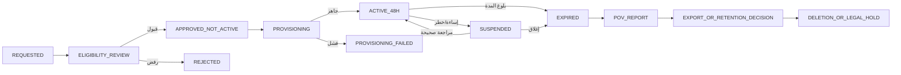

# AIGAS Risk Engine — 48H-TRIAL-SPEC

> **Document ID:** `AIGAS-RE-TRIAL-001` · **Version:** `1.0.0-draft` · **Date:** 2026-11-01  
> **Canonical path:** `docs/products/risk-engine/48H-TRIAL-SPEC.md`  
> **Parent:** `docs/ENTERPRISE-TRIAL-POLICY.md` + `docs/PRICING-AND-LICENSING.md`  
> **Present state:** `TRIAL_NOT_ACTIVE / RISK_ENGINE_RUNTIME_NOT_VERIFIED`.

## 1. الهدف والتمييز الدقيق

تجربة **Proof of Value لمدة 48 ساعة** مستقبلية، هدفها إثبات قدرة Risk Engine على تحويل وصف أصل AI إلى **تقييم مُفسّر ومراجعة مؤسسية قابلة للتتبع** باستخدام بيانات اصطناعية، ضمن حدود مستأجر ونسخة منهجية وسياسة واضحة. هي **ليست** عرض المصفوفة التعليمية الحالية في `/products/risk-engine/`، وليست Pilot مؤسسيًا مرتبطًا ببيانات إنتاج، وليست ترخيصًا تجاريًا.

**الحالة الآن:** الموقع العام يقول إن تجربة 48 ساعة غير مفعلة، ولا توجد أدلة تشغيل Risk Engine API أو نسخة إنتاجية. يمنع تنفيذ زر بدء حقيقي أو إصدار ترخيص تجربة حتى اكتمال أدلة القبول في `ACCEPTANCE-AND-EVIDENCE.md`. أي «نتيجة» Demo لا تُحسب في تقرير PoV بوصفها تشغيل خدمة.

## 2. ثوابت السياسة

1. `expires_at = activated_at + 48 hours` متصلة من **اكتمال التفعيل الموثق**، لا من زيارة الموقع أو تقديم الطلب.
2. انتهاء تلقائي؛ لا شراء، لا خصم، لا زيادة مدفوعة، ولا ترقية صامتة بعد انتهاء التجربة.
3. بيانات **اصطناعية افتراضيًا**؛ بيانات حقيقية لا تدخل إلا بموافقة خطية صريحة، وتقييم مخاطر، وعقد معالجة/بيئة معتمدة، ولا يغيّر ذلك قاعدة منع التدريب.
4. منع استخدام بيانات العميل في تدريب أو تحسين النماذج لدى BRIGHT AI أو المزودين **دون استثناء**.
5. جهة العميل والبيئة والسياسات تحدد مقدماً؛ عدم تحويل البيانات إلى مزود أو إقليم غير معتمد. الاستضافة داخل السعودية هي الافتراض المستهدف لخدمة العملاء السعوديين، و**موقع المعالجة الخارجية** مسألة مستقلة تحتاج تصريحًا.
6. التجربة اختيارية لكل منتج؛ Risk Engine مع Kernel فقط يكفي لوظيفته الأساسية، ولا يُجبر العميل على شراء FW/HG/LD.
7. حصص طلبات، تكلفة نموذج، عدد مستخدمين، معدل طلبات، أقصى مدة وتصدير تُحدّد مسبقًا وفق سياسة معتمدة؛ **لا اختلاق أرقام**.
8. كل تقييم يحمل هوية المؤسسة والأصل ونسخة المنهج والسياسة وسبب التصنيف؛ المراجعة البشرية لا تُستبدل بتأكيد واجهة.
9. فشل مزود تحليل سياقي، أو نقص دليل، أو تضارب صلاحيات: لا اعتماد آلي؛ حالة `INCOMPLETE` أو `REVIEW_REQUIRED` مع أثر قابل للتتبع.
10. لا تمديد تلقائي. أي تمديد استثناء معتمد بمدة ونطاق وحصص مسجلة، دون تغيير تاريخ الانتهاء السابق أو محو تاريخ القرار.

## 3. نطاق التجربة ومخرجاتها

| القدرة | الحد الأدنى للعرض الحقيقي | ليس جزءًا من إثبات المنتج |
|---|---|---|
| RE-01 جرد أصول | إنشاء أصل/نسخة ومالك وبيانات/ضوابط/سياق من بيانات اصطناعية | تمثيل بطاقات UI بلا كتابة وتخزين وعزل |
| RE-02 تقييم | منهج ونسخة، نتائج قواعد مفسرة، ومكون AI سياقي معتمد إن كان ضمن النطاق | تخمين درجة من نموذج عام بلا منهج |
| RE-03 سياسات | حدود tenant أعلى، ورفض تخفيف حد إلزامي | ألوان مصفوفة ثابتة لا تطبق سياسة |
| RE-04 تغيّر | تسجيل تغير مادي وفتح إعادة تقييم بإصدار جديد | تغيير نص واجهة لا يترك تاريخًا |
| RE-05 مراجعة | قرار مخوّل ومسبب، منع self-approval المحظور، أثر مراجعة | زر موافقة من أي مستخدم بدون فحص صلاحية |
| Kernel | هوية/عزل/صلاحية وترخيص محدود وAudit أساس | الاعتماد الإلزامي على Ledger أو Human Gate المرخصين |

أمثلة تقييم القطاعات (حكومة/مالية/صحة/قطاع خاص) **توضيحية ببيانات صناعية** ولا تعني أن المؤسسة مُعتمدة للقطاع تلقائيًا.

## 4. الأهلية والتحقق

| مقدم الطلب | المسار المستهدف | أسباب وقف أو مراجعة |
|---|---|---|
| مؤسسة سعودية خاصة مؤهلة | Self-service لاحقًا إذا نجحت هوية المنشأة ومكافحة الاحتيال/التكرار وقيود المورد والميزانية | عدم اكتمال إثبات المنشأة، طلب بيانات حقيقية، محاولة تكرار، سياسة لا تسمح |
| جهة حكومية | مراجعة بشرية قبل تفعيل الطلب، والالتزام بمسار المشتريات/الأمن عند انطباقه | شراء/معالجة دون موافقات الجهة |
| مؤسسة ذات متطلبات On-Premise | تصميم تجربة مؤسسية منفصل بعقد وبيئة معتمدة؛ لا افتراض التثبيت تلقائيًا | لا توافر دعم/مفاتيح/نسخة معتمدة |
| Air-Gapped | تجربة معزولة بشحنة/رخصة محلية موقعة، بدون اعتماد على بوابة Cloud | اشتراط اتصال خارجي، غياب نموذج معتمد محليًا |

لا يثبت استفسار `mailto` أن منشأة تحققت أو أن تجربة فُعلت. قاعدة منع التكرار تعتمد على مؤشرات قانونية وأقل بيانات لازمة؛ لا جمع هوية شخصية حساسة لمجرد تجربة موقع.

## 5. دورة الحالة (State Machine)

- الخادم هو مرجع الوقت باستخدام UTC؛ اختلاف ساعة المتصفح لا يغير انتهاء الترخيص.
- حالة `SUSPENDED` لا تمدد المدة تلقائيًا. `activated_at` لا يُعاد تعيينه عند استئناف.
- التمديد، إن سمحت السياسة، ينتج قرارًا مستقلاً وسجل Audit؛ ليس انتقالًا صامتًا.
- بعد الانتهاء: ترفض العمليات المدفوعة/المقيّدة بإذن التجربة، ويمكن توفير تصدير أو تقرير بالحدود التي وافق عليها العميل والسند القانوني، دون استمرار محرك التقييم.

## 6. التجهيز الأمني قبل التفعيل

**بوابة G0 — لا يبدأ المؤقت قبل نجاحها:**

1. المستأجر معزول وله معرف وهوية مستخدم مخوّل.
2. رخصة Risk Engine المؤقتة، مفعلة وموقعة (أو تحقق خادم SaaS معتمد)، وربطها بالمستأجر.
3. سياسة المنهج والعتبات معتمدة ومثبتة الإصدار، حتى لو كانت خاصة بمجموعة أمثلة محدودة.
4. خطة معالجة البيانات والمزودين والإقامة/التحويل المعتمدة.
5. بيئة بيانات اصطناعية، قائمة السيناريوهات، وعدم وجود أسرار أو PII فعلية.
6. ضبط الحدود المالية/الاستهلاك ومعدل الطلبات وإشعارات الرفض.
7. واجهات الصلاحية والمراجعة تعمل وتمنع تجاوز السياسات الأعلى.
8. Audit أساسي محفوظ مع محاذاة الوقت وإخفاء بيانات المحتوى الحساسة.
9. إمكان إنهاء وترحيل/تصدير وحذف البيانات وفق سياسة معتمدة.
10. ربط الأزرار والحالات الحقيقية بدل محاكاة UI، وتسجيل أدلة استلام/نجاح التفعيل.

**إذا أي شرط أساسي غير متحقق:** لا تفعيل، والحالة `BLOCKED_NOT_READY` مع سبب ومراجعته.

## 7. خطة 16 سيناريو لـProof of Value

| ID | متطلب | مدخلات اصطناعية | ما يجب إثباته |
|---|---|---|---|
| `RE-T01` | RE-01 | أصل «مساعد للوثائق العامة»، مالك معروف | إنشاؤه في tenant صحيح ومعرف ثابت |
| `RE-T02` | RE-01 | محاولة أصل بلا مالك | رفض واضح، لا سجل يتيم |
| `RE-T03` | RE-01 | مستخدم Tenant B يطلب أصل Tenant A | `403/404` بلا تسريب وجود/معلومات |
| `RE-T04` | RE-01 | تحديث أصل بإصدار قديم | `409/412` ولا ضياع تحديثات |
| `RE-T05` | RE-02 | أدلة احتمال وأثر قابلة للتوثيق | تقييم يبين قواعد/منهج/مراجع/نقص دليل |
| `RE-T06` | RE-02 | طلب `HYBRID_APPROVED` بمزود معتمد | أثر يميز القواعد من تحليل النموذج والسياق |
| `RE-T07` | RE-02 | نموذج غير معتمد أو متوقف | لا تخمين لموافقة؛ مراجعة/تعذر واضح |
| `RE-T08` | RE-02 | طلب تقييم بلا دليل أثر أساسي | `INCOMPLETE` / `REVIEW_REQUIRED` مع سبب |
| `RE-T09` | RE-03 | سياسة عليا تمنع تخفيف خطر | رفض محاولة المستخدم الأدنى وتسجيلها |
| `RE-T10` | RE-03 | مجموعتان/دوران بحدود مختلفة | تطبيق حدود الصلاحيات الهرمية الصحيحة |
| `RE-T11` | RE-04 | تغيير إصدار نموذج مقصود | إشعار تغير مادي وفق سياسة معتمدة |
| `RE-T12` | RE-04 | تغيير لا يستدعي إعادة تقييم | تصنيف ومبرر موثق دون إطلاق غير مبرر |
| `RE-T13` | RE-04 | إعادة تقييم بعد تغير مادي | نسخة جديدة تحفظ القديمة وتربط العلاقة |
| `RE-T14` | RE-05 | مقدم الأصل يحاول اعتماد نفسه مع SoD | رفض مع سبب وأثر تدقيق |
| `RE-T15` | RE-05 | مراجع مفوض يطلب استكمال/يرفض | قرار مرتبط بهوية وصلاحية ونسخة تقييم |
| `RE-T16` | نظام التجربة | انقضاء 48 ساعة أو تجاوز حصة | قفل صحيح، لا فوترة، حفظ مسار التقرير والحذف |

**النجاح المشروط:** يجب إتمام كل سيناريو مشمول في العرض الفعلي. إذا تعذر `RE-02` الهجين أو أحد متطلبات الأمان، لا تُسوّق التجربة على أنها تقييم Risk Engine مكتمل؛ نطاق PoV المعلن يجب أن يذكر عدم توافره، ولا يجوز إدعاء تحقق MVP كامل.

## 8. الحصص والإنفاق والتكلفة

القيم التالية **تُترك `TBD / null` قبل الاعتماد**، ولا يُسمح بتحويل `null` إلى غير محدود افتراضيًا:

| البند | القيمة الحالية | الاعتماد المطلوب |
|---|---|---|
| `trial_duration_hours` | **48 ثابتة** | قرار المالك |
| `trial_assessment_allowance` | `null` | Finance + Product + Capacity |
| `trial_reassessment_allowance` | `null` | تعريف احتساب إعادة التقييم |
| `max_assets_per_tenant` | `null` | منتج/خصوصية/سعة |
| `max_trial_users` | `null` | أمن/منتج |
| `per_minute_api_rate` | `null` | تشغيل/حماية إساءة |
| `external_model_spend_ceiling` | `null` | Finance + Provider Governance |
| `max_tokens_or_calls` | `null` | وحدة وحصة واضحة |
| `export_limit` | `null` | عقد وخصوصية وأمان |
| `retention_after_trial` | `null` | Legal/Privacy وتفصيل فئات البيانات |
| `provider_region` | `null` | موافقة المعالجة والمورد |
| `support_sla` | `null` | التشغيل والعقد |

**Metering:** وحدة مبدئية `RISK_ASSESSMENT`؛ لا نعد مرتين عند retry له نفس `Idempotency-Key`. تعريف إعادة التقييم، تقييم ناقص، طلب مرفوض، تشغيل قواعد فقط مقابل نموذج، وتكلفة المورد يجب اعتماده قبل حساب حصص أو عرض سعر. إظهار الاستخدام المتبقي يعتمد على عدادات حقيقية عند التفعيل، ولا توجد قيم عداد فورية الآن.

## 9. أمن النموذج والبيانات والضبط

- القواعد أولًا، ثم نموذج **معتمد فقط** إذا سمح نطاق الحالة والمورد والبيانات والبيئة.
- لا model fallback لمزود غير معتمد أو منطقة غير مصرح بها؛ Air-Gapped لا يرسل إنترنت مطلقًا.
- تخفيف PII والأسرار قبل prompts/logs، وعدم تسجيل نصوص حساسة للـAnalytics.
- منع عميل من تجاوز السياسة العليا، وفصل مهام اعتماد التقييم الحساس.
- بيانات الاستدلال لا تُستخدم لتدريب أو تحسين النموذج لدى أي طرف؛ يثبت ذلك بعقد/إعدادات وأدلة.
- نُسخ السياسة والمنهج والتقييم والمدخلات النصية الاصطناعية تحفظ بالحد الأدنى، وتتبع retention approved.
- أي طلب تحكم في نظام خارجي يتطلب إذنًا ونقطة تكامل حقيقية؛ لا حظر وهميًا مبنيًا على تغير لون UI.

## 10. تقرير Proof of Value

**مخرجات إلزامية مقترحة:** تقرير إداري موجز، تقرير تقني، كشف بالسيناريوهات، سجل التعليقات والمخاطر، أدلة غير حساسة، توصية بالخطوة التالية، وإثبات انتهاء الحقوق المؤقتة.

قالب التقرير:

| الحقل | محتوى التقرير |
|---|---|
| `trial_id / tenant_reference` | معرفات غير حساسة وخالية من بيانات هوية شخصية غير لازمة |
| `activated_at / expires_at` | طوابع UTC، 48 ساعة فعلية |
| `product/version/environment` | اسم Risk Engine، نسخة قابلة للتحقق، SaaS/On-Prem/Offline |
| `scope` | السيناريوهات المنفذة والمتطلبات المستثناة بصراحة |
| `methodology_version / policy_version` | مصدر التصنيف والضوابط الفعلية |
| `results` | Pass/Fail/Blocked/Not Verified لكل `RE-T01..16` |
| `assessment_findings` | أمثلة اصطناعية لأسباب النتائج والنقص |
| `security_and_privacy` | فحوص العزل والـSoD والمورد وعدم التدريب |
| `metering` | عدد التقييمات الفعلي وحصص التكلفة المعتمدة (عند التفعيل) |
| `limitations` | ما لم تُثبته التجربة، الأخطاء، التكاليف والتحذيرات |
| `next_steps` | PoV only → Pilot منفصل أو Quote أو إنهاء بلا شراء |
| `data_exit` | تصدير/حذف/Legal Hold والموافقات ذات الصلة |

**لا تُنشئ نسب نجاح أو وفورات مالية من الخيال.** غياب أدلة ينتج `NOT_VERIFIED`، وليس `PASS`.

## 11. الإشعارات والتجربة التشغيلية

تُعرض في البوابة المستقبلية: حالة الأهلية، سبب التعليق، وقت بداية/نهاية فعلي، الحصص المعتمدة، اقتراب الانتهاء، حالة التقرير والخروج. أي إشعار بريد/رسالة يجب أن تكون قناة اتصالها مصرحًا بها وتوثيق الاستلام/الإرسال منفصلًا عن ظهور UI. لا تُربط البيانات الحساسة بمنصات تحليلات الموقع العام.

## 12. الفرق عن Pilot والعقد

- **Demo:** محتوى تعليمي ثابت أو محاكاة محلية، بلا خدمة تقييم.
- **Trial 48h:** بيانات اصطناعية افتراضيًا، وظائف حقيقية مثبتة وبحدود موقع/جهة محددة، إيقاف آلي.
- **Pilot:** تنفيذ محدود لدى جهة مختارة بعد وثائق وميزانية وأهداف وأدوار وتكاملات وأمن مستقلين؛ ليس تجديدًا صامتًا.
- **Contract / Paid License:** موافقة شراء صريحة وعقد وترخيص وشروط بيانات ومورد وقياس تكاليف؛ لا يتحول من Demo أو Trial تلقائيًا.

## 13. الفشل والاستثناء

| الحالة | التصرف الإلزامي |
|---|---|
| فشل التحقق من المنشأة | رفض/انتظار، دون تفعيل ساعة التجربة |
| تعذر عزل tenant | `BLOCKED`، لا بيانات فعلية ولا تشغيل |
| تعذر محرك سياسة أو هوية أساسي | إيقاف مسار اعتماد مؤثر، تسجيل السبب |
| نموذج السياق تعطل | بقاء قواعد آمنة مع `INCOMPLETE/REVIEW_REQUIRED`؛ لا موافقة صامتة |
| تجاوز الحصة أو الإنفاق | وقف الطلب الجديد، لا فاتورة مفاجئة |
| وصول الفترة لنهايتها | إلغاء صلاحية الاستخدام، لا إعادة تفعيل بإعادة دخول |
| طلب تمديد | موافقة مستقلة بمدة وحدود ومبرر، ولا تمديد صامت |
| وجود بيانات حقيقية دون تصريح | إيقاف وإجراء حادث/تصحيح والاحتفاظ بالدليل وفق القانون |
| تعذر تقرير PoV | تقرير نقص الأدلة، لا ادعاء اكتمال |
| عميل يطلب شراء بعد التجربة | انتقال منفصل وموافقة/دفع صريحان |

## 14. بوابات قبول تجربة Risk Engine

- `RE-TRIAL-G01` استيفاء سياقات الأهلية واعتماد الموارد والتكلفة.
- `RE-TRIAL-G02` تشغيل نسخة حقيقية ذات أدلة أمن/هوية/سياسات/اختبار.
- `RE-TRIAL-G03` تحقق التوقيع والمدة والعزل والحصص ووقف الاستخدام بعد 48 ساعة.
- `RE-TRIAL-G04` تقارير التقييم المعتمدة بالمنهج والأدلة والتفسير، لا أرقام ملونة فقط.
- `RE-TRIAL-G05` حماية البيانات وحظر التدريب والمزود غير المعتمد.
- `RE-TRIAL-G06` عدم تمكين self-approval الممنوع أو bypass لسياسة أعلى.
- `RE-TRIAL-G07` قابلية التصدير والحذف والاحتفاظ بناءً على قرار قانوني/تعاقدي.
- `RE-TRIAL-G08` لا تحويل مدفوع تلقائي، ولا احتساب استخدام مكرر.
- `RE-TRIAL-G09` PoV واضح الفروقات بين PASS/FAIL/NOT_VERIFIED.
- `RE-TRIAL-G10` موافقة Product/Security/Privacy/Operations/Finance وفق سياسة صلاحيات صحيحة.

**التجربة لا تُفتح لأن مستندها مكتمل؛ تفتح فقط بعد إثبات كل بوابة وقبولها.**

## 15. المراجع داخل المجلد

- `PRODUCT-SPEC.md` — النطاق والمتطلبات.
- `FEATURE-STATUS.yaml` — الحالة الحالية للوظائف ومبرراتها.
- `PAGE-EXPERIENCE.md` — أزرار الاستفسار لا التفعيل حاليًا.
- `API-CONTRACT.yaml` — مخطط API غير منشور/غير متحقق.
- `ACCEPTANCE-AND-EVIDENCE.md` — إطار الدليل وحالات المنع قبل الإطلاق.
