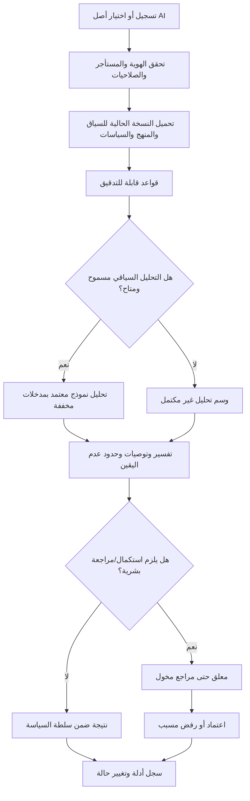

# AIGAS Risk Engine — PRODUCT-SPEC

> **Document ID:** `AIGAS-RE-SPEC-001` · **Version:** `1.0.0-draft` · **Date:** 2026-11-01  
> **Canonical path:** `docs/products/risk-engine/PRODUCT-SPEC.md`  
> **Product ID:** `AIGAS-RE` · **Wave:** `WAVE_2 / P1`  
> **Document state:** `APPROVED REQUIREMENTS / PRODUCT IMPLEMENTATION NOT VERIFIED`  
> **Audience:** Product, Security, Risk, Privacy, AI Governance, Architecture, Engineering, Customer Success.

## 0. قاعدة الحقيقة والمصادر

هذه وثيقة مواصفات **مستهدفة**، وليست دليلًا على منتج يعمل أو خدمة منشورة أو امتثال معتمد. مصدر المتطلبات الأساسي `docs/MASTER-PROJECT-BLUEPRINT.md` §03.5 (`RE-01`–`RE-05`)، ثم `docs/PRODUCT-MASTER-CATALOG.yaml` (`AIGAS-RE`)، ووثائق المنصة والخصوصية والتراخيص. أسماء واجهات الـAPI في هذا المجلد **مقترحات** ولا تمثل Endpoints عاملة.

**الدليل الحالي من المستودع `YEEEAE/BRIGHTAI`، فرع `main` عند المراجعة:** صفحة `/products/risk-engine/` تُولّد عبر `src/pages/products/[product].astro`، وتعرض مصفوفة احتمال × أثر تعليمية في `src/components/ProductExperience.astro`، مع أقسام شرح في `ProductContentExtension.astro`؛ لا يوجد دليل من شجرة المصدر المستعرضة على API Risk Engine تشغيلية أو خدمة تقييم تُصدر قرارات مؤسسية فعليًا. ملف `kernel/README.md` تاريخي ولا يُستخدم لإثبات جاهزية منظومة تشغيلية. **حالة التشغيل التجاري: `NOT_VERIFIED`؛ تفعيل تجربة الـ48 ساعة: `UNAVAILABLE`.**

## 1. التعريف والمشكلة والقيمة

**AIGAS Risk Engine** منتج مستقل لتسجيل أصول واستخدامات الذكاء الاصطناعي، وتقدير مخاطرها في سياق محدد، وإنتاج نتائج **مفسّرة، قابلة للاعتراض والمراجعة وإعادة الاعتماد** وفق سياسات الجهة وصلاحياتها. المنتج ليس مجرد لون في مصفوفة أو رقم احتمالي؛ النتيجة يجب أن تشرح مصادر البيانات والمنهج والسياسة والقيود وعدم اليقين والخطوات التالية.

المشكلة: تقييم الخطورة اعتمادًا على اسم النموذج أو نتيجة LLM واحدة لا يكفي؛ السياق، فئة البيانات، الأطراف المتأثرة، التغيرات التقنية والضوابط القائمة قد تغير مستوى الخطر. التقييمات غير الموثقة يصعب تدقيقها أو إعادة إنتاجها، وقد تتحول أخطاء التحليل إلى قرار مؤثر دون صاحب صلاحية.

القيمة المستهدفة: سجل أصول موحد؛ منهج تقييم شفاف؛ سياسات عتبات هرمية؛ مراجعة بشرية؛ مراقبة التغيّر وإعادة التقييم؛ وتصدير الأدلة الأساسية دون اشتراط شراء Ledger.

## 2. المستخدمون والمشترون

| الشخصية | حاجتها | صلاحيتها المتوقعة |
|---|---|---|
| AI Governance Lead / Risk Owner | فهم الحالة ومخاطرها وضوابطها | يحدد منهجًا أو يراجع ضمن صلاحيات معتمدة |
| CISO / Security Reviewer | مراجعة تهديدات واختبارات وضوابط أمنية | تقديم رأي/شرط أمني؛ ليس تجاوزًا منفردًا لقيد أعلى |
| Privacy Officer | تقييم نوع المعالجة والبيانات والخصوصية | مراجعة أثر الخصوصية وفق نطاقه |
| Product / Model Owner | تسجيل الأصل وتحديثه وتقديم أدلة | إنشاء/تعديل أصل دون اعتماد تقييمه لنفسه إذا اشترط الفصل |
| Internal Audit / Compliance | مراجعة القرارات والإصدارات والأدلة | قراءة مقيدة، لا تعديل نتيجة معتمدة |
| Platform Admin | إعداد ربط الهوية والتراخيص والمستأجر | إدارة تقنية لا تمنح تلقائيًا صلاحية تجاوز منهج المخاطر |
| Government / Enterprise Procurement | تحديد نطاق الاستفادة والتشغيل والتكلفة | الاطلاع على نطاق تعاقدي وإثباتات منشورة ومصرح بها |

القطاع الحكومي والخاص السعودي **بنفس الأولوية**، مع اختلاف مسار الموافقة والبيانات والتكامل وفق العقد والحساسية.

## 3. حدود المنتج والاستقلالية

- يباع Risk Engine منفردًا، أو ضمن باقة اختيارية؛ `AIGAS Kernel` مشترك و**دون رسم ترخيص منفصل**.
- يجب أن تعمل الوظيفة الأساسية (جرد أصل، قواعد، تقييم، مراجعة، سجل أمني أساسي) دون اشتراط رخص Firewall أو Human Gate أو Ledger.
- تكامل Firewall قد **يثري** قرار حماية عبر تصنيف موثوق؛ لا يخلق نقطة اعتراض في نظام غير مدمج.
- Human Gate خيار لتنسيق موافقات متقدمة؛ في غيابه يظل مسار اعتماد أساسي يفي بالحد الأدنى ومقيدًا بالصلاحيات.
- Ledger خيار لإثباتات متقدمة؛ سجل الأمان الأساسي من Kernel لا يسقط بغيابه.
- لا يقيّم المنتج كل AI في المنشأة تلقائيًا؛ نطاق التغطية الأصول المسجلة والمصادر/التكاملات المصرّح بها.
- لا يعد بقياس دقة احتمالات واقعية أو معيار درجة رقمي أو مخطط درجات `0–100` دون اعتماد منهج ومعايرته. `numeric_score_range = null` في الكتالوج المعتمد.
- لا يصدر شهادة امتثال، ولا يحل محل قرار الإنسان المخوّل، ولا يسمح لتقييم AI بإلغاء قيد أمني إلزامي.

## 4. متطلبات Blueprint الرسمية

| المتطلب | السلوك المستهدف | دليل الإطلاق المطلوب |
|---|---|---|
| `RE-01` | سجل أصول/استخدامات AI ومالكيها وسياقاتها وبياناتها وضوابطها؛ ربط احتمال الخطر بأثره | دورة إنشاء/تعديل/قراءة ضمن tenant صحيح ومراجع سياسة |
| `RE-02` | تقييم هجين من قواعد واضحة وتحليل سياقي **بنموذج AI معتمد فقط**؛ تفسير ومراجعة واعتراض | تشغيل قابل لإعادة الإنتاج، نسب مصدر كل عامل، حالات تعذر النموذج |
| `RE-03` | عتبات هرميّة حسب المؤسسة والوحدة/المنتج/المستخدم؛ منع تجاوز القيود الأعلى | إثبات precedence، رفض التخفيف غير المصرح، snapshot policy version |
| `RE-04` | كشف تغير مادي في النموذج أو البيانات أو السياق وتفعيل إعادة التقييم/الاعتماد | مقارنة نسخ وتوليد حدث وقرار إعادة المراجعة وتوقيع صاحبه |
| `RE-05` | مراجعات Privacy/Security/Safety بحسب الخطر؛ Enforcement فقط على تكامل فعلي | مراجعات موثقة، وعدم تجاوز بوابات عالية المخاطر أو إدعاء حظر عالمي |

**MVP المستهدف:** أصل AI قابل للإضافة/الاستيراد، تقييم مسبب ومسجل، عتبات مؤسسة معتمدة، مسار مراجعة واعتماد وفق الدور، أدلة قابلة للتتبع، مع متطلبات أمن وخصوصية Kernel الأساسية. AI التحليلي الهجين جزء من الهدف `RE-02` ويجب عدم تسويق النسخة القاعدية وحدها بوصفها تحقيقًا كاملًا لـ`RE-02`.

## 5. النموذج المفاهيمي للبيانات

| الكيان | الحقول الجوهرية المقترحة | قواعد حاكمة |
|---|---|---|
| `RiskAsset` | `asset_id`, `tenant_id`, `owner_id`, `purpose`, `model_ref`, `data_categories`, `affected_parties`, `environment`, `version` | تعريف غرض، مالك، تصنيف بيانات؛ عدم قبول أصل يتيم بلا مالك |
| `RiskContext` | `use_case`, `impact_domains`, `threats`, `controls`, `likelihood_evidence`, `impact_evidence` | مصادر موثوقة؛ لا تُدخل بيانات شخصية غير لازمة |
| `Assessment` | `assessment_id`, `asset_version`, `methodology_version`, `policy_version`, `status`, `findings`, `confidence_basis` | Snapshot ثابت لكل تقييم؛ لا إعادة كتابة نتيجة معتمدة |
| `RiskFinding` | `category`, `observed_evidence`, `rule_id`, `reason`, `recommended_action`, `residual_risk` | لا درجة رقمية غير معتمدة؛ تمييز ملاحظة آلية عن رأي بشري |
| `RiskThreshold` | `scope`, `parent_policy`, `severity_class`, `required_action`, `effective_from` | الموروث الأعلى يقيّد الأدنى؛ الاستثناء يخضع للسلطة والمسموح نظاميًا |
| `Review` | `reviewer_id`, `role`, `decision`, `rationale`, `decision_at`, `policy_version` | فصل مهام عند الحاجة؛ لا يوافق المستخدم على عمله المحظور |
| `ChangeEvent` | `asset_id`, `change_type`, `before_ref`, `after_ref`, `detected_at`, `materiality` | سبب التغيير وأثره، منع تعديل مرجع تاريخي |
| `EvidenceRecord` | `correlation_id`, `actor`, `event_type`, `reference`, `integrity_metadata` | الحد الأدنى من البيانات، إخفاء الحسّاس، صلاحيات واحتفاظ معتمدة |

حقول النصوص، الأطوال، عتبات المخاطر، أنواع التصنيفات النهائية، أسماء الجداول وقاعدة البيانات **ليست معتمدة** هنا؛ يقترح فريق التصميم عقدًا ويعتمده مالك المنتج والأمن قبل التطوير.

## 6. مسار التقييم المستهدف

- `NO_CONTEXT` / `INSUFFICIENT_EVIDENCE`: لا إصدار اعتماد صامت؛ تُعاد النتيجة `NEEDS_INFORMATION` أو `REVIEW_REQUIRED`.
- فشل مزود التحليل السياقي لا يبرر تحويل حالة عالية الخطورة إلى `APPROVED`؛ تسجل الحالة والسبب وتُستكمل القواعد الممكنة فقط.
- `risk_assessment` عملية **تقدير** وليست سماحًا آليًا بالوصول أو تشغيل AI؛ بوابة نشر مؤثرة لا تنفذ إلا ضمن نقطة تحكم مصرح بها وتحمل قرارًا معتمدًا.
- جميع المخرجات تربط `tenant_id`, `asset_id`, `policy_version`, `methodology_version`, `correlation_id`.

## 7. منهج التقييم ودرجاته

**منهج مستهدف قابل للتخصيص والاعتماد، لا منهج مُعتمد حاليًا.** المحاور المقترحة: احتمال الضرر، أثره على الأفراد/المؤسسة/البيانات/البيئة، قابلية التحكم، جودة الدليل، الخطر المتبقي، والتغير عبر دورة الحياة. ينبغي التمييز بين `severity_class` التصنيف النوعي، و`score` الرقمي الاختياري. **لا تُنشر عتبات أو أوزان أو نسبة ثقة بلا اعتماد ومعايرة.**

قواعد إلزامية:
1. لا يُقبل تفسير من LLM بوصفه دليلًا مستقلًا لإثبات استيفاء ضابط أو امتثال قانوني.
2. مصدر كل عامل: قاعدة/مستند/مدخل صاحب أصل/نموذج مساعد، مع النسخة وتاريخ الالتقاط.
3. تُسجّل الاعتراضات ولا تمسح التقييم السابق؛ يُنشأ إصدار أو مراجعة لاحقة.
4. سياسة أعلى مرتبة تمنع نتيجة أدنى من إلغاء قيودها، سواء كان السبب نموذجًا أو مسؤولًا بشريًا.
5. مخرجات التقييم تتضمن أسبابها وحدودها واحتمال نقص الأدلة، لا مجرد لون أخضر/أحمر.

## 8. الصلاحيات والضوابط الأمنية

الحد الأدنى: `risk.asset.read`, `risk.asset.write`, `risk.assessment.create`, `risk.assessment.read`, `risk.review.decide`, `risk.policy.manage`, `risk.audit.read`, `risk.change.create`. أسماء الصلاحيات **مقترحة**، وتعتمد ضمن عقد هوية Kernel قبل الإنتاج.

- عزل tenant على قاعدة البيانات، API، البحث والتصدير والسجلات والملفات والأحداث.
- مراجع ذو صلاحية واعتماد مؤسسي، مع منع self-approval حين تنطبق قاعدة فصل المهام.
- MFA/SSO أو هوية محلية مناسبة لنوع النشر، ولا وصول للدعم إلى بيانات العملاء افتراضيًا.
- حجب البيانات الحساسة من prompts/telemetry وتقييد الـAI provider على ما وافقت عليه الجهة.
- منع استخدام بيانات العملاء في تدريب أو تحسين النماذج لدى BRIGHT AI أو المزودين بلا استثناء.
- العزل المحلي الكامل في Air-Gapped بما فيه الترخيص والأدلة والتحديثات والمفاتيح والنماذج.
- سياسات احتفاظ وحذف وتصدير وLegal Hold معتمدة بحسب نوع السجل/العقد؛ لم تُحدّد مدد هنا.

## 9. معمارية التشغيل والتكامل

**Kernel أساس مشترك إلزامي دون ترخيص منفصل:** هوية، tenants، سياسات وصلاحيات، تراخيص، Audit أساسي، إدارة الأسرار، حدود البيانات ومراقبة. **Risk Engine يدير** سجل الأصول والتقييمات والمنهج والعتبات والمراجعات ذات الصلة، ولا يتحول إلى محرك Firewall عام.

| تكامل | الاتجاه والهدف | إلزاميته |
|---|---|---|
| `AIGAS-FW` | تقييم مراجع يثري قرار حركة AI متكاملة في Firewall | اختياري؛ لا يجعل FW يعتمد على شراء RE |
| `AIGAS-HG` | إنشاء طلب موافقة متقدم إن كان مرخصًا؛ وإرجاع النتيجة الموقعة | اختياري؛ المسار الأساسي محليًا قائم |
| `AIGAS-LD` | إرسال مراجع وأدلة موسعة قابلة للتحقق | اختياري؛ Audit Kernel أساسي دائمًا |
| SIEM/SOAR/ITSM | أحداث ومهام ورصد بناءً على نطاق العميل | اختياري بتفويض وقيود حركة بيانات |
| Model Registry / CMDB | استيراد مالك/نموذج/نسخة وحدث تغيير | اختياري، لا يتم تلقائيًا دون تكامل |
| External AI Provider | تحليل سياقي بعد اعتماد المزود والبيانات والمنطقة | مشروط؛ Air-Gapped يستخدم نموذجًا محليًا معتمدًا إن توافر |

استخدم `docs/INTEGRATION-AND-DEPLOYMENT.md` لتفصيل النشر والأحداث؛ و`API-CONTRACT.yaml` لعقد مقترح مبدئي. لا تفترض Kubernetes أو PostgreSQL أو Queue مُعينة لم يجرِ اعتمادها.

## 10. سيناريوهات قيمة أساسية

1. **تقييم استخدام مساعد كتابة داخلي:** أثر محدود مفترض وبيانات عامة اصطناعية، مع شرح عدم تعميم النتيجة على حالات أخرى.
2. **تقييم استخدام له أثر على مستفيد:** مراجعات خصوصية وسلامة وأدلة إضافية قبل اعتماد التشغيل.
3. **تغير نسخة نموذج أو جهة معالجة:** تسجيل اختلاف مادي وإعادة التقييم بدل الاحتفاظ بتقييم غير صالح.
4. **محاولة تخفيف حد خطر أعلى:** رفض تحديث سياسة أدنى مع سبب وسجل محاولات.
5. **غياب نموذج التحليل:** تسجيل نقص التقييم وعدم إصدار قرار اعتماد كامل بسبب فشل مورد.
6. **طلب اعتماد من مقدم التقييم نفسه:** منع أو تعليق عندما تتطلب سياسة الجهة فصل مهام.

## 11. تجربة المنتج ووحدات الاستخدام

- `48H Trial`: سياسة 48 ساعة تبدأ **من التفعيل الفعلي**، بيانات اصطناعية افتراضيًا، لا تحوّل مدفوع صامت؛ التجربة **غير مفعّلة** حاليًا.
- `Metering candidate`: عدد **تقييمات المخاطر** (`RISK_ASSESSMENT`)؛ تعريف «تقييم جديد»، «إعادة تقييم»، «محاولة فاشلة»، «نسخة مكررة» يحتاج اعتمادًا ماليًا وتقنيًا لمنع العد المزدوج.
- `Allowance`, `API Rate`, `Tenant Quotas`, `Overage`: قيم `null` حاليًا؛ تحدد بالقدرة الفعلية والدراسة المالية والموافقة قبل تفعيل تجربة حقيقية.
- لا يُشغّل تحليل نموذجي مدفوع دون حصة/حد تكلفة وموافقة وملاءمة مزود.

## 12. حالات المنتج والإطلاق

| الصنف | الحالة الحالية | الدليل |
|---|---|---|
| صفحة عامة ومصفوفة تعليمية | `SOURCE_PRESENT / RUNTIME_NOT_INDEPENDENTLY_VERIFIED` | ملفات Astro المشار إليها |
| سجل أصول وتقييمات حقيقي | `PLANNED / NOT_VERIFIED` | لا عقود تشغيلية مثبَتة ضمن شجرة المصدر التي روجعت |
| منهج وعتبات واعتماد فعلي | `PLANNED / NOT_VERIFIED` | متطلبات `RE-02` و`RE-03` وتوقيع المعايير غير موجود |
| خدمة API مؤسسية | `UNAVAILABLE / NO_DEPLOYED_ENDPOINT_VERIFIED` | `API-CONTRACT.yaml` مقترح |
| تجربة 48 ساعة | `UNAVAILABLE` | صفحة `/pricing/` تنص على عدم التفعيل |
| تطبيق الامتثال/الأداء | `NOT_VERIFIED` | لا شهادات ولا مؤشرات أداء ولا عقود منشورة مثبتة |

مراحل التنفيذ: تأسيس Kernel والبيانات والسياسات → RE-01 وRE-03 → RE-02 بقواعد ثم نموذج معتمد وتفسير → RE-05 ومراجعات → RE-04 دورة التغير → تكاملات اختيارية → تجربة محكومة → إطلاق وفق الدليل. ترتيب التنفيذ التفصيلي يعتمد على أمن البيانات وتبعياته، دون ادعاء جاهزية موجة الإنتاج الأولى.

## 13. خارج النطاق

- المسح التلقائي لكل حسابات AI بلا مصدر بيانات أو تصريح.
- منح شهادات ISO أو موافقة NCA/PDPL تلقائية.
- تنبؤات احتمالية دقيقة أو درجة `0–100` كمعيار مُعتمد دون منهج وقياس.
- إيقاف خدمات غير مدمجة أو منعها عبر تقدير مخاطر فقط.
- مراجعات بشرية آلية أو توصية نموذج تعد موافقة أو تفويضًا.
- إرسال محتوى العملاء لنماذج غير معتمدة أو استخدامه للتدريب.
- فرض شراء Firewall/Human Gate/Ledger لاستكمال الوظيفة الأساسية.

## 14. القرارات المفتوحة المطلوبة قبل تطوير الإنتاج

| ID | القرار | صاحب الاعتماد المقترح |
|---|---|---|
| `RE-ADR-01` | منهج قياس الاحتمال/الأثر والتصنيفات والأوزان | Risk Owner + Security |
| `RE-ADR-02` | مستويات صلاحيات الاعتماد وSoD والاعتراض | Owner + IAM + Risk |
| `RE-ADR-03` | ما التغيّر المادي ومتى تعاد المراجعة | Risk + Product + Privacy |
| `RE-ADR-04` | مصادر الأصول والتكاملات وإقامة البيانات | Architecture + Privacy |
| `RE-ADR-05` | مزود التحليل وقواعد البيانات والتخزين وOffline | Architecture + Security |
| `RE-ADR-06` | الاحتفاظ والتصدير والإزالة وسجلات الأدلة | Legal + Privacy |
| `RE-ADR-07` | حصص وتكلفة/قياس تقييمات المخاطر وTrial | Finance + Product |
| `RE-ADR-08` | السلوك عند تعذر النموذج وعدم كفاية الدليل | Risk + Security |
| `RE-ADR-09` | نموذج التحكم بنشر أصل عالي المخاطر عند التكامل | Engineering + Security |

## 15. روابط داخلية للمجلد

- `FEATURE-STATUS.yaml`: الحالة الفعلية لكل قدرة ومكون.
- `PAGE-EXPERIENCE.md`: تجربة الصفحة العامة ولوحة المؤسسة المستهدفة.
- `API-CONTRACT.yaml`: مسارات وعقود مقترحة **غير منشورة**.
- `48H-TRIAL-SPEC.md`: سيناريوهات التقييم المؤسسي المؤقت.
- `ACCEPTANCE-AND-EVIDENCE.md`: بوابات الإثبات قبل الإطلاق.

**لا يجوز تغيير حالة المنتج إلى `AVAILABLE` أو تسجيل وظيفة `WORKING` اعتمادًا على هذه الوثيقة وحدها.**
