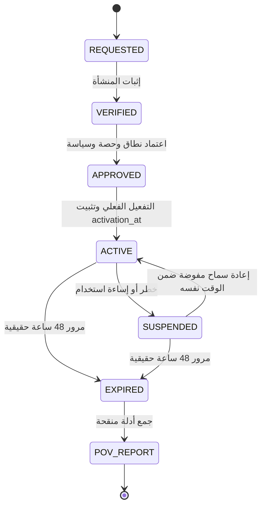

# AIGAS Secure Chat — مواصفة تجربة 48 ساعة وProof of Value

> **المشروع:** مؤسسة مُشرقة (BRIGHT AI) — AIGAS · **المنتج:** `AIGAS-SC` · **النسخة:** `1.0.0-draft` · **التاريخ:** 2026-11-01  
> **المسار المنطقي:** `docs/products/secure-chat/48H-TRIAL-SPEC.md` · **الخطة:** `WAVE_2 / P1` · **الحالة:** المتطلبات معتمدة مستهدفًا؛ التنفيذ التشغيلي `NOT_VERIFIED`.  
> **تنبيه:** وثيقة تصميم وتنفيذ للاعتماد، لا تثبت وجود الخدمة أو API منشورة أو تفعيل التجربة؛ لا تعديل على GitHub.

## 0. حالة الإتاحة

تجربة Secure Chat **متطلب مستهدف غير مفعّل أو مثبت التشغيل**. لا تعرض هذه الوثيقة دعوة دخول منتج حقيقي، ولا تمنح حق معالجة بيانات عملاء. تسلسل PoV أدناه لا يبدأ قبل الاعتماد الفني والأمني والتجاري. المرجع: `docs/MASTER-PROJECT-BLUEPRINT.md` §12 و`ENTERPRISE-TRIAL-POLICY.md`.

## 1. القيمة التي يجب إثباتها

- **إجابة حقيقية** من نموذج ومزود ومنطقة معالجة **مصرح بها** مع رسالة عربية تجريبية.
- **حماية أساسية تعمل** في Kernel حتى عند عدم شراء AIGAS Firewall.
- **خصوصية متن المحادثة** عن مسؤول المؤسسة، وفصل Audit عنه.
- **منع التصدير والمشاركة** افتراضيًا وعدم تجاوز DLP أو الموافقات.
- **ميزانية وقيود فعّالة**، ومنع fallback غير معتمد واحتساب مزدوج.
- **احترام حدود نطاق MVP:** لا RAG أو رفع ملفات ولا تنفيذ أدوات بحجة وجود شات.
- **No-Training** مؤيد بعقد/سياسة مزود وإعداد مثبت؛ بدون ذلك لا يستخدم المنتج بيانات حقيقية.

## 2. الفئة المؤهلة والموافقة

1. تتأكد هوية المنشأة وصفتها ومالك التقييم وتفويضه ونوع الاستخدام قبل منح أي حساب.
2. يمكن النظر في تفعيل ذاتي للقطاع الخاص **فقط** عند وجود تحقق من المنشأة ومكافحة إساءة استخدام وطبقة أمن جاهزة؛ لا يُفترض أن ذلك مفعل الآن.
3. الجهات الحكومية والتكاملات المؤثرة والبيانات الحقيقية تتطلب مراجعة بشرية وتعاقدية بحسب السياسة.
4. **البيانات اصطناعية افتراضيًا.** لا بيانات شخصية حقيقية أو أسرار تجارية أو ملفات عملاء أو API Keys حقيقية أثناء التجربة العامة.
5. استخدام بيانات حقيقية يستلزم موافقة خطية صريحة منفصلة وبيئة معتمدة وعقد معالجة مناسب، ولا يقع ضمن المسار الافتراضي.
6. بيانات المؤسسة في Trial لا تستخدم لتدريب/تحسين نموذج لدى BRIGHT AI أو المورد تحت أي ظرف.
7. منع تكرار الاستحقاق بهويات وهمية أو حسابات متعددة، مع معالجة حالات الرفض والطعن بشكل منضبط.
8. لا تُدمج مفاتيح ومحتوى PoV مع Analytics التسويقية؛ يحظر إرسال محتوى الجلسات إلى GA4/GSC.

## 3. الوقت ودورة الحياة

- `activation_at` وقت التفعيل الناجح من خادم موثوق؛ `expires_at = activation_at + 48h` بلا تغيير بسبب الانقطاع أو وضع Suspend.
- لا تمديد أو إعادة تفعيل تلقائية؛ يتطلب الاستثناء قرارًا مفوضًا مسجلًا، ولا تتحول التجربة تلقائيًا إلى اشتراك مدفوع.
- انتهاء الاستحقاق يمنع استدعاءات Chat جديدة حتى لو ما زالت الواجهة مفتوحة أو جلسة SSE معلقة؛ تُنهى الطلبات وفق سياسة إغلاق معلنة.
- PoV تقرير مستقل؛ عقد Pilot أو الشراء خطوات منفصلة بموافقة صريحة.

## 4. نطاق وبيئة التجربة

| المحور | المستهدف | شرط البدء |
|---|---|---|
| المنتجات | Secure Chat مع Kernel الأساسي | لا شراء Firewall أو Ledger أو Risk Engine أو Human Gate لإثبات الوظيفة الأساسية |
| نماذج AI | مزود/نموذج معتمد مسبقًا أو محلي مرخص | إثبات منطقة المعالجة وNo-Training وموافقة العميل |
| البيانات | نصوص اصطناعية غير حساسة | نسخة Demo منفصلة عن بيانات فعلية |
| الهوية | مؤسسات ومستخدمون تجريبيون معزولون | MFA/SSO أو بديل معتمد وفق النطاق |
| النشر | SaaS افتراضيًا عند جاهزية النشر | On-Premise/Air-Gapped تجربة معزولة تُحدد بعقد منفصل |
| المشاركة/التصدير | مغلقان افتراضيًا | فتح محدود فقط لاختبار التحكم بحسابات مفوضة |
| حفظ المحادثة | افتراضي دون تخزين متن دائم ما لم تُعتمد سياسة مختلفة | قرار سياسة واحتفاظ منفصل |

## 5. مصفوفة الحصص — لا أرقام تجارية مختلقة

| البند | متغير التنفيذ | قيمة نهائية | من يعتمد |
|---|---|---|---|
| مدة التجربة | `trial_duration_hours` | **48** (قرار معتمد) | مالك المشروع |
| رسائل لكل مستخدم | `max_messages_per_user` | **غير معتمدة** | المالية/المنتج/الأمن |
| إجمالي رسائل المستأجر | `max_messages_per_tenant` | **غير معتمدة** | المالية/المنتج |
| عدد المستخدمين | `max_trial_seats` | **غير معتمد** | المبيعات/الأمن |
| Input Tokens | `max_input_tokens` | **غير معتمد** | FinOps |
| Output Tokens | `max_output_tokens` | **غير معتمد** | FinOps |
| الطلبات بالدقيقة | `rate_limit_per_minute` | **غير معتمدة** | SRE/الأمن |
| سقف كلفة مزود AI | `provider_spend_cap` | **غير معتمد** | المالية |
| سقف كلفة BRIGHT AI | `trial_total_spend_cap` | **غير معتمد** | المالية |
| سقف التخزين | `retention_storage_cap` | **غير معتمد** | الخصوصية/المنتج |
| مدد الحذف/النسخ | `post_trial_data_policy` | **غير معتمدة** | الخصوصية/قانوني |
| مهلة توقف توليد | `provider_timeout` | **غير معتمدة** | الهندسة/SRE |

**تنفيذيًا:** لا تفعيل للتجربة الممولة قبل إدخال هذه الحدود وتثبيتها مركزيًا بحسب نطاق الحصة ووثيقة العقد. عند بلوغ الحد توقف الخدمة بأمان ولا تُحمّل العميل رسومًا جديدة تلقائيًا. تُسوّى الرسائل الملغاة وإعادة المحاولة بطريقة تزيل الازدواجية.

## 6. سيناريوهات إثبات القيمة (PoV)

كل سيناريو هو **خطة تحقق** وليس نتيجة منفّذة. تُجمع أدلة من بيئة مصرح بها ببيانات اصطناعية، ويُثبت الإصدار والوقت والسياسة ونتيجة القبول عند التنفيذ.

| ID | السيناريو | المتطلب | الإجراء | نتيجة النجاح المستهدفة | الدليل | الحالة |
|---|---|---|---|---|---|---|
| `POV-SC-01` | تفعيل مؤسسي مع أهلية معتمدة | `SC-01` | منشأة اصطناعية مؤهلة، اعتماد بشر/آلي حسب السياسة ثم تفعيل يدوي موثق | لا بدء للـ48 ساعة قبل activation_at؛ لا تحميل بيانات عميل | Trial approval + activation transaction | `NOT_VERIFIED` |
| `POV-SC-02` | جلسة محادثة عربية حقيقية | `SC-01` | مستخدم مفوض يرسل سؤالًا عامًا اصطناعيًا إلى نموذج مصرح | مخرجات من مزود معتمد فعليًا لا فقاعات Demo | Provider request receipt + masked policy trace | `NOT_VERIFIED` |
| `POV-SC-03` | اختيار نموذج غير مدرج | `SC-01` | تغيير model_id في الطلب إلى قيمة خارج Allowlist | رفض قبل خروج أي نص من حدود المؤسسة | Provider egress denial + policy revision | `NOT_VERIFIED` |
| `POV-SC-04` | المكان/المورد غير مسموح | `SC-06` | تعطيل مزود معتمد ومحاولة fallback إلى مزود غير معتمد | رفض آمن؛ لا إرسال بيانات ولا تكلفة غير مصرح بها | Network egress audit + error code | `NOT_VERIFIED` |
| `POV-SC-05` | كشف إدخال حساس اصطناعي | `SC-02` | نص تجريبي يحوي رمزًا اصطناعيًا يبدو حساسًا | منع/تنقيح حسب سياسة موثقة قبل المزود | Synthetic fixture + preflight DLP decision | `NOT_VERIFIED` |
| `POV-SC-06` | منع تسرب بالمخرجات | `SC-02` | مخرج مزود اختبار يحتوي سلسلة اختبار حساسة | لا يصدر إلى الشاشة/stream قبل فحصه | SSE trace + blocked/redacted output | `NOT_VERIFIED` |
| `POV-SC-07` | حقن تعليمات سياقي | `SC-02` | طلب يحاول تغيير السياسة أو كشف System Prompt | يُعامل الإدخال كبيانات؛ لا تغيير صلاحيات أو تسرب أسرار | Injection fixture + audit decision | `NOT_VERIFIED` |
| `POV-SC-08` | عدم وجود ترخيص Firewall | `SC-02` | تجربة Secure Chat وحده مع Kernel من دون رخصة FW | تعمل حماية Chat الأساسية كما هي | Entitlement snapshot + policy trace | `NOT_VERIFIED` |
| `POV-SC-09` | عزل مستخدم ومؤسسة أخرى | `SC-03` | مستخدم من مستأجر B يحاول قراءة جلسة A | 403/404 آمن بلا كشف تفاصيل ملكية | Cross-tenant denial + data-scope validation | `NOT_VERIFIED` |
| `POV-SC-10` | خصوصية المحادثة من الإدارة | `SC-03` | Tenant Admin يعرض الجلسات والأدوار ويحاول قراءة محتوى الموظف | قراءة المتن مرفوضة افتراضيًا | Role matrix + denial logs | `NOT_VERIFIED` |
| `POV-SC-11` | وصول استثنائي غير معتمد | `SC-03` | فتح طلب تحقيق بدون موافقة ثانية | عدم حصول requester على وصول لمجرد الطلب | Exception state trace + independent approver | `NOT_VERIFIED` |
| `POV-SC-12` | جلسة مؤقتة بلا حفظ نص | `SC-03` | إنشاء جلسة EPHEMERAL وإكمال محادثة اصطناعية | عدم إبقاء المتن بشكل دائم؛ Audit بيانات وصفية فقط | Storage inspection + audit contrast | `NOT_VERIFIED` |
| `POV-SC-13` | تلوث السجلات والتحليلات | `SC-04` | إدخال علامة حساسة اصطناعية ثم فحص Logs/Traces | لا وصول متن خاص إلى السجلات أو تحليلات GA4 | Redaction grep result + representative logs | `NOT_VERIFIED` |
| `POV-SC-14` | المشاركة والتصدير المغلقان | `SC-05` | محاولة تصدير/مشاركة بعد إنشاء Tenant دون تغيير سياسة | رفض لجميع المسارات افتراضيًا | Share/export policy snapshot + denies | `NOT_VERIFIED` |
| `POV-SC-15` | تصدير محكوم مع DLP | `SC-05` | موافقة مستخدم مفوض ونطاق معلوم وتحقق DLP من مادة اصطناعية | حزمة مقيدة لا رابط عام؛ تنقيح المحتوى الحساس | Approval trace + DLP result + token scope | `NOT_VERIFIED` |
| `POV-SC-16` | ميزانية ورسائل محدودة | `SC-06` | الوصول إلى سقف مؤسسي تم اعتماده أثناء التجربة | منع طلب جديد قبل استهلاك مزود AI | Quota counters + provider egress proof | `NOT_VERIFIED` |
| `POV-SC-17` | تكرار Idempotency وإلغاء | `SC-06` | إرسال المفتاح نفسه ثم إعادة المحاولة وإلغاء التدفق | لا طلبين مدفوعين لنفس العملية؛ لا تكرار احتساب | Usage reconciliation + cancellation evidence | `NOT_VERIFIED` |
| `POV-SC-18` | منع ملفات وRAG | `SC-07` | محاولة رفع ملف أو استدعاء endpoint معرفي خارج النطاق | رفض موثق وعدم إنشاء قاعدة Embedding أو ملف | API route inventory + denial proof | `NOT_VERIFIED` |
| `POV-SC-19` | انتهاء 48 ساعة | `SC-06` | دفع البيئة التجريبية إلى expiration عبر ساعة اختبار معزولة | توقف الوصول والحصص دون خصم أو اشتراك مدفوع | License transition + access denial | `NOT_VERIFIED` |
| `POV-SC-20` | حذف/إتاحة تقارير PoV | `SC-03` | طلب تقرير النتائج وحالة التخلص من محتوى اصطناعي | تقرير منقح يذكر القيود؛ حذف/احتفاظ حسب السياسة وLegal Hold | PoV bundle + deletion/hold audit | `NOT_VERIFIED` |

## 7. نصوص حالة المستفيد في بوابة التجربة

- **قبل التفعيل:** «طلبك تحت المراجعة؛ لم تبدأ فترة الـ48 ساعة بعد».
- **بعد اعتماد التفعيل:** «الوقت المتبقي يُحسب من وقت بدء التجربة المسجل» (لا يظهر عداد قبل تاريخ صحيح من الخادم).
- **الحد الآمن:** «اكتمل حد الاستخدام المعتمد لهذه التجربة؛ لا يتم أي خصم إضافي تلقائيًا».
- **تعذر النموذج:** «لا يتوفر نموذج مسموح ضمن سياسة الجهة حاليًا»؛ لا تبديل إلى مزود غير مصرح.
- **انتهاء التجربة:** «انتهت تجربة الـ48 ساعة؛ لن تتحول إلى اشتراك مدفوع تلقائيًا».
- **إيقاف أمني:** «أُوقف الوصول مؤقتًا لأسباب أمنية؛ تُراجع الحالة عبر قناة الدعم المعتمدة».

## 8. سجل القياس والتكلفة

- عدد الطلبات المحمية والناجحة والمرفوضة ونوع السبب غير الحساس ونسخة السياسة.
- استهلاك Input/Output Tokens وعدد الرسائل والفشل والإلغاء والتكرار **من مصدر Metering حقيقي**.
- قائمة النماذج المستخدمة ومواقع المعالجة المعتمدة دون مشاركة مفاتيح.
- التفريق بين تكلفة BRIGHT AI وتكلفة المورد الفعلية/التقديرية؛ الأسعار غير معتمدة.
- قياسات الأداء تؤخذ في بيئة التجربة الفعلية مع تعريف الحمل والاتصال والنسخة؛ **لا أرقام مسبقة**.
- لا تطبع نصوص الرسائل الخاصة أو بيانات المستخدمين الحساسة في التقرير أو سجلات الدعم.

## 9. تقرير Proof of Value النهائي

يُنشأ التقرير بمعلومات قابلة للمراجعة، ويشمل:

1. اسم المنشأة ورمز Trial غير حساس، مالك الطلب، نطاق المنتجات وبيئة ومكان المعالجة المصرح بهما.
2. `activation_at` و`expires_at` وسبب أي تعليق أو انتهاء.
3. النماذج/الموردون المعتمدون مع حالة إثبات منع التدريب وحماية البيانات.
4. جدول السيناريوهات ونتائج `PASS / FAIL / BLOCKED / NOT_VERIFIED` مع روابط أدلة مُنقّحة.
5. الاستخدام الفعلي، وحدود الحصص، والتسوية، والتكلفة مع بيان المنهج وأي نواقص.
6. فحص خصوصية جلسات الموظفين مقابل الإدارة، وعدم وصول النصوص إلى سجلات الأمن.
7. قائمة الانحرافات والقيود ومواطن عدم الجاهزية.
8. قرار التوصية: لا شراء تلقائي؛ قد يعقبها عرض Pilot أو نطاق تعاقدي جديد.
9. سياسة التصدير أو الحذف عند انتهاء التجربة، مع Legal Hold عند انطباقه.
10. اعتماد المراجعين المختصين وتاريخ اعتماد PoV دون الادعاء بشهادة امتثال.

## 10. شروط وقف التجربة أو عدم إطلاقها

- غياب عقد/دليل No-Training أو انكشاف موقع المعالجة خارج الترخيص.
- عدم تطبيق الحماية الأساسية إلا بشراء Firewall تجاري.
- تجاوز المحتوى المحظور عبر SSE قبل فحصه.
- إمكانية مسؤول المؤسسة قراءة نصوص الموظفين افتراضيًا.
- تسرب محتوى إلى Logs أو Telemetry أو تحليلات التسويق.
- مشاركة أو تصدير غير محكومين أو رابط عام مجهول.
- تمرير طلب إلى مزود/منطقة أخرى بسبب تعطل المزود الأساسي.
- الفوترة أو الاستمرار في استدعاء المزود بعد انتهاء 48 ساعة أو الحصة.
- تداول بيانات حقيقية دون تصريح كتابي وبيئة مناسبة.

## 11. الاعتمادات التي تسبق الاستخدام الفعلي

مالك المنتج → الأمن السيبراني → مسؤول الخصوصية/قانوني → مسؤول المنصة وFinOps → مسؤول تجربة العملاء. لكل جهة اعتماد دليل مستقل، ولا يثبت إعداد واجهة أو ملف YAML وجود هذه الموافقات.

**مرجع الإثبات التفصيلي:** `ACCEPTANCE-AND-EVIDENCE.md`، ومعرّفات `SC-xx.xx` من `FEATURE-STATUS.yaml`. جميع السيناريوهات أعلاه `NOT_VERIFIED` وقت إنشاء الوثيقة.
