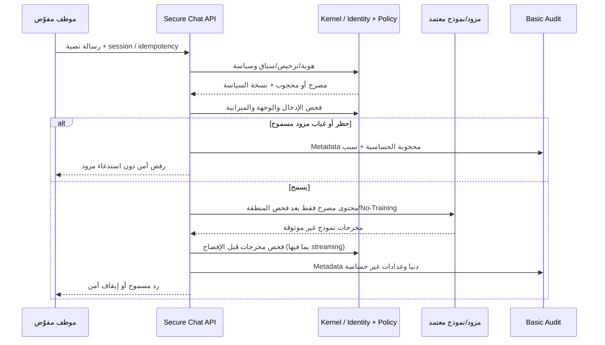

# AIGAS Secure Chat — مواصفة المنتج ونطاقه

> **المشروع:** مؤسسة مُشرقة (BRIGHT AI) — AIGAS · **المنتج:** `AIGAS-SC` · **النسخة:** `1.0.0-draft` · **التاريخ:** 2026-11-01  
> **المسار المنطقي:** `docs/products/secure-chat/PRODUCT-SPEC.md` · **الخطة:** `WAVE_2 / P1` · **الحالة:** المتطلبات معتمدة مستهدفًا؛ التنفيذ التشغيلي `NOT_VERIFIED`.  
> **تنبيه:** وثيقة تصميم وتنفيذ للاعتماد، لا تثبت وجود الخدمة أو API منشورة أو تفعيل التجربة؛ لا تعديل على GitHub.

## 0. المصدر والتحقق والفصل بين الحقائق

**مراجع أساسية:** `docs/MASTER-PROJECT-BLUEPRINT.md` §03.6، §04، §08، §11، §12؛ `docs/PRODUCT-MASTER-CATALOG.yaml` / `AIGAS-SC`، و`docs/PLATFORM-ARCHITECTURE.md`، `docs/DATA-PRIVACY-AND-SECURITY.md`، `docs/INTEGRATION-AND-DEPLOYMENT.md`، `docs/ENTERPRISE-TRIAL-POLICY.md`، `docs/PRICING-AND-LICENSING.md`.

**نتيجة مراجعة مصدر GitHub (قراءة فقط، 2026-11-01):**

- `src/pages/products/[product].astro` ينتج `/products/secure-chat/` ويصفه «تصور المنتج» و«مخطط · غير متحقق تشغيليًا».
- `src/components/ProductExperience.astro` يعرض فقاعات نصوص جاهزة واختيار مثال، مع شارة «بلا اتصال» ونص يمنع إدخال بيانات حقيقية. `RedactionDemo` يوضح التنقيح فقط.
- `src/components/ProductContentExtension.astro` يشرح نموذج المحادثة المستهدف وخصوصية النصوص وحدود RAG/الملفات.
- `src/scripts/interior-motion.ts` ينفذ تفاعلات بصرية محلية؛ لا يثبت وجود مزود AI متصل.
- في الشجرة التي تمت مراجعتها لم يظهر `src/pages/api/` تشغيلي؛ ما ورد في ملفات `kernel/README.md` التاريخية غير كاف لإثبات خدمة حالية.

**قاعدة الحقيقة:** `APPROVED_TARGET` لا تعني `IMPLEMENTED`؛ ووجود كود عرض لا يعني `VERIFIED_OPERATIONAL`؛ ولا يحق إعلان `AVAILABLE` أو `BETA` دون أدلة التشغيل والأمن والموافقة.

## 1. تعريف المنتج والمشكلة

**AIGAS Secure Chat** تطبيق محادثة مؤسسي عربي أولًا يتيح للموظف المصرح له التواصل مع **نماذج ذكاء اصطناعي معتمدة فقط** ضمن سياسة المؤسسة: هوية المستخدم، فئة البيانات، مكان المعالجة، الميزانية، صلاحية الوصول، الحفظ والمشاركة. هو منتج تجاري مستقل مع **AIGAS Kernel** كأساس لازم دون ترخيص منفصل.

**المشكلة:** استخدام أدوات AI غير المحكومة قد يرسل مواد حساسة لوجهات غير مصرح بها، يفتح سجلات المحادثات لمسؤولي المؤسسة دون داعٍ، أو يرفع تكلفة الاستهلاك دون سقف. حل المشكلة لا يعني أن كل إجابة صحيحة أو أن كل هجوم حقن تعليمات قابل للكشف.

**القيمة المستهدفة:** قناة محادثة عربية بسيطة وقابلة للضبط والتدقيق الأمني الأساسي، بحماية بيانات مؤسسية حتى دون شراء Firewall المتقدم، مع حرية اختيار المزودين **المعتمدين** أو التشغيل المحلي وفق بيئة النشر.

## 2. الجمهور وصلاحياته

| الشخصية | الحاجة | حدود الصلاحية |
|---|---|---|
| موظف مستخدم | سؤال نصي إلى نموذج مسموح | جلساته ومحتواه الذي تسمح السياسة بعرضه؛ لا إعدادات مؤسسة |
| مسؤول مؤسسة (Tenant Admin) | إدارة مستخدمين وحصص وإتاحة النماذج | **لا يقرأ متن محادثات الموظفين افتراضيًا** |
| مسؤول حوكمة AI | اعتماد النماذج والبيانات والسياسات | يعاين السياسات وبيانات التدقيق الضرورية دون نصوص خاصة |
| مسؤول أمن/خصوصية | مراجعة التسريب والحوادث | استثناء الوصول للمحتوى يحتاج تفويضًا مستقلًا ونطاقًا وزمنًا وسجلًا |
| المشتريات/FinOps | حدود الميزانيات والتكلفة | مؤشرات استخدام دنيا، دون محتوى المستخدم |
| مسؤول تكامل/بنية | توصيل نموذج ومفاتيح ومناطق | أسرار مخفية، واختصاص حسب البيئة والترخيص |
| مراجع مستقل | إثبات اتخاذ الضوابط والاحتفاظ | أدلة منقحة ومصرح بها، ليس وصولًا شاملاً للمحادثات |

## 3. حدود المنتج والوظائف المعتمدة

| الرمز | الحد الأدنى المطلوب | شرط عدم الانحراف |
|---|---|---|
| `SC-01` | **محادثة عربية مع نماذج AI معتمدة** — محادثة آمنة بالعربية وتوجيه إلى نموذج معتمد ضمن المنطقة والكلفة والسياسة | لا يعلن العمل حتى تجتاز معايير `SC-01` المسجلة في `ACCEPTANCE-AND-EVIDENCE.md` |
| `SC-02` | **حماية Kernel الأساسية دون شراء Firewall** — تطبيق ضوابط حماية المدخلات والمخرجات والسياسة والهوية لكل طلب دون الاعتماد على ترخيص Firewall مستقل | لا يعلن العمل حتى تجتاز معايير `SC-02` المسجلة في `ACCEPTANCE-AND-EVIDENCE.md` |
| `SC-03` | **خصوصية المحادثات والاحتفاظ الاختياري** — عزل وخصوصية محادثة المستخدم، حفظ اختياري وسياسة احتفاظ ووصول استثنائي مقيّد | لا يعلن العمل حتى تجتاز معايير `SC-03` المسجلة في `ACCEPTANCE-AND-EVIDENCE.md` |
| `SC-04` | **فصل محتوى المحادثة عن سجلات الأمن** — عدم ظهور نصوص المحادثات في Audit/Logs/Analytics وإبقاء الحد الأدنى الضروري من البيانات الوصفية | لا يعلن العمل حتى تجتاز معايير `SC-04` المسجلة في `ACCEPTANCE-AND-EVIDENCE.md` |
| `SC-05` | **مشاركة وتصدير معطّلان افتراضيًا** — عدم السماح بالمشاركة أو التصدير إلا بعد تفويض وسياسة وفحص محتوى | لا يعلن العمل حتى تجتاز معايير `SC-05` المسجلة في `ACCEPTANCE-AND-EVIDENCE.md` |
| `SC-06` | **حدود المزوّد والنموذج والميزانية** — سياسات المزودين والأماكن والميزانية وTokens والحصص والتوقف الآمن | لا يعلن العمل حتى تجتاز معايير `SC-06` المسجلة في `ACCEPTANCE-AND-EVIDENCE.md` |
| `SC-07` | **نطاق منتج محادثة محدد** — لا رفع ملفات ولا RAG ولا Knowledge Base متكاملة ضمن قدرات النسخة الأساسية | لا يعلن العمل حتى تجتاز معايير `SC-07` المسجلة في `ACCEPTANCE-AND-EVIDENCE.md` |

### 3.1 حدود النطاق المعتمدة

- **داخل النطاق:** رسالة نصية، جلسة ومخرجات محكومة، قائمة نماذج معتمدة، حماية دخول/خروج، سياسات خصوصية، سجل أمان منفصل، حدود استهلاك، تحكم مشاركة وتصدير.
- **خارج النطاق الأساسي عمدًا:** RAG، رفع الملفات، فهرسة مستندات، مستودع معرفة مؤسسية، تشغيل أدوات أو Agents ذات صلاحيات تنفيذية، مراقبة كل تطبيقات المؤسسة الأخرى بلا تكامل.
- **اختياري ولا يُفرض تجاريًا:** Firewall التجاري لتعزيز الحماية، Risk Engine للتقييم المتقدم، Human Gate للموافقات، Ledger للأدلة الموسعة. كل الوظائف الأمنية الأساسية وAudit الضروري تعمل في عقد Kernel حتى دون شراء هذه المنتجات.
- **النماذج/المزودون:** لا مزود معتمد أو API Key أو منطقة معالجة فعلية مثبتة ضمن هذا الملف. لا اختيار تلقائي لمزود يخرق شروط No-Training أو موقع البيانات.

## 4. رحلة المحادثة الحقيقية المستهدفة

**عقد الإنفاذ:** يجب أن يكون مسار إرسال البيانات والنموذج تحت سيطرة آلية الحماية فعلًا. مجرد إظهار قرار `BLOCK` أو خانة «النموذج معتمد» في الواجهة لا يحمي إن استطاع المتصفح أو التكامل تجاوز بوابة الفحص.

## 5. الخصوصية والمحتوى والاحتفاظ

1. **منع التدريب القطعي:** عدم استخدام بيانات عملاء BRIGHT AI أو مورديها لتدريب/تحسين نماذج AI نهائيًا. قبل أول رسالة إنتاجية يلزم عقد، تهيئة، وتأكيد قابل للتدقيق من كل مزود.
2. **المستخدم مالك خصوصية محادثته** ضمن سياسة المنشأة؛ مسؤول المؤسسة يدير الأعضاء والنماذج والحصص دون قراءة المتن افتراضيًا.
3. **الحفظ ليس إلزاميًا:** حالة حفظ الجلسات ومدد الاحتفاظ والمحو وتجميد Legal Hold تحتاج قرار مالك البيانات ومراجعة قانونية؛ لا تُخترع مدد أو يُوعد بحذف فوري شامل.
4. **المتن مقابل Audit:** محتوى السؤال والإجابة لا يُحقن في Logs أو Telemetry أو GA4؛ سجل الأمن يحفظ الحد الأدنى المصرح من tenant/user pseudonym، معرف القرار، توقيت، outcome، usage غير الحساس.
5. **الاستثناء:** وصول فريق تحقيق لمتن محادثة مشروط بسبب وموافقة مناسبة وصلاحية مؤقتة وتسجيل منفصل، مع احترام أي قيود قانونية.
6. **المشاركة/التصدير مغلقان:** تفعيلهما يكون لكل مؤسسة وبصلاحية ونطاق وفحص DLP. لا رابط عام مجهول افتراضيًا.

## 6. النشر والاستقلالية

| البعد | SaaS | On-Premise / Private Cloud | Air-Gapped |
|---|---|---|---|
| الهوية | هوية مؤسسة/MFA/SSO بحسب الاعتماد | موصل هوية أو مستقل محلي | هوية محلية لا تحتاج Cloud |
| موقع البيانات | السعودية افتراضيًا؛ مسار الطلب للنموذج يطابق التفويض | يحدد العقد وواقع البنية | محلي تمامًا بلا اتصال خارجي |
| اختيار النماذج | خدمات خارجية معتمدة أو محلية بحسب العقد | خدمات مصرح بها أو محلية | **نماذج محلية فقط** |
| التراخيص | SaaS حسب عقد | ترخيص محلي موقع | ترخيص موقع قابل للتحقق Offline |
| المفاتيح | KMS/BYOK حسب اعتماد المؤسسة | مخزن أسرار معتمد للعميل | أسرار ومفاتيح محلية مستقلة |
| الحماية/التدقيق | Kernel أساسي | Kernel محلي | Kernel محلي حتى دون إنترنت |

لا يجوز وصف النشر أو مناطق المعالجة هذه بأنها متوفرة تشغيليًا قبل إثباتها.

## 7. تكاملات المنتجات الأخرى

| الوجهة | الغرض الاختياري | لا يجوز افتراض |
|---|---|---|
| Firewall | DLP إضافي/سياسات متقدمة | وجوب شراء Firewall كي تعمل حماية Chat الأساسية |
| Risk Engine | تقييم مخاطر أعلى لسيناريوهات محادثة | فرض إيقاف لكل حالة دون سياسة معتمدة |
| Human Gate | موافقات عمل مؤثرة عند وجود تكامل مأذون | تنفيذ أدوات فقط لأن المستخدم طلبها في نص |
| Ledger | أدلة موسعة لحوادث أو قرارات | تضمين نصوص خاصة في Audit افتراضيًا |

## 8. نمذجة البيانات المرشحة (غير نهائية)

| الكيان | حقول مرشحة | حساسية وضوابط |
|---|---|---|
| `ChatSession` | session_id، tenant_ref، owner_ref، model_policy_ref، status، created_at | ملكية مستخدم، لا يربط مستأجرين |
| `ChatMessage` | message_id، session_ref، role، encrypted_content_ref أو ephemeral_content، timestamps | المحتوى قد لا يُحفظ حسب السياسة |
| `ModelAllowance` | provider_ref، model_ref، allowed_region، data_class، policy_version | لا يفترض مزودًا أو منطقة بلا اعتماد |
| `ChatPrivacyPolicy` | store_opt_in، sharing_enabled، export_enabled، retention_ref، access_exception | سياسة قابلة للإصدار والمراجعة |
| `UsageRecord` | request_ref، token_in/out، estimated_cost، provider_ref، idempotency_hash | لا يُسجّل متن الرسالة |
| `SecurityEvent` | correlation_ref، decision_ref، policy_version، outcome، actor_ref | metadata فقط دون أسرار |

تحديد آلية تخزين الرسائل ومفاتيح تشفيرها وضمان الحذف والنسخ الاحتياطية يأتي من تصميم معتمد وDPIA عند انطباقه، لا من أسماء الحقول.

## 9. معيار MVP والبوابات

لا يعتبر المنتج مكتملًا إلا إذا وُجد مسار محادثة **حقيقي** مع نموذج ومكان معالجة مصرح بهما، واختبارات رفض قبل إرسال المحتوى لمزود محظور، وحماية Kernel دون ترخيص Firewall، وخصوصية محتوى المستخدم، وفصل Audit، وحصص قابلة للإنفاذ، ومنع مشاركة غير معتمدة، وإثبات No-Training لدى المزود.

**لا يكفي:** لقطة شاشة، حوار نصي ثابت، محاكاة تنقيح، نجاح `npm run build`، ملف README تاريخي، أو مجرد HTTP 200 دون تطبيق القواعد.

## 10. أداء وتجربة مستخدم من دون أرقام مفترضة

- زمن أول رمز TTFT وزمن الاستجابة ومعدل فشل المزود ومعدل الحظر الخاطئ تقدر فقط بعد اختيار البنية وبيئة التجربة وحجم الحمل.
- واجهة عربية RTL متوافقة مع الأجهزة ولوحة المفاتيح وقارئ الشاشة و`prefers-reduced-motion`؛ لا تُعرض tokens/المؤشرات على أنها بث مباشر دون مصدر حقيقي.
- يجب فصل تجربة الجمهور العامة التعليمية عن بوابة المؤسسة المغلقة؛ لا تنقل أسرار أو جلسات عبر الموقع التسويقي.

## 11. المخاطر والأمور المعلقة

| القرار | الوضع | من يعتمد |
|---|---|---|
| مزود/نموذج/منطقة المعالجة | غير معتمد حاليًا | الحوكمة والأمن ومالك العقد |
| سياسة حفظ متن المحادثة ومدد الإزالة | غير محددة رقميًا | خصوصية/قانوني ومالك البيانات |
| نموذج الاستثناء الأمني وLegal Hold | بحاجة تصميم واعتماد | خصوصية/أمن/قانوني |
| مرجع سياسة قبول الملفات/RAG | **مستبعد من النطاق الأساسي** | يحتاج قرار تغيير نطاق منفصل |
| طريقة قياس الاستهلاك والسعر | مرشحة دون قيم نهائية | مالية/تجاري/تقني |
| قدرات البث بعد فحص المخرجات | بحاجة تصميم أمني وأدلة | الأمن والهندسة |
| المزود الاحتياطي | غير مفترض | الأمن والحكومة التقنية |
| حماية بيانات حقيقية خلال PoV | لا تُسمح افتراضيًا | عميل + خصوصية + بيئة معتمدة |

## 12. وثائق الحزمة والتتبع

- `FEATURE-STATUS.yaml`: كل ميزة وحالة إثباتها وسجل مصادرها.
- `PAGE-EXPERIENCE.md`: أقسام الصفحة والنصوص والأزرار والحالات.
- `API-CONTRACT.yaml`: عقد OpenAPI مستهدف **غير منشور**.
- `48H-TRIAL-SPEC.md`: سيناريوهات PoV والحدود والمخرجات.
- `ACCEPTANCE-AND-EVIDENCE.md`: معايير الإثبات المانعة للإطلاق.
